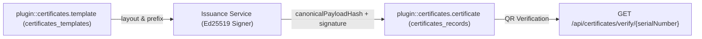
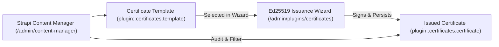
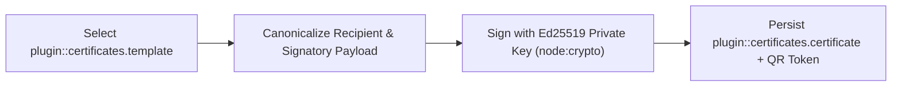
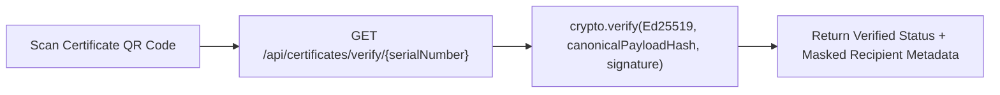
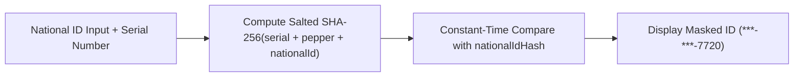
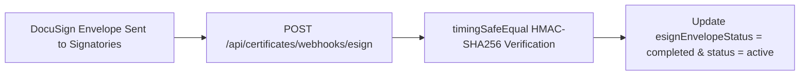

## 1. التثبيت وإعداد الاعتماديات

```bash
pnpm add @vicacha-devs/strapi-plugin-certificates
```

## 2. إعدادات الخادم (`config/plugins.ts`)

أضف إعدادات الإضافة إلى ملف `config/plugins.ts` في مشروع Strapi v5 الخاص بك:

```ts
// config/plugins.ts
export default ({ env }: { env: (key: string, defaultValue?: string) => string }) => ({
  certificates: {
    enabled: true,
    config: {
      organizationName: env("CERTIFICATES_ORG_NAME", "Central Organization"),
      verificationBaseUrl: env("CERTIFICATES_VERIFY_URL", "https://example.org/verify"),
    },
  },
});
```


## 3. جولة في واجهة الإدارة (Strapi v5 Admin UI — دعم RTL)

بمجرد تفعيل الإضافة، يتم تسجيل مساحة العمل والإعدادات داخل لوحة تحكم Strapi v5 مع دعم كامل للغة العربية واتجاه RTL:


### نماذج من نصوص الواجهة المعربة (العربية)

| مفتاح الترجمة                                          | النص المعروض في الواجهة   |
| :----------------------------------------------------- | :------------------------ |
| `field.certificate_template`                           | الشهادة القالب            |
| `certificates.field.certificate_template`              | الشهادة القالب            |
| `placeholder.select_certificate_template`              | اختر certificate template |
| `certificates.placeholder.select_certificate_template` | اختر certificate template |
| `field.recipient_full_legal_name`                      | المستلم الكامل Legal الاسم |
| `certificates.field.recipient_full_legal_name`         | المستلم الكامل Legal الاسم |
| `placeholder.e_g_carlos_andres_perez`                  | مثال: Carlos Andres Perez |
| `certificates.placeholder.e_g_carlos_andres_perez`     | مثال: Carlos Andres Perez |

## 4. كيانات أنواع المحتوى ومواقعها ومخططاتها (`strapi.documents`)

Registers two Collection Types (`plugin::certificates.template` and `plugin::certificates.certificate`). Templates define reusable certificate layouts, signatory rules, witness counts, and serial prefixes; Issued Certificates store canonical JSON payloads signed with Ed25519 (`cryptographicSignature`, `publicKeyFingerprint`), salted PII hashes (`nationalIdHash`), and DocuSign envelope status. Supports `schemaExtensions` in `config/plugins.ts`.



### أين تجد كيانات أنواع المحتوى في Strapi v5

- **Content Manager**: `/admin/content-manager/collection-types/plugin::certificates.template` & `/admin/content-manager/collection-types/plugin::certificates.certificate` (`visible: true`)
- **Content-Type Builder**: `/admin/plugins/content-type-builder` under **Collection Types** (`Certificate Template` & `Issued Certificate`)
- **Plugin Workspace & Settings**: `/admin/plugins/certificates` (Issuance Wizard, Ledger & Templates) and `/admin/settings/certificates`
- **Database Tables**: `certificates_templates` and `certificates_records`

### `plugin::certificates.certificate` — Issued Certificate

Cryptographically signed official certificate record with signatory and witness attestation

> **Kind**: `collectionType` · **DB Table**: `certificates_records` · **Admin Location**: `/admin/content-manager/collection-types/plugin::certificates.certificate` · **Draft & Publish**: `No` · **i18n**: `No`

| الحقل                    | النوع في Strapi | إلزامي | القيود / العلاقات                                                                      |
| :----------------------- | :-------------- | :----- | :------------------------------------------------------------------------------------ |
| `serialNumber`           | `string`        | Yes    | max: 64                                                                               |
| `templateDocumentId`     | `string`        | Yes    | max: 120                                                                              |
| `templateSlug`           | `string`        | Yes    | max: 120                                                                              |
| `templateName`           | `string`        | Yes    | max: 160                                                                              |
| `status`                 | `enumeration`   | Yes    | enum: `pending_approval, issued, revoked, expired`; default: `"pending_approval"`     |
| `recipientFullName`      | `string`        | Yes    | max: 200                                                                              |
| `recipientChosenName`    | `string`        | No     | max: 200                                                                              |
| `recipientEmail`         | `email`         | No     | —                                                                                     |
| `recipientPhone`         | `string`        | No     | max: 64                                                                               |
| `recipientNationality`   | `string`        | No     | max: 120                                                                              |
| `nationalIdMasked`       | `string`        | No     | max: 32                                                                               |
| `nationalIdHash`         | `string`        | No     | max: 128; `private: true`                                                             |
| `issuedAt`               | `string`        | Yes    | max: 40                                                                               |
| `expiresAt`              | `string`        | No     | max: 40                                                                               |
| `revokedAt`              | `string`        | No     | max: 40                                                                               |
| `revocationReason`       | `text`          | No     | —                                                                                     |
| `signatories`            | `json`          | No     | default: `[]`                                                                         |
| `witnesses`              | `json`          | No     | default: `[]`                                                                         |
| `customData`             | `json`          | No     | default: `{}`                                                                         |
| `secondaryDates`         | `json`          | No     | default: `{}`                                                                         |
| `canonicalPayloadHash`   | `string`        | Yes    | max: 128                                                                              |
| `cryptographicSignature` | `text`          | Yes    | —                                                                                     |
| `publicKeyFingerprint`   | `string`        | Yes    | max: 96                                                                               |
| `verificationToken`      | `string`        | No     | max: 128; `private: true`                                                             |
| `esignProvider`          | `enumeration`   | No     | enum: `none, docusign, webhook`; default: `"none"`                                    |
| `esignEnvelopeId`        | `string`        | No     | max: 128                                                                              |
| `esignEnvelopeStatus`    | `enumeration`   | No     | enum: `not_sent, sent, delivered, completed, declined, voided`; default: `"not_sent"` |
| `esignCompletedAt`       | `string`        | No     | max: 40                                                                               |
| `linkedBookingCode`      | `string`        | No     | max: 64                                                                               |
| `notes`                  | `text`          | No     | —                                                                                     |

### `plugin::certificates.template` — Certificate Template

Reusable official certificate template with signatory rules, witness requirements, and body statement

> **Kind**: `collectionType` · **DB Table**: `certificates_templates` · **Admin Location**: `/admin/content-manager/collection-types/plugin::certificates.template` · **Draft & Publish**: `No` · **i18n**: `No`

| الحقل                   | النوع في Strapi | إلزامي | القيود / العلاقات                                   |
| :---------------------- | :-------------- | :----- | :------------------------------------------------- |
| `name`                  | `string`        | Yes    | max: 160                                           |
| `slug`                  | `uid`           | Yes    | —                                                  |
| `description`           | `text`          | No     | —                                                  |
| `serialPrefix`          | `string`        | Yes    | max: 8; default: `"CERT"`                          |
| `defaultValidityDays`   | `integer`       | No     | —                                                  |
| `requiresWitnesses`     | `boolean`       | No     | default: `false`                                   |
| `minWitnesses`          | `integer`       | No     | default: `0`                                       |
| `requiresApproval`      | `boolean`       | No     | default: `true`                                    |
| `esignEnabled`          | `boolean`       | No     | default: `false`                                   |
| `esignProvider`         | `enumeration`   | No     | enum: `none, docusign, webhook`; default: `"none"` |
| `organizationName`      | `string`        | Yes    | max: 200                                           |
| `organizationSubheader` | `string`        | No     | max: 240                                           |
| `headerText`            | `string`        | No     | max: 240                                           |
| `titleText`             | `string`        | Yes    | max: 200                                           |
| `bodyTemplate`          | `text`          | Yes    | —                                                  |
| `footerText`            | `text`          | No     | —                                                  |
| `defaultSignatories`    | `json`          | No     | default: `[]`                                      |
| `customFieldsSchema`    | `json`          | No     | default: `[]`                                      |
| `secondaryCalendars`    | `json`          | No     | default: `[]`                                      |
| `accentColor`           | `string`        | No     | max: 16; default: `"#14532d"`                      |
| `active`                | `boolean`       | No     | default: `true`                                    |

## التكامل مع مدير المحتوى في Strapi v5 (`/admin/content-manager`)

> **مجموعة الشريط الجانبي في مدير المحتوى**: `Donations & Certificates`

### الكيانات والمكونات المسجلة في مدير المحتوى

- `plugin::certificates.template` (**Certificate Template** — `/admin/content-manager/collection-types/plugin::certificates.template`)
- `plugin::certificates.certificate` (**Issued Certificate** — `/admin/content-manager/collection-types/plugin::certificates.certificate`)


### لماذا تنشئ هذه الإضافة كيانات داخل مدير المحتوى (Content Manager)؟

`@vicacha-devs/strapi-plugin-certificates` exposes **Certificate Template** (`plugin::certificates.template`) and **Issued Certificate** (`plugin::certificates.certificate`) inside the Strapi v5 Content Manager so legal, academic, and finance administrators can manage templates, link signatories, and audit issued credentials using Strapi's native tools:

- **Structured Template & Signatory Management**: Create and version `Certificate Template` records (`shahada`, `nikah`, `donation_tax`, `course_completion`, `membership`) with default signatory titles, serial prefixes, and witness counts in Content Manager.
- **Cryptographic Audit Trail Inspection**: Inspect `serialNumber`, `canonicalPayloadHash`, `cryptographicSignature` (Ed25519), `publicKeyFingerprint`, `nationalIdMasked` (`***-***-7720`), and `esignEnvelopeStatus` on `Issued Certificate` entries while keeping `nationalIdHash` and `verificationToken` protected (`private: true`).
- **Relational & Schema Extensions**: Link `Issued Certificate` records to `api::leader.leader` officiating scholars or donor profiles via `config/plugins.ts -> schemaExtensions`.

### كيفية الاستخدام داخل مدير المحتوى في Strapi (خطوة بخطوة)

1. **Open in Content Manager**: In the left sidebar, expand **Content Manager -> Collection Types -> Donations & Certificates** and click **Certificate Template** (`/admin/content-manager/collection-types/plugin::certificates.template`) or **Issued Certificate** (`/admin/content-manager/collection-types/plugin::certificates.certificate`).
2. **Manage Certificate Templates**: Open **Certificate Template** to configure `name`, `slug`, `category`, `serialPrefix` (e.g., `SHD`, `DON`), `bodyTemplate`, `requiresWitnesses`, and `defaultSignatories`.
3. **Audit or Revoke Issued Certificates**: Open **Issued Certificate** to filter credentials by `serialNumber`, `status` (`active`, `pending_signature`, `revoked`), `recipientName`, or `esignEnvelopeStatus`.
4. **Workspace vs. Content Manager**: Use the **Certificates Workspace** (`/admin/plugins/certificates`) to issue new Ed25519-signed credentials via the cryptographic signing wizard; use **Content Manager** to maintain templates, inspect audit hashes, and manage custom relational fields.

### التزامن بين مدير المحتوى ومساحة عمل الإضافة



### حالات الاستخدام داخل مدير المحتوى ومسارات العمل التحريرية

#### Content Manager Use Case 1 — Designing & Updating Official Shahada, Nikah & Tax Certificate Templates

- **الغرض والأهمية**: Maintain standardized legal wording, serial prefixes (`SHD-`, `TAX-`), and default signatory blocks in Content Manager.
- **خطوات التنفيذ في مدير المحتوى**: Open `/admin/content-manager/collection-types/plugin::certificates.template`, edit `Official Shahada Certificate` or `Tax-Deductible Donation Certificate`, and save.

#### Content Manager Use Case 2 — Compliance Filtering of Issued Credentials by Status & Fiscal Year

- **الغرض والأهمية**: Audit all active or revoked tax donation and consular certificates for annual compliance reporting.
- **خطوات التنفيذ في مدير المحتوى**: Open `/admin/content-manager/collection-types/plugin::certificates.certificate` and filter by `category = donation_tax` and `status = active`.

## 5. حالات الاستخدام ومسارات العمل المتكاملة

### Use Case 1 — Issuing Cryptographically Signed Official Credentials

- **What it is for**: Issue tamper-evident Shahada, Marriage (Nikah), Course Completion, or Tax Donation certificates signed with an Ed25519 private key.
- **How it works**: Select a `plugin::certificates.template` in `/admin/plugins/certificates` or call `POST /certificates/certificates/issue`; the service canonicalizes the payload, signs it with Ed25519, and persists `plugin::certificates.certificate`.




### Use Case 2 — Public QR Code Verification & Tamper Detection

- **What it is for**: Let third parties (embassies, employers, auditors) verify a certificate's authenticity by scanning its QR code.
- **How it works**: Call `GET /api/certificates/verify/{serialNumber}?token=...` to re-verify the Ed25519 signature against `canonicalPayloadHash` and return masked recipient details.




### Use Case 3 — Privacy-Preserving National ID Lookup (`nationalIdHash`)

- **What it is for**: Verify whether a certificate belongs to a specific national ID number without storing plaintext national IDs in the database.
- **How it works**: The entity stores only `nationalIdMasked` (`***-***-7720`) and a per-serial salted SHA-256 `nationalIdHash` (`private: true`).




### Use Case 4 — DocuSign / Webhook Multi-Party E-Signature Attestation

- **What it is for**: Route pending certificates to signatories and witnesses via DocuSign envelopes and automatically transition status upon completion.
- **How it works**: Webhook events hit `POST /api/certificates/webhooks/esign` (verified with constant-time HMAC-SHA256) and update `esignEnvelopeStatus` on `plugin::certificates.certificate`.



## 6. نقاط النهاية البرمجية REST API (`content-api` و `admin`)

| الطريقة | مسار نقطة النهاية                                       | النطاق        | المعالج (Handler)                   | المصادقة   |
| :------ | :------------------------------------------------------ | :------------ | :---------------------------------- | :--------- |
| `GET`   | `/certificates/settings`                                | `admin`       | `admin.getSettings`                 | Bearer JWT |
| `PUT`   | `/certificates/settings`                                | `admin`       | `admin.updateSettings`              | Bearer JWT |
| `POST`  | `/certificates/settings/rotate-keys`                    | `admin`       | `admin.rotateKeys`                  | Bearer JWT |
| `GET`   | `/certificates/templates`                               | `admin`       | `admin.listTemplates`               | Bearer JWT |
| `POST`  | `/certificates/templates`                               | `admin`       | `admin.createTemplate`              | Bearer JWT |
| `POST`  | `/certificates/templates/seed`                          | `admin`       | `admin.seedTemplates`               | Bearer JWT |
| `GET`   | `/certificates/certificates`                            | `admin`       | `admin.listCertificates`            | Bearer JWT |
| `POST`  | `/certificates/certificates/issue`                      | `admin`       | `admin.issueCertificate`            | Bearer JWT |
| `POST`  | `/certificates/certificates/{documentId}/send-docusign` | `admin`       | `admin.sendDocuSignEnvelope`        | Bearer JWT |
| `PUT`   | `/certificates/certificates/{documentId}/approve`       | `admin`       | `admin.approveCertificate`          | Bearer JWT |
| `PUT`   | `/certificates/certificates/{documentId}/revoke`        | `admin`       | `admin.revokeCertificate`           | Bearer JWT |
| `GET`   | `/certificates/certificates/{documentId}/print`         | `admin`       | `admin.printCertificate`            | Bearer JWT |
| `GET`   | `/certificates/certificates/export/csv`                 | `admin`       | `admin.exportCsv`                   | Bearer JWT |
| `GET`   | `/api/certificates/templates`                           | `content-api` | `content-api.listPublicTemplates`   | Public     |
| `GET`   | `/api/certificates/public-key`                          | `content-api` | `content-api.getPublicKey`          | Public     |
| `POST`  | `/api/certificates/apply`                               | `content-api` | `content-api.applyCertificate`      | Public     |
| `GET`   | `/api/certificates/verify/{serial}`                     | `content-api` | `content-api.verifyBySerial`        | Public     |
| `GET`   | `/api/certificates/verify/{serial}/print`               | `content-api` | `content-api.downloadPrintableHtml` | Public     |
| `POST`  | `/api/certificates/webhooks/docusign`                   | `content-api` | `content-api.docusignWebhook`       | Public     |

## 7. الاستخدام البرمجي داخل الخادم (`strapi.plugin` و `strapi.documents`)

```ts
// Registered services on plugin "certificates": "settings", "issuance", "docusign"
const pluginService = strapi.plugin("certificates")?.service("issuance");

// Querying records via the Strapi v5 Document Service API
const records = await strapi.documents("plugin::certificates.certificate").findMany({
  limit: 25,
  sort: "createdAt:desc",
});
```

## 8. استكشاف الأخطاء والتحقق من الجودة

- **عدم ظهور التغييرات في لوحة الإدارة**: قم بتشغيل `pnpm strapi build` بعد تعديل ملف `config/plugins.ts`.
- **عزل حزم Strapi**: حافظ على إعداد `hoistPattern: ["*", "!@strapi/*"]` داخل `pnpm-workspace.yaml` لمنع تكرار سياق React.
- **فحص الأنواع الصارم (TypeScript)**: قم بتشغيل `pnpm check` للتحقق من سلامة حزمتي الواجهة والخادم.
