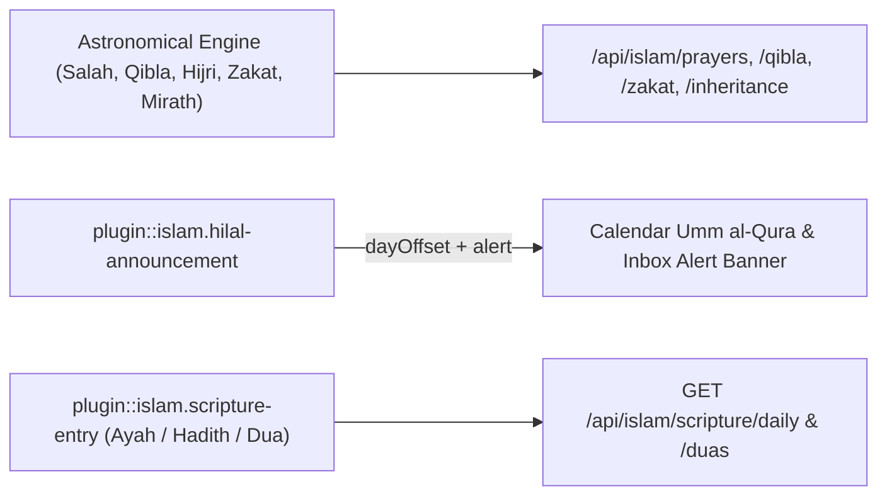
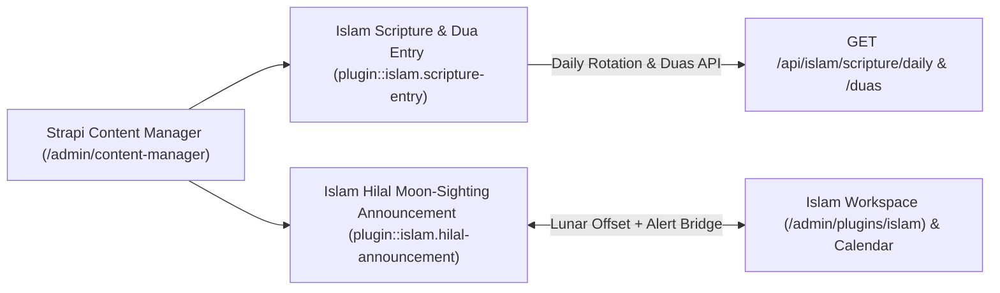
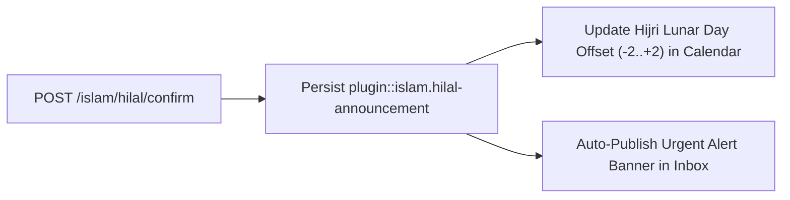
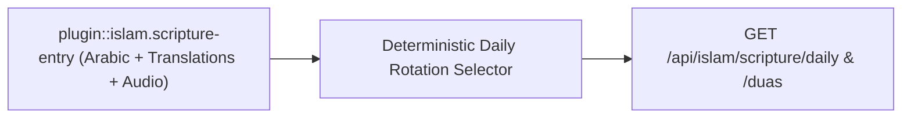
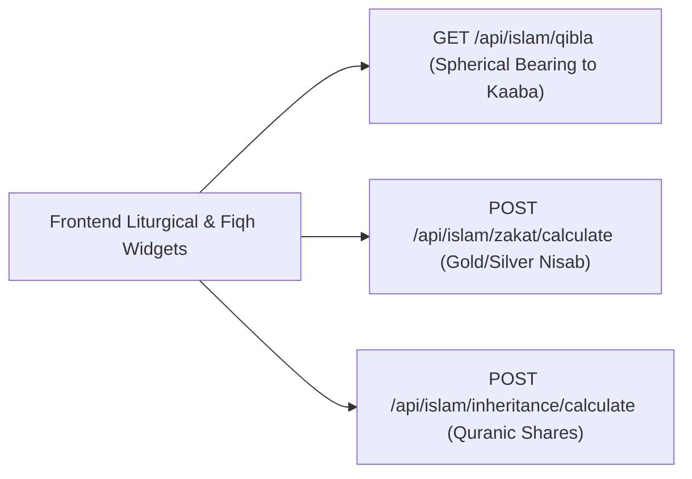

## 1. التثبيت وإعداد الاعتماديات

```bash
pnpm add @vicacha-devs/strapi-plugin-islam
```

## 2. إعدادات الخادم (`config/plugins.ts`)

أضف إعدادات الإضافة إلى ملف `config/plugins.ts` في مشروع Strapi v5 الخاص بك:

```ts
// config/plugins.ts
export default ({
  env,
}: {
  env: (key: string, defaultValue?: string) => string;
}) => ({
  islam: {
    enabled: true,
    config: {
      defaultLat: 4.6685,
      defaultLon: -74.0758,
      method: "3",
      quranFoundation: {
        defaultScript: "uthmani",
        defaultReciterId: 7, // Mishari Rashid al-`Afasy
        defaultChapterReciterId: 7, // Mishari Rashid al-`Afasy
      },
      enableInboxAlertBridge: true,
    },
  },
});
```


## 3. جولة في واجهة الإدارة (Strapi v5 Admin UI — دعم RTL)

بمجرد تفعيل الإضافة، يتم تسجيل مساحة العمل والإعدادات داخل لوحة تحكم Strapi v5 مع دعم كامل للغة العربية واتجاه RTL:


### نماذج من نصوص الواجهة المعربة (العربية)

| مفتاح الترجمة                                      | النص المعروض في الواجهة                    |
| :------------------------------------------------- | :----------------------------------------- |
| `page.ui.islam_liturgical_scriptural_fiqh_cockpit` | لوحة الشعائر والنصوص الشرعية والفقه الإسلامي |
| `page.ui.1_salah_adhan_iqamah`                     | الصلاة والأذان والإقامة                       |
| `page.ui.2_hilal_ramadan_eid`                      | الهلال ورمضان والعيد                        |
| `page.ui.3_quran_hadith_dua`                       | القرآن والحديث والدعاء                     |
| `page.ui.4_zakat_nisab_qibla`                      | الزكاة والنصاب والقبلة                     |
| `page.ui.refresh`                                  | تحديث                                      |
| `page.ui.prayer_salah`                             | الصلاة                                      |
| `page.ui.adhan_time`                               | وقت الأذان                                  |

## 4. كيانات أنواع المحتوى ومواقعها ومخططاتها (`strapi.documents`)

Registers two Collection Types (`plugin::islam.hilal-announcement` and `plugin::islam.scripture-entry`) paired with pure astronomical calculation engines (`prayerEngine`, `qiblaEngine`, `hijriEngine`, `zakatEngine`, `inheritanceEngine`).



### أين تجد كيانات أنواع المحتوى في Strapi v5

- **Content Manager**: `/admin/content-manager/collection-types/plugin::islam.hilal-announcement` & `/admin/content-manager/collection-types/plugin::islam.scripture-entry` (`visible: true`)
- **Content-Type Builder**: `/admin/plugins/content-type-builder` under **Collection Types** (`Islam Hilal Moon-Sighting Announcement` & `Islam Scripture & Dua Entry`)
- **Plugin Workspace & Settings**: `/admin/plugins/islam` (Salah & Iqamah, Hilal Sighting, Scripture Hub, Zakat & Mirath) and `/admin/settings/islam`
- **Database Tables**: `islam_hilal_announcements` and `islam_scripture_entries`

### `plugin::islam.hilal-announcement` — Islam Hilal Moon-Sighting Announcement

Official Mosque Hilal Moon-Sighting confirmations for Ramadan, Eid al-Fitr, and Dhu al-Hijjah

> **Kind**: `collectionType` · **DB Table**: `islam_hilal_announcements` · **Admin Location**: `/admin/content-manager/collection-types/plugin::islam.hilal-announcement` · **Draft & Publish**: `No` · **i18n**: `No`

| الحقل                    | النوع في Strapi | إلزامي | القيود / العلاقات                                                                           |
| :----------------------- | :-------------- | :----- | :----------------------------------------------------------------------------------------- |
| `occasion`               | `enumeration`   | Yes    | enum: `ramadan, eid_al_fitr, dhul_hijjah_eid_al_adha, monthly_hilal`; default: `"ramadan"` |
| `hijriYear`              | `integer`       | Yes    | —                                                                                          |
| `hijriMonth`             | `integer`       | Yes    | —                                                                                          |
| `confirmedGregorianDate` | `string`        | Yes    | —                                                                                          |
| `shiftingApplied`        | `string`        | No     | default: `"0"`                                                                             |
| `approvedByImam`         | `string`        | No     | —                                                                                          |
| `notes`                  | `json`          | No     | —                                                                                          |
| `broadcastDispatched`    | `boolean`       | No     | default: `false`                                                                           |

### `plugin::islam.scripture-entry` — Islam Scripture & Dua Entry

Custom curated Quranic Ayah, Prophetic Hadith, or Hisnul Muslim Dua/Adhkar entry

> **Kind**: `collectionType` · **DB Table**: `islam_scripture_entries` · **Admin Location**: `/admin/content-manager/collection-types/plugin::islam.scripture-entry` · **Draft & Publish**: `No` · **i18n**: `No`

| الحقل                    | النوع في Strapi | إلزامي | القيود / العلاقات                            |
| :----------------------- | :-------------- | :----- | :------------------------------------------ |
| `entryKind`              | `enumeration`   | Yes    | enum: `ayah, hadith, dua`; default: `"dua"` |
| `slug`                   | `string`        | Yes    | —                                           |
| `referenceKey`           | `string`        | Yes    | —                                           |
| `arabicText`             | `text`          | Yes    | —                                           |
| `transliteration`        | `text`          | No     | —                                           |
| `translations`           | `json`          | Yes    | —                                           |
| `reflections`            | `json`          | No     | —                                           |
| `gradingOrCategory`      | `string`        | No     | —                                           |
| `recommendedRepetitions` | `integer`       | No     | default: `1`                                |
| `audioUrl`               | `string`        | No     | —                                           |
| `topicTags`              | `json`          | No     | —                                           |
| `active`                 | `boolean`       | No     | default: `true`                             |

## التكامل مع مدير المحتوى في Strapi v5 (`/admin/content-manager`)

> **مجموعة الشريط الجانبي في مدير المحتوى**: `Islam, Liturgy & Scripture`

### الكيانات والمكونات المسجلة في مدير المحتوى

- `plugin::islam.scripture-entry` (**Islam Scripture & Dua Entry** — `/admin/content-manager/collection-types/plugin::islam.scripture-entry`)
- `plugin::islam.hilal-announcement` (**Islam Hilal Moon-Sighting Announcement** — `/admin/content-manager/collection-types/plugin::islam.hilal-announcement`)


### لماذا تنشئ هذه الإضافة كيانات داخل مدير المحتوى (Content Manager)؟

`@vicacha-devs/strapi-plugin-islam` pairs its astronomical calculation engines (`Salah`, `Qibla`, `Hijri`, `Zakat`, `Mirath`) with two visible Content Manager collection types—**Islam Scripture & Dua Entry** (`plugin::islam.scripture-entry`) and **Islam Hilal Moon-Sighting Announcement** (`plugin::islam.hilal-announcement`)—so scholars and editors can curate verified religious texts and moon-sighting records with full editorial governance:

- **Verified Arabic Scripture, Transliteration & Multilingual Translations**: Curate Quran `ayah`, `hadith`, and `dua` records in `plugin::islam.scripture-entry` with vocalized `arabicText`, `transliteration`, `translations` (`es`, `en`, `ar`, `tr`), `reference` (`Quran 2:255`, `Sahih al-Bukhari 1`), and audio recitation URLs.
- **Historical Hilal Moon-Sighting Ledger**: Maintain an auditable archive of official Ramadan, Shawwal (Eid al-Fitr), and Dhu al-Hijjah crescent confirmations in `plugin::islam.hilal-announcement` (`hijriYear`, `hijriMonth`, `dayOffset`, `gregorianStartDate`, `authority`).
- **Scholar Review with Editorial Notes**: Scholars can review Arabic diacritics and translations directly inside Content Manager and leave verification notes via `@vicacha-devs/strapi-plugin-notes`.

### كيفية الاستخدام داخل مدير المحتوى في Strapi (خطوة بخطوة)

1. **Open in Content Manager**: In the left sidebar, expand **Content Manager -> Collection Types -> Islam, Liturgy & Scripture** and select **Islam Scripture & Dua Entry** (`/admin/content-manager/collection-types/plugin::islam.scripture-entry?plugins[i18n][locale]=en`) or **Islam Hilal Moon-Sighting Announcement** (`/admin/content-manager/collection-types/plugin::islam.hilal-announcement`).
2. **Curate Quran, Hadith & Dua Entries**: Click **+ Create new entry** in **Islam Scripture & Dua Entry**, choose `entryKind` (`ayah`, `hadith`, `dua`), enter `arabicText`, `transliteration`, `reference`, `category`, and localized `translations`, and toggle `featuredDaily`.
3. **Inspect or Edit Hilal Announcements**: Open **Islam Hilal Moon-Sighting Announcement** to review or update official moon-sighting declarations and their lunar `dayOffset` (`-2` to `+2`).
4. **Workspace vs. Content Manager**: Use **Content Manager** for bulk scripture curation, citation filtering, and scholar review; use the **Islam Suite Workspace** (`/admin/plugins/islam`) for live astronomical Salah/Iqamah timetables, 1-click Hilal confirmation + Inbox alert bridging, and Zakat/Mirath calculators.

### التزامن بين مدير المحتوى ومساحة عمل الإضافة



### حالات الاستخدام داخل مدير المحتوى ومسارات العمل التحريرية

#### Content Manager Use Case 1 — Curating the Daily Ayah, Hadith & Hisnul Muslim Supplication Library

- **الغرض والأهمية**: Manage verified Arabic scripture entries (`Ayat al-Kursi`, `Sahih al-Bukhari 1`, mosque etiquette duas) with English, Spanish, and Turkish translations in Content Manager.
- **خطوات التنفيذ في مدير المحتوى**: Open `/admin/content-manager/collection-types/plugin::islam.scripture-entry?plugins[i18n][locale]=en`, filter by `entryKind = dua` or `featuredDaily = true`, and edit the entry.

#### Content Manager Use Case 2 — Auditing Historical Hilal Moon-Sighting Confirmations

- **الغرض والأهمية**: Maintain the institutional archive of Ramadan and Eid moon-sighting resolutions across Hijri years (`1446 AH`, `1447 AH`).
- **خطوات التنفيذ في مدير المحتوى**: Open `/admin/content-manager/collection-types/plugin::islam.hilal-announcement` to inspect `hijriYear`, `hijriMonthName`, `dayOffset`, and `authority`.

## 5. حالات الاستخدام ومسارات العمل المتكاملة

### Use Case 1 — Daily & Monthly Astronomical Salah, Adhan & Iqamah Timetables

- **What it is for**: Serve accurate Fajr, Sunrise, Dhuhr, Asr, Maghrib, Isha, and Jumu'ah Iqamah schedules with high-latitude and Ramadan Imsak/Iftar rules.
- **How it works**: Configure coordinates, `calculationMethod` (`MWL`, `UmmAlQura`, `ISNA`, etc.), and Iqamah offsets in `/admin/settings/islam`; query `GET /api/islam/prayers/today` or `GET /api/islam/prayers/monthly`.


### Use Case 2 — Official Hilal Moon-Sighting Confirmation & Cross-Plugin Sync

- **What it is for**: Record official local/regional crescent moon sightings for Ramadan, Eid al-Fitr, and Dhu al-Hijjah and immediately adjust Hijri dates across the platform.
- **How it works**: `POST /islam/hilal/confirm` creates a `plugin::islam.hilal-announcement` record, updates the Umm al-Qura `shifting` offset (`-2` to `+2`), and optionally publishes a `plugin::inbox.alert-banner`.




### Use Case 3 — Curated Multilingual Quran Ayah, Hadith & Hisnul Muslim Dua Hub

- **What it is for**: Manage verified Arabic scripture entries (`entryKind: 'ayah' | 'hadith' | 'dua'`) with transliteration, translations (`es`, `en`, `ar`, `tr`), audio recitations (defaulting to `Mishari Rashid al-\`Afasy`, ID `7`), and daily rotation.
- **How it works**: Store records in `plugin::islam.scripture-entry` and serve them via `GET /api/islam/scripture/daily`, `GET /api/islam/scripture/duas`, and `GET /api/islam/quran/resources`.




### Use Case 4 — Qibla Great-Circle Compass, Zakat Nisab & Faraid Inheritance Calculators

- **What it is for**: Provide interactive liturgical and Fiqh utilities via stateless REST endpoints.
- **How it works**: Call `GET /api/islam/qibla?lat=...&lng=...`, `POST /api/islam/zakat/calculate`, and `POST /api/islam/inheritance/calculate`.



## 6. نقاط النهاية البرمجية REST API (`content-api` و `admin`)

| الطريقة | مسار نقطة النهاية                                 | النطاق        | المعالج (Handler)                    | المصادقة   |
| :------ | :------------------------------------------------ | :------------ | :----------------------------------- | :--------- |
| `GET`   | `/islam/overview`                                 | `admin`       | `admin.getOverview`                  | Bearer JWT |
| `GET`   | `/islam/settings`                                 | `admin`       | `admin.getSettings`                  | Bearer JWT |
| `PUT`   | `/islam/settings`                                 | `admin`       | `admin.updateSettings`               | Bearer JWT |
| `POST`  | `/islam/hilal/confirm`                            | `admin`       | `admin.confirmHilal`                 | Bearer JWT |
| `POST`  | `/islam/scripture/pins`                           | `admin`       | `admin.updateDailyPins`              | Bearer JWT |
| `GET`   | `/api/islam/prayer-times`                         | `content-api` | `content-api.getPrayerTimes`         | Bearer JWT |
| `GET`   | `/api/islam/prayer-times/monthly`                 | `content-api` | `content-api.getMonthlyPrayerTimes`  | Bearer JWT |
| `GET`   | `/api/islam/prayer-times/calendar.ics`            | `content-api` | `content-api.getPrayerCalendarIcs`   | Bearer JWT |
| `GET`   | `/api/islam/qibla`                                | `content-api` | `content-api.getQibla`               | Bearer JWT |
| `GET`   | `/api/islam/hijri`                                | `content-api` | `content-api.getHijriAndObservances` | Bearer JWT |
| `GET`   | `/api/islam/hijri/convert`                        | `content-api` | `content-api.convertDate`            | Bearer JWT |
| `GET`   | `/api/islam/scripture`                            | `content-api` | `content-api.getScriptureHub`        | Bearer JWT |
| `GET`   | `/api/islam/scripture/daily`                      | `content-api` | `content-api.getDailyInspiration`    | Bearer JWT |
| `GET`   | `/api/islam/daily-inspiration`                    | `content-api` | `content-api.getDailyInspiration`    | Bearer JWT |
| `GET`   | `/api/islam/quran/chapters`                       | `content-api` | `content-api.getQuranChapters`       | Bearer JWT |
| `GET`   | `/api/islam/quran/chapters/{chapterNumber}`       | `content-api` | `content-api.getQuranChapterVerses`  | Bearer JWT |
| `GET`   | `/api/islam/quran/chapters/{chapterNumber}/info`  | `content-api` | `content-api.getQuranChapterInfo`    | Bearer JWT |
| `GET`   | `/api/islam/quran/chapters/{chapterNumber}/audio` | `content-api` | `content-api.getQuranChapterAudio`   | Bearer JWT |
| `GET`   | `/api/islam/quran/verses/{verseKey}`              | `content-api` | `content-api.getQuranVerseByKey`     | Bearer JWT |
| `GET`   | `/api/islam/quran/verses/{verseKey}/hadiths`      | `content-api` | `content-api.getQuranAyahHadiths`    | Bearer JWT |
| `GET`   | `/api/islam/quran/resources`                      | `content-api` | `content-api.getQuranResources`      | Bearer JWT |
| `GET`   | `/api/islam/nisab`                                | `content-api` | `content-api.getNisab`               | Bearer JWT |
| `POST`  | `/api/islam/zakat/calculate`                      | `content-api` | `content-api.calculateZakat`         | Bearer JWT |
| `POST`  | `/api/islam/fitrana-fidyah/calculate`             | `content-api` | `content-api.calculateFitranaFidyah` | Bearer JWT |

## 7. الاستخدام البرمجي داخل الخادم (`strapi.plugin` و `strapi.documents`)

```ts
// Registered services on plugin "islam": "settings", "islamService"
const pluginService = strapi.plugin("islam")?.service("islamService");

// Querying records via the Strapi v5 Document Service API
const records = await strapi
  .documents("plugin::islam.hilal-announcement")
  .findMany({
    limit: 25,
    sort: "createdAt:desc",
  });
```

## 8. استكشاف الأخطاء والتحقق من الجودة

- **عدم ظهور التغييرات في لوحة الإدارة**: قم بتشغيل `pnpm strapi build` بعد تعديل ملف `config/plugins.ts`.
- **عزل حزم Strapi**: حافظ على إعداد `hoistPattern: ["*", "!@strapi/*"]` داخل `pnpm-workspace.yaml` لمنع تكرار سياق React.
- **فحص الأنواع الصارم (TypeScript)**: قم بتشغيل `pnpm check` للتحقق من سلامة حزمتي الواجهة والخادم.
