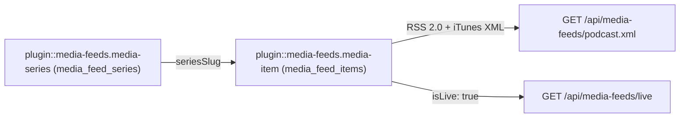
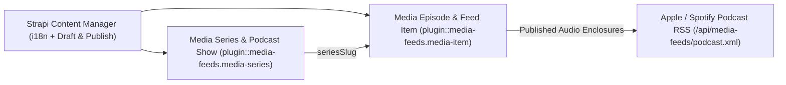
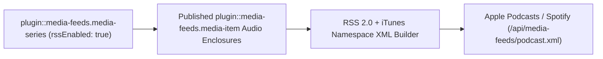
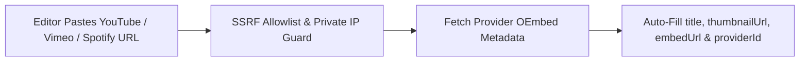
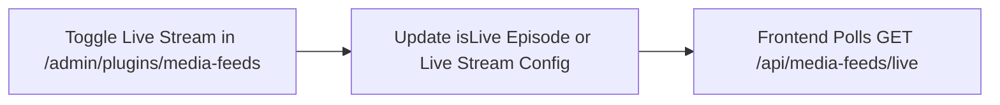

> **Package**: `@vicacha-devs/strapi-plugin-media-feeds` · **Plugin ID**: `media-feeds` · **Admin Workspace**: `/admin/plugins/media-feeds`

## 1. كيانات أنواع المحتوى ومواقعها ومخططاتها (`strapi.documents`)

Registers two localized, draft-and-publish Collection Types (`plugin::media-feeds.media-item` and `plugin::media-feeds.media-series`). Media Series group episodes into podcast shows or video playlists; Media Items store multi-language audio/video episodes, OEmbed metadata, audio enclosures, transcripts, and chapter markers. Supports `schemaExtensions` in `config/plugins.ts`.

### أين تجد كيانات أنواع المحتوى في Strapi v5

- **Content Manager**: `/admin/content-manager/collection-types/plugin::media-feeds.media-item` & `/admin/content-manager/collection-types/plugin::media-feeds.media-series` (`visible: true`)
- **Content-Type Builder**: `/admin/plugins/content-type-builder` under **Collection Types** (`Media Episode & Feed Item` & `Media Series & Podcast Show`)
- **Plugin Workspace & Settings**: `/admin/plugins/media-feeds` (Episode Hub, Series, OEmbed Enricher, Live Stream Control) and `/admin/settings/media-feeds`
- **Database Tables**: `media_feed_items` and `media_feed_series`

### `plugin::media-feeds.media-item` — Media Episode & Feed Item

Generic multi-language video, podcast, audio lecture, YouTube item, or live broadcast

> **Kind**: `collectionType` · **DB Table**: `media_feed_items` · **Admin Location**: `/admin/content-manager/collection-types/plugin::media-feeds.media-item` · **Draft & Publish**: `Yes` · **i18n**: `Yes`

| الحقل              | النوع في Strapi | إلزامي | القيود / العلاقات                                                                                  |
| :----------------- | :-------------- | :----- | :------------------------------------------------------------------------------------------------ |
| `title`            | `string`        | Yes    | —                                                                                                 |
| `slug`             | `uid`           | Yes    | —                                                                                                 |
| `description`      | `text`          | Yes    | —                                                                                                 |
| `transcript`       | `richtext`      | No     | —                                                                                                 |
| `type`             | `string`        | Yes    | default: `"video"`                                                                                |
| `provider`         | `enumeration`   | No     | enum: `youtube, spotify, apple_podcasts, vimeo, soundcloud, direct, upload`; default: `"youtube"` |
| `externalId`       | `string`        | No     | —                                                                                                 |
| `sourceUrl`        | `string`        | No     | —                                                                                                 |
| `embedUrl`         | `string`        | No     | —                                                                                                 |
| `speaker`          | `string`        | No     | —                                                                                                 |
| `speakerSlug`      | `string`        | No     | —                                                                                                 |
| `seriesSlug`       | `string`        | No     | —                                                                                                 |
| `duration`         | `string`        | No     | —                                                                                                 |
| `publishedAtLabel` | `string`        | No     | —                                                                                                 |
| `imageUrl`         | `string`        | No     | —                                                                                                 |
| `imageAlt`         | `string`        | No     | —                                                                                                 |
| `thumbnail`        | `media`         | No     | —                                                                                                 |
| `audioFile`        | `media`         | No     | —                                                                                                 |
| `transcriptFile`   | `media`         | No     | —                                                                                                 |
| `spokenLanguages`  | `json`          | No     | default: `["es"]`                                                                                 |
| `languageTracks`   | `json`          | No     | default: `[]`                                                                                     |
| `chapters`         | `json`          | No     | default: `[]`                                                                                     |
| `featured`         | `boolean`       | No     | default: `false`                                                                                  |
| `isLive`           | `boolean`       | No     | default: `false`                                                                                  |

### `plugin::media-feeds.media-series` — Media Series & Podcast Show

Generic multi-language podcast show, video playlist, or lecture series

> **Kind**: `collectionType` · **DB Table**: `media_feed_series` · **Admin Location**: `/admin/content-manager/collection-types/plugin::media-feeds.media-series` · **Draft & Publish**: `Yes` · **i18n**: `Yes`

| الحقل               | النوع في Strapi | إلزامي | القيود / العلاقات                 |
| :------------------ | :-------------- | :----- | :------------------------------- |
| `title`             | `string`        | Yes    | —                                |
| `slug`              | `uid`           | Yes    | —                                |
| `description`       | `text`          | Yes    | —                                |
| `author`            | `string`        | No     | —                                |
| `coverImageUrl`     | `string`        | No     | —                                |
| `category`          | `string`        | No     | default: `"Education"`           |
| `defaultType`       | `string`        | No     | default: `"podcast"`             |
| `spokenLanguages`   | `json`          | No     | default: `["es","en","ar","tr"]` |
| `rssEnabled`        | `boolean`       | No     | default: `true`                  |
| `youtubePlaylistId` | `string`        | No     | —                                |
| `spotifyShowUrl`    | `string`        | No     | —                                |
| `applePodcastsUrl`  | `string`        | No     | —                                |
| `active`            | `boolean`       | No     | default: `true`                  |

## التكامل مع مدير المحتوى في Strapi v5 (`/admin/content-manager`)

> **مجموعة الشريط الجانبي في مدير المحتوى**: `Media, Resources & Library`

### الكيانات والمكونات المسجلة في مدير المحتوى

- `plugin::media-feeds.media-item` (**Media Episode & Feed Item** — `/admin/content-manager/collection-types/plugin::media-feeds.media-item`)
- `plugin::media-feeds.media-series` (**Media Series & Podcast Show** — `/admin/content-manager/collection-types/plugin::media-feeds.media-series`)

### لماذا تنشئ هذه الإضافة كيانات داخل مدير المحتوى (Content Manager)؟

`@vicacha-devs/strapi-plugin-media-feeds` registers **Media Episode & Feed Item** (`plugin::media-feeds.media-item`) and **Media Series & Podcast Show** (`plugin::media-feeds.media-series`) with `i18n.localized: true`, `draftAndPublish: true`, and `content-manager.visible: true` so media producers can manage multilingual episodes, transcripts, and speaker relations in Content Manager:

- **Multilingual (`i18n`) Episode & Podcast Show Publishing**: Localize episode titles, summaries, full transcripts, and chapter markers across `en`, `es`, `ar`, and `tr` (`?plugins[i18n][locale]=en`).
- **Relational Speaker & Series Linking**: Link episodes in Content Manager to `Staff, Scholar & Author` (`api::leader.leader`) profiles via `schemaExtensions` and group them under `Media Series & Podcast Show` (`seriesSlug`).
- **Draft Staging Before Podcast RSS Syndication**: Only `Published` `plugin::media-feeds.media-item` records are emitted in `/api/media-feeds/podcast.xml`, allowing producers to stage upcoming episodes in `Draft` status inside Content Manager.

### كيفية الاستخدام داخل مدير المحتوى في Strapi (خطوة بخطوة)

1. **Open in Content Manager**: In the left sidebar, click **Content Manager -> Collection Types -> Media, Resources & Library** and select **Media Episode & Feed Item** (`/admin/content-manager/collection-types/plugin::media-feeds.media-item?plugins[i18n][locale]=en`) or **Media Series & Podcast Show** (`/admin/content-manager/collection-types/plugin::media-feeds.media-series`).
2. **Create Podcast Shows & Video Series**: In **Media Series & Podcast Show**, define `title`, `slug`, `author`, `coverUrl`, `itunesCategory`, and `rssEnabled`.
3. **Publish Multilingual Episodes**: In **Media Episode & Feed Item**, populate `title`, `slug`, `mediaType` (`video`, `audio`, `podcast`, `khutbah`, `live`), `sourceUrl`, `audioEnclosureUrl`, `durationSeconds`, and `transcript`, then click **Publish**.
4. **Workspace vs. Content Manager**: Use **Content Manager** for multilingual transcript authoring, draft staging, and speaker relations; use the **Media Feeds Workspace** (`/admin/plugins/media-feeds`) for 1-click SSRF-safe YouTube/Vimeo OEmbed enrichment and live stream banner toggling.

### التزامن بين مدير المحتوى ومساحة عمل الإضافة

### حالات الاستخدام داخل مدير المحتوى ومسارات العمل التحريرية

#### Content Manager Use Case 1 — Staging & Translating Friday Khutbahs and Podcast Episodes

- **الغرض والأهمية**: Author English, Spanish, and Arabic episode descriptions, chapter markers, and transcripts in Content Manager before publishing to Apple Podcasts and Spotify.
- **خطوات التنفيذ في مدير المحتوى**: Open `/admin/content-manager/collection-types/plugin::media-feeds.media-item?plugins[i18n][locale]=en`, edit `Jumu'ah Khutbah: Mercy and Coexistence`, switch locales, and click **Publish**.

## 3. حالات الاستخدام ومسارات العمل المتكاملة

### Use Case 1 — Apple Podcasts & Spotify iTunes RSS 2.0 XML Syndication

- **What it is for**: Automatically generate standards-compliant podcast RSS feeds with `<itunes:image>`, `<enclosure>`, duration, and per-series filtering.
- **How it works**: Organize `plugin::media-feeds.media-item` records under a `plugin::media-feeds.media-series` (`rssEnabled: true`) and syndicate `GET /api/media-feeds/podcast.xml` or `GET /api/media-feeds/podcast/{seriesSlug}.xml`.

### Use Case 2 — SSRF-Hardened YouTube, Vimeo & Spotify OEmbed Auto-Enrichment

- **What it is for**: Allow editors to paste a YouTube or Vimeo URL and automatically populate episode title, thumbnail, embed URL, and provider ID.
- **How it works**: In `/admin/plugins/media-feeds`, trigger `POST /media-feeds/enrich` (which validates hostnames against SSRF private IP ranges) before saving `plugin::media-feeds.media-item`.

### Use Case 3 — Live Broadcast Status Banner & Stream Switcher

- **What it is for**: Toggle a live khutbah, lecture, or webinar stream on the website header with real-time status polling.
- **How it works**: Mark an episode `isLive: true` or update live stream settings in `/admin/plugins/media-feeds`, and poll `GET /api/media-feeds/live` from the frontend.

---

- [استكشف دليل المطور وواجهة الإدارة](/ar/strapi-plugin-media-feeds/guide/)
- [استكشف مرجع OpenAPI التفاعلي](/strapi-plugin-media-feeds/api/)
