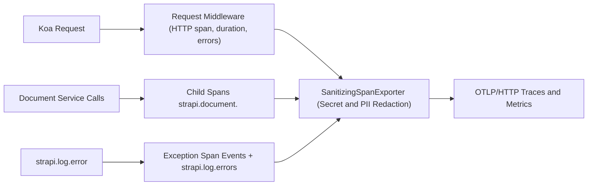
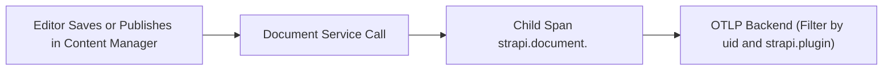
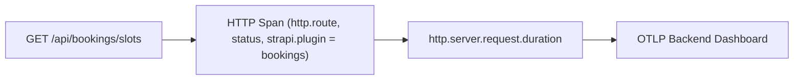
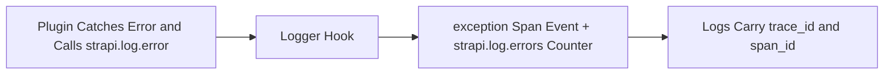
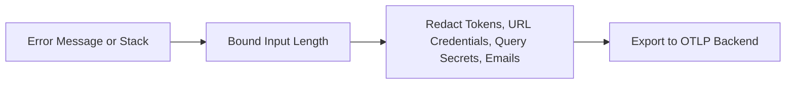

> **Package**: `@vicacha-devs/strapi-plugin-opentelemetry` · **Plugin ID**: `opentelemetry`

## 1. كيانات أنواع المحتوى ومواقعها ومخططاتها (`strapi.documents`)

Registers no Content-Types, routes, or admin pages. When `enabled`, the server `register()` lifecycle validates the config, starts the OpenTelemetry Node SDK (OTLP/HTTP traces and metrics plus auto-instrumentations), hooks `strapi.log.error`, adds a request middleware (HTTP spans, the `http.server.request.duration` histogram, and the `http.server.errors` counter), and, when `captureDocumentService` is `true`, wraps Document Service calls in child spans named `strapi.document.<action> <uid>`. `bootstrap()` logs the active exporter and `destroy()` flushes buffered spans and metrics. All exported error text passes through built-in secret and PII redaction.

### أين تجد كيانات أنواع المحتوى في Strapi v5

- **Strapi Boot Log**: `[opentelemetry] Active for service ...` is logged from `bootstrap()` with the service name and the exporter target (`otlpEndpoint`, `console`, or `no-exporter`).
- **Your OTLP Backend**: traces and metrics arrive at `<otlpEndpoint>/v1/traces` and `<otlpEndpoint>/v1/metrics` in SigNoz, Grafana, Sentry OTLP ingest, or any OTLP/HTTP collector.
- **Strapi Config**: `config/plugins.ts` -> `opentelemetry.config`, validated at boot by `validateOtelConfig`.
- **No Admin UI or Content-Types**: this plugin creates no entities, routes, settings page, or database tables.

تعمل هذه الإضافة مباشرة على كيانات أنواع المحتوى الحالية في Strapi (`api::*` و `plugin::*`).

## التكامل مع مدير المحتوى في Strapi v5 (`/admin/content-manager`)

> **مجموعة الشريط الجانبي في مدير المحتوى**: `No Content Manager panel; instruments the Document Service calls that Content Manager actions trigger`

### الكيانات والمكونات المسجلة في مدير المحتوى

- Document Service calls (`strapi.documents(...)`) made when editors create, update, publish, or delete entries in `/admin/content-manager`, recorded as `strapi.document.<action> <uid>` child spans
- No Content-Type, route, or database table is created by this plugin

### لماذا تنشئ هذه الإضافة كيانات داخل مدير المحتوى (Content Manager)؟

`@vicacha-devs/strapi-plugin-opentelemetry` adds no Content Manager UI. Every create, update, publish, or delete an editor performs becomes a traced Document Service operation, so slow or failing saves can be tied to a specific content type and plugin in your observability backend.

- **Per-Content-Type Visibility**: spans carry `strapi.document.uid`, `strapi.document.action`, and `strapi.plugin` (for `plugin::*` UIDs).
- **Opt-Out per Environment**: set `captureDocumentService: false` to stop wrapping Document Service calls without disabling HTTP tracing.
- **Safe by Default**: payloads and user identity beyond `enduser.id` are never attached to spans, and error text is redacted before export.

### كيفية الاستخدام داخل مدير المحتوى في Strapi (خطوة بخطوة)

1. **Enable the Plugin**: add `opentelemetry` to `config/plugins.ts` and set `OTEL_EXPORTER_OTLP_ENDPOINT` (or `OTEL_CONSOLE_EXPORTER=true` locally).
2. **Work Normally in Content Manager**: save or publish entries in `/admin/content-manager`.
3. **Inspect the Traces**: search your backend for `strapi.document.update` (or `create`, `publish`, `delete`) spans filtered by `strapi.document.uid`.

### التزامن بين مدير المحتوى ومساحة عمل الإضافة

### حالات الاستخدام داخل مدير المحتوى ومسارات العمل التحريرية

#### Content Manager Use Case 1 — Diagnosing Slow Publishes

- **الغرض والأهمية**: Identify which content type and plugin make publishing slow, without logging any entry content.
- **خطوات التنفيذ في مدير المحتوى**: Publish an entry in `/admin/content-manager`, then find the `strapi.document.publish <uid>` span under the request trace and compare its duration with other content types.

## 3. حالات الاستخدام ومسارات العمل المتكاملة

### Use Case 1 — Tracing Slow or Failing Requests Across Plugins

- **What it is for**: Find which plugin makes an endpoint slow or failing, using the `strapi.plugin` attribute derived from `plugin::<name>.<model>` UIDs and plugin route paths (for example `/api/bookings/...` -> `bookings`).
- **How it works**: Point `otlpEndpoint` at your collector; each request produces an HTTP span with `http.route`, `http.response.status_code`, and `strapi.plugin`, and `http.server.request.duration` is recorded by method, route, and status.

### Use Case 2 — Capturing Caught Errors from Plugins and Background Jobs

- **What it is for**: Surface errors that plugins, email lifecycles, or background jobs catch and only log, which would otherwise never reach an error tracker.
- **How it works**: The plugin hooks `strapi.log.error`, records each call as an `exception` span event, and counts it in `strapi.log.errors`; unhandled request errors also log `trace_id`, `span_id`, `method`, `path`, and `plugin` for log-trace correlation.

### Use Case 3 — Shipping Telemetry Without Leaking Secrets or PII

- **What it is for**: Send traces to a third-party backend while keeping credentials and personal data out of them.
- **How it works**: Request bodies, `Authorization`, `Cookie`, and user emails or names are never attached to spans. Error text is redacted for `Bearer`/`Basic` tokens, URL credentials, sensitive query parameters, and email addresses, and is length-bounded before redaction so pathological input cannot stall the sanitizer.

---

- [استكشف دليل المطور وواجهة الإدارة](/ar/strapi-plugin-opentelemetry/guide/)
