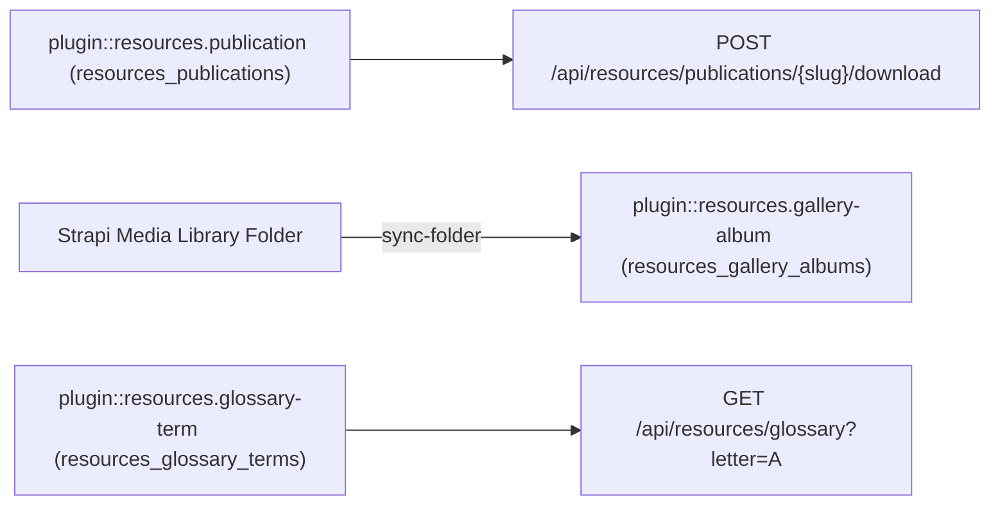
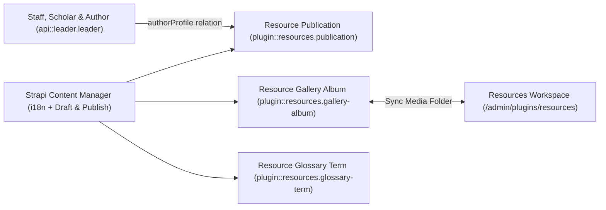
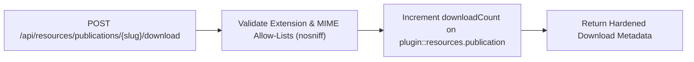
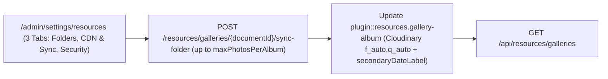
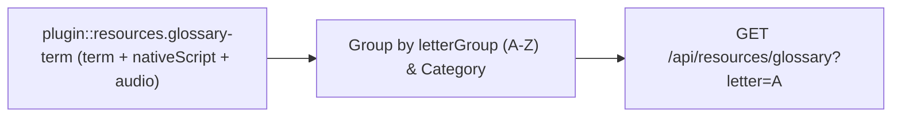

> **Package**: `@vicacha-devs/strapi-plugin-resources` · **Plugin ID**: `resources` · **Category**: `Community & Engagement` · **Version**: `1.0.0` · **Routes**: `25`

مكتبة الإصدارات الرقمية مع تنزيلات محمية ومعارض الصور المتزامنة مع مكتبة الوسائط ومسرد المصطلحات متعدد اللغات مع النطق الصوتي.

```bash
pnpm add @vicacha-devs/strapi-plugin-resources
```


## 1. المزايا الرئيسية والقدرات المعمارية

- [استكشف كيانات المحتوى وحالات الاستخدام (مع المخططات التفاعلية)](/ar/strapi-plugin-resources/use-cases/)
- [استكشف دليل المطور وواجهة الإدارة](/ar/strapi-plugin-resources/guide/)
- [استكشف مرجع OpenAPI التفاعلي](/strapi-plugin-resources/api/)

## 2. كيانات أنواع المحتوى ومواقعها ومخططاتها (`strapi.documents`)

Registers three localized (`i18n.localized: true`), draft-and-publish (`draftAndPublish: true`) Collection Types: `plugin::resources.publication`, `plugin::resources.gallery-album`, and `plugin::resources.glossary-term`, plus a 3-tab settings panel (`/admin/settings/resources`) covering Media Library folder paths, multi-calendar secondary dates, Cloudinary `f_auto,q_auto` optimization, album photo caps, and download extension/MIME allow-lists. Supports runtime `schemaExtensions` in `config/plugins.ts`.



### أين تجد كيانات أنواع المحتوى في Strapi v5

- **Content Manager**: `/admin/content-manager/collection-types/plugin::resources.publication`, `plugin::resources.gallery-album`, and `plugin::resources.glossary-term` (`visible: true`)
- **Content-Type Builder**: `/admin/plugins/content-type-builder` under **Collection Types** (`Resource Publication`, `Resource Gallery Album`, `Resource Glossary Term`)
- **Plugin Workspace**: `/admin/plugins/resources` (Publications, Gallery Albums, Glossary Terms, Media Folder Sync)
- **Settings Panel (3 Tabs)**: `/admin/settings/resources` — **Media Library Folders & Organization** (`organizationName`, `defaultPublicationsFolderPath`, `defaultGalleriesFolderPath`, `secondaryCalendar`, `defaultLocale`, `supportedLocales`), **CDN Optimization & Folder Sync** (`enableCloudinaryOptimization`, `autoSyncMediaFolders`, `maxPhotosPerAlbum`), and **Download Security & Allow-Lists** (`allowedDownloadExtensions`, `allowedDownloadMimeTypes`)
- **Database Tables**: `resources_publications`, `resources_gallery_albums`, and `resources_glossary_terms`

### `plugin::resources.gallery-album` — Resource Gallery Album

Curated photo and video albums synced with Strapi v5 Media Library folders and Cloudinary optimization

> **Kind**: `collectionType` · **DB Table**: `resources_gallery_albums` · **Admin Location**: `/admin/content-manager/collection-types/plugin::resources.gallery-album` · **Draft & Publish**: `Yes` · **i18n**: `Yes`

| الحقل                   | النوع في Strapi | إلزامي | القيود / العلاقات                                                                              |
| :---------------------- | :-------------- | :----- | :-------------------------------------------------------------------------------------------- |
| `title`                 | `string`        | Yes    | max: 200                                                                                      |
| `slug`                  | `uid`           | Yes    | —                                                                                             |
| `description`           | `text`          | No     | —                                                                                             |
| `category`              | `enumeration`   | Yes    | enum: `architecture, community, events, ramadan_eid, heritage, press`; default: `"community"` |
| `coverPhoto`            | `media`         | No     | —                                                                                             |
| `photos`                | `media`         | No     | —                                                                                             |
| `mediaFolderId`         | `integer`       | No     | —                                                                                             |
| `mediaFolderPath`       | `string`        | No     | max: 160                                                                                      |
| `eventDate`             | `date`          | No     | —                                                                                             |
| `secondaryDateOverride` | `string`        | No     | max: 80                                                                                       |
| `photographerCredit`    | `string`        | No     | max: 140                                                                                      |
| `framingNotes`          | `string`        | No     | max: 500                                                                                      |
| `featured`              | `boolean`       | No     | default: `false`                                                                              |
| `sortOrder`             | `integer`       | No     | default: `0`                                                                                  |

### `plugin::resources.glossary-term` — Resource Glossary Term

Multilingual A-Z glossary terms with native script, transliteration, and Strapi Media Library audio pronunciation

> **Kind**: `collectionType` · **DB Table**: `resources_glossary_terms` · **Admin Location**: `/admin/content-manager/collection-types/plugin::resources.glossary-term` · **Draft & Publish**: `Yes` · **i18n**: `Yes`

| الحقل                | النوع في Strapi | إلزامي | القيود / العلاقات                                                                    |
| :------------------- | :-------------- | :----- | :---------------------------------------------------------------------------------- |
| `term`               | `string`        | Yes    | max: 120                                                                            |
| `slug`               | `uid`           | Yes    | —                                                                                   |
| `nativeScript`       | `string`        | No     | max: 200                                                                            |
| `transliteration`    | `string`        | No     | max: 200                                                                            |
| `definition`         | `text`          | Yes    | —                                                                                   |
| `category`           | `enumeration`   | Yes    | enum: `beliefs, worship, ethics, history, community, general`; default: `"general"` |
| `letterGroup`        | `string`        | No     | max: 4; default: `"A"`                                                              |
| `pronunciationAudio` | `media`         | No     | —                                                                                   |
| `relatedTerms`       | `json`          | No     | —                                                                                   |
| `featured`           | `boolean`       | No     | default: `false`                                                                    |

### `plugin::resources.publication` — Resource Publication

Localized digital library books, guides, pamphlets, and press kit assets backed by the Strapi v5 Media Library

> **Kind**: `collectionType` · **DB Table**: `resources_publications` · **Admin Location**: `/admin/content-manager/collection-types/plugin::resources.publication` · **Draft & Publish**: `Yes` · **i18n**: `Yes`

| الحقل                   | النوع في Strapi | إلزامي | القيود / العلاقات                                                                |
| :---------------------- | :-------------- | :----- | :------------------------------------------------------------------------------ |
| `title`                 | `string`        | Yes    | max: 200                                                                        |
| `slug`                  | `uid`           | Yes    | —                                                                               |
| `summary`               | `text`          | No     | —                                                                               |
| `category`              | `enumeration`   | Yes    | enum: `guide, book, pamphlet, press_kit, academic, general`; default: `"guide"` |
| `file`                  | `media`         | No     | —                                                                               |
| `coverImage`            | `media`         | No     | —                                                                               |
| `authorName`            | `string`        | No     | max: 140                                                                        |
| `authorSlug`            | `string`        | No     | max: 140                                                                        |
| `isbnOrReference`       | `string`        | No     | max: 80                                                                         |
| `pageCount`             | `integer`       | No     | —                                                                               |
| `languageCode`          | `string`        | No     | max: 10; default: `"es"`                                                        |
| `publishedAtDate`       | `date`          | No     | —                                                                               |
| `secondaryDateOverride` | `string`        | No     | max: 80                                                                         |
| `mediaFolderPath`       | `string`        | No     | max: 160                                                                        |
| `externalDownloadUrl`   | `string`        | No     | max: 500                                                                        |
| `downloadCount`         | `integer`       | No     | default: `0`                                                                    |
| `featured`              | `boolean`       | No     | default: `false`                                                                |
| `allowPublicDownload`   | `boolean`       | No     | default: `true`                                                                 |

## التكامل مع مدير المحتوى في Strapi v5 (`/admin/content-manager`)

> **مجموعة الشريط الجانبي في مدير المحتوى**: `Media, Resources & Library`

### الكيانات والمكونات المسجلة في مدير المحتوى

- `plugin::resources.publication` (**Resource Publication** — `/admin/content-manager/collection-types/plugin::resources.publication`)
- `plugin::resources.gallery-album` (**Resource Gallery Album** — `/admin/content-manager/collection-types/plugin::resources.gallery-album`)
- `plugin::resources.glossary-term` (**Resource Glossary Term** — `/admin/content-manager/collection-types/plugin::resources.glossary-term`)


### لماذا تنشئ هذه الإضافة كيانات داخل مدير المحتوى (Content Manager)؟

`@vicacha-devs/strapi-plugin-resources` registers all three of its entities (`Resource Publication`, `Resource Gallery Album`, and `Resource Glossary Term`) with `i18n.localized: true`, `draftAndPublish: true`, and `content-manager.visible: true` so librarians, scholars, and archivists can manage digital books, photo albums, and glossary terms inside the Strapi v5 Content Manager:

- **Multilingual (`i18n`) Digital Library & Glossary Authoring**: Author publications, photo gallery descriptions, and A–Z glossary definitions across `en`, `es`, `ar`, and `tr` (`?plugins[i18n][locale]=en`) with native Draft & Publish staging.
- **Relational Author Profile Linking (`authorProfile`)**: In Content Manager, link `Resource Publication` records directly to `Staff, Scholar & Author` (`api::leader.leader`) profiles via `config/plugins.ts -> schemaExtensions.publication`.
- **Direct Media Library Asset & Folder Binding**: Attach cover images, downloadable PDF files, pronunciation audio clips, and Media Library folder paths directly inside Content Manager forms.

### كيفية الاستخدام داخل مدير المحتوى في Strapi (خطوة بخطوة)

1. **Open in Content Manager**: In the left sidebar, expand **Content Manager -> Collection Types -> Media, Resources & Library** and select **Resource Publication** (`/admin/content-manager/collection-types/plugin::resources.publication?plugins[i18n][locale]=en`), **Resource Gallery Album** (`plugin::resources.gallery-album`), or **Resource Glossary Term** (`plugin::resources.glossary-term`).
2. **Publish Books, Guides & Press Kits**: In **Resource Publication**, populate `title`, `slug`, `summary`, `category` (`book`, `guide`, `pamphlet`, `press_kit`), `fileUrl`, `pageCount`, and `authorProfile`, then click **Publish**.
3. **Curate A–Z Glossary Terms**: In **Resource Glossary Term**, enter `term`, `nativeScript` (Arabic script), `transliteration`, `definition`, `letterGroup` (`A`–`Z`), and `pronunciationAudioUrl`.
4. **Workspace vs. Content Manager**: Use **Content Manager** for multilingual authoring, scholar `authorProfile` relations, and bulk publishing; use the **Resources Workspace** (`/admin/plugins/resources`) for 1-click Media Library folder synchronization (`Sync Folder`) and download analytics.

### التزامن بين مدير المحتوى ومساحة عمل الإضافة



### حالات الاستخدام داخل مدير المحتوى ومسارات العمل التحريرية

#### Content Manager Use Case 1 — Publishing Multilingual PDF Guides Linked to Institutional Authors (`api::leader.leader`)

- **الغرض والأهمية**: Author downloadable PDF guides (`Mosque Welcome & Visitor Etiquette Guide`, `Introduction to the Five Pillars of Islam`) in Content Manager and link each publication to its scholar author.
- **خطوات التنفيذ في مدير المحتوى**: Open `/admin/content-manager/collection-types/plugin::resources.publication?plugins[i18n][locale]=en`, edit the entry, select the `authorProfile` relation, switch locales (`es`, `ar`, `tr`) to translate, and click **Publish**.

#### Content Manager Use Case 2 — Managing Multilingual Glossary Terms with Native Script & Audio

- **الغرض والأهمية**: Curate A–Z glossary entries with vocalized Arabic script, phonetic transliteration, and audio pronunciation links in Content Manager.
- **خطوات التنفيذ في مدير المحتوى**: Open `/admin/content-manager/collection-types/plugin::resources.glossary-term?plugins[i18n][locale]=en`, filter by `letterGroup` or `category`, and publish.

## 3. حالات الاستخدام ومسارات العمل المتكاملة

### Use Case 1 — Digital Publications Library with Hardened Download Allow-Lists

- **What it is for**: Publish downloadable books, PDF guides, pamphlets, and press kits protected by extension (`allowedDownloadExtensions`) and MIME (`allowedDownloadMimeTypes`) allow-lists, `X-Content-Type-Options: nosniff`, and atomic download counters.
- **How it works**: Configure allowed extensions/MIME types in `/admin/settings/resources` (**Download Security & Allow-Lists** tab), create `plugin::resources.publication` records, and serve downloads via `POST /api/resources/publications/{slug}/download`.




### Use Case 2 — Configuring Media Library Folders, Secondary Calendars, CDN Optimization & Download Security

- **What it is for**: Manage all 11 `ResourcesPluginSettings` fields across 3 organized tabs in `/admin/settings/resources` (`Media Library Folders & Organization`, `CDN Optimization & Folder Sync`, and `Download Security & Allow-Lists`) and automatically sync `plugin::upload.folder` assets into `plugin::resources.gallery-album` up to `maxPhotosPerAlbum`.
- **How it works**: Configure `defaultPublicationsFolderPath`, `defaultGalleriesFolderPath`, `secondaryCalendar`, `enableCloudinaryOptimization`, `autoSyncMediaFolders`, `maxPhotosPerAlbum`, and download allow-lists in `/admin/settings/resources` (`PUT /resources/settings`), then click **Sync Folder** (`POST /resources/galleries/{documentId}/sync-folder`).




### Use Case 3 — Multilingual A–Z Glossary with Native Script & Audio Pronunciation

- **What it is for**: Maintain an educational glossary of Arabic/Islamic or domain terms (`term`, `nativeScript`, `transliteration`, `definition`, `pronunciationAudio`, `letterGroup`).
- **How it works**: Manage entries in `plugin::resources.glossary-term` and query grouped A–Z terms via `GET /api/resources/glossary?letter=A&category=worship`.




## 4. نقاط النهاية البرمجية REST API (`content-api` و `admin`)

| الطريقة  | مسار نقطة النهاية                                     | النطاق  | المعالج (Handler)                          | المصادقة   |
| :------- | :---------------------------------------------------- | :------ | :----------------------------------------- | :--------- |
| `GET`    | `/resources/hub`                                      | `admin` | `resourcesController.getHubOverview`       | Bearer JWT |
| `GET`    | `/resources/publications`                             | `admin` | `resourcesController.listPublications`     | Bearer JWT |
| `POST`   | `/resources/publications`                             | `admin` | `resourcesController.createPublication`    | Bearer JWT |
| `PUT`    | `/resources/publications/{documentId}`                | `admin` | `resourcesController.updatePublication`    | Bearer JWT |
| `DELETE` | `/resources/publications/{documentId}`                | `admin` | `resourcesController.deletePublication`    | Bearer JWT |
| `GET`    | `/resources/galleries`                                | `admin` | `resourcesController.listGalleries`        | Bearer JWT |
| `POST`   | `/resources/galleries`                                | `admin` | `resourcesController.createGalleryAlbum`   | Bearer JWT |
| `PUT`    | `/resources/galleries/{documentId}`                   | `admin` | `resourcesController.updateGalleryAlbum`   | Bearer JWT |
| `DELETE` | `/resources/galleries/{documentId}`                   | `admin` | `resourcesController.deleteGalleryAlbum`   | Bearer JWT |
| `POST`   | `/resources/galleries/{documentId}/sync-media-folder` | `admin` | `resourcesController.syncAlbumMediaFolder` | Bearer JWT |
