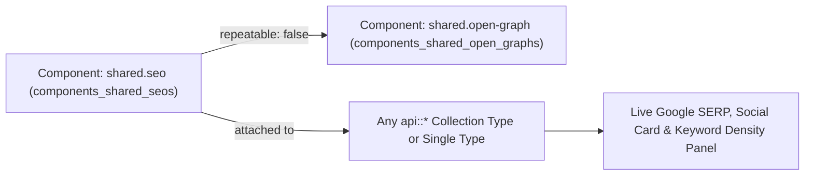
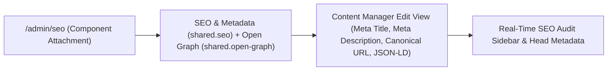
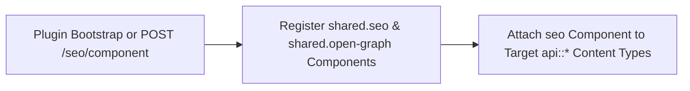
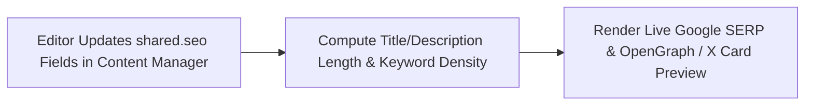
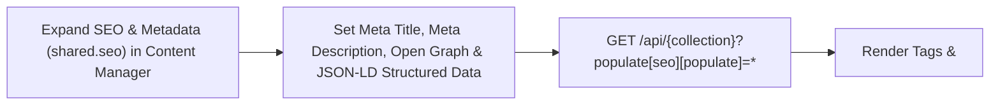

> **Package**: `@vicacha-devs/strapi-plugin-seo` · **Plugin ID**: `seo` · **Admin Workspace**: `/admin/plugins/seo`

## 1. كيانات أنواع المحتوى ومواقعها ومخططاتها (`strapi.documents`)

Registers and manages two shared Strapi Components (`shared.seo` and `shared.open-graph`) inside the Content-Type Builder and injects a live Google SERP, OpenGraph/X Social Card, and Keyword Density Analyzer into the Content Manager edit view for any `api::*` Collection Type or Single Type that includes `shared.seo`.

### أين تجد كيانات أنواع المحتوى في Strapi v5

- **Content-Type Builder (Components)**: `/admin/plugins/content-type-builder` under **COMPONENTS -> Shared** (`seo` -> `components_shared_seos`, `openGraph` -> `components_shared_open_graphs`)
- **Content Manager Edit View**: Open any Collection Type or Single Type with the `seo` component attached (e.g., `/admin/content-manager/single-types/api::about-page.about-page`)
- **Plugin Workspace & Settings**: `/admin/plugins/seo` (Content-Type SEO Coverage Audit & 1-Click Component Attachment) and `/admin/settings/seo`

### `shared.open-graph` — Component: openGraph

Shared Strapi component (shared.open-graph) managed in Content-Type Builder and Content Manager

> **Kind**: `component` · **DB Table**: `components_shared_open_graphs` · **Admin Location**: `/admin/plugins/content-type-builder` (Component) · **Draft & Publish**: `No` · **i18n**: `Yes`

| الحقل           | النوع في Strapi | إلزامي | القيود / العلاقات |
| :-------------- | :-------------- | :----- | :--------------- |
| `ogTitle`       | `string`        | Yes    | max: 70          |
| `ogDescription` | `string`        | Yes    | max: 200         |
| `ogImage`       | `media`         | No     | —                |
| `ogUrl`         | `string`        | No     | —                |
| `ogType`        | `string`        | No     | —                |

### `shared.seo` — Component: seo

Shared Strapi component (shared.seo) managed in Content-Type Builder and Content Manager

> **Kind**: `component` · **DB Table**: `components_shared_seos` · **Admin Location**: `/admin/plugins/content-type-builder` (Component) · **Draft & Publish**: `No` · **i18n**: `Yes`

| الحقل             | النوع في Strapi | إلزامي | القيود / العلاقات               |
| :---------------- | :-------------- | :----- | :----------------------------- |
| `metaTitle`       | `string`        | Yes    | max: 60                        |
| `metaDescription` | `string`        | Yes    | max: 160                       |
| `metaImage`       | `media`         | No     | —                              |
| `openGraph`       | `component`     | No     | component: `shared.open-graph` |
| `keywords`        | `text`          | No     | —                              |
| `metaRobots`      | `string`        | No     | —                              |
| `metaViewport`    | `string`        | No     | —                              |
| `canonicalURL`    | `string`        | No     | —                              |
| `structuredData`  | `json`          | No     | —                              |

## التكامل مع مدير المحتوى في Strapi v5 (`/admin/content-manager`)

> **مجموعة الشريط الجانبي في مدير المحتوى**: `Components (`shared.seo`— **SEO & Metadata** &`shared.open-graph` — **Open Graph (Social Sharing)**) inside Content Manager Edit Views`

### الكيانات والمكونات المسجلة في مدير المحتوى

- Component `shared.seo` (**SEO & Metadata** attached to `api::article.article` and other Collection/Single Types in Content Manager)
- Component `shared.open-graph` (**Open Graph (Social Sharing)** nested inside `SEO & Metadata`)

### لماذا تنشئ هذه الإضافة كيانات داخل مدير المحتوى (Content Manager)؟

`@vicacha-devs/strapi-plugin-seo` registers the reusable `shared.seo` (**SEO & Metadata**) and `shared.open-graph` (**Open Graph (Social Sharing)**) Strapi Components so every Collection Type (`api::article.article`, `api::page.page`) and Single Type in the **Strapi v5 Content Manager** includes a complete, localized SEO & structured-data panel alongside a live **SEO Audit** sidebar:

- **Native Localization & Draft Support via `SEO & Metadata` (`shared.seo`)**: Because `shared.seo` is embedded directly inside Content Manager entries, `Meta Title*` (`metaTitle`, max. 60 chars), `Meta Description*` (`metaDescription`, 50–160 chars), `Meta Social Share Image` (`metaImage`), `SEO Keywords` (`keywords`), `Meta Robots Directive` (`metaRobots`), `Meta Viewport` (`metaViewport`), `Canonical URL` (`canonicalURL`), and `JSON-LD Structured Data` (`structuredData`) automatically inherit each document's `i18n` locale (`en`, `es`, `ar`, `tr`) and Draft/Publish state.
- **Nested Open Graph Social Card Component (`shared.open-graph`)**: Expand **Open Graph (Social Sharing)** inside `SEO & Metadata` to customize `ogTitle`, `ogDescription`, `ogImage`, `ogUrl`, and `ogType` per locale.

### كيفية الاستخدام داخل مدير المحتوى في Strapi (خطوة بخطوة)

1. **Attach `shared.seo` in `/admin/seo`**: Enable the `seo` component on your target Collection Types and Single Types in `/admin/seo` (or automatically on bootstrap).
2. **Open Any Entry in Content Manager & Expand `SEO & Metadata`**: Navigate to `/admin/content-manager/collection-types/api::article.article/{documentId}` and scroll down to the **SEO & Metadata** (`shared.seo`) component panel (click `+` if no entry has been initialized yet).
3. **Populate Meta, Open Graph & JSON-LD Fields**: Fill in `Meta Title*` (`max. 60 characters`), `Meta Description*` (`min. 50 / max. 160 characters`), upload `Meta Social Share Image`, optionally expand `Open Graph (Social Sharing)`, configure `SEO Keywords`, `Meta Robots Directive` (e.g. `index, follow`), `Meta Viewport` (e.g. `width=device-width, initial-scale=1`), `Canonical URL`, and paste valid Schema.org JSON into `JSON-LD Structured Data`.

### التزامن بين مدير المحتوى ومساحة عمل الإضافة

### حالات الاستخدام داخل مدير المحتوى ومسارات العمل التحريرية

#### Content Manager Use Case 1 — Authoring Localized `SEO & Metadata`, Open Graph Cards & `JSON-LD Structured Data`

- **الغرض والأهمية**: Configure per-locale `Meta Title*`, `Meta Description*`, `Canonical URL`, and `JSON-LD Structured Data` (`structuredData`) directly inside an Article (`api::article.article`) in Content Manager.
- **خطوات التنفيذ في مدير المحتوى**: Open `/admin/content-manager/collection-types/api::article.article/{documentId}?plugins[i18n][locale]=en`, expand **SEO & Metadata**, complete the required meta title (<= 60 chars) and meta description (50–160 chars), add your JSON-LD block, and click **Publish**.

## 3. حالات الاستخدام ومسارات العمل المتكاملة

### Use Case 1 — 1-Click `shared.seo` Component Bootstrap Across Content Types

- **What it is for**: Automatically create the `shared.seo` and `shared.open-graph` components and attach them to Articles, Pages, Events, or Courses without manual field setup.
- **How it works**: On bootstrap (when `autoCreateComponent: true`) or via `/admin/plugins/seo` (`POST /seo/component`), the plugin registers `shared.seo` and attaches it to selected `api::*` schemas.

### Use Case 2 — Live Google SERP, Social Card Preview & Keyword Density Scoring

- **What it is for**: Give editors real-time feedback on `metaTitle` (<= 60 chars), `metaDescription` (50–160 chars), `canonicalURL`, `metaRobots`, and focus keyword density while editing.
- **How it works**: Edit the `seo` component inside any Content Manager entry to preview desktop/mobile Google SERP snippets and OpenGraph social cards.

### Use Case 3 — Authoring `SEO & Metadata` (`Meta Title`, `Meta Description`, `Open Graph`, `Canonical URL` & `JSON-LD Structured Data`) in Content Manager

- **What it is for**: Configure localized meta titles (`max. 60 characters`), meta descriptions (`50–160 characters`), Open Graph social cards, robots/viewport directives, canonical URLs, and Schema.org JSON-LD (`Article`, `Event`, `FAQPage`, `Organization`) directly inside the Content Manager edit view.
- **How it works**: Expand **SEO & Metadata** (`shared.seo`) on any entry in `/admin/content-manager`, populate `Meta Title*` (`metaTitle`), `Meta Description*` (`metaDescription`), `Meta Social Share Image` (`metaImage`), `Open Graph (Social Sharing)` (`openGraph`), `SEO Keywords` (`keywords`), `Meta Robots Directive` (`metaRobots`), `Meta Viewport` (`metaViewport`), `Canonical URL` (`canonicalURL`), and `JSON-LD Structured Data` (`structuredData`), and query via `?populate[seo][populate]=*`.

---

- [استكشف دليل المطور وواجهة الإدارة](/ar/strapi-plugin-seo/guide/)
- [استكشف مرجع OpenAPI التفاعلي](/strapi-plugin-seo/api/)
