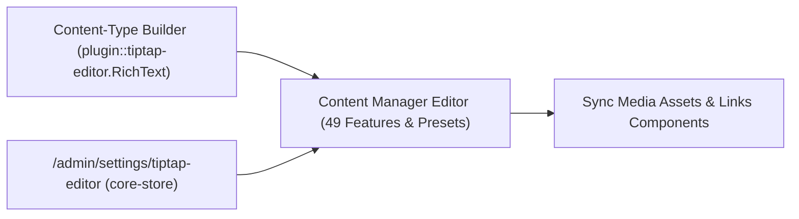
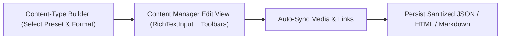
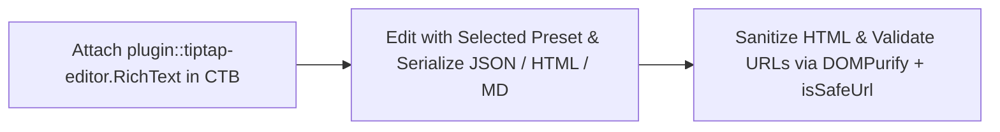
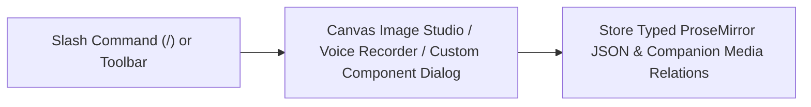
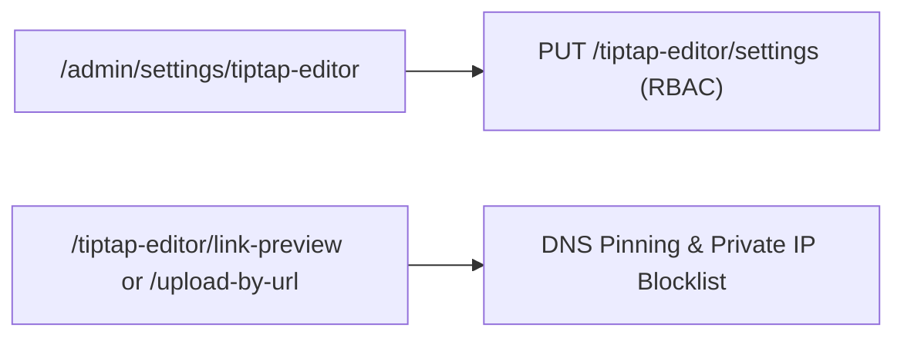

> **Package**: `@vicacha-devs/strapi-plugin-tiptap-editor` · **Plugin ID**: `tiptap-editor` · **Category**: `Editorial & SEO` · **Version**: `1.3.1` · **Routes**: `10`

حقل محرر نصوص منسقة TipTap v3 + Edifice IO مع 49 ميزة قابلة للتخصيص ومكونات مخصصة واستوديو صور Canvas ومسجل صوتي وحماية DOMPurify و SSRF.

```bash
pnpm add @vicacha-devs/strapi-plugin-tiptap-editor
```


## 1. المزايا الرئيسية والقدرات المعمارية

- [استكشف كيانات المحتوى وحالات الاستخدام (مع المخططات التفاعلية)](/ar/strapi-plugin-tiptap-editor/use-cases/)
- [استكشف دليل المطور وواجهة الإدارة](/ar/strapi-plugin-tiptap-editor/guide/)
- [استكشف مرجع OpenAPI التفاعلي](/strapi-plugin-tiptap-editor/api/)

## 2. كيانات أنواع المحتوى ومواقعها ومخططاتها (`strapi.documents`)

Registers the `plugin::tiptap-editor.RichText` custom field in Content-Type Builder & Content Manager alongside Strapi `core-store` runtime settings (`settings`), optional `links.links` internal reference sync, and companion `<FieldName>Media` relational media tracking.



### أين تجد كيانات أنواع المحتوى في Strapi v5

- **Content Manager Rich-Text Fields**: `/admin/content-manager` (any Collection Type or Single Type field configured with custom field `plugin::tiptap-editor.RichText`)
- **Content-Type Builder Preset Selector**: `/admin/plugins/content-type-builder` (`PresetSelect`, output format `json | html | markdown`, character limit, and placeholder options)
- **Global Settings Panel**: `/admin/settings/tiptap-editor` (`Settings -> Global Settings -> Tiptap Editor` — runtime preset overrides, iframe domain allowlist, and relational sync)

تعمل هذه الإضافة مباشرة على كيانات أنواع المحتوى الحالية في Strapi (`api::*` و `plugin::*`).

## التكامل مع مدير المحتوى في Strapi v5 (`/admin/content-manager`)

> **مجموعة الشريط الجانبي في مدير المحتوى**: `Operates Inside Every Content Manager Entry Using plugin::tiptap-editor.RichText`

### الكيانات والمكونات المسجلة في مدير المحتوى

- Custom Field `plugin::tiptap-editor.RichText` (attached to `api::article.article`, `api::page.page`, or any Collection/Single Type in `/admin/content-manager`)
- Companion `<FieldName>Media` & `<FieldName>Links` fields automatically synchronized on edit (`enableRelationalSync`)
- Settings Store `plugin::tiptap-editor.settings` (`core-store` managed via `/admin/settings/tiptap-editor`)


### لماذا تنشئ هذه الإضافة كيانات داخل مدير المحتوى (Content Manager)؟

`@vicacha-devs/strapi-plugin-tiptap-editor` delivers a WCAG 2.1 AA WYSIWYG editing workspace directly inside **Strapi v5 Content Manager** edit views via custom field `plugin::tiptap-editor.RichText` without creating intrusive standalone tables:

- **Hybrid Code + Runtime Presets**: Fields inherit code-first presets (`minimal`, `default`, `full`, `edifice`, or custom `config/plugins.ts` presets) and respect live overrides saved at `/admin/settings/tiptap-editor`.
- **Automatic Relational Media & Document Linker Sync**: `useRelationalSync` extracts embedded Media Library assets (`<FieldName>Media`) and internal `linker` document references (`<FieldName>Links`) as editors type.
- **Zero-Data-Loss Fallback**: Disabling an extension renders existing nodes read-only rather than dropping structured content on publish.

### كيفية الاستخدام داخل مدير المحتوى في Strapi (خطوة بخطوة)

1. **Add the Custom Field in Content-Type Builder**: Open `/admin/plugins/content-type-builder`, add custom field **Rich Text (Tiptap)** (`plugin::tiptap-editor.RichText`), and pick a preset and output format (`json`, `html`, or `markdown`).
2. **Edit Content in Content Manager**: Open `/admin/content-manager` for the entry, format text using the roving toolbar, `/` slash menu, HTML5 Canvas image studio, voice recorder, or custom components, and click **Publish**.
3. **Review Global Overrides**: Visit `/admin/settings/tiptap-editor` (`Settings -> Global Settings -> Tiptap Editor`) to tune allowed iframe domains and runtime feature toggles.

### التزامن بين مدير المحتوى ومساحة عمل الإضافة



### حالات الاستخدام داخل مدير المحتوى ومسارات العمل التحريرية

#### Content Manager Use Case 1 — Authoring Accessible Multilingual Rich Content & Linked Assets

- **الغرض والأهمية**: Compose localized articles in `/admin/content-manager` with WCAG `language` spans (`dir='rtl'|'ltr'`), semantic headings, internal document links, cropped images, and automatic relational asset tracking.
- **خطوات التنفيذ في مدير المحتوى**: Open an entry in `/admin/content-manager`, switch locale via i18n, insert media/links/blocks in the `RichText` field, verify the inspector preview (JSON/HTML/Markdown), and click **Publish**.

## 3. حالات الاستخدام ومسارات العمل المتكاملة

### Use Case 1 — Configuring Preset-Driven Rich-Text Fields & Output Formats (`json`, `html`, `markdown`)

- **What it is for**: Bind fields on `api::article.article` or `api::page.page` to tailored TipTap presets (`minimal`, `default`, `full`, `edifice`, or custom presets in `config/plugins.ts`) with strict DOMPurify + URL sanitization.
- **How it works**: Assign custom field `plugin::tiptap-editor.RichText` in Content-Type Builder (or `fieldBindings` in config), choose preset & output format, and edit richly in `/admin/content-manager`.




### Use Case 2 — Schema-Driven Custom Components, Multimedia Studio & Slash Commands

- **What it is for**: Let editors insert `button` CTA atoms, callouts (`informationPane`), accordions, multi-column grids, LaTeX math, HTML5 Canvas-cropped images, voice recordings, and `/` slash commands cleanly.
- **How it works**: Register reusable components via `registerRichTextComponent()` or use built-in Edifice IO blocks inside `/admin/content-manager` with zero-data-loss fallback for unknown nodes.




### Use Case 3 — Runtime Governance, Allowed Iframe Domains & SSRF-Safe Media Ingestion

- **What it is for**: Manage global editor defaults, trusted iframe host allowlists, per-preset overrides (`PUT /tiptap-editor/settings`), link previews (`GET /tiptap-editor/link-preview`), and remote uploads (`POST /tiptap-editor/upload-by-url`) safely.
- **How it works**: Open `/admin/settings/tiptap-editor` to toggle runtime overrides and configure `allowedIframeDomains`; remote URL lookups enforce DNS-pinned SSRF checks (`isSsrfSafeUrl`).




## 4. نقاط النهاية البرمجية REST API (`content-api` و `admin`)

| الطريقة | مسار نقطة النهاية                                  | النطاق  | المعالج (Handler)    | المصادقة   |
| :------ | :------------------------------------------------- | :------ | :------------------- | :--------- |
| `GET`   | `/tiptap-editor/presets`                           | `admin` | `preset.find`        | Bearer JWT |
| `GET`   | `/tiptap-editor/presets/{name}`                    | `admin` | `preset.findOne`     | Bearer JWT |
| `GET`   | `/tiptap-editor/theme`                             | `admin` | `theme.find`         | Bearer JWT |
| `GET`   | `/tiptap-editor/settings`                          | `admin` | `settings.find`      | Bearer JWT |
| `PUT`   | `/tiptap-editor/settings`                          | `admin` | `settings.update`    | Bearer JWT |
| `GET`   | `/tiptap-editor/search`                            | `admin` | `search.search`      | Bearer JWT |
| `GET`   | `/tiptap-editor/get/{collectionName}/{documentId}` | `admin` | `search.getDocument` | Bearer JWT |
| `GET`   | `/tiptap-editor/identify/{collectionName}`         | `admin` | `search.identify`    | Bearer JWT |
| `GET`   | `/tiptap-editor/link-preview`                      | `admin` | `media.linkPreview`  | Bearer JWT |
| `POST`  | `/tiptap-editor/upload-by-url`                     | `admin` | `media.uploadByUrl`  | Bearer JWT |
