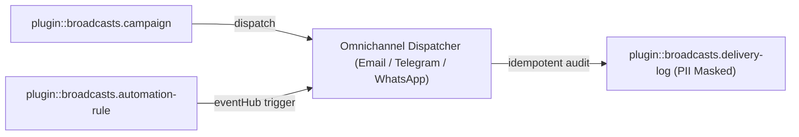
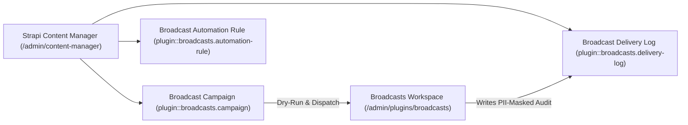
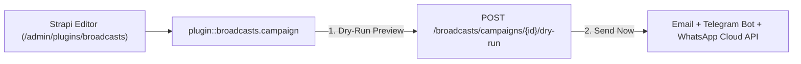
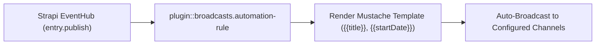
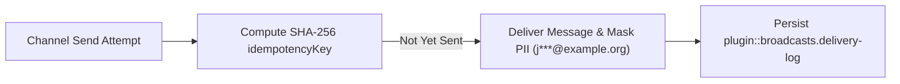

## 1. Instalación y Dependencias

```bash
pnpm add @vicacha-devs/strapi-plugin-broadcasts
```

## 2. Configuración del Servidor (`config/plugins.ts`)

Agregue la configuración del plugin en el archivo `config/plugins.ts` de su aplicación Strapi v5:

```ts
// config/plugins.ts
export default ({
  env,
}: {
  env: (key: string, defaultValue?: string) => string;
}) => ({
  broadcasts: {
    enabled: true,
    config: {
      defaultSenderName: env("BROADCASTS_SENDER_NAME", "Community Hub"),
      dryRun: false,
    },
  },
});
```


## 3. Recorrido por la Interfaz de Administración (Strapi v5 Admin UI)

Una vez habilitado, el plugin registra su espacio de trabajo y ajustes dentro del panel de administración de Strapi v5 utilizando Strapi Design System v2:


### Etiquetas Localizadas de la Interfaz (Español)

| Clave de Traducción                                       | Texto en Interfaz                                              |
| :-------------------------------------------------------- | :------------------------------------------------------------- |
| `checkbox.enable_dry_run_sandbox_mode`                    | Activar modo de simulación (Dry-Run)                           |
| `checkbox.enable_email_designer_5_html_template_bridge`   | Activar puente de plantillas HTML de Email Designer 5          |
| `checkbox.enable_eventhub_auto_broadcast_triggers`        | Activar disparadores automáticos de difusión por EventHub      |
| `checkbox.enable_telegram_transport`                      | Activar transporte de Telegram                                 |
| `checkbox.enable_whatsapp_transport`                      | Activar transporte de WhatsApp                                 |
| `checkbox.segment_confirmed_subscribers_via_inbox_bridge` | Segmentar suscriptores confirmados mediante el puente de Inbox |
| `common.activate`                                         | Activar                                                        |
| `common.active`                                           | activo                                                         |

## 4. Entidades Content-Type, Ubicación y Esquemas (`strapi.documents`)

Registers three Collection Types (`plugin::broadcasts.campaign`, `plugin::broadcasts.automation-rule`, `plugin::broadcasts.delivery-log`). Campaigns store multi-channel message payloads; Automation Rules subscribe to Strapi `eventHub` events (e.g., `entry.publish`); Delivery Logs store idempotent (`idempotencyKey`), PII-masked (`recipientMasked`) audit trails. Supports `schemaExtensions` in `config/plugins.ts`.



### Dónde Encontrar las Entidades Content-Type en Strapi v5

- **Content Manager**: `/admin/content-manager/collection-types/plugin::broadcasts.campaign`, `plugin::broadcasts.automation-rule`, and `plugin::broadcasts.delivery-log` (`visible: true`)
- **Content-Type Builder**: `/admin/plugins/content-type-builder` under **Collection Types**
- **Plugin Workspace & Settings**: `/admin/plugins/broadcasts` (Campaigns, Automation Rules, Delivery Audit) and `/admin/settings/broadcasts`
- **Database Tables**: `broadcast_campaigns`, `broadcast_automation_rules`, and `broadcast_delivery_logs`

### `plugin::broadcasts.automation-rule` — Broadcast Automation Rule

EventHub-driven automated multi-channel broadcast rule

> **Kind**: `collectionType` · **DB Table**: `broadcast_automation_rules` · **Admin Location**: `/admin/content-manager/collection-types/plugin::broadcasts.automation-rule` · **Draft & Publish**: `No` · **i18n**: `No`

| Atributo            | Tipo en Strapi | Requerido | Restricciones / Relación                               |
| :------------------ | :------------- | :-------- | :----------------------------------------------------- |
| `name`              | `string`       | Yes       | —                                                      |
| `slug`              | `uid`          | Yes       | —                                                      |
| `eventName`         | `string`       | Yes       | —                                                      |
| `targetContentType` | `string`       | No        | —                                                      |
| `topic`             | `string`       | Yes       | default: `"announcements"`                             |
| `channels`          | `json`         | Yes       | default: `["telegram"]`                                |
| `active`            | `boolean`      | No        | default: `true`                                        |
| `priority`          | `enumeration`  | No        | enum: `low, normal, high, urgent`; default: `"normal"` |
| `subjectTemplate`   | `string`       | Yes       | —                                                      |
| `bodyTextTemplate`  | `text`         | Yes       | —                                                      |
| `bodyHtmlTemplate`  | `richtext`     | No        | —                                                      |
| `ctaLabelTemplate`  | `string`       | No        | —                                                      |
| `ctaUrlTemplate`    | `string`       | No        | —                                                      |
| `translations`      | `json`         | No        | default: `{}`                                          |
| `lastTriggeredAt`   | `datetime`     | No        | —                                                      |
| `triggerCount`      | `integer`      | No        | default: `0`                                           |

### `plugin::broadcasts.campaign` — Broadcast Campaign

Omnichannel Email, Telegram & WhatsApp broadcast campaign

> **Kind**: `collectionType` · **DB Table**: `broadcast_campaigns` · **Admin Location**: `/admin/content-manager/collection-types/plugin::broadcasts.campaign` · **Draft & Publish**: `No` · **i18n**: `No`

| Atributo               | Tipo en Strapi | Requerido | Restricciones / Relación                                                       |
| :--------------------- | :------------- | :-------- | :----------------------------------------------------------------------------- |
| `title`                | `string`       | Yes       | —                                                                              |
| `slug`                 | `uid`          | Yes       | —                                                                              |
| `topic`                | `string`       | Yes       | default: `"announcements"`                                                     |
| `channels`             | `json`         | Yes       | default: `["email","telegram"]`                                                |
| `priority`             | `enumeration`  | Yes       | enum: `low, normal, high, urgent`; default: `"normal"`                         |
| `status`               | `enumeration`  | Yes       | enum: `draft, scheduled, sending, sent, failed, cancelled`; default: `"draft"` |
| `scheduledAt`          | `datetime`     | No        | —                                                                              |
| `sentAt`               | `datetime`     | No        | —                                                                              |
| `subject`              | `string`       | Yes       | —                                                                              |
| `bodyText`             | `text`         | Yes       | —                                                                              |
| `bodyHtml`             | `richtext`     | No        | —                                                                              |
| `ctaLabel`             | `string`       | No        | —                                                                              |
| `ctaUrl`               | `string`       | No        | —                                                                              |
| `mediaUrl`             | `string`       | No        | —                                                                              |
| `emailTemplateRef`     | `string`       | No        | —                                                                              |
| `whatsappTemplateName` | `string`       | No        | —                                                                              |
| `whatsappGroupIds`     | `json`         | No        | default: `[]`                                                                  |
| `telegramChatId`       | `string`       | No        | —                                                                              |
| `telegramThreadId`     | `integer`      | No        | —                                                                              |
| `translations`         | `json`         | No        | default: `{}`                                                                  |
| `secondaryDate`        | `json`         | No        | default: `{}`                                                                  |
| `secondaryDateLabel`   | `string`       | No        | —                                                                              |
| `stats`                | `json`         | No        | default: `{}`                                                                  |
| `metadata`             | `json`         | No        | default: `{}`                                                                  |

### `plugin::broadcasts.delivery-log` — Broadcast Delivery Log

Idempotent, PII-masked multi-channel delivery audit log

> **Kind**: `collectionType` · **DB Table**: `broadcast_delivery_logs` · **Admin Location**: `/admin/content-manager/collection-types/plugin::broadcasts.delivery-log` · **Draft & Publish**: `No` · **i18n**: `No`

| Atributo             | Tipo en Strapi | Requerido | Restricciones / Relación                           |
| :------------------- | :------------- | :-------- | :------------------------------------------------- |
| `idempotencyKey`     | `string`       | Yes       | —                                                  |
| `campaignSlug`       | `string`       | Yes       | —                                                  |
| `channel`            | `enumeration`  | Yes       | enum: `email, telegram, whatsapp`                  |
| `driver`             | `string`       | Yes       | —                                                  |
| `recipientMasked`    | `string`       | Yes       | —                                                  |
| `locale`             | `string`       | Yes       | default: `"es"`                                    |
| `status`             | `enumeration`  | Yes       | enum: `sent, simulated, skipped_duplicate, failed` |
| `externalMessageId`  | `string`       | No        | —                                                  |
| `errorMessage`       | `text`         | No        | —                                                  |
| `sentAt`             | `datetime`     | Yes       | —                                                  |
| `secondaryDateLabel` | `string`       | No        | —                                                  |

## Integración con el Content Manager de Strapi v5 (`/admin/content-manager`)

> **Grupo en la Barra Lateral del Content Manager**: `Inbox & Omnichannel Broadcasts`

### Entidades y Componentes en el Content Manager

- `plugin::broadcasts.campaign` (**Broadcast Campaign** — `/admin/content-manager/collection-types/plugin::broadcasts.campaign`)
- `plugin::broadcasts.automation-rule` (**Broadcast Automation Rule** — `/admin/content-manager/collection-types/plugin::broadcasts.automation-rule`)
- `plugin::broadcasts.delivery-log` (**Broadcast Delivery Log** — `/admin/content-manager/collection-types/plugin::broadcasts.delivery-log`)


### Por Qué Este Plugin Crea e Integra Entidades en el Content Manager

`@vicacha-devs/strapi-plugin-broadcasts` exposes all three of its entities (`Broadcast Campaign`, `Broadcast Automation Rule`, and `Broadcast Delivery Log`) in the Strapi v5 Content Manager so communication teams can author rich campaign payloads, audit PII-masked delivery logs, and govern access via native RBAC:

- **Structured Campaign Authoring & Review**: Draft `bodyHtml`, `bodyText`, `telegramParseMode`, `whatsappTemplateName`, and `ctaUrl` in Content Manager with collaborative `@vicacha-devs/strapi-plugin-notes` annotations before dispatching from `/admin/plugins/broadcasts`.
- **Declarative EventHub Rule Management**: Inspect and bulk-toggle `Broadcast Automation Rule` (`plugin::broadcasts.automation-rule`) triggers (`entry.publish`, `entry.create`) and Mustache templates (`{{title}}`, `{{slug}}`) in Content Manager.
- **Compliance & Delivery Log Auditing**: Filter `Broadcast Delivery Log` (`plugin::broadcasts.delivery-log`) by `channel`, `status` (`sent`, `failed`, `skipped_duplicate`), `idempotencyKey`, and `recipientMasked` using Content Manager's native search and pagination.
- **Role-Based Access Separation**: Grant copywriters Content Manager permission to draft `plugin::broadcasts.campaign` records while restricting actual live dispatch (`POST /broadcasts/campaigns/{id}/send`) to senior administrators.

### Cómo Usarlo en el Content Manager de Strapi (Paso a Paso)

1. **Open in Content Manager**: Navigate to **Content Manager -> Collection Types -> Inbox & Omnichannel Broadcasts** and select **Broadcast Campaign**, **Broadcast Automation Rule**, or **Broadcast Delivery Log**.
2. **Author & Schedule Campaigns**: In **Broadcast Campaign** (`/admin/content-manager/collection-types/plugin::broadcasts.campaign`), create an entry with `title`, `slug`, `topic`, `targetLocale`, `channels` (`['email', 'telegram', 'whatsapp']`), and channel-specific templates.
3. **Configure EventHub Automation Rules**: In **Broadcast Automation Rule** (`/admin/content-manager/collection-types/plugin::broadcasts.automation-rule`), bind `eventName` (`entry.publish`) and `targetContentType` (e.g., `plugin::events.event` or `plugin::islam.hilal-announcement`).
4. **Workspace vs. Content Manager**: Use **Content Manager** to draft campaign copy, attach review notes, and query `Broadcast Delivery Log` history; use the **Broadcasts Workspace** (`/admin/plugins/broadcasts`) to execute dry-run previews and trigger live omnichannel sends.

### Sincronización entre el Content Manager y el Espacio del Plugin



### Casos de Uso en el Content Manager y Flujos Editoriales

#### Content Manager Use Case 1 — Two-Stage Editorial Approval Before Omnichannel Dispatch

- **Para qué sirve y por qué usarlo**: Allow editors to prepare multilingual campaign copy and WhatsApp template variables in Content Manager while a reviewer leaves approval notes before sending.
- **Cómo ejecutarlo en el Content Manager**: Create a `Broadcast Campaign` with `status: 'draft'` in `/admin/content-manager/collection-types/plugin::broadcasts.campaign`, review it via the Content Manager **Notes** panel, and dispatch it from `/admin/plugins/broadcasts`.

#### Content Manager Use Case 2 — Filtering Failed or Skipped Delivery Logs by Channel & Campaign

- **Para qué sirve y por qué usarlo**: Investigate delivery failures or idempotent duplicate skips across Email, Telegram, and WhatsApp without exposing raw subscriber PII.
- **Cómo ejecutarlo en el Content Manager**: Open `/admin/content-manager/collection-types/plugin::broadcasts.delivery-log` and filter by `status = failed` or `channel = whatsapp` to inspect `errorMessage` and `recipientMasked`.

## 5. Casos de Uso y Flujos de Trabajo

### Use Case 1 — Omnichannel Manual & Scheduled Community Campaigns

- **What it is for**: Dispatch announcements simultaneously across Email (SMTP/Resend), Telegram Bot channels/threads, and WhatsApp Cloud API.
- **How it works**: Create a `plugin::broadcasts.campaign` entity with `channels: ['email', 'telegram', 'whatsapp']`, preview via `POST /broadcasts/campaigns/{id}/dry-run`, and dispatch via `POST /broadcasts/campaigns/{id}/send`.




### Use Case 2 — EventHub Zero-Touch Publish Automation

- **What it is for**: Automatically broadcast a Telegram/WhatsApp notification whenever an editor publishes a new Event, Hilal Announcement, or Urgent Campaign.
- **How it works**: Create a `plugin::broadcasts.automation-rule` entity matching `eventName: 'entry.publish'` and `targetContentType: 'plugin::events.event'` with Mustache-style `subjectTemplate` and `bodyTextTemplate`.




### Use Case 3 — Idempotent PII-Masked Delivery Auditing

- **What it is for**: Guarantee no subscriber receives duplicate messages on retry while keeping phone numbers and emails masked in database logs.
- **How it works**: Every dispatch computes a deterministic `idempotencyKey` recorded in `plugin::broadcasts.delivery-log` with `recipientMasked` (`j***@example.org`, `+57***4821`).




## 6. Endpoints REST API (`content-api` y `admin`)

| Método | Ruta del Endpoint                           | Ámbito        | Controlador                                | Autenticación |
| :----- | :------------------------------------------ | :------------ | :----------------------------------------- | :------------ |
| `GET`  | `/api/broadcasts/public/channels`           | `content-api` | `broadcastController.listPublicChannels`   | Public        |
| `GET`  | `/api/broadcasts/public/archive`            | `content-api` | `broadcastController.listPublicArchive`    | Public        |
| `GET`  | `/broadcasts/settings`                      | `admin`       | `broadcastController.getSettings`          | Bearer JWT    |
| `PUT`  | `/broadcasts/settings`                      | `admin`       | `broadcastController.updateSettings`       | Bearer JWT    |
| `GET`  | `/broadcasts/templates`                     | `admin`       | `broadcastController.listStarterTemplates` | Bearer JWT    |
| `GET`  | `/broadcasts/email-templates`               | `admin`       | `broadcastController.listEmailTemplates`   | Bearer JWT    |
| `GET`  | `/broadcasts/campaigns`                     | `admin`       | `broadcastController.listCampaigns`        | Bearer JWT    |
| `POST` | `/broadcasts/campaigns`                     | `admin`       | `broadcastController.createCampaign`       | Bearer JWT    |
| `PUT`  | `/broadcasts/campaigns/{documentId}`        | `admin`       | `broadcastController.updateCampaign`       | Bearer JWT    |
| `POST` | `/broadcasts/campaigns/from-template`       | `admin`       | `broadcastController.createFromTemplate`   | Bearer JWT    |
| `POST` | `/broadcasts/campaigns/{documentId}/send`   | `admin`       | `broadcastController.sendCampaign`         | Bearer JWT    |
| `GET`  | `/broadcasts/automation-rules`              | `admin`       | `broadcastController.listAutomationRules`  | Bearer JWT    |
| `POST` | `/broadcasts/automation-rules`              | `admin`       | `broadcastController.createAutomationRule` | Bearer JWT    |
| `PUT`  | `/broadcasts/automation-rules/{documentId}` | `admin`       | `broadcastController.updateAutomationRule` | Bearer JWT    |
| `GET`  | `/broadcasts/delivery-logs`                 | `admin`       | `broadcastController.listDeliveryLogs`     | Bearer JWT    |

## 7. Uso Programático en el Servidor (`strapi.plugin` y `strapi.documents`)

```ts
// Registered services on plugin "broadcasts": "settings", "transportService", "campaignService", "automationService"
const pluginService = strapi.plugin("broadcasts")?.service("transportService");

// Querying records via the Strapi v5 Document Service API
const records = await strapi
  .documents("plugin::broadcasts.automation-rule")
  .findMany({
    limit: 25,
    sort: "createdAt:desc",
  });
```

## 8. Solución de Problemas y Verificación

- **Cambios no visibles en el panel Admin**: Ejecute `pnpm strapi build` después de editar `config/plugins.ts`.
- **Aislamiento de dependencias peer**: Mantenga `hoistPattern: ["*", "!@strapi/*"]` en `pnpm-workspace.yaml` para evitar colisiones de contexto en React.
- **Verificación estricta de TypeScript**: Ejecute `pnpm check` para validar `admin/tsconfig.json` y `server/tsconfig.json`.
