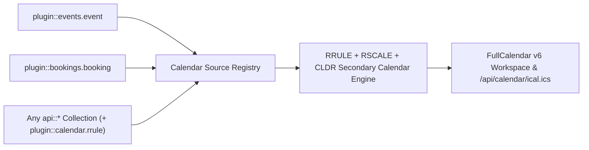
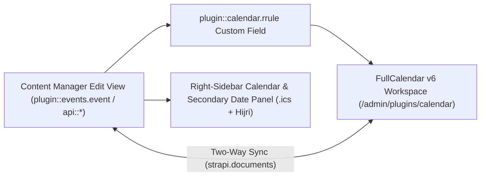
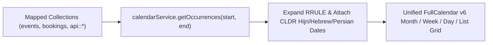
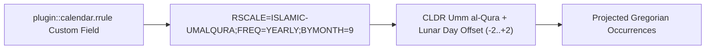
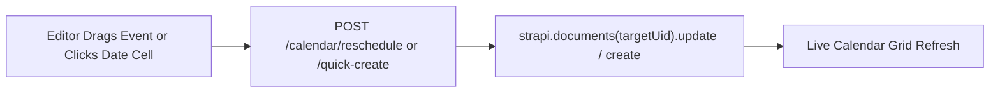
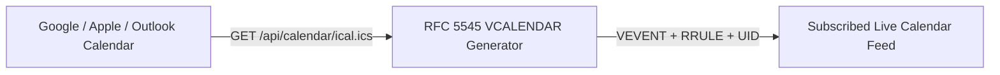

## 1. Instalación y Dependencias

```bash
pnpm add @vicacha-devs/strapi-plugin-calendar
```

## 2. Configuración del Servidor (`config/plugins.ts`)

Agregue la configuración del plugin en el archivo `config/plugins.ts` de su aplicación Strapi v5:

```ts
// config/plugins.ts
export default ({
  env,
}: {
  env: (key: string, defaultValue?: string) => string;
}) => ({
  calendar: {
    enabled: true,
    config: {
      defaultView: "dayGridMonth",
      defaultTimezone: env("CALENDAR_DEFAULT_TIMEZONE", "UTC"),
    },
  },
});
```


## 3. Recorrido por la Interfaz de Administración (Strapi v5 Admin UI)

Una vez habilitado, el plugin registra su espacio de trabajo y ajustes dentro del panel de administración de Strapi v5 utilizando Strapi Design System v2:


### Etiquetas Localizadas de la Interfaz (Español)

| Clave de Traducción                    | Texto en Interfaz                                                                         |
| :------------------------------------- | :---------------------------------------------------------------------------------------- |
| `settings.theme.breeze.label`          | Brisa (Cielo y Pizarra — Predeterminado)                                                  |
| `settings.theme.breeze.description`    | Cuadrícula azul cielo y pizarra de alto contraste con insignias Hijri en ámbar cálido     |
| `settings.theme.emerald.label`         | Mezquita Esmeralda (Verde Azulado y Oro)                                                  |
| `settings.theme.emerald.description`   | Encabezados verde esmeralda islámico con resaltados dorados para el calendario secundario |
| `settings.theme.sandstone.label`       | Arenisca Andalusí (Tierra Cálida)                                                         |
| `settings.theme.sandstone.description` | Tonos cálidos de terracota y pergamino inspirados en los patios andalusíes                |
| `settings.theme.midnight.label`        | Observatorio de Medianoche (Pizarra Oscura)                                               |
| `settings.theme.midnight.description`  | Lienzo oscuro en pizarra profunda con acentos luminosos en cian y dorado                  |

## 4. Entidades Content-Type, Ubicación y Esquemas (`strapi.documents`)

Acts as a multi-collection scheduler engine that binds to **any** Strapi Content-Type entity (`api::*` or `plugin::*`) configured in `collections[]` or registered dynamically via `calendar.service('registry').registerSource()`. Also registers the `plugin::calendar.rrule` Custom Field (`json`) for RFC 5545 `RRULE` + RFC 7529 `RSCALE` recurrence rules.



### Dónde Encontrar las Entidades Content-Type en Strapi v5

- **Bound Content-Type Entities**: Any Content Manager collection mapped in `/admin/settings/calendar` (e.g., `plugin::events.event`, `plugin::bookings.booking`, `api::article.article`)
- **Custom Field in Content-Type Builder**: Add the `plugin::calendar.rrule` custom field to any collection type in `/admin/plugins/content-type-builder`
- **Plugin Workspace & Settings**: `/admin/plugins/calendar` (FullCalendar v6 Month/Week/Day/Agenda workspace) and `/admin/settings/calendar` (General, Prayer & Islamic, Bookings & Availability tabs)

Este plugin opera dinámicamente sobre las entidades Content-Type existentes de Strapi (`api::*` y `plugin::*`).

## Integración con el Content Manager de Strapi v5 (`/admin/content-manager`)

> **Grupo en la Barra Lateral del Content Manager**: `Events, Scheduling & Bookings`

### Entidades y Componentes en el Content Manager

- Custom Field `plugin::calendar.rrule` (**RFC 5545 RRULE + RFC 7529 RSCALE Recurrence Field** inside any Content Manager edit view)
- Bound Content Manager Collections (`plugin::events.event`, `plugin::bookings.booking`, and any configured `api::*` collection)


### Por Qué Este Plugin Crea e Integra Entidades en el Content Manager

Instead of locking schedules inside an isolated table, `@vicacha-devs/strapi-plugin-calendar` embeds directly into the **Strapi v5 Content Manager** edit view of any mapped collection (`plugin::events.event`, `plugin::bookings.booking`, or custom `api::*` entities) via its `plugin::calendar.rrule` Custom Field and right-sidebar **Calendar & Schedule** widget:

- **In-Place Secondary Calendar Preview in Content Manager**: When editing an event in Content Manager, the right-sidebar **Calendar & Schedule** panel automatically computes and displays the corresponding Hijri (Umm al-Qura), Hebrew, or Persian date (`4 Jumada I 1448 AH`) plus 1-click `.ics` download and **Open in Calendar View** buttons.
- **Visual RFC 5545 `RRULE` + RFC 7529 `RSCALE` Authoring**: The `plugin::calendar.rrule` custom field lets editors configure Gregorian or lunar recurrence rules directly inside any Content Manager form.
- **Zero Data Duplication**: Dragging an event in `/admin/plugins/calendar` or editing start/end dates in `/admin/content-manager/collection-types/plugin::events.event` mutates the exact same Strapi v5 Document Service record.

### Cómo Usarlo en el Content Manager de Strapi (Paso a Paso)

1. **Open a Bound Collection in Content Manager**: Navigate to **Content Manager -> Collection Types -> Events, Scheduling & Bookings -> Event** (`/admin/content-manager/collection-types/plugin::events.event?plugins[i18n][locale]=en`) and open any entry.
2. **Configure Start/End Dates & Recurrence**: Edit `startDate`, `endDate`, `allDay`, `timezone`, and the `rrule` custom field directly inside the Content Manager form.
3. **Use the Right-Sidebar Calendar Panel**: In the right column of the Content Manager edit view, inspect the live **Alternative Calendar Dates** badge, click **Download .ics Invite**, or click **Open in Calendar View** to jump to `/admin/plugins/calendar`.
4. **Bind Additional Content Manager Collections**: In `/admin/settings/calendar`, map any `api::*` collection's `titleField`, `startField`, `endField`, and `rruleField` to project its Content Manager entries onto the unified calendar grid.

### Sincronización entre el Content Manager y el Espacio del Plugin



### Casos de Uso en el Content Manager y Flujos Editoriales

#### Content Manager Use Case 1 — Authoring a Localized Recurring Course with Live Hijri Date Preview

- **Para qué sirve y por qué usarlo**: Edit a weekly Arabic course (`Classical Arabic Course`) in Content Manager while verifying its Umm al-Qura Hijri date and downloading its `.ics` invite from the right sidebar.
- **Cómo ejecutarlo en el Content Manager**: Open `/admin/content-manager/collection-types/plugin::events.event/{documentId}?plugins[i18n][locale]=en`, set `startDate` and `rrule`, and verify the **Calendar & Schedule** panel on the right.

## 5. Casos de Uso y Flujos de Trabajo

### Use Case 1 — Aggregating Multiple Strapi Collections into One Calendar

- **What it is for**: Display Events, Bookings, Courses, and Editorial Deadlines from different Content-Type entities on a single color-coded FullCalendar grid.
- **How it works**: Map each collection's `uid`, `titleField`, `startField`, `endField`, and `rruleField` in `/admin/settings/calendar` or `config/plugins.ts`, then query `GET /api/calendar/occurrences?start=...&end=...`.




### Use Case 2 — Sacred & Lunar Recurrence (`RRULE` + `RSCALE=ISLAMIC-UMALQURA`)

- **What it is for**: Schedule annual or monthly recurring events that follow the Hijri, Hebrew, or Persian calendar and automatically project onto Gregorian dates.
- **How it works**: Attach `plugin::calendar.rrule` to your Content-Type entity to author RFC 7529 rules (`RSCALE=ISLAMIC-UMALQURA;FREQ=YEARLY;BYMONTH=9;BYMONTHDAY=1`).




### Use Case 3 — Drag-and-Drop Rescheduling & Quick-Create into Target Entities

- **What it is for**: Let editors drag an event on the calendar grid or click a date cell to create/update the underlying Strapi document directly.
- **How it works**: Uses `POST /calendar/quick-create` and `POST /calendar/reschedule` to mutate the mapped `strapi.documents(uid)` record in place.




### Use Case 4 — Public RFC 5545 iCal (`.ics`) Subscription Feeds

- **What it is for**: Allow users to subscribe to live calendar feeds in Google Calendar, Apple Calendar, or Outlook.
- **How it works**: Subscribe to `GET /api/calendar/ical.ics` (all sources) or `GET /api/calendar/ical/{collectionId}.ics` (single source).



## 6. Endpoints REST API (`content-api` y `admin`)

| Método | Ruta del Endpoint                       | Ámbito        | Controlador                    | Autenticación |
| :----- | :-------------------------------------- | :------------ | :----------------------------- | :------------ |
| `GET`  | `/calendar/calendar`                    | `admin`       | `admin.getCalendar`            | Bearer JWT    |
| `POST` | `/calendar/calendar/reschedule`         | `admin`       | `admin.reschedule`             | Bearer JWT    |
| `POST` | `/calendar/calendar/quick-create`       | `admin`       | `admin.quickCreate`            | Bearer JWT    |
| `GET`  | `/calendar/content-types`               | `admin`       | `admin.getContentTypes`        | Bearer JWT    |
| `GET`  | `/calendar/settings`                    | `admin`       | `admin.getSettings`            | Bearer JWT    |
| `PUT`  | `/calendar/settings`                    | `admin`       | `admin.updateSettings`         | Bearer JWT    |
| `POST` | `/calendar/clear-settings`              | `admin`       | `admin.clearSettings`          | Bearer JWT    |
| `GET`  | `/api/calendar/occurrences`             | `content-api` | `content-api.getOccurrences`   | Bearer JWT    |
| `GET`  | `/api/calendar/feed.ics`                | `content-api` | `content-api.downloadFeedIcs`  | Bearer JWT    |
| `GET`  | `/api/calendar/{documentId}/invite.ics` | `content-api` | `content-api.downloadEventIcs` | Bearer JWT    |

## 7. Uso Programático en el Servidor (`strapi.plugin` y `strapi.documents`)

```ts
// Registered services on plugin "calendar": "settings", "registry", "occurrence", "ical"
const pluginService = strapi.plugin("calendar")?.service("registry");

// Retrieving plugin settings via Strapi plugin store
const store = strapi.store({ type: "plugin", name: "calendar" });
const settings = await store.get({ key: "settings" });
```

## 8. Solución de Problemas y Verificación

- **Cambios no visibles en el panel Admin**: Ejecute `pnpm strapi build` después de editar `config/plugins.ts`.
- **Aislamiento de dependencias peer**: Mantenga `hoistPattern: ["*", "!@strapi/*"]` en `pnpm-workspace.yaml` para evitar colisiones de contexto en React.
- **Verificación estricta de TypeScript**: Ejecute `pnpm check` para validar `admin/tsconfig.json` y `server/tsconfig.json`.
