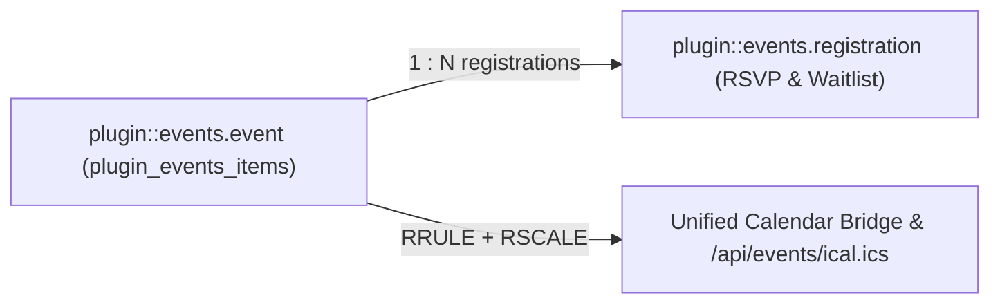
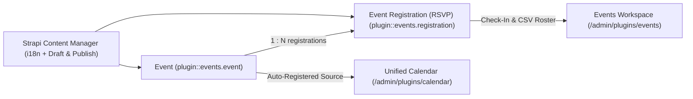
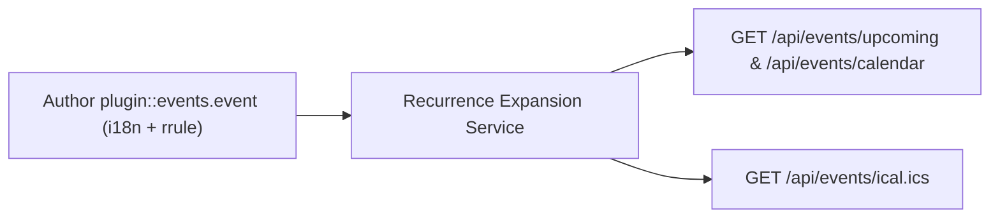
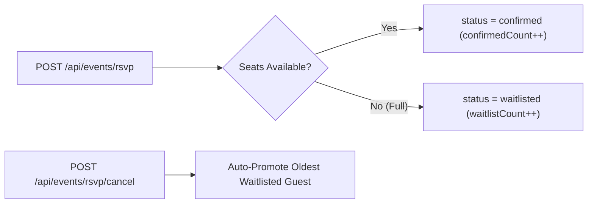
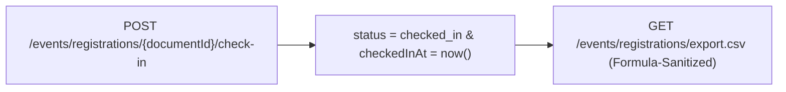

> **Package**: `@vicacha-devs/strapi-plugin-events` · **Plugin ID**: `events` · **Category**: `Scheduling & Operations` · **Version**: `1.0.0` · **Routes**: `17`

Gestión de eventos, control de cupos, promoción automática desde lista de espera, check-in en 1 clic, exportación CSV segura e integración con el Calendario unificado.

```bash
pnpm add @vicacha-devs/strapi-plugin-events
```


## 1. Características Principales y Arquitectura

- [Explorar Entidades Content-Type y Casos de Uso (con Diagramas Interactivos)](/es/strapi-plugin-events/use-cases/)
- [Explorar la Guía de Desarrollo y Admin UI](/es/strapi-plugin-events/guide/)
- [Explorar la Referencia Interactiva OpenAPI](/strapi-plugin-events/api/)

## 2. Entidades Content-Type, Ubicación y Esquemas (`strapi.documents`)

Registers two Collection Types (`plugin::events.event` with `draftAndPublish: true` & `i18n.localized: true`, and `plugin::events.registration`) plus the `plugin::events.rrule` Custom Field. Also supports binding additional custom `api::*` event collections via `sources[]` and extending schemas via `schemaExtensions` in `config/plugins.ts`.



### Dónde Encontrar las Entidades Content-Type en Strapi v5

- **Content Manager**: `/admin/content-manager/collection-types/plugin::events.event` & `/admin/content-manager/collection-types/plugin::events.registration` (`visible: true`)
- **Content-Type Builder**: `/admin/plugins/content-type-builder` under **Collection Types** (`Event` & `Event Registration (RSVP)`) + Custom Field `plugin::events.rrule`
- **Plugin Workspace & Settings**: `/admin/plugins/events` (Events Manager, RSVP Roster, Waitlist, Check-In) and `/admin/settings/events`
- **Database Tables**: `plugin_events_items` and `plugin_events_registrations`

### `plugin::events.event` — Event

Recurring & single events managed by strapi-plugin-events

> **Kind**: `collectionType` · **DB Table**: `plugin_events_items` · **Admin Location**: `/admin/content-manager/collection-types/plugin::events.event` · **Draft & Publish**: `Yes` · **i18n**: `Yes`

| Atributo                   | Tipo en Strapi | Requerido | Restricciones / Relación                                                     |
| :------------------------- | :------------- | :-------- | :--------------------------------------------------------------------------- |
| `title`                    | `string`       | Yes       | max: 200                                                                     |
| `slug`                     | `uid`          | Yes       | —                                                                            |
| `summary`                  | `text`         | No        | max: 500                                                                     |
| `description`              | `richtext`     | No        | —                                                                            |
| `startDate`                | `datetime`     | Yes       | —                                                                            |
| `endDate`                  | `datetime`     | No        | —                                                                            |
| `allDay`                   | `boolean`      | No        | default: `false`                                                             |
| `timezone`                 | `string`       | No        | default: `"UTC"`                                                             |
| `recurrence`               | `customField`  | No        | customField: `plugin::events.rrule`                                          |
| `eventStatus`              | `enumeration`  | Yes       | enum: `scheduled, cancelled, postponed, rescheduled`; default: `"scheduled"` |
| `locationType`             | `enumeration`  | No        | enum: `in_person, online, hybrid`; default: `"in_person"`                    |
| `location`                 | `string`       | No        | —                                                                            |
| `virtualUrl`               | `string`       | No        | —                                                                            |
| `category`                 | `string`       | No        | default: `"general"`                                                         |
| `speaker`                  | `string`       | No        | —                                                                            |
| `speakerSlug`              | `string`       | No        | —                                                                            |
| `color`                    | `string`       | No        | default: `"#0D9488"`                                                         |
| `featured`                 | `boolean`      | No        | default: `false`                                                             |
| `rsvpEnabled`              | `boolean`      | No        | default: `false`                                                             |
| `capacity`                 | `integer`      | No        | —                                                                            |
| `waitlistEnabled`          | `boolean`      | No        | default: `true`                                                              |
| `maxGuestsPerRegistration` | `integer`      | No        | default: `5`                                                                 |
| `registrationDeadline`     | `datetime`     | No        | —                                                                            |
| `alternateDates`           | `json`         | No        | —                                                                            |
| `poster`                   | `media`        | No        | —                                                                            |
| `actionLinks`              | `json`         | No        | —                                                                            |
| `spotlightConfig`          | `json`         | No        | —                                                                            |
| `metadata`                 | `json`         | No        | —                                                                            |

### `plugin::events.registration` — Event Registration (RSVP)

Attendee RSVPs, waitlists, and check-ins managed by strapi-plugin-events

> **Kind**: `collectionType` · **DB Table**: `plugin_events_registrations` · **Admin Location**: `/admin/content-manager/collection-types/plugin::events.registration` · **Draft & Publish**: `No` · **i18n**: `No`

| Atributo          | Tipo en Strapi | Requerido | Restricciones / Relación                                                     |
| :---------------- | :------------- | :-------- | :--------------------------------------------------------------------------- |
| `eventUid`        | `string`       | Yes       | default: `"plugin::events.event"`                                            |
| `eventDocumentId` | `string`       | Yes       | —                                                                            |
| `eventTitle`      | `string`       | No        | —                                                                            |
| `occurrenceDate`  | `string`       | Yes       | —                                                                            |
| `attendeeName`    | `string`       | Yes       | max: 160                                                                     |
| `attendeeEmail`   | `email`        | Yes       | —                                                                            |
| `attendeePhone`   | `string`       | No        | max: 50                                                                      |
| `guestsCount`     | `integer`      | Yes       | default: `1`                                                                 |
| `status`          | `enumeration`  | Yes       | enum: `confirmed, waitlisted, cancelled, checked_in`; default: `"confirmed"` |
| `checkInToken`    | `string`       | No        | `private: true`                                                              |
| `checkedInAt`     | `datetime`     | No        | —                                                                            |
| `locale`          | `string`       | No        | default: `"es"`                                                              |
| `notes`           | `text`         | No        | max: 2000                                                                    |
| `metadata`        | `json`         | No        | —                                                                            |

## Integración con el Content Manager de Strapi v5 (`/admin/content-manager`)

> **Grupo en la Barra Lateral del Content Manager**: `Events, Scheduling & Bookings`

### Entidades y Componentes en el Content Manager

- `plugin::events.event` (**Event** — `/admin/content-manager/collection-types/plugin::events.event`)
- `plugin::events.registration` (**Event Registration (RSVP)** — `/admin/content-manager/collection-types/plugin::events.registration`)
- Custom Field `plugin::events.rrule`


### Por Qué Este Plugin Crea e Integra Entidades en el Content Manager

`@vicacha-devs/strapi-plugin-events` registers **Event** (`plugin::events.event`, with `i18n.localized: true` and `draftAndPublish: true`) and **Event Registration (RSVP)** (`plugin::events.registration`) as primary Content Manager collection types so editorial teams can author rich multilingual event pages while operations staff manage RSVPs and check-ins:

- **Rich Editorial & Speaker Relations**: In Content Manager, `Event` records support rich-text descriptions, poster images, speaker relations (e.g., linking `Staff, Scholar & Author` `api::leader.leader`), virtual meeting URLs, and `plugin::events.rrule` recurrence rules.
- **Multilingual (`i18n`) Event Publishing**: Author event pages across `en`, `es`, `ar`, and `tr` (`?plugins[i18n][locale]=en`) with independent draft/publish control per locale.
- **Injected Right-Sidebar Widgets**: Opening an `Event` in Content Manager displays both the **Calendar & Schedule** widget (Hijri date + `.ics` export) and the **Event & RSVP Summary** panel alongside **Editorial Notes**.
- **Direct RSVP Roster Inspection**: Inspect, filter, and search individual `Event Registration (RSVP)` records (`confirmed`, `waitlisted`, `checked_in`, `cancelled`) directly in Content Manager.

### Cómo Usarlo en el Content Manager de Strapi (Paso a Paso)

1. **Open in Content Manager**: In the left sidebar, click **Content Manager -> Collection Types -> Events, Scheduling & Bookings** and select **Event** (`/admin/content-manager/collection-types/plugin::events.event?plugins[i18n][locale]=en`) or **Event Registration (RSVP)** (`/admin/content-manager/collection-types/plugin::events.registration`).
2. **Author & Localize Events**: Click **+ Create new entry** in **Event**, fill in `title`, `slug`, `summary`, `description`, `startDate`, `endDate`, `rrule`, `capacity`, and `waitlistEnabled`, then click **Publish**.
3. **Inspect RSVP Registrations**: Open **Event Registration (RSVP)** in Content Manager to filter attendees by `status`, `occurrenceDate`, `attendeeEmail`, or linked `event`.
4. **Workspace vs. Content Manager**: Use **Content Manager** for rich multilingual event authoring, poster uploads, and speaker relations; use the **Events Workspace** (`/admin/plugins/events`) for 1-click door check-in, waitlist promotion, and formula-sanitized CSV exports.

### Sincronización entre el Content Manager y el Espacio del Plugin



### Casos de Uso en el Content Manager y Flujos Editoriales

#### Content Manager Use Case 1 — Authoring Multilingual Recurring Classes & Community Dinners

- **Para qué sirve y por qué usarlo**: Create and translate recurring educational classes (`Classical Arabic Course`), youth circles (`Weekly Youth Circle`), and scholarship announcements (`Türkiye Bursları Scholarship Orientation`) in Content Manager.
- **Cómo ejecutarlo en el Content Manager**: Open `/admin/content-manager/collection-types/plugin::events.event?plugins[i18n][locale]=en`, edit the event attributes and `rrule` recurrence, verify the Hijri date in the right sidebar, and publish across locales.

#### Content Manager Use Case 2 — Filtering Waitlisted or Checked-In Attendees Across Occurrences

- **Para qué sirve y por qué usarlo**: Search attendee registrations by email, occurrence date, or dietary/accessibility notes inside Content Manager.
- **Cómo ejecutarlo en el Content Manager**: Open `/admin/content-manager/collection-types/plugin::events.registration` and filter by `status = waitlisted` or `status = checked_in`.

## 3. Casos de Uso y Flujos de Trabajo

### Use Case 1 — Multilingual Recurring Events with Poster & Speaker Metadata

- **What it is for**: Publish localized single or recurring lectures, workshops, and community gatherings with speaker profiles and virtual/hybrid links.
- **How it works**: Author records in `plugin::events.event` (using `plugin::events.rrule` for recurrence) and query expanded occurrences via `GET /api/events/upcoming` or `GET /api/events/calendar`.




### Use Case 2 — Capacity-Controlled Public RSVP & Automatic Waitlist Promotion

- **What it is for**: Enforce seat limits (`capacity`, `maxGuestsPerRegistration`) per occurrence date and automatically promote waitlisted guests when someone cancels.
- **How it works**: Visitors submit `POST /api/events/rsvp` (creating `plugin::events.registration` as `confirmed` or `waitlisted`); `POST /api/events/rsvp/cancel` cancels a seat and promotes the oldest waitlisted record.




### Use Case 3 — 1-Click Door Check-In & Formula-Injection-Safe CSV Roster Export

- **What it is for**: Check in attendees at the venue entrance and export clean attendee rosters for spreadsheets.
- **How it works**: Use `POST /events/registrations/{documentId}/check-in` in `/admin/plugins/events` and download rosters via `GET /events/registrations/export.csv`.




## 4. Endpoints REST API (`content-api` y `admin`)

| Método | Ruta del Endpoint                             | Ámbito  | Controlador                      | Autenticación |
| :----- | :-------------------------------------------- | :------ | :------------------------------- | :------------ |
| `GET`  | `/events/settings`                            | `admin` | `admin.getSettings`              | Bearer JWT    |
| `PUT`  | `/events/settings`                            | `admin` | `admin.updateSettings`           | Bearer JWT    |
| `GET`  | `/events/calendar`                            | `admin` | `admin.getCalendar`              | Bearer JWT    |
| `POST` | `/events/calendar/reschedule`                 | `admin` | `admin.reschedule`               | Bearer JWT    |
| `POST` | `/events/calendar/quick-create`               | `admin` | `admin.quickCreate`              | Bearer JWT    |
| `GET`  | `/events/stats/{documentId}`                  | `admin` | `admin.getEventStats`            | Bearer JWT    |
| `GET`  | `/events/registrations`                       | `admin` | `admin.listRegistrations`        | Bearer JWT    |
| `GET`  | `/events/registrations/export.csv`            | `admin` | `admin.exportRegistrationsCsv`   | Bearer JWT    |
| `POST` | `/events/registrations/{documentId}/status`   | `admin` | `admin.updateRegistrationStatus` | Bearer JWT    |
| `POST` | `/events/registrations/{documentId}/check-in` | `admin` | `admin.checkIn`                  | Bearer JWT    |
