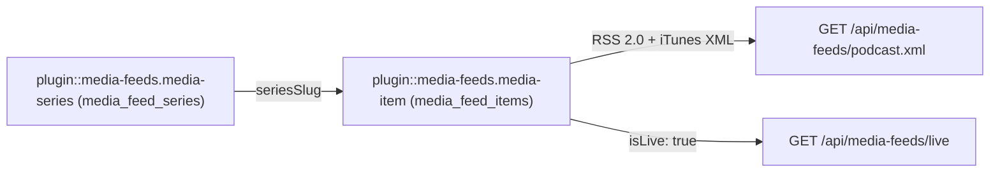
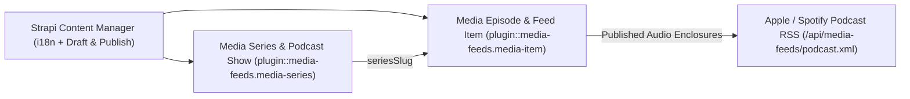
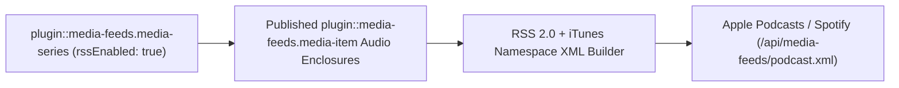
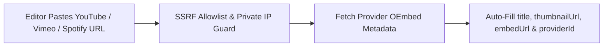
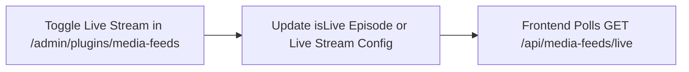

## 1. Instalación y Dependencias

```bash
pnpm add @vicacha-devs/strapi-plugin-media-feeds
```

## 2. Configuración del Servidor (`config/plugins.ts`)

Agregue la configuración del plugin en el archivo `config/plugins.ts` de su aplicación Strapi v5:

```ts
// config/plugins.ts
export default ({
  env,
}: {
  env: (key: string, defaultValue?: string) => string;
}) => ({
  "media-feeds": {
    enabled: true,
    config: {
      podcastTitle: env("PODCAST_TITLE", "Community Lectures"),
      podcastLanguage: "es",
    },
  },
});
```


## 3. Recorrido por la Interfaz de Administración (Strapi v5 Admin UI)

Una vez habilitado, el plugin registra su espacio de trabajo y ajustes dentro del panel de administración de Strapi v5 utilizando Strapi Design System v2:


### Etiquetas Localizadas de la Interfaz (Español)

| Clave de Traducción          | Texto en Interfaz                            |
| :--------------------------- | :------------------------------------------- |
| `common.disabled`            | Deshabilitado                                |
| `common.enabled`             | Habilitado                                   |
| `common.remove`              | Eliminar                                     |
| `field.author_organization`  | Autor / Organización                         |
| `field.default_locale`       | Predeterminado Idioma                        |
| `field.live_broadcast_title` | En vivo Transmisión Título                   |
| `field.live_event_slug`      | Slug del Evento Vinculado (Opcional)         |
| `field.live_schedule_label`  | Horario / Etiqueta de Ventana de Transmisión |

## 4. Entidades Content-Type, Ubicación y Esquemas (`strapi.documents`)

Registers two localized, draft-and-publish Collection Types (`plugin::media-feeds.media-item` and `plugin::media-feeds.media-series`). Media Series group episodes into podcast shows or video playlists; Media Items store multi-language audio/video episodes, OEmbed metadata, audio enclosures, transcripts, and chapter markers. Supports `schemaExtensions` in `config/plugins.ts`.



### Dónde Encontrar las Entidades Content-Type en Strapi v5

- **Content Manager**: `/admin/content-manager/collection-types/plugin::media-feeds.media-item` & `/admin/content-manager/collection-types/plugin::media-feeds.media-series` (`visible: true`)
- **Content-Type Builder**: `/admin/plugins/content-type-builder` under **Collection Types** (`Media Episode & Feed Item` & `Media Series & Podcast Show`)
- **Plugin Workspace & Settings**: `/admin/plugins/media-feeds` (Episode Hub, Series, OEmbed Enricher, Live Stream Control) and `/admin/settings/media-feeds`
- **Database Tables**: `media_feed_items` and `media_feed_series`

### `plugin::media-feeds.media-item` — Media Episode & Feed Item

Generic multi-language video, podcast, audio lecture, YouTube item, or live broadcast

> **Kind**: `collectionType` · **DB Table**: `media_feed_items` · **Admin Location**: `/admin/content-manager/collection-types/plugin::media-feeds.media-item` · **Draft & Publish**: `Yes` · **i18n**: `Yes`

| Atributo           | Tipo en Strapi | Requerido | Restricciones / Relación                                                                          |
| :----------------- | :------------- | :-------- | :------------------------------------------------------------------------------------------------ |
| `title`            | `string`       | Yes       | —                                                                                                 |
| `slug`             | `uid`          | Yes       | —                                                                                                 |
| `description`      | `text`         | Yes       | —                                                                                                 |
| `transcript`       | `richtext`     | No        | —                                                                                                 |
| `type`             | `string`       | Yes       | default: `"video"`                                                                                |
| `provider`         | `enumeration`  | No        | enum: `youtube, spotify, apple_podcasts, vimeo, soundcloud, direct, upload`; default: `"youtube"` |
| `externalId`       | `string`       | No        | —                                                                                                 |
| `sourceUrl`        | `string`       | No        | —                                                                                                 |
| `embedUrl`         | `string`       | No        | —                                                                                                 |
| `speaker`          | `string`       | No        | —                                                                                                 |
| `speakerSlug`      | `string`       | No        | —                                                                                                 |
| `seriesSlug`       | `string`       | No        | —                                                                                                 |
| `duration`         | `string`       | No        | —                                                                                                 |
| `publishedAtLabel` | `string`       | No        | —                                                                                                 |
| `imageUrl`         | `string`       | No        | —                                                                                                 |
| `imageAlt`         | `string`       | No        | —                                                                                                 |
| `thumbnail`        | `media`        | No        | —                                                                                                 |
| `audioFile`        | `media`        | No        | —                                                                                                 |
| `transcriptFile`   | `media`        | No        | —                                                                                                 |
| `spokenLanguages`  | `json`         | No        | default: `["es"]`                                                                                 |
| `languageTracks`   | `json`         | No        | default: `[]`                                                                                     |
| `chapters`         | `json`         | No        | default: `[]`                                                                                     |
| `featured`         | `boolean`      | No        | default: `false`                                                                                  |
| `isLive`           | `boolean`      | No        | default: `false`                                                                                  |

### `plugin::media-feeds.media-series` — Media Series & Podcast Show

Generic multi-language podcast show, video playlist, or lecture series

> **Kind**: `collectionType` · **DB Table**: `media_feed_series` · **Admin Location**: `/admin/content-manager/collection-types/plugin::media-feeds.media-series` · **Draft & Publish**: `Yes` · **i18n**: `Yes`

| Atributo            | Tipo en Strapi | Requerido | Restricciones / Relación         |
| :------------------ | :------------- | :-------- | :------------------------------- |
| `title`             | `string`       | Yes       | —                                |
| `slug`              | `uid`          | Yes       | —                                |
| `description`       | `text`         | Yes       | —                                |
| `author`            | `string`       | No        | —                                |
| `coverImageUrl`     | `string`       | No        | —                                |
| `category`          | `string`       | No        | default: `"Education"`           |
| `defaultType`       | `string`       | No        | default: `"podcast"`             |
| `spokenLanguages`   | `json`         | No        | default: `["es","en","ar","tr"]` |
| `rssEnabled`        | `boolean`      | No        | default: `true`                  |
| `youtubePlaylistId` | `string`       | No        | —                                |
| `spotifyShowUrl`    | `string`       | No        | —                                |
| `applePodcastsUrl`  | `string`       | No        | —                                |
| `active`            | `boolean`      | No        | default: `true`                  |

## Integración con el Content Manager de Strapi v5 (`/admin/content-manager`)

> **Grupo en la Barra Lateral del Content Manager**: `Media, Resources & Library`

### Entidades y Componentes en el Content Manager

- `plugin::media-feeds.media-item` (**Media Episode & Feed Item** — `/admin/content-manager/collection-types/plugin::media-feeds.media-item`)
- `plugin::media-feeds.media-series` (**Media Series & Podcast Show** — `/admin/content-manager/collection-types/plugin::media-feeds.media-series`)


### Por Qué Este Plugin Crea e Integra Entidades en el Content Manager

`@vicacha-devs/strapi-plugin-media-feeds` registers **Media Episode & Feed Item** (`plugin::media-feeds.media-item`) and **Media Series & Podcast Show** (`plugin::media-feeds.media-series`) with `i18n.localized: true`, `draftAndPublish: true`, and `content-manager.visible: true` so media producers can manage multilingual episodes, transcripts, and speaker relations in Content Manager:

- **Multilingual (`i18n`) Episode & Podcast Show Publishing**: Localize episode titles, summaries, full transcripts, and chapter markers across `en`, `es`, `ar`, and `tr` (`?plugins[i18n][locale]=en`).
- **Relational Speaker & Series Linking**: Link episodes in Content Manager to `Staff, Scholar & Author` (`api::leader.leader`) profiles via `schemaExtensions` and group them under `Media Series & Podcast Show` (`seriesSlug`).
- **Draft Staging Before Podcast RSS Syndication**: Only `Published` `plugin::media-feeds.media-item` records are emitted in `/api/media-feeds/podcast.xml`, allowing producers to stage upcoming episodes in `Draft` status inside Content Manager.

### Cómo Usarlo en el Content Manager de Strapi (Paso a Paso)

1. **Open in Content Manager**: In the left sidebar, click **Content Manager -> Collection Types -> Media, Resources & Library** and select **Media Episode & Feed Item** (`/admin/content-manager/collection-types/plugin::media-feeds.media-item?plugins[i18n][locale]=en`) or **Media Series & Podcast Show** (`/admin/content-manager/collection-types/plugin::media-feeds.media-series`).
2. **Create Podcast Shows & Video Series**: In **Media Series & Podcast Show**, define `title`, `slug`, `author`, `coverUrl`, `itunesCategory`, and `rssEnabled`.
3. **Publish Multilingual Episodes**: In **Media Episode & Feed Item**, populate `title`, `slug`, `mediaType` (`video`, `audio`, `podcast`, `khutbah`, `live`), `sourceUrl`, `audioEnclosureUrl`, `durationSeconds`, and `transcript`, then click **Publish**.
4. **Workspace vs. Content Manager**: Use **Content Manager** for multilingual transcript authoring, draft staging, and speaker relations; use the **Media Feeds Workspace** (`/admin/plugins/media-feeds`) for 1-click SSRF-safe YouTube/Vimeo OEmbed enrichment and live stream banner toggling.

### Sincronización entre el Content Manager y el Espacio del Plugin



### Casos de Uso en el Content Manager y Flujos Editoriales

#### Content Manager Use Case 1 — Staging & Translating Friday Khutbahs and Podcast Episodes

- **Para qué sirve y por qué usarlo**: Author English, Spanish, and Arabic episode descriptions, chapter markers, and transcripts in Content Manager before publishing to Apple Podcasts and Spotify.
- **Cómo ejecutarlo en el Content Manager**: Open `/admin/content-manager/collection-types/plugin::media-feeds.media-item?plugins[i18n][locale]=en`, edit `Jumu'ah Khutbah: Mercy and Coexistence`, switch locales, and click **Publish**.

## 5. Casos de Uso y Flujos de Trabajo

### Use Case 1 — Apple Podcasts & Spotify iTunes RSS 2.0 XML Syndication

- **What it is for**: Automatically generate standards-compliant podcast RSS feeds with `<itunes:image>`, `<enclosure>`, duration, and per-series filtering.
- **How it works**: Organize `plugin::media-feeds.media-item` records under a `plugin::media-feeds.media-series` (`rssEnabled: true`) and syndicate `GET /api/media-feeds/podcast.xml` or `GET /api/media-feeds/podcast/{seriesSlug}.xml`.




### Use Case 2 — SSRF-Hardened YouTube, Vimeo & Spotify OEmbed Auto-Enrichment

- **What it is for**: Allow editors to paste a YouTube or Vimeo URL and automatically populate episode title, thumbnail, embed URL, and provider ID.
- **How it works**: In `/admin/plugins/media-feeds`, trigger `POST /media-feeds/enrich` (which validates hostnames against SSRF private IP ranges) before saving `plugin::media-feeds.media-item`.




### Use Case 3 — Live Broadcast Status Banner & Stream Switcher

- **What it is for**: Toggle a live khutbah, lecture, or webinar stream on the website header with real-time status polling.
- **How it works**: Mark an episode `isLive: true` or update live stream settings in `/admin/plugins/media-feeds`, and poll `GET /api/media-feeds/live` from the frontend.




## 6. Endpoints REST API (`content-api` y `admin`)

| Método | Ruta del Endpoint           | Ámbito        | Controlador                 | Autenticación |
| :----- | :-------------------------- | :------------ | :-------------------------- | :------------ |
| `GET`  | `/media-feeds/overview`     | `admin`       | `admin.getOverview`         | Bearer JWT    |
| `GET`  | `/media-feeds/settings`     | `admin`       | `admin.getSettings`         | Bearer JWT    |
| `PUT`  | `/media-feeds/settings`     | `admin`       | `admin.updateSettings`      | Bearer JWT    |
| `POST` | `/media-feeds/enrich-url`   | `admin`       | `admin.enrichUrl`           | Bearer JWT    |
| `POST` | `/media-feeds/sync-youtube` | `admin`       | `admin.syncYouTube`         | Bearer JWT    |
| `GET`  | `/api/media-feeds/episodes` | `content-api` | `content-api.listEpisodes`  | Public        |
| `GET`  | `/api/media-feeds/series`   | `content-api` | `content-api.listSeries`    | Public        |
| `GET`  | `/api/media-feeds/live`     | `content-api` | `content-api.getLiveStatus` | Public        |
| `GET`  | `/api/media-feeds/rss.xml`  | `content-api` | `content-api.getRssXml`     | Public        |

## 7. Uso Programático en el Servidor (`strapi.plugin` y `strapi.documents`)

```ts
// Registered services on plugin "media-feeds": "settings", "feedService", "syncService"
const pluginService = strapi.plugin("media-feeds")?.service("feedService");

// Querying records via the Strapi v5 Document Service API
const records = await strapi
  .documents("plugin::media-feeds.media-item")
  .findMany({
    limit: 25,
    sort: "createdAt:desc",
  });
```

## 8. Solución de Problemas y Verificación

- **Cambios no visibles en el panel Admin**: Ejecute `pnpm strapi build` después de editar `config/plugins.ts`.
- **Aislamiento de dependencias peer**: Mantenga `hoistPattern: ["*", "!@strapi/*"]` en `pnpm-workspace.yaml` para evitar colisiones de contexto en React.
- **Verificación estricta de TypeScript**: Ejecute `pnpm check` para validar `admin/tsconfig.json` y `server/tsconfig.json`.
