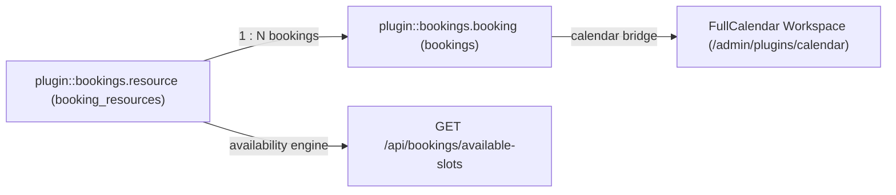
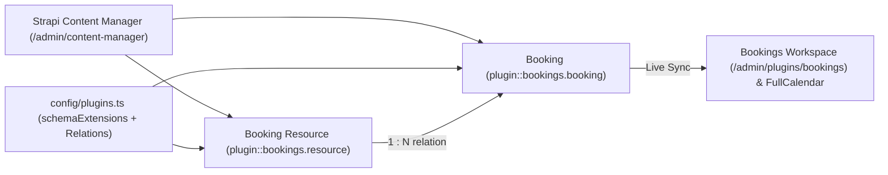
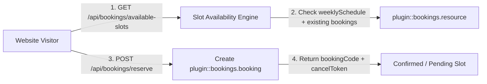
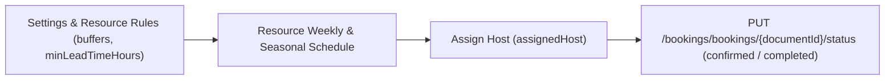
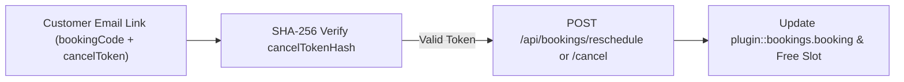
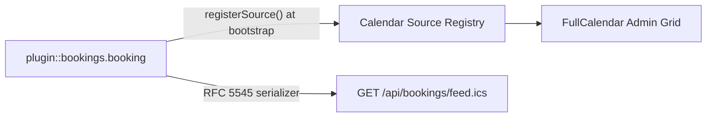

Generic **Bookings, Appointments, Resource Scheduling & Time-Slot Availability Engine** for **Strapi v5**, powered by [`@vicacha-devs/strapi-plugin-calendar`](../strapi-plugin-calendar) as a required dependency.

---

## Key Features

- **Bookable Resources & Operating Schedules (`plugin::bookings.resource`)**:
  - Model any bookable resource: services, consultations, appointments, rooms, staff members, or equipment.
  - Supports both **interval slicing** (`slotDurationMinutes` + `bufferBeforeMinutes` + `bufferAfterMinutes`) and **named time windows** (`mode: 'window'`, e.g. `morning` `09:00-12:00`, `afternoon` `14:00-17:00`).
  - Per-slot capacity (`capacityPerSlot`), maximum party size (`maxPartySize`), minimum lead-time hours (`minLeadTimeHours`), maximum advance horizon (`maxAdvanceDays`), seasonal schedule overrides (`seasonalSchedules`), holiday rules (`holidayRules`), and blackout periods (`blackoutDates`).
- **Reservations & Self-Service Token Workflows (`plugin::bookings.booking`)**:
  - Atomic capacity and double-booking validation across overlapping slots and buffer windows.
  - Automatic staff/host assignment matching `preferredLanguage` and real-time slot availability.
  - Cryptographically generated self-service reschedule & cancel tokens (`SHA-256` hashed at rest, verified with `crypto.timingSafeEqual`).
- **Dedicated Reservations Approval & Resource Workspace (`/admin/plugins/bookings`) + Unified Calendar Integration**:
  - **Required Dependency on `@vicacha-devs/strapi-plugin-calendar`**: Automatically registers `plugin::bookings.booking` into the central `/admin/plugins/calendar` registry on server bootstrap so all schedule grid views are unified in one place (with a 1-click **Open in Calendar** shortcut to `/admin/plugins/calendar?source=bookings`).
  - **Reservations Approval, Resource Filter & Ledger Workspace**: KPI summary cards, bookable resource / status / search filters, the reservations ledger, `BookingSidePanel` for Approve / Reject / Cancel / Complete & staff host assignment, and `+ New Booking` creation modal.
- **100% Generic & Extensible**:
  - Extend `resource` and `booking` schemas via `schemaExtensions` in `config/plugins.ts` without forking the plugin.
  - Map existing Strapi collections into the Bookings Ledger via `sources`.
- **13-Locale Admin UI**:
  - Ships with full translations for `en`, `es`, `ar`, `tr`, `fr`, `de`, `pt`, `it`, `nl`, `pl`, `id`, `ur`, and `zh`.

## Quick Installation & Configuration

```bash
pnpm add @vicacha-devs/strapi-plugin-bookings
```

Enable the plugin in `config/plugins.ts`:

```ts
export default () => ({
  bookings: {
    enabled: true,
  },
});
```

## Content-Type Entities & Where to Find Them

Registers two relational Collection Types (`plugin::bookings.resource` one-to-many `plugin::bookings.booking`). Resources define weekly/seasonal availability windows, slot duration, buffers, and capacity; Bookings store individual customer reservations, party size, status transitions, and hashed self-service cancellation tokens. Supports runtime `schemaExtensions` (`resource`, `booking`) and `customFields` in `config/plugins.ts`.



- **Content Manager**: `/admin/content-manager/collection-types/plugin::bookings.resource` & `/admin/content-manager/collection-types/plugin::bookings.booking` (`visible: true`)
- **Content-Type Builder**: `/admin/plugins/content-type-builder` under **Collection Types** (`Booking Resource` & `Booking`)
- **Plugin Workspace & Settings**: `/admin/plugins/bookings` (Reservations & Resources manager) and `/admin/settings/bookings`
- **Database Tables**: `booking_resources` and `bookings`

## Strapi v5 Content Manager Integration (`/admin/content-manager`)

> **Content Manager Sidebar Group**: `Events, Scheduling & Bookings`

### Content Manager Entities & Components

- `plugin::bookings.resource` (**Booking Resource** — `/admin/content-manager/collection-types/plugin::bookings.resource`)
- `plugin::bookings.booking` (**Booking** — `/admin/content-manager/collection-types/plugin::bookings.booking`)


### Why This Plugin Creates & Integrates Content Manager Entities

`@vicacha-devs/strapi-plugin-bookings` registers both **Booking Resource** (`plugin::bookings.resource`) and **Booking** (`plugin::bookings.booking`) with `pluginOptions['content-manager'].visible = true` so teams can combine the operational slot-availability engine in `/admin/plugins/bookings` with Strapi v5's native Content Manager relational modeling and schema extensibility:

- **Relational Linking to Host Entities (`api::*`)**: Link a `Booking Resource` directly to a `Staff, Scholar & Author` (`api::leader.leader`) record, room media gallery, or department via `schemaExtensions.resource` in `config/plugins.ts`.
- **Custom Intake Attributes (`customFields` & `schemaExtensions.booking`)**: Inspect and edit custom reservation fields (such as `organizationName`, `cateringRequired`, or `equipmentNotes`) alongside native Strapi audit columns (`createdBy`, `updatedBy`).
- **Advanced Filtering & Bulk Operations**: Filter hundreds of historical reservations by `status`, `startAt`, `resource`, or `customerEmail` using Content Manager's multi-condition filter builder and bulk-delete test records.
- **Cross-Plugin Side-Panel Ecosystem**: Attach internal staff handoff notes via `@vicacha-devs/strapi-plugin-notes` in the Content Manager right sidebar or jump straight to a booking via `Cmd+K` (`@vicacha-devs/strapi-plugin-global-search`).

### How to Use in Strapi Content Manager (Step-by-Step)

1. **Open in Content Manager**: In the left sidebar, click **Content Manager -> Collection Types -> Events, Scheduling & Bookings** and select **Booking Resource** (`/admin/content-manager/collection-types/plugin::bookings.resource`) or **Booking** (`/admin/content-manager/collection-types/plugin::bookings.booking`).
2. **Configure Bookable Resources**: Click **+ Create new entry** in **Booking Resource** to define `name`, `slug`, `resourceType` (`room`, `counselor`, `equipment`, `service`, `appointment`), `capacity`, `slotDurationMinutes`, `bufferBeforeMinutes`, `bufferAfterMinutes`, and `weeklySchedule` JSON rules.
3. **Manage & Link Reservations**: Open any **Booking** entry to inspect or update `bookingCode`, `startAt`, `endAt`, `partySize`, `status`, the linked `resource` relation, and any custom fields registered under `config.schemaExtensions.booking`.
4. **Workspace vs. Content Manager**: Use **Content Manager** for structured resource setup, relational linking, and bulk filtering; use the **Bookings Workspace** (`/admin/plugins/bookings`) for 1-click status transitions (`confirmed`, `completed`, `no_show`) and availability slot testing.

### Content Manager & Plugin Workspace Synchronization



### Content Manager Use Cases & Editorial Workflows

#### Content Manager Use Case 1 — Linking Counselors & Imams (`api::leader.leader`) to Bookable Resources

- **Why & What it is for**: Connect each appointment or counseling resource in `plugin::bookings.resource` to an institutional profile in `api::leader.leader` and a Media Library cover photo.
- **How to use in Content Manager**: Extend `resource` via `schemaExtensions` in `config/plugins.ts`, open `/admin/content-manager/collection-types/plugin::bookings.resource`, select the assigned scholar/counselor relation, and save.

#### Content Manager Use Case 2 — Auditing & Bulk-Filtering Reservations with Editorial Notes

- **Why & What it is for**: Filter pending or high-capacity room bookings in Content Manager and attach internal preparation checklists in the right sidebar.
- **How to use in Content Manager**: Open `/admin/content-manager/collection-types/plugin::bookings.booking`, apply a filter on `status = pending` or `partySize > 20`, open the entry, and add a pinned note in the **Notes** side panel.

## End-to-End Use Cases & Workflows

### Use Case 1 — Public Self-Service Slot Discovery & Reservation

- **What it is for**: Allow website visitors to query available time slots for a room, counselor, imam, or equipment resource and book a slot without double-booking.
- **How it works**: Query `GET /api/bookings/available-slots?resourceSlug=main-conference-hall&date=2026-05-15`, then submit `POST /api/bookings/reserve` to create a `plugin::bookings.booking` entity and receive a one-time cancellation token.




### Use Case 2 — Multi-Host Appointment & Buffer Enforcement

- **What it is for**: Manage 1-on-1 consultations or guided tours with automatic pre/post buffer windows (`bufferBeforeMinutes`, `bufferAfterMinutes`), minimum lead time (`minLeadTimeHours`), and host assignment (`assignedHost`).
- **How it works**: Configure `weeklySchedule`, `seasonalSchedules`, and `blackoutDates` on `plugin::bookings.resource`; staff approve or mark `completed` / `no_show` via `PUT /bookings/bookings/{documentId}/status`.




### Use Case 3 — Tokenized Self-Service Rescheduling & Cancellation

- **What it is for**: Let customers reschedule or cancel their reservation from an email link without requiring a Strapi account.
- **How it works**: Pass the customer's `bookingCode` and plaintext `cancelToken` (verified against `cancelTokenHash`) to `POST /api/bookings/reschedule` or `POST /api/bookings/cancel`.




### Use Case 4 — Unified Calendar & iCal Feed Synchronization

- **What it is for**: Project all confirmed and pending reservations into the FullCalendar workspace and external Google/Apple Calendar clients.
- **How it works**: At bootstrap, `bookings` registers `plugin::bookings.booking` with `strapi.plugin('calendar').service('registry')` and exposes `GET /api/bookings/feed.ics`.



## Admin Workspace, Content Manager & Settings Panel Preview


### Strapi v5 Content Manager Entities (`/admin/content-manager`)


### Settings Panel (`Settings -> Configuration`)


> Explore [**Content Types & Use Cases**](/strapi-plugin-bookings/use-cases/), the [**Developer Guide & Admin UI Tour**](/strapi-plugin-bookings/guide/), and the [**Interactive OpenAPI Reference**](/strapi-plugin-bookings/api/) for complete schema, workflow diagram, and endpoint documentation.
