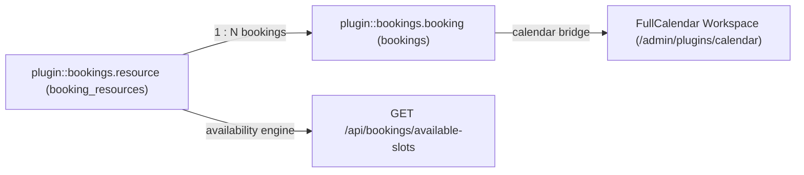
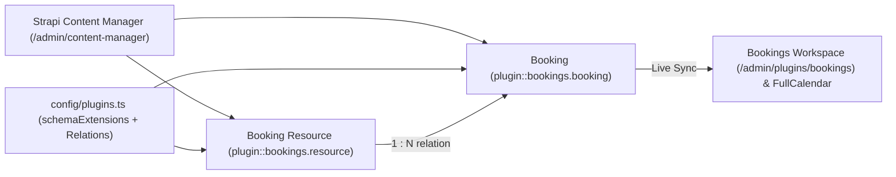
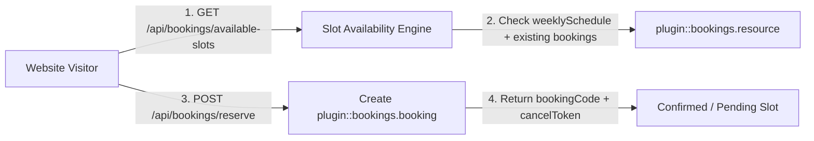
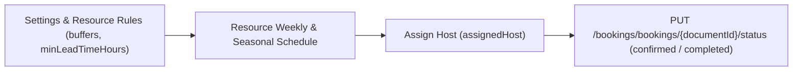
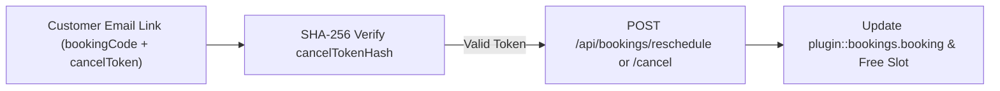
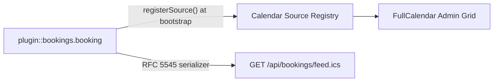

> **Package**: `@vicacha-devs/strapi-plugin-bookings` · **Plugin ID**: `bookings` · **Admin Workspace**: `/admin/plugins/bookings`

## 1. Content-Type Entities, Locations & Schemas (`strapi.documents`)

Registers two relational Collection Types (`plugin::bookings.resource` one-to-many `plugin::bookings.booking`). Resources define weekly/seasonal availability windows, slot duration, buffers, and capacity; Bookings store individual customer reservations, party size, status transitions, and hashed self-service cancellation tokens. Supports runtime `schemaExtensions` (`resource`, `booking`) and `customFields` in `config/plugins.ts`.

### Where to Find Content-Type Entities in Strapi v5

- **Content Manager**: `/admin/content-manager/collection-types/plugin::bookings.resource` & `/admin/content-manager/collection-types/plugin::bookings.booking` (`visible: true`)
- **Content-Type Builder**: `/admin/plugins/content-type-builder` under **Collection Types** (`Booking Resource` & `Booking`)
- **Plugin Workspace & Settings**: `/admin/plugins/bookings` (Reservations & Resources manager) and `/admin/settings/bookings`
- **Database Tables**: `booking_resources` and `bookings`

### `plugin::bookings.booking` — Booking

Reservation, appointment, or resource slot booking

> **Kind**: `collectionType` · **DB Table**: `bookings` · **Admin Location**: `/admin/content-manager/collection-types/plugin::bookings.booking` · **Draft & Publish**: `No` · **i18n**: `No`

| Attribute           | Strapi Type   | Required | Constraints / Target                                                            |
| :------------------ | :------------ | :------- | :------------------------------------------------------------------------------ |
| `bookingCode`       | `string`      | Yes      | max: 48                                                                         |
| `title`             | `string`      | No       | max: 200                                                                        |
| `resource`          | `relation`    | No       | target: `plugin::bookings.resource`                                             |
| `customerName`      | `string`      | Yes      | max: 120                                                                        |
| `customerEmail`     | `email`       | Yes      | —                                                                               |
| `customerPhone`     | `string`      | No       | max: 40                                                                         |
| `organization`      | `string`      | No       | max: 160                                                                        |
| `startDate`         | `datetime`    | Yes      | —                                                                               |
| `endDate`           | `datetime`    | Yes      | —                                                                               |
| `slotLabel`         | `string`      | No       | max: 80                                                                         |
| `timezone`          | `string`      | No       | max: 64; default: `"UTC"`                                                       |
| `partySize`         | `integer`     | Yes      | default: `1`                                                                    |
| `status`            | `enumeration` | Yes      | enum: `pending, confirmed, completed, cancelled, no_show`; default: `"pending"` |
| `preferredLanguage` | `string`      | No       | max: 16                                                                         |
| `assignedHost`      | `string`      | No       | max: 120                                                                        |
| `notes`             | `text`        | No       | max: 2000                                                                       |
| `internalNotes`     | `text`        | No       | max: 2000; `private: true`                                                      |
| `cancelTokenHash`   | `string`      | No       | max: 128; `private: true`                                                       |
| `sourceCollection`  | `string`      | No       | default: `"plugin::bookings.booking"`                                           |
| `metadata`          | `json`        | No       | —                                                                               |

### `plugin::bookings.resource` — Booking Resource

Bookable service, appointment type, room, staff member, or equipment schedule

> **Kind**: `collectionType` · **DB Table**: `booking_resources` · **Admin Location**: `/admin/content-manager/collection-types/plugin::bookings.resource` · **Draft & Publish**: `No` · **i18n**: `No`

| Attribute             | Strapi Type   | Required | Constraints / Target                                                              |
| :-------------------- | :------------ | :------- | :-------------------------------------------------------------------------------- |
| `name`                | `string`      | Yes      | max: 160                                                                          |
| `slug`                | `uid`         | Yes      | —                                                                                 |
| `resourceType`        | `enumeration` | Yes      | enum: `service, appointment, room, staff, equipment, other`; default: `"service"` |
| `description`         | `text`        | No       | —                                                                                 |
| `color`               | `string`      | No       | max: 32; default: `"#0d9488"`                                                     |
| `timezone`            | `string`      | No       | max: 64; default: `"UTC"`                                                         |
| `slotDurationMinutes` | `integer`     | Yes      | default: `60`                                                                     |
| `bufferBeforeMinutes` | `integer`     | No       | default: `0`                                                                      |
| `bufferAfterMinutes`  | `integer`     | No       | default: `0`                                                                      |
| `capacityPerSlot`     | `integer`     | Yes      | default: `1`                                                                      |
| `maxPartySize`        | `integer`     | No       | default: `50`                                                                     |
| `minLeadTimeHours`    | `integer`     | No       | default: `2`                                                                      |
| `maxAdvanceDays`      | `integer`     | No       | default: `90`                                                                     |
| `requiresApproval`    | `boolean`     | No       | default: `false`                                                                  |
| `weeklySchedule`      | `json`        | No       | —                                                                                 |
| `seasonalSchedules`   | `json`        | No       | —                                                                                 |
| `holidayRules`        | `json`        | No       | —                                                                                 |
| `blackoutDates`       | `json`        | No       | —                                                                                 |
| `recurrenceRule`      | `string`      | No       | —                                                                                 |
| `supportedLanguages`  | `json`        | No       | —                                                                                 |
| `assignedHosts`       | `json`        | No       | —                                                                                 |
| `location`            | `string`      | No       | max: 240                                                                          |
| `price`               | `decimal`     | No       | default: `0`                                                                      |
| `currency`            | `string`      | No       | max: 10; default: `"USD"`                                                         |
| `isActive`            | `boolean`     | No       | default: `true`                                                                   |
| `metadata`            | `json`        | No       | —                                                                                 |
| `bookings`            | `relation`    | No       | target: `plugin::bookings.booking`                                                |

## Strapi v5 Content Manager Integration (`/admin/content-manager`)

> **Content Manager Sidebar Group**: `Events, Scheduling & Bookings`

### Content Manager Entities & Components

- `plugin::bookings.resource` (**Booking Resource** — `/admin/content-manager/collection-types/plugin::bookings.resource`)
- `plugin::bookings.booking` (**Booking** — `/admin/content-manager/collection-types/plugin::bookings.booking`)

### Why This Plugin Creates & Integrates Content Manager Entities

`@vicacha-devs/strapi-plugin-bookings` registers both **Booking Resource** (`plugin::bookings.resource`) and **Booking** (`plugin::bookings.booking`) with `pluginOptions['content-manager'].visible = true` so teams can combine the operational slot-availability engine in `/admin/plugins/bookings` with Strapi v5's native Content Manager relational modeling and schema extensibility:

- **Relational Linking to Host Entities (`api::*`)**: Link a `Booking Resource` directly to a `Staff, Scholar & Author` (`api::leader.leader`) record, room media gallery, or department via `schemaExtensions.resource` in `config/plugins.ts`.
- **Custom Intake Attributes (`customFields` & `schemaExtensions.booking`)**: Inspect and edit custom reservation fields (such as `organizationName`, `cateringRequired`, or `equipmentNotes`) alongside native Strapi audit columns (`createdBy`, `updatedBy`).
- **Advanced Filtering & Bulk Operations**: Filter hundreds of historical reservations by `status`, `startAt`, `resource`, or `customerEmail` using Content Manager's multi-condition filter builder and bulk-delete test records.
- **Cross-Plugin Side-Panel Ecosystem**: Attach internal staff handoff notes via `@vicacha-devs/strapi-plugin-notes` in the Content Manager right sidebar or jump straight to a booking via `Cmd+K` (`@vicacha-devs/strapi-plugin-global-search`).

### How to Use in Strapi Content Manager (Step-by-Step)

1. **Open in Content Manager**: In the left sidebar, click **Content Manager -> Collection Types -> Events, Scheduling & Bookings** and select **Booking Resource** (`/admin/content-manager/collection-types/plugin::bookings.resource`) or **Booking** (`/admin/content-manager/collection-types/plugin::bookings.booking`).
2. **Configure Bookable Resources**: Click **+ Create new entry** in **Booking Resource** to define `name`, `slug`, `resourceType` (`room`, `counselor`, `equipment`, `service`, `appointment`), `capacity`, `slotDurationMinutes`, `bufferBeforeMinutes`, `bufferAfterMinutes`, and `weeklySchedule` JSON rules.
3. **Manage & Link Reservations**: Open any **Booking** entry to inspect or update `bookingCode`, `startAt`, `endAt`, `partySize`, `status`, the linked `resource` relation, and any custom fields registered under `config.schemaExtensions.booking`.
4. **Workspace vs. Content Manager**: Use **Content Manager** for structured resource setup, relational linking, and bulk filtering; use the **Bookings Workspace** (`/admin/plugins/bookings`) for 1-click status transitions (`confirmed`, `completed`, `no_show`) and availability slot testing.

### Content Manager & Plugin Workspace Synchronization

### Content Manager Use Cases & Editorial Workflows

#### Content Manager Use Case 1 — Linking Counselors & Imams (`api::leader.leader`) to Bookable Resources

- **Why & What it is for**: Connect each appointment or counseling resource in `plugin::bookings.resource` to an institutional profile in `api::leader.leader` and a Media Library cover photo.
- **How to use in Content Manager**: Extend `resource` via `schemaExtensions` in `config/plugins.ts`, open `/admin/content-manager/collection-types/plugin::bookings.resource`, select the assigned scholar/counselor relation, and save.

#### Content Manager Use Case 2 — Auditing & Bulk-Filtering Reservations with Editorial Notes

- **Why & What it is for**: Filter pending or high-capacity room bookings in Content Manager and attach internal preparation checklists in the right sidebar.
- **How to use in Content Manager**: Open `/admin/content-manager/collection-types/plugin::bookings.booking`, apply a filter on `status = pending` or `partySize > 20`, open the entry, and add a pinned note in the **Notes** side panel.

## 3. End-to-End Use Cases & Workflows

### Use Case 1 — Public Self-Service Slot Discovery & Reservation

- **What it is for**: Allow website visitors to query available time slots for a room, counselor, imam, or equipment resource and book a slot without double-booking.
- **How it works**: Query `GET /api/bookings/available-slots?resourceSlug=main-conference-hall&date=2026-05-15`, then submit `POST /api/bookings/reserve` to create a `plugin::bookings.booking` entity and receive a one-time cancellation token.

### Use Case 2 — Multi-Host Appointment & Buffer Enforcement

- **What it is for**: Manage 1-on-1 consultations or guided tours with automatic pre/post buffer windows (`bufferBeforeMinutes`, `bufferAfterMinutes`), minimum lead time (`minLeadTimeHours`), and host assignment (`assignedHost`).
- **How it works**: Configure `weeklySchedule`, `seasonalSchedules`, and `blackoutDates` on `plugin::bookings.resource`; staff approve or mark `completed` / `no_show` via `PUT /bookings/bookings/{documentId}/status`.

### Use Case 3 — Tokenized Self-Service Rescheduling & Cancellation

- **What it is for**: Let customers reschedule or cancel their reservation from an email link without requiring a Strapi account.
- **How it works**: Pass the customer's `bookingCode` and plaintext `cancelToken` (verified against `cancelTokenHash`) to `POST /api/bookings/reschedule` or `POST /api/bookings/cancel`.

### Use Case 4 — Unified Calendar & iCal Feed Synchronization

- **What it is for**: Project all confirmed and pending reservations into the FullCalendar workspace and external Google/Apple Calendar clients.
- **How it works**: At bootstrap, `bookings` registers `plugin::bookings.booking` with `strapi.plugin('calendar').service('registry')` and exposes `GET /api/bookings/feed.ics`.

---

- [Explore the Developer Guide & Admin UI Tour](/strapi-plugin-bookings/guide/)
- [Explore the Interactive OpenAPI Reference](/strapi-plugin-bookings/api/)
