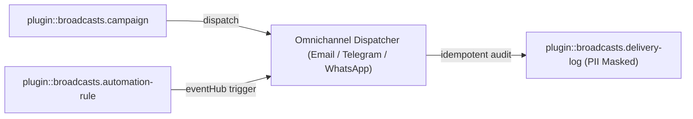
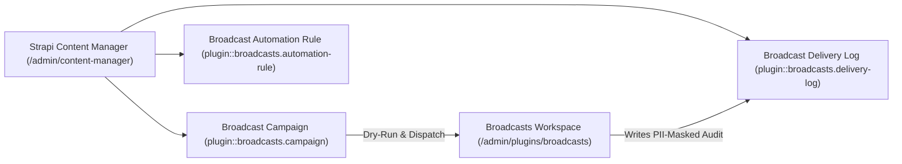
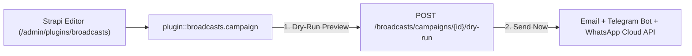
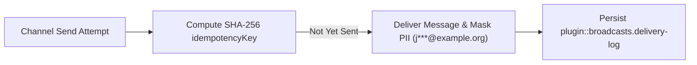

Omnichannel Community Broadcasts & EventHub Automation Engine for Strapi v5:

- **Multi-Channel Transports**:
  - **Email Newsletters**: Dispatches via `strapi.plugin('email')` (and optional `strapi-plugin-email-designer-5` templates) with `List-Unsubscribe` headers and per-subscriber `{{unsubscribeUrl}}`.
  - **Telegram Bot & Channel/Supergroup Broadcasts**: Dispatches rich HTML messages with inline CTA buttons (`InlineKeyboardMarkup`) and optional Forum topic thread (`message_thread_id`) routing.
  - **WhatsApp Broadcasts**: Supports **Meta WhatsApp Cloud API** (`meta-cloud` — WABA templates & text) and self-hosted gateways (**OpenWA / WAHA / Evolution API**) with E.164 phone normalization.
  - **Dry-Run Sandbox Mode**: Automatically records simulated deliveries when `dryRun: true` or when external provider tokens are not configured.
- **Ecosystem Bridges**:
  - **`@vicacha-devs/strapi-plugin-inbox` Bridge**: Segments confirmed double opt-in subscribers (`plugin::inbox.subscriber`) by `topic` and `locale`, selecting each subscriber's localized campaign copy (`es`, `en`, `ar`, `tr`, etc.).
  - **`@vicacha-devs/strapi-plugin-calendar` Bridge**: Computes Hijri (`islamic-umalqura`) or other secondary calendar dates on every campaign (`secondaryDateLabel`).
- **EventHub Automation Rules**:
  - Trigger automatic Telegram/WhatsApp/Email broadcasts when Strapi `eventHub` events fire (e.g., `inbox.alert.published`, `api::event.event` published, `plugin::media-feeds.episode` synced).
- **Idempotent & PII-Masked Delivery Ledger**:
  - Deduplicates dispatches via deterministic SHA-256 `idempotencyKey` and masks recipient emails/phones (`j***@example.com`, `+57***4567`) in `plugin::broadcasts.delivery-log`.

## Quick Installation & Configuration

```bash
pnpm add @vicacha-devs/strapi-plugin-broadcasts
```

Enable the plugin in `config/plugins.ts`:

```ts
export default () => ({
  broadcasts: {
    enabled: true,
  },
});
```

## Content-Type Entities & Where to Find Them

Registers three Collection Types (`plugin::broadcasts.campaign`, `plugin::broadcasts.automation-rule`, `plugin::broadcasts.delivery-log`). Campaigns store multi-channel message payloads; Automation Rules subscribe to Strapi `eventHub` events (e.g., `entry.publish`); Delivery Logs store idempotent (`idempotencyKey`), PII-masked (`recipientMasked`) audit trails. Supports `schemaExtensions` in `config/plugins.ts`.



- **Content Manager**: `/admin/content-manager/collection-types/plugin::broadcasts.campaign`, `plugin::broadcasts.automation-rule`, and `plugin::broadcasts.delivery-log` (`visible: true`)
- **Content-Type Builder**: `/admin/plugins/content-type-builder` under **Collection Types**
- **Plugin Workspace & Settings**: `/admin/plugins/broadcasts` (Campaigns, Automation Rules, Delivery Audit) and `/admin/settings/broadcasts`
- **Database Tables**: `broadcast_campaigns`, `broadcast_automation_rules`, and `broadcast_delivery_logs`

## Strapi v5 Content Manager Integration (`/admin/content-manager`)

> **Content Manager Sidebar Group**: `Inbox & Omnichannel Broadcasts`

### Content Manager Entities & Components

- `plugin::broadcasts.campaign` (**Broadcast Campaign** — `/admin/content-manager/collection-types/plugin::broadcasts.campaign`)
- `plugin::broadcasts.automation-rule` (**Broadcast Automation Rule** — `/admin/content-manager/collection-types/plugin::broadcasts.automation-rule`)
- `plugin::broadcasts.delivery-log` (**Broadcast Delivery Log** — `/admin/content-manager/collection-types/plugin::broadcasts.delivery-log`)


### Why This Plugin Creates & Integrates Content Manager Entities

`@vicacha-devs/strapi-plugin-broadcasts` exposes all three of its entities (`Broadcast Campaign`, `Broadcast Automation Rule`, and `Broadcast Delivery Log`) in the Strapi v5 Content Manager so communication teams can author rich campaign payloads, audit PII-masked delivery logs, and govern access via native RBAC:

- **Structured Campaign Authoring & Review**: Draft `bodyHtml`, `bodyText`, `telegramParseMode`, `whatsappTemplateName`, and `ctaUrl` in Content Manager with collaborative `@vicacha-devs/strapi-plugin-notes` annotations before dispatching from `/admin/plugins/broadcasts`.
- **Declarative EventHub Rule Management**: Inspect and bulk-toggle `Broadcast Automation Rule` (`plugin::broadcasts.automation-rule`) triggers (`entry.publish`, `entry.create`) and Mustache templates (`{{title}}`, `{{slug}}`) in Content Manager.
- **Compliance & Delivery Log Auditing**: Filter `Broadcast Delivery Log` (`plugin::broadcasts.delivery-log`) by `channel`, `status` (`sent`, `failed`, `skipped_duplicate`), `idempotencyKey`, and `recipientMasked` using Content Manager's native search and pagination.
- **Role-Based Access Separation**: Grant copywriters Content Manager permission to draft `plugin::broadcasts.campaign` records while restricting actual live dispatch (`POST /broadcasts/campaigns/{id}/send`) to senior administrators.

### How to Use in Strapi Content Manager (Step-by-Step)

1. **Open in Content Manager**: Navigate to **Content Manager -> Collection Types -> Inbox & Omnichannel Broadcasts** and select **Broadcast Campaign**, **Broadcast Automation Rule**, or **Broadcast Delivery Log**.
2. **Author & Schedule Campaigns**: In **Broadcast Campaign** (`/admin/content-manager/collection-types/plugin::broadcasts.campaign`), create an entry with `title`, `slug`, `topic`, `targetLocale`, `channels` (`['email', 'telegram', 'whatsapp']`), and channel-specific templates.
3. **Configure EventHub Automation Rules**: In **Broadcast Automation Rule** (`/admin/content-manager/collection-types/plugin::broadcasts.automation-rule`), bind `eventName` (`entry.publish`) and `targetContentType` (e.g., `plugin::events.event` or `plugin::islam.hilal-announcement`).
4. **Workspace vs. Content Manager**: Use **Content Manager** to draft campaign copy, attach review notes, and query `Broadcast Delivery Log` history; use the **Broadcasts Workspace** (`/admin/plugins/broadcasts`) to execute dry-run previews and trigger live omnichannel sends.

### Content Manager & Plugin Workspace Synchronization



### Content Manager Use Cases & Editorial Workflows

#### Content Manager Use Case 1 — Two-Stage Editorial Approval Before Omnichannel Dispatch

- **Why & What it is for**: Allow editors to prepare multilingual campaign copy and WhatsApp template variables in Content Manager while a reviewer leaves approval notes before sending.
- **How to use in Content Manager**: Create a `Broadcast Campaign` with `status: 'draft'` in `/admin/content-manager/collection-types/plugin::broadcasts.campaign`, review it via the Content Manager **Notes** panel, and dispatch it from `/admin/plugins/broadcasts`.

#### Content Manager Use Case 2 — Filtering Failed or Skipped Delivery Logs by Channel & Campaign

- **Why & What it is for**: Investigate delivery failures or idempotent duplicate skips across Email, Telegram, and WhatsApp without exposing raw subscriber PII.
- **How to use in Content Manager**: Open `/admin/content-manager/collection-types/plugin::broadcasts.delivery-log` and filter by `status = failed` or `channel = whatsapp` to inspect `errorMessage` and `recipientMasked`.

## End-to-End Use Cases & Workflows

### Use Case 1 — Omnichannel Manual & Scheduled Community Campaigns

- **What it is for**: Dispatch announcements simultaneously across Email (SMTP/Resend), Telegram Bot channels/threads, and WhatsApp Cloud API.
- **How it works**: Create a `plugin::broadcasts.campaign` entity with `channels: ['email', 'telegram', 'whatsapp']`, preview via `POST /broadcasts/campaigns/{id}/dry-run`, and dispatch via `POST /broadcasts/campaigns/{id}/send`.




### Use Case 2 — EventHub Zero-Touch Publish Automation

- **What it is for**: Automatically broadcast a Telegram/WhatsApp notification whenever an editor publishes a new Event, Hilal Announcement, or Urgent Campaign.
- **How it works**: Create a `plugin::broadcasts.automation-rule` entity matching `eventName: 'entry.publish'` and `targetContentType: 'plugin::events.event'` with Mustache-style `subjectTemplate` and `bodyTextTemplate`.


### Use Case 3 — Idempotent PII-Masked Delivery Auditing

- **What it is for**: Guarantee no subscriber receives duplicate messages on retry while keeping phone numbers and emails masked in database logs.
- **How it works**: Every dispatch computes a deterministic `idempotencyKey` recorded in `plugin::broadcasts.delivery-log` with `recipientMasked` (`j***@example.org`, `+57***4821`).




## Admin Workspace, Content Manager & Settings Panel Preview


### Strapi v5 Content Manager Entities (`/admin/content-manager`)


### Settings Panel (`Settings -> Configuration`)


> Explore [**Content Types & Use Cases**](/strapi-plugin-broadcasts/use-cases/), the [**Developer Guide & Admin UI Tour**](/strapi-plugin-broadcasts/guide/), and the [**Interactive OpenAPI Reference**](/strapi-plugin-broadcasts/api/) for complete schema, workflow diagram, and endpoint documentation.
