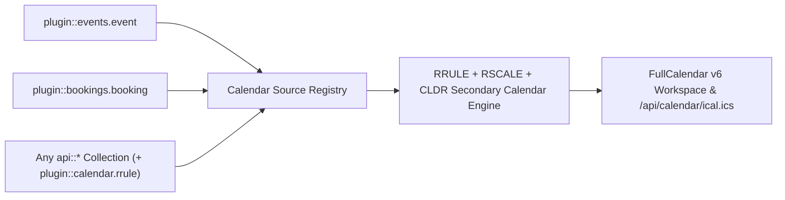
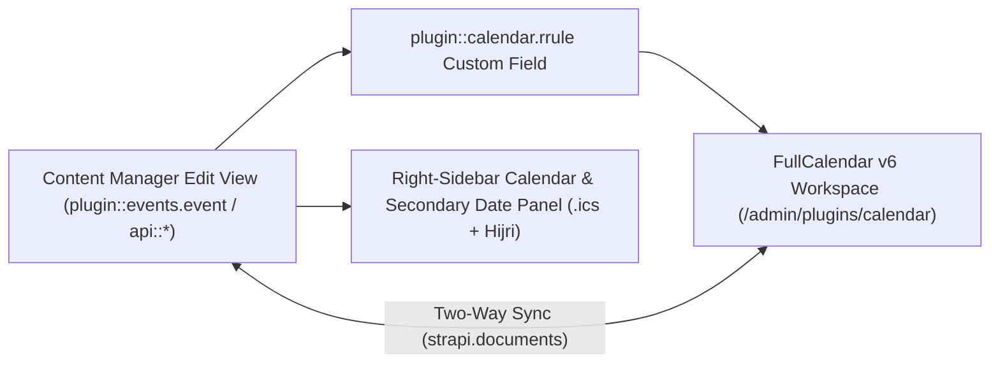
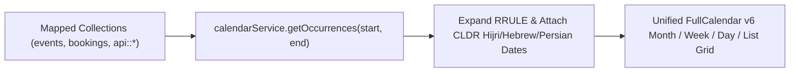
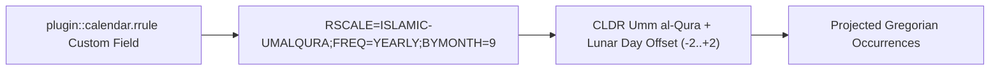
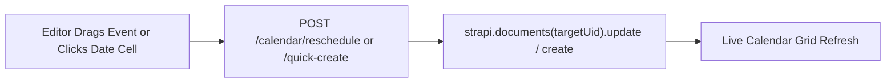
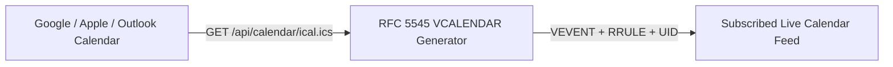

Enterprise, **100% generic Multi-Collection Calendar, Scheduler, Non-Gregorian `RSCALE` Recurrence, Dual-Calendar Overlay, and iCal (`.ics`) Syndication Plugin** for Strapi v5, powered by **FullCalendar v6** (`@fullcalendar/react`) and **Unicode CLDR / `@internationalized/date`**.

---

## ✨ Key Capabilities

1. **Multi-Collection Aggregation & No-Code Field Mapper**:
   - Aggregate events, bookings, Editorial deadlines, classes, or any Strapi v5 collection on a single unified calendar.
   - **No-Code Collection/Field Picker** in **Settings → Calendar Plugin → Sources & Calendar Settings** auto-discovers all collections and classifies their date/string/boolean fields so admins can map `titleField`, `startField`, `endField`, `allDayField`, `rruleField`, `colorField`, and `categoryField` via dropdowns.
   - Companion plugins (`@vicacha-devs/strapi-plugin-events`, `@vicacha-devs/strapi-plugin-bookings`, etc.) can also register sources programmatically via `strapi.plugin('calendar').service('registry').registerSource(...)`.
2. **FullCalendar v6 Interactive Scheduler**:
   - **5 Views out of the box**: Month (`dayGridMonth`), Week (`timeGridWeek`), Day (`timeGridDay`), Agenda (`listMonth`), and Year (`multiMonthYear`).
   - **Drag-and-Drop Rescheduling & Resize**: Drag events across days/times or resize durations to automatically update the underlying Strapi document's mapped `startField` and `endField`.
   - **Drag-to-Create Slot Selection**: Select any time range on the calendar to quick-create a new entry in any mapped collection or jump directly to the Strapi Content Manager.
   - **Configurable Operating Hours & Time Slots**: Customize `slotDuration`, `startHour`, `endHour`, and `firstDayOfWeek`.
3. **Multi-Calendar Systems & Dual-Calendar Day Cells (`Hijri`, `Hebrew`, `Persian`, etc.)**:
   - Supports 13 built-in Unicode CLDR calendar systems (`islamic-umalqura`, `islamic-civil`, `islamic-tbla`, `hebrew`, `persian`, `buddhist`, `chinese`, `japanese`, `indian`, `coptic`, `ethiopic`, `gregory`, `iso8601`).
   - Renders secondary calendar dates directly inside FullCalendar day cells and inside the Content Manager edit view side panel.
   - Supports **`dayOffset` (`-2..+2`)** for moon-sighting adjustments and **`overrideField`** for explicit document-level date strings (e.g. `hijriDate`).
4. **RFC 5545 `RRULE` + RFC 7529 `RSCALE` Non-Gregorian Recurrence Engine**:
   - Includes a custom field (`plugin::calendar.rrule`) with a visual builder and preset selector.
   - Supports standard Gregorian recurrence (`FREQ=WEEKLY;BYDAY=FR`) **and** non-Gregorian `RSCALE` recurrence (`RSCALE=ISLAMIC-UMALQURA;FREQ=YEARLY;BYMONTH=9;BYMONTHDAY=1` for annual 1st of Ramadan, or `RSCALE=HEBREW` / `RSCALE=PERSIAN`).
5. **Unified RFC 5545 iCalendar (`.ics`) Feed**:
   - Content-API `/api/calendar/feed.ics` and single-event `/api/calendar/:documentId/invite.ics` endpoints with `?sourceId=`, `?category=`, `?from=`, and `?to=` filters for Google Calendar, Apple Calendar, and Outlook subscriptions.
6. **10 Admin Locales Included**:
   - `en`, `es`, `ar` (RTL), `tr`, `fr`, `de`, `pt`, `id`, `ur` (RTL), `fa` (RTL).

---

## 📦 Installation

```bash
pnpm add @vicacha-devs/strapi-plugin-calendar
```

---

## ⚙️ Configuration (`config/plugins.ts`)

```ts
export default () => ({
  calendar: {
    enabled: true,
    config: {
      defaultView: "dayGridMonth",
      defaultTimezone: "UTC",
      firstDayOfWeek: 1, // Monday
      slotDuration: "00:30:00",
      startHour: "06:00:00",
      endHour: "22:00:00",
      sources: [
        {
          id: "events",
          label: "Community Events",
          uid: "plugin::events.event",
          color: "#4945FF",
          enabled: true,
          publicFeed: true,
          fields: {
            title: "title",
            startDate: "startDate",
            endDate: "endDate",
            rrule: "recurrence",
            location: "location",
            category: "category",
            status: "eventStatus",
            summary: "summary",
            slug: "slug",
          },
        },
        {
          id: "bookings",
          label: "Facility Bookings",
          uid: "plugin::bookings.booking",
          color: "#059669",
          enabled: true,
          publicFeed: false,
          fields: {
            title: "customerName",
            startDate: "startDate",
            endDate: "endDate",
            status: "status",
          },
        },
      ],
      secondaryCalendars: [
        {
          id: "hijri",
          label: "Hijri (Umm al-Qura)",
          intlCalendar: "islamic-umalqura",
          dayOffset: 0,
          overrideField: "hijriDate",
          enabled: true,
        },
      ],
      recurrencePresets: [
        {
          id: "ramadan-start",
          label: "Every 1st of Ramadan (Hijri Yearly)",
          rrule: "RSCALE=ISLAMIC-UMALQURA;FREQ=YEARLY;BYMONTH=9;BYMONTHDAY=1",
        },
      ],
    },
  },
});
```

---

## 🔌 Programmatic Companion Plugin API

Other plugins (such as `@vicacha-devs/strapi-plugin-events` or `@vicacha-devs/strapi-plugin-bookings`) can register their collections automatically during `bootstrap`:

```ts
const calendarRegistry = strapi.plugin("calendar")?.service("registry");

await calendarRegistry?.registerSource({
  id: "events-plugin",
  label: "Events",
  uid: "plugin::events.event",
  color: "#4945FF",
  enabled: true,
  fields: {
    title: "title",
    startDate: "startDate",
    endDate: "endDate",
    rrule: "recurrence",
    location: "location",
    category: "category",
    status: "eventStatus",
  },
});
```

---

## 🌐 REST API Endpoints

### Content API (`/api/calendar/*`)

- `GET /api/calendar/occurrences?from=2026-05-01T00:00:00Z&to=2026-05-31T23:59:59Z&sourceId=events`
- `GET /api/calendar/feed.ics?sourceId=events&category=Religious`
- `GET /api/calendar/:documentId/invite.ics`

### Admin API (`/calendar/*`)

- `GET /calendar/calendar` — Fetch occurrences across all enabled sources
- `POST /calendar/calendar/reschedule` — Drag-and-drop / resize reschedule handler
- `POST /calendar/calendar/quick-create` — Slot selection quick-create handler
- `GET /calendar/content-types` — Discover collections & fields for the No-Code Mapper
- `GET /calendar/settings` / `PUT /calendar/settings` — Read or update plugin settings
- `POST /calendar/clear-settings` — Reset settings to `config/plugins.ts` defaults

---

## 🧪 Testing

```bash
npm test
```

## 📄 License

MIT © Vicacha Devs

## Content-Type Entities & Where to Find Them

Acts as a multi-collection scheduler engine that binds to **any** Strapi Content-Type entity (`api::*` or `plugin::*`) configured in `collections[]` or registered dynamically via `calendar.service('registry').registerSource()`. Also registers the `plugin::calendar.rrule` Custom Field (`json`) for RFC 5545 `RRULE` + RFC 7529 `RSCALE` recurrence rules.



- **Bound Content-Type Entities**: Any Content Manager collection mapped in `/admin/settings/calendar` (e.g., `plugin::events.event`, `plugin::bookings.booking`, `api::article.article`)
- **Custom Field in Content-Type Builder**: Add the `plugin::calendar.rrule` custom field to any collection type in `/admin/plugins/content-type-builder`
- **Plugin Workspace & Settings**: `/admin/plugins/calendar` (FullCalendar v6 Month/Week/Day/Agenda workspace) and `/admin/settings/calendar` (General, Prayer & Islamic, Bookings & Availability tabs)

## Strapi v5 Content Manager Integration (`/admin/content-manager`)

> **Content Manager Sidebar Group**: `Events, Scheduling & Bookings`

### Content Manager Entities & Components

- Custom Field `plugin::calendar.rrule` (**RFC 5545 RRULE + RFC 7529 RSCALE Recurrence Field** inside any Content Manager edit view)
- Bound Content Manager Collections (`plugin::events.event`, `plugin::bookings.booking`, and any configured `api::*` collection)


### Why This Plugin Creates & Integrates Content Manager Entities

Instead of locking schedules inside an isolated table, `@vicacha-devs/strapi-plugin-calendar` embeds directly into the **Strapi v5 Content Manager** edit view of any mapped collection (`plugin::events.event`, `plugin::bookings.booking`, or custom `api::*` entities) via its `plugin::calendar.rrule` Custom Field and right-sidebar **Calendar & Schedule** widget:

- **In-Place Secondary Calendar Preview in Content Manager**: When editing an event in Content Manager, the right-sidebar **Calendar & Schedule** panel automatically computes and displays the corresponding Hijri (Umm al-Qura), Hebrew, or Persian date (`4 Jumada I 1448 AH`) plus 1-click `.ics` download and **Open in Calendar View** buttons.
- **Visual RFC 5545 `RRULE` + RFC 7529 `RSCALE` Authoring**: The `plugin::calendar.rrule` custom field lets editors configure Gregorian or lunar recurrence rules directly inside any Content Manager form.
- **Zero Data Duplication**: Dragging an event in `/admin/plugins/calendar` or editing start/end dates in `/admin/content-manager/collection-types/plugin::events.event` mutates the exact same Strapi v5 Document Service record.

### How to Use in Strapi Content Manager (Step-by-Step)

1. **Open a Bound Collection in Content Manager**: Navigate to **Content Manager -> Collection Types -> Events, Scheduling & Bookings -> Event** (`/admin/content-manager/collection-types/plugin::events.event?plugins[i18n][locale]=en`) and open any entry.
2. **Configure Start/End Dates & Recurrence**: Edit `startDate`, `endDate`, `allDay`, `timezone`, and the `rrule` custom field directly inside the Content Manager form.
3. **Use the Right-Sidebar Calendar Panel**: In the right column of the Content Manager edit view, inspect the live **Alternative Calendar Dates** badge, click **Download .ics Invite**, or click **Open in Calendar View** to jump to `/admin/plugins/calendar`.
4. **Bind Additional Content Manager Collections**: In `/admin/settings/calendar`, map any `api::*` collection's `titleField`, `startField`, `endField`, and `rruleField` to project its Content Manager entries onto the unified calendar grid.

### Content Manager & Plugin Workspace Synchronization



### Content Manager Use Cases & Editorial Workflows

#### Content Manager Use Case 1 — Authoring a Localized Recurring Course with Live Hijri Date Preview

- **Why & What it is for**: Edit a weekly Arabic course (`Classical Arabic Course`) in Content Manager while verifying its Umm al-Qura Hijri date and downloading its `.ics` invite from the right sidebar.
- **How to use in Content Manager**: Open `/admin/content-manager/collection-types/plugin::events.event/{documentId}?plugins[i18n][locale]=en`, set `startDate` and `rrule`, and verify the **Calendar & Schedule** panel on the right.

## End-to-End Use Cases & Workflows

### Use Case 1 — Aggregating Multiple Strapi Collections into One Calendar

- **What it is for**: Display Events, Bookings, Courses, and Editorial Deadlines from different Content-Type entities on a single color-coded FullCalendar grid.
- **How it works**: Map each collection's `uid`, `titleField`, `startField`, `endField`, and `rruleField` in `/admin/settings/calendar` or `config/plugins.ts`, then query `GET /api/calendar/occurrences?start=...&end=...`.




### Use Case 2 — Sacred & Lunar Recurrence (`RRULE` + `RSCALE=ISLAMIC-UMALQURA`)

- **What it is for**: Schedule annual or monthly recurring events that follow the Hijri, Hebrew, or Persian calendar and automatically project onto Gregorian dates.
- **How it works**: Attach `plugin::calendar.rrule` to your Content-Type entity to author RFC 7529 rules (`RSCALE=ISLAMIC-UMALQURA;FREQ=YEARLY;BYMONTH=9;BYMONTHDAY=1`).




### Use Case 3 — Drag-and-Drop Rescheduling & Quick-Create into Target Entities

- **What it is for**: Let editors drag an event on the calendar grid or click a date cell to create/update the underlying Strapi document directly.
- **How it works**: Uses `POST /calendar/quick-create` and `POST /calendar/reschedule` to mutate the mapped `strapi.documents(uid)` record in place.




### Use Case 4 — Public RFC 5545 iCal (`.ics`) Subscription Feeds

- **What it is for**: Allow users to subscribe to live calendar feeds in Google Calendar, Apple Calendar, or Outlook.
- **How it works**: Subscribe to `GET /api/calendar/ical.ics` (all sources) or `GET /api/calendar/ical/{collectionId}.ics` (single source).



## Admin Workspace, Content Manager & Settings Panel Preview


### Strapi v5 Content Manager Entities (`/admin/content-manager`)


### Settings Panel (`Settings -> Configuration`)


> Explore [**Content Types & Use Cases**](/strapi-plugin-calendar/use-cases/), the [**Developer Guide & Admin UI Tour**](/strapi-plugin-calendar/guide/), and the [**Interactive OpenAPI Reference**](/strapi-plugin-calendar/api/) for complete schema, workflow diagram, and endpoint documentation.
