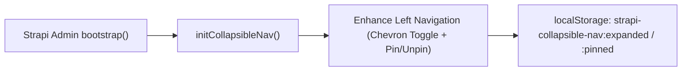
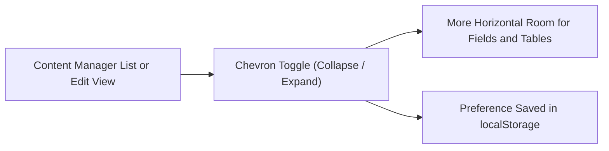
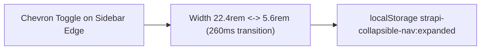
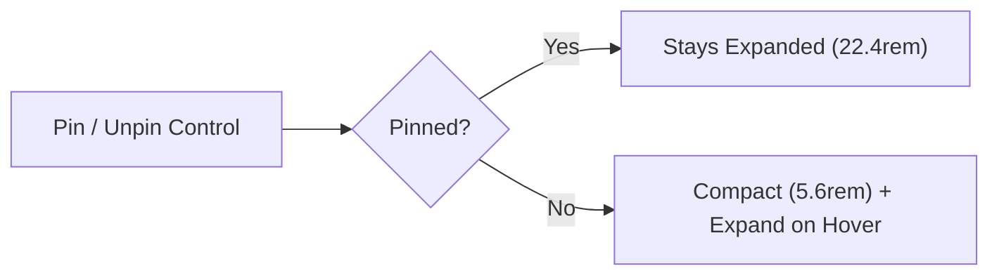
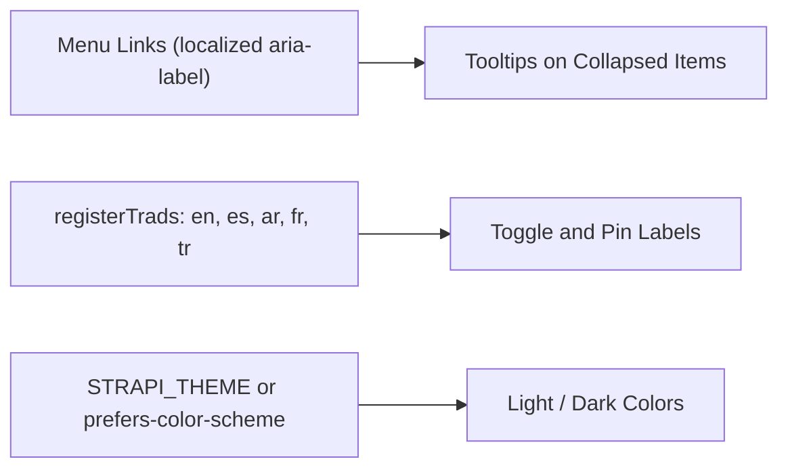

[](https://strapi.io)
[](LICENSE)

Restores Strapi v4-style **collapsible & expandable** left navigation in the **Strapi v5** admin panel—complete with **Pin / Unpin** (hover-to-peek) support, `localStorage` persistence, and smooth desktop-only transitions.

---

## Features

- **Strapi v4-Style Collapse & Expand** — Adds a floating chevron toggle button on the sidebar edge to smoothly expand (`22.4rem`) or collapse (`5.6rem`) the desktop navigation rail.
- **Pin / Unpin Mode** — Pin the sidebar open, or unpin it so it stays compact (`5.6rem`) and **auto-expands on hover** to peek at labels without losing workspace width.
- **Zero-Jump Anchored Layout** — Icons, brand logo, and user avatar stay anchored in place while labels glide in smoothly (`260ms cubic-bezier(0.4, 0, 0.2, 1)`).
- **Theme & Locale Aware** — Reads each link's localized `aria-label` (plus `NavBrand` and `NavUser` accessible labels) and inherits Strapi's light/dark theme colors.
- **Desktop Scoped** — Only activates at Strapi's `large` desktop breakpoint (`>= 1080px`); mobile/tablet `NavBurgerMenu` remains untouched.
- **Zero Configuration** — Install, enable, and restart Strapi. No `preinstall` / `install` / `postinstall` scripts.

---

## Installation

```bash
pnpm add @vicacha-devs/strapi-plugin-collapsible-nav
npm install @vicacha-devs/strapi-plugin-collapsible-nav
```

Enable it in `config/plugins.ts` (or `config/plugins.js`):

```ts
export default () => ({
  "collapsible-nav": {
    enabled: true,
  },
});
```

Rebuild and start Strapi:

```bash
pnpm build && pnpm develop
```

> **Upgrading / Local Dev:** If Strapi's Vite pre-bundler has cached an older version of the admin bundle, clear `node_modules/.strapi` and `.strapi` before restarting `develop`.

---

## Controls & Persistence

| Control                | Location                           | Behavior                                                                                           |
| :--------------------- | :--------------------------------- | :------------------------------------------------------------------------------------------------- |
| **Chevron Toggle**     | Bottom-right edge of sidebar       | Expands/collapses when pinned; pins open if clicked while unpinned.                                |
| **Pin / Unpin Button** | Top-right of expanded brand header | Locks sidebar open (`pinned: true`) or enables auto-collapse with hover-to-peek (`pinned: false`). |

State is persisted per browser in `localStorage`:

- `strapi-collapsible-nav:expanded` (`"true"` | `"false"`, default `"true"`)
- `strapi-collapsible-nav:pinned` (`"true"` | `"false"`, default `"true"`)

---

## How It Works

Strapi v5's `LeftMenu` / `MainNav` component renders an icon-only desktop sidebar without an official plugin override slot. At `bootstrap()`, this plugin:

1. Injects desktop-scoped CSS (`#strapi-collapsible-nav-styles`) into `document.head`.
2. Observes `<nav>` via `MutationObserver` to keep dynamically mounted plugin links synchronized.
3. Hydrates `.scn-nav-label` spans from each link's `aria-label`, reveals `NavBrand` / `NavUser` accessible text when expanded, and mounts accessible `<button>` controls for toggling and pinning.

---

## License

MIT © Vicacha Devs

## Content-Type Entities & Where to Find Them

Registers no Content-Types, routes, or server services (`server/index.ts` exports an empty object). The admin entry registers the plugin and calls `initCollapsibleNav()` once from `bootstrap()`: a DOM controller that finds Strapi's main left navigation, adds a floating chevron toggle and a Pin/Unpin control, animates the width between `22.4rem` (expanded) and `5.6rem` (collapsed), and stores both choices in the browser's `localStorage` (`strapi-collapsible-nav:expanded` and `strapi-collapsible-nav:pinned`). It only activates at Strapi's `large` desktop breakpoint (`>= 1080px`).



- **Every Admin Page**: the chevron toggle sits on the edge of the left navigation sidebar across `/admin/*`, with the Pin/Unpin control next to it.
- **Browser Storage**: `localStorage` keys `strapi-collapsible-nav:expanded` and `strapi-collapsible-nav:pinned` (per browser profile, not per Strapi user).
- **No Content-Types or API**: this plugin creates no entities, routes, settings page, or database tables.

## Strapi v5 Content Manager Integration (`/admin/content-manager`)

> **Content Manager Sidebar Group**: `Applies to Strapi's left navigation on every admin page, including all Content Manager screens`

### Content Manager Entities & Components

- Strapi main left navigation (`NavBrand`, menu links, `NavUser`), enhanced in place with a chevron toggle and a Pin/Unpin control
- Browser `localStorage` keys `strapi-collapsible-nav:expanded` and `strapi-collapsible-nav:pinned` (no Content-Type, route, or database table is created)

### Why This Plugin Creates & Integrates Content Manager Entities

`@vicacha-devs/strapi-plugin-collapsible-nav` does not add fields or panels to Content Manager documents. It gives editors more horizontal room while they work in Content Manager lists and edit views by letting them collapse the left navigation that Strapi v5 does not collapse on desktop.

- **Wider Content Manager Lists and Edit Views**: collapse the sidebar to `5.6rem` icons to fit more columns and wider rich-text fields on screen.
- **Zero Configuration, Zero Server Footprint**: install, enable, and restart Strapi; there are no options, routes, or install scripts.
- **Per-Browser Preference**: the expanded and pinned state is remembered in `localStorage`, so each editor keeps their own layout.

### How to Use in Strapi Content Manager (Step-by-Step)

1. **Open Any Content Manager Screen**: go to `/admin/content-manager` on a desktop viewport (`>= 1080px`).
2. **Click the Chevron Toggle**: use the control on the sidebar edge to collapse or expand the navigation.
3. **Choose Pinned or Hover-to-Peek**: use Pin/Unpin to keep the labels visible, or leave the sidebar compact and hover it to read the labels.

### Content Manager & Plugin Workspace Synchronization



### Content Manager Use Cases & Editorial Workflows

#### Content Manager Use Case 1 — Editing Wide Entries Without Horizontal Squeeze

- **Why & What it is for**: Keep wide Content Manager tables and multi-column edit views readable on laptop screens by collapsing the navigation to icons.
- **How to use in Content Manager**: Open a collection in `/admin/content-manager`, click the chevron toggle to collapse the sidebar, and reopen it later; the collapsed state is restored automatically.

## End-to-End Use Cases & Workflows

### Use Case 1 — Reclaiming Workspace Width on Dense Admin Pages

- **What it is for**: Give editors more room for wide Content Manager tables, the Calendar, and the Media Library by collapsing the left navigation to icons only (`5.6rem`).
- **How it works**: Click the chevron toggle on the sidebar edge; the width animates between `22.4rem` and `5.6rem` while icons, the brand logo, and the user avatar stay anchored. The choice is saved in `strapi-collapsible-nav:expanded` and restored on the next visit.



### Use Case 2 — Compact Sidebar with Hover-to-Peek (Unpinned Mode)

- **What it is for**: Keep the navigation compact by default but still read the full labels on demand.
- **How it works**: Unpin the sidebar with the Pin/Unpin control: it stays at `5.6rem` and expands on hover, then collapses again. Pin it to keep the labels visible. The state is saved in `strapi-collapsible-nav:pinned`.



### Use Case 3 — Localized, Theme-Aware Labels for Multilingual Teams

- **What it is for**: Show tooltips and control labels in each editor's language and in the active light or dark theme.
- **How it works**: The controller reads each menu link's localized `aria-label` (plus the `NavBrand` and `NavUser` labels) so collapsed items keep readable tooltips; toggle and pin labels come from the plugin's `en`, `es`, `ar`, `fr`, and `tr` translations registered through `registerTrads`, and colors follow Strapi's `STRAPI_THEME` setting or the system preference.


