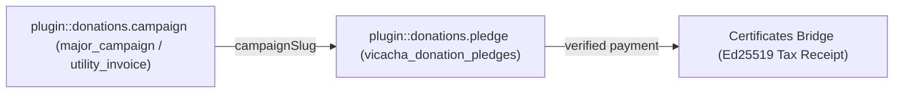
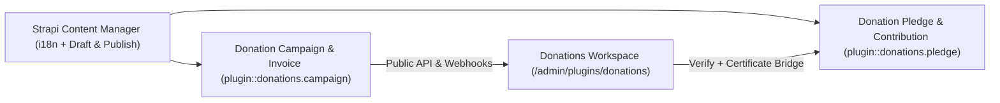
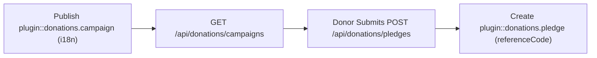
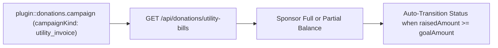
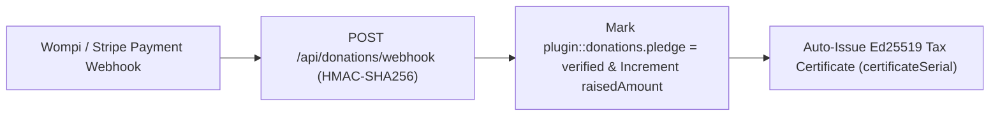
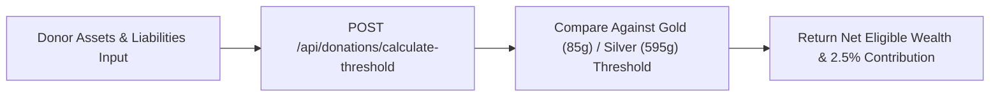

Generic **Crowdfunding Campaigns, Donor Pledges, Utility Invoice Sponsorship, Commodity Assessment Calculator & Tax Certificate Bridge** for **Strapi v5**, powered by [`@vicacha-devs/strapi-plugin-calendar`](../strapi-plugin-calendar) and [`@vicacha-devs/strapi-plugin-certificates`](../strapi-plugin-certificates).

---

## Key Features

- **Fundraising Campaigns & Utility Invoice Transparency (`plugin::donations.campaign`)**:
  - Track campaign goals (`goalAmount`), raised totals (`raisedAmount`), donor counts, urgency badges, and recurring monthly utility bills (`category: 'utility_invoice'`, e.g., Electricity, Water, Gas, Internet).
- **Donor Pledges & Payment Proof Verification (`plugin::donations.pledge`)**:
  - Public pledge submission (`POST /api/donations/pledges`) and HMAC-verified payment gateway webhook receiver (`POST /api/donations/webhook`).
  - Automatic campaign progress recalculation and tax-deductible receipt issuance via `@vicacha-devs/strapi-plugin-certificates`.
- **Rule-Based Assessment & Commodity Threshold Calculator**:
  - Configurable precious-metal/commodity thresholds (`GET /api/donations/calculator`, `POST /api/donations/calculate`) supporting multi-currency (`COP`, `USD`, `EUR`, `TRY`) assessments.
- **13-Locale Admin UI**:
  - Ships with full translations for `en`, `es`, `ar`, `tr`, `fr`, `de`, `pt`, `it`, `nl`, `pl`, `id`, `ur`, and `zh`.

## Quick Installation & Configuration

```bash
pnpm add @vicacha-devs/strapi-plugin-donations
```

Enable the plugin in `config/plugins.ts`:

```ts
export default () => ({
  donations: {
    enabled: true,
  },
});
```

## Content-Type Entities & Where to Find Them

Registers two Collection Types (`plugin::donations.campaign` with `draftAndPublish: true` and `i18n.localized: true`, and `plugin::donations.pledge`) plus two Custom Fields (`plugin::donations.currency` and `plugin::donations.country`). Supports runtime `schemaExtensions` in `config/plugins.ts`.



- **Content Manager**: `/admin/content-manager/collection-types/plugin::donations.campaign` & `/admin/content-manager/collection-types/plugin::donations.pledge` (`visible: true`)
- **Content-Type Builder**: `/admin/plugins/content-type-builder` under **Collection Types** + Custom Fields `plugin::donations.currency` & `plugin::donations.country`
- **Plugin Workspace & Settings**: `/admin/plugins/donations` (Campaigns, Utility Bills, Pledges, Nisab Calculator) and `/admin/settings/donations`
- **Database Tables**: `vicacha_donation_campaigns` and `vicacha_donation_pledges`

## Strapi v5 Content Manager Integration (`/admin/content-manager`)

> **Content Manager Sidebar Group**: `Donations & Certificates`

### Content Manager Entities & Components

- `plugin::donations.campaign` (**Donation Campaign & Invoice** — `/admin/content-manager/collection-types/plugin::donations.campaign`)
- `plugin::donations.pledge` (**Donation Pledge & Contribution** — `/admin/content-manager/collection-types/plugin::donations.pledge`)
- Custom Fields `plugin::donations.currency` & `plugin::donations.country`


### Why This Plugin Creates & Integrates Content Manager Entities

`@vicacha-devs/strapi-plugin-donations` registers **Donation Campaign & Invoice** (`plugin::donations.campaign`, with `i18n.localized: true` and `draftAndPublish: true`) and **Donation Pledge & Contribution** (`plugin::donations.pledge`) in the Strapi v5 Content Manager so fundraising and accounting teams get full multilingual publishing and ledger auditing:

- **Multilingual (`i18n`) Campaign & Utility Invoice Authoring**: Translate campaign titles, descriptions, and impact stories across `en`, `es`, `ar`, and `tr` using Content Manager's locale switcher (`?plugins[i18n][locale]=en`) while sharing unified financial progress.
- **Draft & Publish Staging for Fundraising Appeals**: Prepare Ramadan, Zakat, or emergency relief campaigns in `Draft` mode, attach Media Library invoice PDFs or cover images, and publish when ready.
- **Accounting & Pledge Reconciliation**: Filter `Donation Pledge & Contribution` (`plugin::donations.pledge`) in Content Manager by `status` (`pending`, `verified`, `refunded`), `paymentMethod`, `currency`, `isZakatEligible`, or linked `certificateSerial`.

### How to Use in Strapi Content Manager (Step-by-Step)

1. **Open in Content Manager**: Navigate to **Content Manager -> Collection Types -> Donations & Certificates** and select **Donation Campaign & Invoice** (`/admin/content-manager/collection-types/plugin::donations.campaign?plugins[i18n][locale]=en`) or **Donation Pledge & Contribution** (`/admin/content-manager/collection-types/plugin::donations.pledge`).
2. **Create Major Campaigns or Utility Invoices**: Click **+ Create new entry** in **Donation Campaign & Invoice**, choose `campaignKind` (`major_campaign` or `utility_invoice`), set `goalAmount`, `currency` (`plugin::donations.currency`), and for utility bills populate `utilityProvider`, `invoiceReference`, and `dueDate`.
3. **Translate Across Locales**: Use the top-right locale dropdown (`English (en)`, `Spanish (es)`, `Arabic (ar)`, `Turkish (tr)`) in Content Manager to localize campaign copy.
4. **Workspace vs. Content Manager**: Use **Content Manager** for multilingual campaign authoring, media uploads, and accounting filters; use the **Donations Workspace** (`/admin/plugins/donations`) for real-time KPI dashboards, 1-click pledge verification, and Nisab threshold testing.

### Content Manager & Plugin Workspace Synchronization



### Content Manager Use Cases & Editorial Workflows

#### Content Manager Use Case 1 — Publishing Localized Crowdfunding Campaigns & Monthly Utility Bills

- **Why & What it is for**: Manage both major Waqf/social campaigns (`major_campaign`) and monthly electricity/water/fiber invoices (`utility_invoice`) with localized descriptions in Content Manager.
- **How to use in Content Manager**: Open `/admin/content-manager/collection-types/plugin::donations.campaign?plugins[i18n][locale]=en`, edit `Educational Endowment & Scholarship Fund` or `Monthly Natural Gas Utility Bill`, switch locales to translate, and click **Publish**.

#### Content Manager Use Case 2 — Reconciling Verified Pledges & Linked Tax Certificate Serials

- **Why & What it is for**: Filter verified Zakat and Sadaqah contributions in Content Manager and verify their issued Ed25519 tax certificate serial numbers.
- **How to use in Content Manager**: Open `/admin/content-manager/collection-types/plugin::donations.pledge` and filter by `status = verified` and `certificateSerial is not null`.

## End-to-End Use Cases & Workflows

### Use Case 1 — Multi-Currency Crowdfunding Campaigns (`major_campaign`)

- **What it is for**: Run localized (`en`, `es`, `ar`, `tr`) fundraising campaigns with real-time progress bars (`goalAmount`, `raisedAmount`, `donorCount`).
- **How it works**: Publish a `plugin::donations.campaign` entity (`campaignKind: 'major_campaign'`), list via `GET /api/donations/campaigns`, and submit pledges via `POST /api/donations/pledges`.




### Use Case 2 — Operational Utility Invoice Sponsorship (`utility_invoice`)

- **What it is for**: Allow community members to pay off specific monthly utility bills (electricity, water, internet) partially or in full (`coversRemainingBalance`).
- **How it works**: Create a `plugin::donations.campaign` with `campaignKind: 'utility_invoice'`, `invoiceReference`, `dueDate`, and `invoiceDocumentUrl`; query via `GET /api/donations/utility-bills`.




### Use Case 3 — HMAC-SHA256 Payment Gateway Webhooks & Auto-Certificate Bridge

- **What it is for**: Automatically verify pledges from Wompi/Stripe webhooks, increment campaign totals, and issue an Ed25519 tax certificate.
- **How it works**: `POST /api/donations/webhook` verifies the signature, marks `plugin::donations.pledge` as `verified`, updates `raisedAmount`, and calls `strapi.plugin('certificates').service('issuance')`.




### Use Case 4 — Precious-Metal Threshold (Zakat / Nisab) Calculation

- **What it is for**: Provide donors with an interactive calculator based on live gold/silver gram thresholds in their local currency.
- **How it works**: Call `POST /api/donations/calculate-threshold` with asset balances and liabilities to compute net zakatable wealth and recommended contribution.



## Admin Workspace, Content Manager & Settings Panel Preview


### Strapi v5 Content Manager Entities (`/admin/content-manager`)


### Settings Panel (`Settings -> Configuration`)


> Explore [**Content Types & Use Cases**](/strapi-plugin-donations/use-cases/), the [**Developer Guide & Admin UI Tour**](/strapi-plugin-donations/guide/), and the [**Interactive OpenAPI Reference**](/strapi-plugin-donations/api/) for complete schema, workflow diagram, and endpoint documentation.
