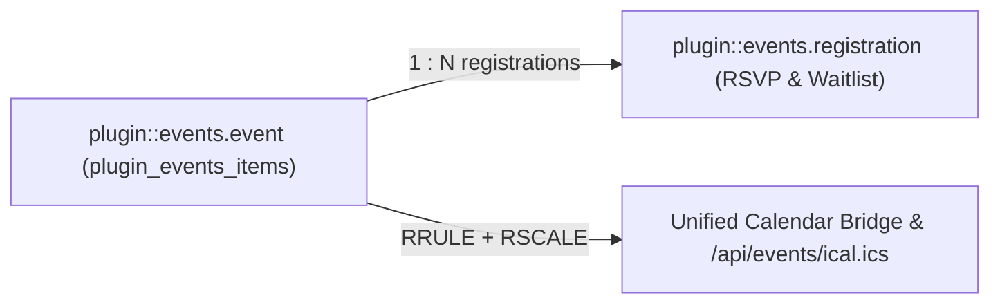
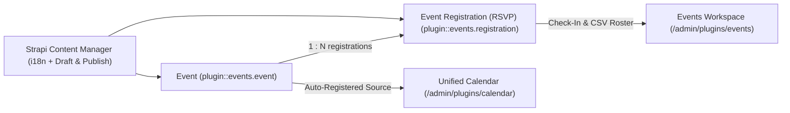
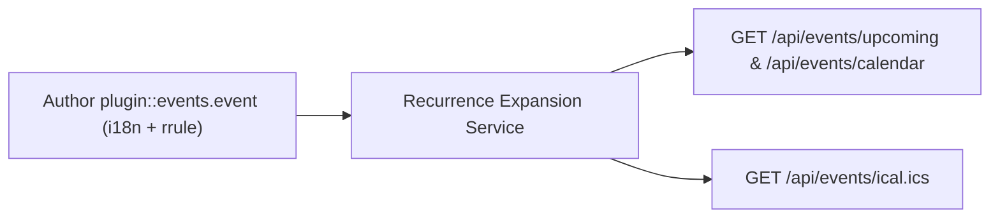
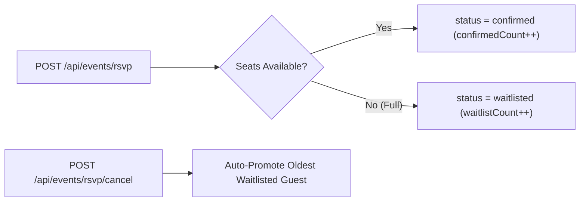
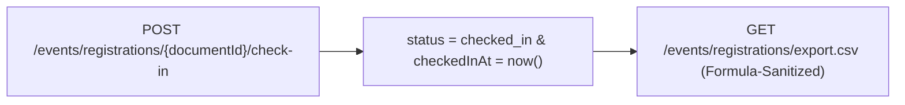

Enterprise-grade **Events, RFC 5545 Recurrence (`RRULE`), Multi-Calendar System Engine, RSVP/Capacity/Waitlist & iCal (`.ics`)** plugin for **Strapi v5**, powered by [`@vicacha-devs/strapi-plugin-calendar`](../strapi-plugin-calendar) as a required dependency.

---

## Features

1. **Dedicated Events RSVP, Waitlist & Check-In Workspace (`/admin/plugins/events`) + Unified Calendar Integration**
   - **Required Dependency on `@vicacha-devs/strapi-plugin-calendar`**: Automatically registers all event sources into the central `/admin/plugins/calendar` workspace on server bootstrap so all Month/Week/Day/Agenda/Year schedule views are unified in one place (with a 1-click **Open in Calendar** shortcut to `/admin/plugins/calendar?source=events`).
   - **RSVP, Waitlist & Attendee Check-In Workspace**: KPI summary cards (Total Registrations, Confirmed Seats, Checked-In Seats, Waitlisted Seats, Events with RSVPs), attendee search & status filters, 1-click attendee check-in, status updates with automatic waitlist promotion, Quick-Create Event panel, and formula-injection-safe CSV export.
2. **Extensible Secondary Calendar Systems (`secondaryCalendars` + Custom Formatters)**
   - Built-in ECMA-402 / Unicode CLDR support (`islamic-umalqura`, `islamic-civil`, `hebrew`, `persian`, `buddhist`, `japanese`, `chinese`, `indian`, `coptic`, `ethiopic`).
   - Configurable `dayOffset` (`-2` to `+2` days) for lunar sighting or regional adjustments.
   - Per-document override field support (`overrideField` / `alternateDateFields`, e.g. `hijriDate`) so manual dates override the base occurrence while recurring occurrences dynamically compute their dates.
   - Programmatic custom date formatter registry (`registerCalendarFormatter(id, fn)`) for custom non-Intl calendars (e.g., fiscal quarters, academic weeks).
3. **Declarative Schema & Field Extensions (`schemaExtensions`, `customFields`)**
   - Extend built-in `plugin::events.event` and `plugin::events.registration` schemas directly from `config/plugins.ts` without modifying plugin source files.
   - Pass arbitrary collection attributes (`customFields: ['hijriDate', 'speaker', ...]`) through to `ExpandedOccurrence.customFields`.
4. **Hybrid Content Model**
   - Ships ready-to-use `plugin::events.event` and `plugin::events.registration` Content-Types (including generic `alternateDates` and `metadata` JSON fields) **and** maps any existing Strapi v5 collection types onto the unified Calendar View and API.
5. **RFC 5545 Recurrence (`plugin::events.rrule`) & iCal (`.ics`) Syndication**
   - Visual `RRuleInput` custom field (`DAILY`, `WEEKLY`, `MONTHLY`, `YEARLY`, `INTERVAL`, `BYDAY`, `BYMONTHDAY`, `COUNT`, `UNTIL`, `exdates`, and per-occurrence `overrides`).
   - Public `.ics` subscription feed (`/api/events/feed.ics`) and single-event `.ics` invites.
6. **RSVP, Seat Capacity, Automatic Waitlist Promotion & 1-Click Check-In**
   - Enforces capacity per occurrence, automatically promotes waitlisted attendees when confirmed attendees cancel, and exports formula-injection-safe CSVs.

---

## Configuration (`config/plugins.ts`)

```ts
export default ({ env }) => ({
  events: {
    enabled: true,
    config: {
      defaultTimezone: env("EVENTS_TIMEZONE", "UTC"),
      defaultCapacity: 100,
      waitlistEnabledByDefault: true,
      defaultMaxGuestsPerRegistration: 5,
      sendRsvpEmails: true,
      feedTitle: "Organization Events Calendar",

      // 1. Optional Secondary Calendar Systems (Unicode CLDR or custom formatter ID)
      secondaryCalendars: [
        {
          id: "hijri",
          label: "Hijri (Umm al-Qura)",
          intlCalendar: "islamic-umalqura",
          dayOffset: env.int("HIJRI_DAY_OFFSET", 0),
          overrideField: "hijriDate",
          enabled: true,
        },
      ],

      // 2. Optional Custom Recurrence Presets for Quick-Create & RRuleInput
      recurrencePresets: [
        { id: "daily", label: "Daily", rrule: "FREQ=DAILY;INTERVAL=1" },
        {
          id: "weekly-fri",
          label: "Weekly on Fridays",
          rrule: "FREQ=WEEKLY;INTERVAL=1;BYDAY=FR",
        },
        { id: "monthly", label: "Monthly", rrule: "FREQ=MONTHLY;INTERVAL=1" },
      ],

      // 3. Optional Declarative Schema Extensions on plugin::events.event / registration
      schemaExtensions: {
        event: {
          hijriDate: {
            type: "string",
            pluginOptions: { i18n: { localized: true } },
          },
        },
      },

      // 4. Mapped Collection Sources
      sources: [
        {
          id: "public-events",
          label: "Events",
          uid: "api::event.event",
          color: "#0D9488",
          enabled: true,
          fields: {
            title: "title",
            startDate: "startDate",
            endDate: "endDate",
            rrule: "recurrence",
            location: "location",
            category: "category",
            summary: "summary",
            slug: "slug",
            capacity: "capacity",
            rsvpEnabled: "rsvpEnabled",
            alternateDateFields: {
              hijri: "hijriDate",
            },
            customFields: ["hijriDate", "featured"],
          },
        },
      ],
    },
  },
});
```

---

## Registering a Custom Programmatic Date System

To add a custom non-Intl date system (such as Fiscal Quarters or Academic Weeks), register a formatter in your Strapi application's `src/index.ts`:

```ts
export default {
  bootstrap({ strapi }) {
    strapi
      .plugin("events")
      .service("occurrence")
      .registerCalendarFormatter("custom-fiscal", (date, { compact }) => {
        const quarter = Math.floor(date.getUTCMonth() / 3) + 1;
        return compact
          ? `Q${quarter}`
          : `FY${date.getUTCFullYear()} Q${quarter}`;
      });
  },
};
```

## Content-Type Entities & Where to Find Them

Registers two Collection Types (`plugin::events.event` with `draftAndPublish: true` & `i18n.localized: true`, and `plugin::events.registration`) plus the `plugin::events.rrule` Custom Field. Also supports binding additional custom `api::*` event collections via `sources[]` and extending schemas via `schemaExtensions` in `config/plugins.ts`.



- **Content Manager**: `/admin/content-manager/collection-types/plugin::events.event` & `/admin/content-manager/collection-types/plugin::events.registration` (`visible: true`)
- **Content-Type Builder**: `/admin/plugins/content-type-builder` under **Collection Types** (`Event` & `Event Registration (RSVP)`) + Custom Field `plugin::events.rrule`
- **Plugin Workspace & Settings**: `/admin/plugins/events` (Events Manager, RSVP Roster, Waitlist, Check-In) and `/admin/settings/events`
- **Database Tables**: `plugin_events_items` and `plugin_events_registrations`

## Strapi v5 Content Manager Integration (`/admin/content-manager`)

> **Content Manager Sidebar Group**: `Events, Scheduling & Bookings`

### Content Manager Entities & Components

- `plugin::events.event` (**Event** — `/admin/content-manager/collection-types/plugin::events.event`)
- `plugin::events.registration` (**Event Registration (RSVP)** — `/admin/content-manager/collection-types/plugin::events.registration`)
- Custom Field `plugin::events.rrule`


### Why This Plugin Creates & Integrates Content Manager Entities

`@vicacha-devs/strapi-plugin-events` registers **Event** (`plugin::events.event`, with `i18n.localized: true` and `draftAndPublish: true`) and **Event Registration (RSVP)** (`plugin::events.registration`) as primary Content Manager collection types so editorial teams can author rich multilingual event pages while operations staff manage RSVPs and check-ins:

- **Rich Editorial & Speaker Relations**: In Content Manager, `Event` records support rich-text descriptions, poster images, speaker relations (e.g., linking `Staff, Scholar & Author` `api::leader.leader`), virtual meeting URLs, and `plugin::events.rrule` recurrence rules.
- **Multilingual (`i18n`) Event Publishing**: Author event pages across `en`, `es`, `ar`, and `tr` (`?plugins[i18n][locale]=en`) with independent draft/publish control per locale.
- **Injected Right-Sidebar Widgets**: Opening an `Event` in Content Manager displays both the **Calendar & Schedule** widget (Hijri date + `.ics` export) and the **Event & RSVP Summary** panel alongside **Editorial Notes**.
- **Direct RSVP Roster Inspection**: Inspect, filter, and search individual `Event Registration (RSVP)` records (`confirmed`, `waitlisted`, `checked_in`, `cancelled`) directly in Content Manager.

### How to Use in Strapi Content Manager (Step-by-Step)

1. **Open in Content Manager**: In the left sidebar, click **Content Manager -> Collection Types -> Events, Scheduling & Bookings** and select **Event** (`/admin/content-manager/collection-types/plugin::events.event?plugins[i18n][locale]=en`) or **Event Registration (RSVP)** (`/admin/content-manager/collection-types/plugin::events.registration`).
2. **Author & Localize Events**: Click **+ Create new entry** in **Event**, fill in `title`, `slug`, `summary`, `description`, `startDate`, `endDate`, `rrule`, `capacity`, and `waitlistEnabled`, then click **Publish**.
3. **Inspect RSVP Registrations**: Open **Event Registration (RSVP)** in Content Manager to filter attendees by `status`, `occurrenceDate`, `attendeeEmail`, or linked `event`.
4. **Workspace vs. Content Manager**: Use **Content Manager** for rich multilingual event authoring, poster uploads, and speaker relations; use the **Events Workspace** (`/admin/plugins/events`) for 1-click door check-in, waitlist promotion, and formula-sanitized CSV exports.

### Content Manager & Plugin Workspace Synchronization



### Content Manager Use Cases & Editorial Workflows

#### Content Manager Use Case 1 — Authoring Multilingual Recurring Classes & Community Dinners

- **Why & What it is for**: Create and translate recurring educational classes (`Classical Arabic Course`), youth circles (`Weekly Youth Circle`), and scholarship announcements (`Türkiye Bursları Scholarship Orientation`) in Content Manager.
- **How to use in Content Manager**: Open `/admin/content-manager/collection-types/plugin::events.event?plugins[i18n][locale]=en`, edit the event attributes and `rrule` recurrence, verify the Hijri date in the right sidebar, and publish across locales.

#### Content Manager Use Case 2 — Filtering Waitlisted or Checked-In Attendees Across Occurrences

- **Why & What it is for**: Search attendee registrations by email, occurrence date, or dietary/accessibility notes inside Content Manager.
- **How to use in Content Manager**: Open `/admin/content-manager/collection-types/plugin::events.registration` and filter by `status = waitlisted` or `status = checked_in`.

## End-to-End Use Cases & Workflows

### Use Case 1 — Multilingual Recurring Events with Poster & Speaker Metadata

- **What it is for**: Publish localized single or recurring lectures, workshops, and community gatherings with speaker profiles and virtual/hybrid links.
- **How it works**: Author records in `plugin::events.event` (using `plugin::events.rrule` for recurrence) and query expanded occurrences via `GET /api/events/upcoming` or `GET /api/events/calendar`.




### Use Case 2 — Capacity-Controlled Public RSVP & Automatic Waitlist Promotion

- **What it is for**: Enforce seat limits (`capacity`, `maxGuestsPerRegistration`) per occurrence date and automatically promote waitlisted guests when someone cancels.
- **How it works**: Visitors submit `POST /api/events/rsvp` (creating `plugin::events.registration` as `confirmed` or `waitlisted`); `POST /api/events/rsvp/cancel` cancels a seat and promotes the oldest waitlisted record.




### Use Case 3 — 1-Click Door Check-In & Formula-Injection-Safe CSV Roster Export

- **What it is for**: Check in attendees at the venue entrance and export clean attendee rosters for spreadsheets.
- **How it works**: Use `POST /events/registrations/{documentId}/check-in` in `/admin/plugins/events` and download rosters via `GET /events/registrations/export.csv`.




## Admin Workspace, Content Manager & Settings Panel Preview


### Strapi v5 Content Manager Entities (`/admin/content-manager`)


### Settings Panel (`Settings -> Configuration`)


> Explore [**Content Types & Use Cases**](/strapi-plugin-events/use-cases/), the [**Developer Guide & Admin UI Tour**](/strapi-plugin-events/guide/), and the [**Interactive OpenAPI Reference**](/strapi-plugin-events/api/) for complete schema, workflow diagram, and endpoint documentation.
