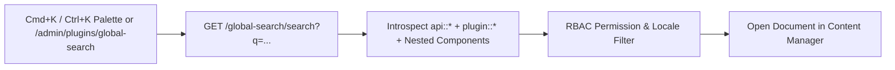
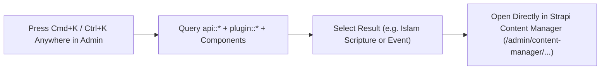
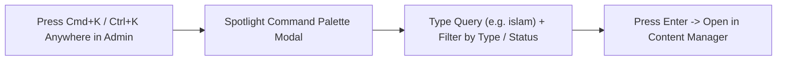
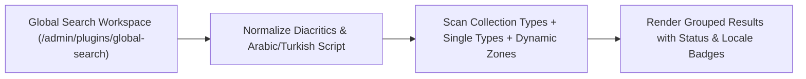
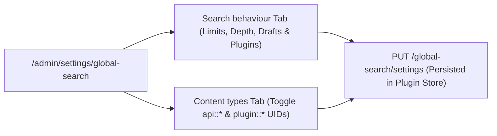

[](https://www.npmjs.com/package/@vicacha-devs/strapi-plugin-global-search)
[](https://strapi.io)
[](LICENSE)

Spotlight-style **global search** for the Strapi v5 admin: every collection type and single type, from a dedicated page or a <kbd>Ctrl</kbd>/<kbd>Cmd</kbd> + <kbd>K</kbd> palette.

Install it, enable it, and start Strapi. It introspects your content types at boot and never needs to know your schema ahead of time.

**Strapi 4:** use [`strapi-global-search@1.x`](https://www.npmjs.com/package/strapi-global-search/v/1.0.0). This major (`2.x`) is Strapi 5 only.

## Features

- **Searches everything** — every `api::` and Content-Manager-visible `plugin::` collection type _and_ single type, including custom fields, structured rich text (ProseMirror / Tiptap JSON), and text fields nested inside components.
- **Two surfaces** — a full search page under the plugins menu, and an instant SPA-navigating command palette (<kbd>Ctrl</kbd>/<kbd>Cmd</kbd> + <kbd>K</kbd>) available from anywhere in the admin.
- **Predictable ordering** — results are ranked id → name → other fields → nested fields (see below), never by an opaque relevance score.
- **Respects your permissions** — an editor only ever sees content types they can read in the Content Manager.
- **i18n and draft/publish aware** — searches every locale by default and finds drafts. Includes UI translations for `en`, `fr`, `es`, `ar`, and `tr`.
- **No index, no extra services** — plain database queries, nothing to keep in sync.

## Installation

```bash
pnpm add @vicacha-devs/strapi-plugin-global-search
npm install @vicacha-devs/strapi-plugin-global-search
```

Enable it in `config/plugins.js` or `config/plugins.ts`:

```js
module.exports = {
  "global-search": {
    enabled: true,
  },
};
```

Then start your Strapi app (`npm run develop`). There is no extra build step.

This package has **no** `preinstall` / `install` / `postinstall` scripts and does not use git or remote URL dependencies. On [npm v12](https://github.blog/changelog/2026-07-08-npm-install-time-security-and-gat-bypass2fa-deprecation/) you do not need an `allowScripts` entry for `strapi-global-search`.

## Result ordering

| Priority | Match                                       |
| -------- | ------------------------------------------- |
| 1        | `id` / `documentId` exact                   |
| 2        | `id` / `documentId` partial                 |
| 3        | Name (the Content Manager main field) exact |
| 4        | Name starts with the query                  |
| 5        | Name contains the query                     |
| 6        | Any other top-level text field              |
| 7        | Any text field inside a component           |

Ties break on an exact-case match, then the shortest matching value, then the most recently updated entry.

## Spotlight Command Palette (<kbd>Cmd</kbd>/<kbd>Ctrl</kbd> + <kbd>K</kbd>)

At bootstrap, the plugin mounts a lightweight React portal (`#global-search-portal-root`) on `document.body` so the command palette can be opened on **any** Strapi v5 Admin route — including inside Content Manager edit views and Settings pages:

| Shortcut                                                     | Action                                                                          |
| :----------------------------------------------------------- | :------------------------------------------------------------------------------ |
| <kbd>⌘</kbd> + <kbd>K</kbd> / <kbd>Ctrl</kbd> + <kbd>K</kbd> | Toggle the Spotlight Command Palette from anywhere in the Strapi v5 Admin panel |
| <kbd>↑</kbd> / <kbd>↓</kbd>                                  | Navigate up and down through ranked search results                              |
| <kbd>↵</kbd> (`Enter`)                                       | Open the highlighted entry in the current tab via SPA router navigation         |
| <kbd>⌘</kbd>/<kbd>Ctrl</kbd> + <kbd>↵</kbd>                  | Open the highlighted entry in a new browser tab                                 |
| <kbd>Esc</kbd>                                               | Close the command palette and restore focus                                     |

Each result row displays:

- **Entry Title & Highlighted Match** — matched query substrings are highlighted inline across both the main field and matched secondary/component fields (e.g., `Slug: historia-del-islam`).
- **Document ID Badge** — quick reference to the Strapi v5 `documentId` (`#ikm8b47sijmgzv99g119h3a5`).
- **Locale & Publication State Badges** — shows the active i18n locale (`en`, `es`, `ar`, `tr`) and `DRAFT` / `PUBLISHED` status alongside the human-readable Content-Type label (`Article & Course`, `Community Service`, `Resource Publication`).

## Configuration

Everything is optional and can be changed at **Settings → Global Search → Configuration**, or pinned in `config/plugins.js` / `config/plugins.ts`:

```js
module.exports = {
  "global-search": {
    enabled: true,
    config: {
      minChars: 2, // minimum query length
      debounce: 250, // ms to wait after the last keystroke
      perTypeLimit: 20, // rows fetched per content type
      maxResults: 100, // cap on the merged, ranked result set
      deep: true, // search inside components
      maxDepth: 3, // how many component levels to walk
      includeDrafts: true, // include unpublished entries
      includePluginContentTypes: true, // include visible plugin::* content types
      queryTimeout: 4000, // per-content-type timeout in ms
      concurrency: 8, // content types queried in parallel
      excludedContentTypes: [], // e.g. ['api::log.log']
      excludedFields: [], // e.g. ['api::article.article:body']
      displayFields: {}, // extra fields in the result row, keyed by UID
    },
  },
};
```

## Permissions

Two RBAC actions are registered and can be assigned per role:

- `plugin::global-search.read` — use the search page and the palette.
- `plugin::global-search.settings` — change the configuration.

Search results are additionally filtered by each user's Content Manager read permissions.

## Performance notes

Searching runs live database `LIKE` queries — there is no index to maintain, but a query on a very large table is only as fast as your database makes it. The plugin keeps this bounded with a per-content-type row limit, a bounded column projection, a per-type timeout, a concurrency cap and a client-side debounce. For very large tables, consider a database index on the fields people actually search, or disable those content types in Settings.

Reported result counts reflect the capped set (`perTypeLimit` rows per type, `maxResults` overall) — a `+` in the UI means there were more matches than were fetched.

## Limitations

- **Dynamic zones** and **blocks** fields are not searched: the query engine cannot filter polymorphic JSON columns.
- Relations, media and raw JSON fields are not searched.
- Internal Strapi system plugin content types (such as `plugin::upload.file`, `plugin::i18n.locale`, and `plugin::users-permissions.*`) are skipped automatically.

## Compatibility

|        |                                     |
| ------ | ----------------------------------- |
| Strapi | `^5.0.0` (developed against 5.52.0) |
| Node   | 20 – 26                             |
| React  | 18                                  |

## Publishing and supply chain

Public releases are published from GitHub Actions with [npm trusted publishing](https://docs.npmjs.com/trusted-publishers/) (OIDC). There is no long-lived 2FA-bypass granular access token. See [npm install-time security and GAT bypass2fa deprecation](https://github.blog/changelog/2026-07-08-npm-install-time-security-and-gat-bypass2fa-deprecation/).

## License

MIT

## Content-Type Entities & Where to Find Them

Operates as a universal zero-schema introspection engine over **all** registered Strapi v5 Content-Type entities (`api::*` collection types, single types, and `plugin::*` entities) plus nested components and dynamic zones. Uses `strapi.contentTypes` metadata and `strapi.documents(uid).findMany()` with RBAC permission filtering.



- **Spotlight Command Palette Overlay**: Press `Cmd+K` (macOS) or `Ctrl+K` (Windows/Linux) from **any** Strapi Admin screen (including Content Manager, Calendar, or Settings)
- **Dedicated Search Workspace**: `/admin/plugins/global-search` (`Global Search` in the main left sidebar)
- **Settings Panel**: `/admin/settings/global-search` (`Settings -> Global Search -> Configuration` — organized into **Search behaviour** and **Content types** tabs)
- **Target Entities**: Opens matched documents directly at `/admin/content-manager/collection-types/{uid}/{documentId}?plugins[i18n][locale]={locale}`

## Strapi v5 Content Manager Integration (`/admin/content-manager`)

> **Content Manager Sidebar Group**: `All Content Manager Collection Types & Single Types (`Cmd+K`/`Ctrl+K`)`

### Content Manager Entities & Components

- Universal Introspection across all `api::*` and `plugin::*` Content Manager Collection Types, Single Types, and Nested Components

### Why This Plugin Creates & Integrates Content Manager Entities

`@vicacha-devs/strapi-plugin-global-search` does not create an isolated database table because its entire purpose is to act as a high-speed **Content Manager Command Palette & Deep-Link Router** over every `api::*` and `plugin::*` entity registered in Strapi v5:

- **Instant Deep-Linking into Content Manager**: Pressing `Enter` on any search result navigates directly to `/admin/content-manager/collection-types/{uid}/{documentId}?plugins[i18n][locale]={locale}` (or `single-types/{uid}`).
- **Searches Both Host `api::*` and Plugin `plugin::*` Entities**: Simultaneously indexes articles, scholars (`api::leader.leader`), events (`plugin::events.event`), scripture entries (`plugin::islam.scripture-entry`), donations (`plugin::donations.campaign`), and publications (`plugin::resources.publication`).

### How to Use in Strapi Content Manager (Step-by-Step)

1. **Invoke from Anywhere**: Press `Cmd+K` (macOS) or `Ctrl+K` (Windows/Linux) while inside Content Manager or any plugin page.
2. **Filter by Entity Type, Status & Locale**: Type a keyword and narrow results by Collection Type, `Draft`/`Published` status, or `i18n` locale badge.
3. **Open in Content Manager**: Press `Enter` to open the entry in Content Manager in the current tab, or `Cmd/Ctrl + Enter` to open it in a new tab.

### Content Manager & Plugin Workspace Synchronization



### Content Manager Use Cases & Editorial Workflows

#### Content Manager Use Case 1 — Jumping Between Plugin Entities & Host Collections Without Leaving the Keyboard

- **Why & What it is for**: Switch from editing a `Booking Resource` to a `Donation Campaign` or `Islam Scripture Entry` in Content Manager in under a second.
- **How to use in Content Manager**: Press `Cmd+K`, type the title or slug, and press `Enter` to load the target document in Content Manager.

## End-to-End Use Cases & Workflows

### Use Case 1 — Instant `Cmd+K` / `Ctrl+K` Spotlight Navigation Across All Entities

- **What it is for**: Jump directly to any Article, Course, Event, Booking, Certificate, or Single Type record from anywhere in Strapi Admin without leaving the keyboard.
- **How it works**: Press `Cmd+K`, type a query (e.g., `islam`), navigate with `↑`/`↓`, and press `Enter` to open the document in Content Manager (or `Cmd/Ctrl + Enter` for a new tab).




### Use Case 2 — Deep Component & Multilingual Script Search (Arabic, Turkish, Spanish)

- **What it is for**: Find records by text buried inside repeatable components, SEO meta descriptions, or Arabic/RTL localized variants.
- **How it works**: `GET /global-search/search?q=...&locale=all` normalizes diacritics and Arabic Alef/Teh Marbuta variants and searches both top-level and nested component fields.




### Use Case 3 — Tabbed Search Behaviour & Per-Content-Type Inclusion Tuning

- **What it is for**: Fine-tune query thresholds (`Minimum characters`, `Debounce (ms)`, `Results per content type`, `Maximum results`, `Component depth`, `Query timeout (ms)`, `Search inside components`, `Include drafts`, `Include plugin content types`) and toggle which Content-Type entities appear in global search.
- **How it works**: Configure the **Search behaviour** and **Content types** tabs in `/admin/settings/global-search` (`PUT /global-search/settings`).




## Admin Workspace, Content Manager & Settings Panel Preview


### Spotlight Command Palette (`Cmd+K` / `Ctrl+K` Overlay)


### Settings Panel (`Settings -> Configuration`)


> Explore [**Content Types & Use Cases**](/strapi-plugin-global-search/use-cases/), the [**Developer Guide & Admin UI Tour**](/strapi-plugin-global-search/guide/), and the [**Interactive OpenAPI Reference**](/strapi-plugin-global-search/api/) for complete schema, workflow diagram, and endpoint documentation.
