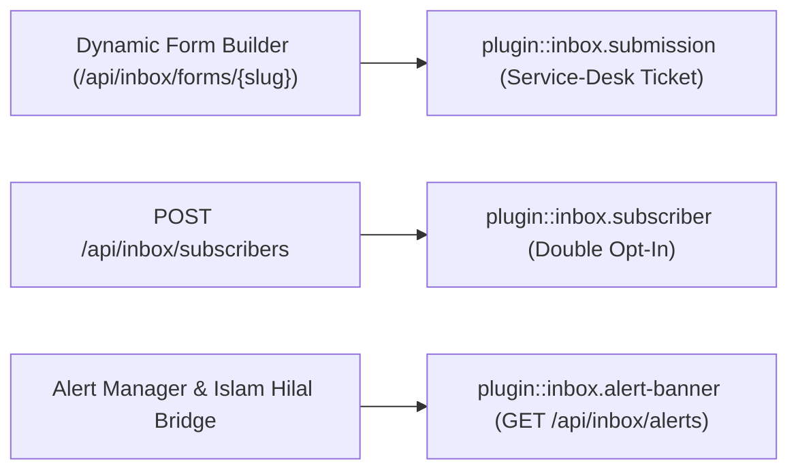
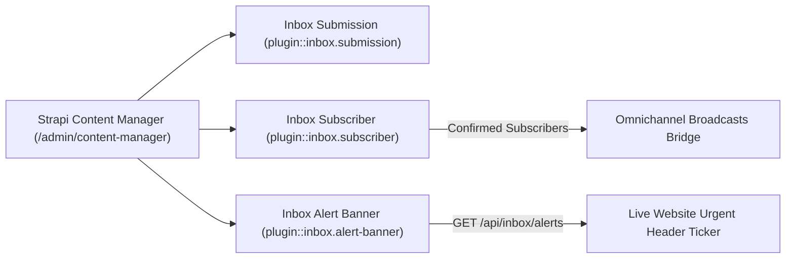
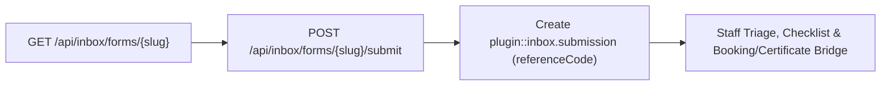
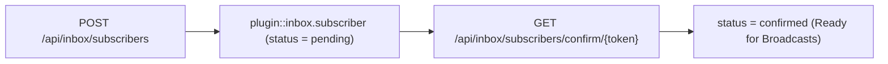
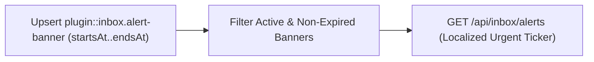

> **Package**: `@vicacha-devs/strapi-plugin-inbox` · **Plugin ID**: `inbox` · **Admin Workspace**: `/admin/plugins/inbox`

## 1. Content-Type Entities, Locations & Schemas (`strapi.documents`)

Registers three Collection Types (`plugin::inbox.submission`, `plugin::inbox.subscriber`, and `plugin::inbox.alert-banner`). Submissions capture dynamic form payloads and service-desk tickets; Subscribers manage double opt-in topic lists; Alert Banners drive time-bounded site-wide urgent tickers.

### Where to Find Content-Type Entities in Strapi v5

- **Content Manager**: `/admin/content-manager/collection-types/plugin::inbox.submission`, `plugin::inbox.subscriber`, and `plugin::inbox.alert-banner` (`visible: true`)
- **Content-Type Builder**: `/admin/plugins/content-type-builder` under **Collection Types** (`Inbox Submission`, `Inbox Subscriber`, `Inbox Alert Banner`)
- **Plugin Workspace & Settings**: `/admin/plugins/inbox` (Service Desk Inbox, Subscribers, Alert Banners) and `/admin/settings/inbox`
- **Database Tables**: `inbox_submissions`, `inbox_subscribers`, and `inbox_alert_banners`

### `plugin::inbox.alert-banner` — Inbox Alert Banner

Time-bounded multi-language urgent announcement ticker / banner

> **Kind**: `collectionType` · **DB Table**: `inbox_alert_banners` · **Admin Location**: `/admin/content-manager/collection-types/plugin::inbox.alert-banner` · **Draft & Publish**: `No` · **i18n**: `No`

| Attribute      | Strapi Type   | Required | Constraints / Target                                          |
| :------------- | :------------ | :------- | :------------------------------------------------------------ |
| `code`         | `string`      | Yes      | —                                                             |
| `title`        | `string`      | Yes      | —                                                             |
| `message`      | `text`        | Yes      | —                                                             |
| `severity`     | `enumeration` | Yes      | enum: `info, warning, urgent, celebration`; default: `"info"` |
| `ctaLabel`     | `string`      | No       | —                                                             |
| `ctaUrl`       | `string`      | No       | —                                                             |
| `dismissible`  | `boolean`     | No       | default: `true`                                               |
| `active`       | `boolean`     | No       | default: `true`                                               |
| `priority`     | `integer`     | No       | default: `10`                                                 |
| `startsAt`     | `datetime`    | No       | —                                                             |
| `endsAt`       | `datetime`    | No       | —                                                             |
| `translations` | `json`        | No       | default: `{}`                                                 |

### `plugin::inbox.submission` — Inbox Submission

Form submission & Service-Desk Casework ticket

> **Kind**: `collectionType` · **DB Table**: `inbox_submissions` · **Admin Location**: `/admin/content-manager/collection-types/plugin::inbox.submission` · **Draft & Publish**: `No` · **i18n**: `No`

| Attribute                 | Strapi Type   | Required | Constraints / Target                                                                         |
| :------------------------ | :------------ | :------- | :------------------------------------------------------------------------------------------- |
| `referenceCode`           | `string`      | Yes      | —                                                                                            |
| `formSlug`                | `string`      | Yes      | —                                                                                            |
| `formTitle`               | `string`      | No       | —                                                                                            |
| `category`                | `enumeration` | No       | enum: `contact, service_desk, inquiry, application, volunteer, custom`; default: `"contact"` |
| `status`                  | `enumeration` | Yes      | enum: `new, read, under_review, scheduled, completed, rejected, archived`; default: `"new"`  |
| `priority`                | `enumeration` | Yes      | enum: `low, normal, high, urgent`; default: `"normal"`                                       |
| `department`              | `string`      | No       | default: `"general"`                                                                         |
| `locale`                  | `string`      | No       | default: `"es"`                                                                              |
| `applicantName`           | `string`      | No       | —                                                                                            |
| `applicantEmail`          | `email`       | No       | —                                                                                            |
| `applicantPhone`          | `string`      | No       | —                                                                                            |
| `data`                    | `json`        | Yes      | default: `{}`                                                                                |
| `checklistItems`          | `json`        | No       | default: `[]`                                                                                |
| `staffNotes`              | `text`        | No       | —                                                                                            |
| `assignedTo`              | `string`      | No       | —                                                                                            |
| `linkedBookingId`         | `string`      | No       | —                                                                                            |
| `linkedCertificateNumber` | `string`      | No       | —                                                                                            |
| `formBuilderSubmissionId` | `integer`     | No       | —                                                                                            |
| `ipAddress`               | `string`      | No       | `private: true`                                                                              |
| `userAgent`               | `string`      | No       | `private: true`                                                                              |
| `submittedAt`             | `datetime`    | Yes      | —                                                                                            |
| `secondaryDate`           | `json`        | No       | —                                                                                            |

### `plugin::inbox.subscriber` — Inbox Subscriber

Double Opt-In newsletter and community topic subscriber

> **Kind**: `collectionType` · **DB Table**: `inbox_subscribers` · **Admin Location**: `/admin/content-manager/collection-types/plugin::inbox.subscriber` · **Draft & Publish**: `No` · **i18n**: `No`

| Attribute          | Strapi Type   | Required | Constraints / Target                                           |
| :----------------- | :------------ | :------- | :------------------------------------------------------------- |
| `email`            | `email`       | Yes      | —                                                              |
| `fullName`         | `string`      | No       | —                                                              |
| `phone`            | `string`      | No       | —                                                              |
| `locale`           | `string`      | No       | default: `"es"`                                                |
| `topics`           | `json`        | No       | default: `["announcements"]`                                   |
| `status`           | `enumeration` | Yes      | enum: `pending, confirmed, unsubscribed`; default: `"pending"` |
| `confirmToken`     | `string`      | No       | `private: true`                                                |
| `unsubscribeToken` | `string`      | Yes      | `private: true`                                                |
| `confirmedAt`      | `datetime`    | No       | —                                                              |
| `unsubscribedAt`   | `datetime`    | No       | —                                                              |
| `sourceFormSlug`   | `string`      | No       | —                                                              |

## Strapi v5 Content Manager Integration (`/admin/content-manager`)

> **Content Manager Sidebar Group**: `Inbox & Omnichannel Broadcasts`

### Content Manager Entities & Components

- `plugin::inbox.submission` (**Inbox Submission** — `/admin/content-manager/collection-types/plugin::inbox.submission`)
- `plugin::inbox.subscriber` (**Inbox Subscriber** — `/admin/content-manager/collection-types/plugin::inbox.subscriber`)
- `plugin::inbox.alert-banner` (**Inbox Alert Banner** — `/admin/content-manager/collection-types/plugin::inbox.alert-banner`)

### Why This Plugin Creates & Integrates Content Manager Entities

`@vicacha-devs/strapi-plugin-inbox` registers all three of its entities (`Inbox Submission`, `Inbox Subscriber`, and `Inbox Alert Banner`) with `pluginOptions['content-manager'].visible = true` so service-desk coordinators, newsletter managers, and editors can combine the operational triage board in `/admin/plugins/inbox` with Strapi v5's native Content Manager:

- **Structured Casework & Cross-Entity Linking**: In Content Manager, `Inbox Submission` (`plugin::inbox.submission`) exposes `referenceCode`, `category`, `status`, `priority`, `department`, `checklistItems`, `linkedBookingId`, and `linkedCertificateNumber` while keeping `ipAddress` and `userAgent` protected (`private: true`).
- **Subscriber Topic & GDPR Compliance Management**: Filter `Inbox Subscriber` (`plugin::inbox.subscriber`) by `status` (`pending`, `confirmed`, `unsubscribed`), `locale`, and `topics` while `confirmToken` and `unsubscribeToken` remain private.
- **Time-Bounded Urgent Alert Authoring**: Author and schedule `Inbox Alert Banner` (`plugin::inbox.alert-banner`) records (`severity`: `info`, `warning`, `urgent`, `celebration`, `startsAt`, `endsAt`, `translations`) directly in Content Manager.

### How to Use in Strapi Content Manager (Step-by-Step)

1. **Open in Content Manager**: In the left sidebar, navigate to **Content Manager -> Collection Types -> Inbox & Omnichannel Broadcasts** and select **Inbox Submission**, **Inbox Subscriber**, or **Inbox Alert Banner**.
2. **Manage Urgent Alert Banners**: Open **Inbox Alert Banner** (`/admin/content-manager/collection-types/plugin::inbox.alert-banner`) to create or toggle site-wide announcements (`RAMADAN-HILAL-1447`, `JUMUAH-LIVE-KHUTBAH`, `WINTER-BLANKET-CAMPAIGN`).
3. **Filter & Assign Service-Desk Submissions**: Open **Inbox Submission** (`/admin/content-manager/collection-types/plugin::inbox.submission`) to filter tickets by `priority = urgent`, `department`, or `status = under_review`, and update `assignedTo` and `staffNotes`.
4. **Workspace vs. Content Manager**: Use **Content Manager** for bulk filtering, alert banner scheduling, and subscriber list audits; use the **Inbox Workspace** (`/admin/plugins/inbox`) for dynamic form schema design and interactive service-desk SLA triage.

### Content Manager & Plugin Workspace Synchronization

### Content Manager Use Cases & Editorial Workflows

#### Content Manager Use Case 1 — Scheduling Multilingual Urgent & Celebration Alert Banners

- **Why & What it is for**: Publish time-bounded header banners for Ramadan Hilal confirmation (`severity: 'celebration'`), Friday live khutbah streams (`info`), or emergency relief appeals (`urgent`).
- **How to use in Content Manager**: Open `/admin/content-manager/collection-types/plugin::inbox.alert-banner`, click **+ Create new entry**, set `code`, `title`, `message`, `severity`, `startsAt`, `endsAt`, and `translations`, and save.

#### Content Manager Use Case 2 — Auditing Service-Desk Submissions & Linking Bookings/Certificates

- **Why & What it is for**: Filter high-priority counseling or matrimonial requests in Content Manager and link them to an appointment (`linkedBookingId`) or certificate (`linkedCertificateNumber`).
- **How to use in Content Manager**: Open `/admin/content-manager/collection-types/plugin::inbox.submission`, filter by `priority = high`, and update the record.

## 3. End-to-End Use Cases & Workflows

### Use Case 1 — Dynamic Public Form Builder & Service-Desk Casework Triage

- **What it is for**: Render multi-step contact, matrimonial, counseling, or volunteer forms on the frontend and triage submissions with SLA priorities and staff checklists.
- **How it works**: Fetch form schemas via `GET /api/inbox/forms/{slug}`, submit via `POST /api/inbox/submit` (creating `plugin::inbox.submission` with a `referenceCode`), and track status via `GET /api/inbox/track/{referenceCode}`.

### Use Case 2 — Double Opt-In Newsletter & Topic Subscription Management

- **What it is for**: Collect GDPR-compliant newsletter and community topic subscribers with tokenized confirmation and 1-click unsubscribe.
- **How it works**: `POST /api/inbox/subscribe` creates a `plugin::inbox.subscriber` in `pending` status; `POST /api/inbox/confirm` and `POST /api/inbox/unsubscribe` verify `confirmToken` / `unsubscribeToken` (`private: true`).

### Use Case 3 — Time-Bounded Multilingual Site-Wide Alert Banners

- **What it is for**: Publish urgent announcements (e.g., Ramadan Hilal sighting, weather closure, live stream alert) in the website header ticker.
- **How it works**: Create `plugin::inbox.alert-banner` records with `severity` (`info`, `warning`, `urgent`, `celebration`), `startsAt`, `endsAt`, and `translations`; fetch active banners via `GET /api/inbox/alerts`.

---

- [Explore the Developer Guide & Admin UI Tour](/strapi-plugin-inbox/guide/)
- [Explore the Interactive OpenAPI Reference](/strapi-plugin-inbox/api/)
