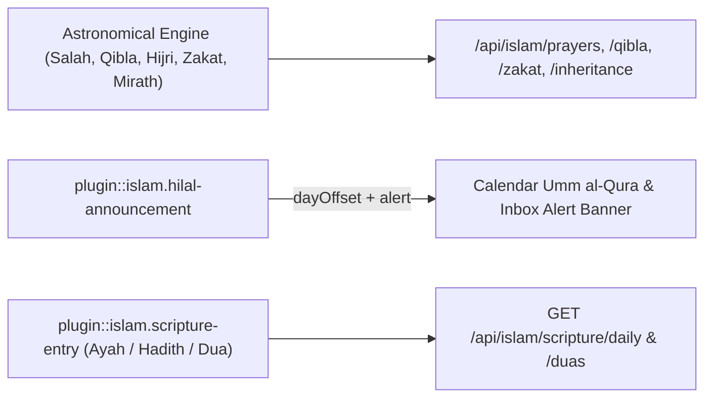
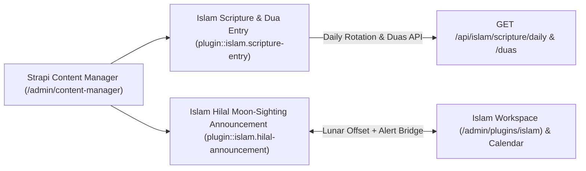
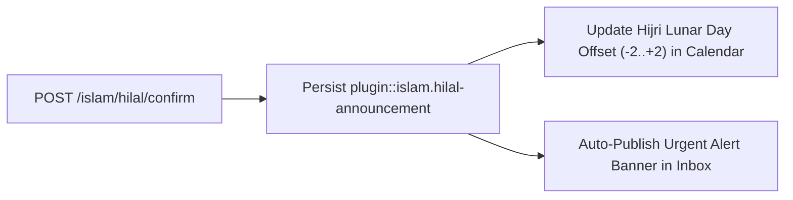
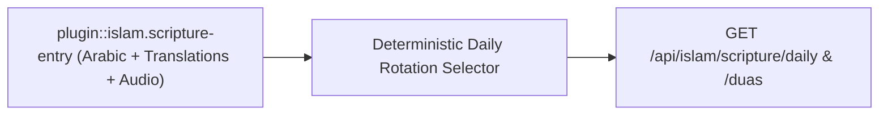
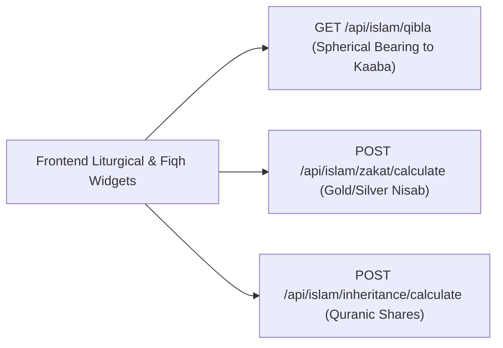

Comprehensive Strapi v5 Islamic Liturgical, Scriptural & Fiqh Suite for Mosques, Islamic Cultural Centers, and Community Platforms.

## 5 Core Pillars

1. **Salah, Adhan, Iqamah, Jumu'ah & Ramadan Imsakiyah Engine**
   - Built-in deterministic astronomical engine (all calculation methods `0`–`23`, Shafi'i & Hanafi Asr shadow factors, per-prayer minute adjustments, high-latitude rules) + optional upstream `IslamicAPI` sync with in-memory TTL caching.
   - Mosque Iqamah rules (`offset_minutes` or `fixed_time`), multi-shift Jumu'ah schedules, Prohibited/Makruh prayer windows (Sunrise, Zawal, Sunset), Adhan audio profiles, and RFC 5545 `.ics` prayer calendar export.
2. **Qibla Spherical Geolocation Compass**
   - Exact Great-Circle bearing (`degrees` clockwise from True North + 16-point compass cardinal) and Haversine geodesic distance (`km` & `mi`) to the Sacred Kaaba in Makkah (`21.422487° N, 39.826206° E`).
3. **Hilal Moon-Sighting, Ramadan, Eid & Islamic Observances**
   - Bidirectional Gregorian ↔ Hijri conversion (`islamic-umalqura` + tabular fallback) with Imam Hilal moon-sighting day offset (`-2` to `+2` days) and explicit Gregorian date confirmation.
   - Automatic countdowns for Ramadan, Laylat al-Qadr, Eid al-Fitr, Day of Arafah, Eid al-Adha, Islamic New Year, Day of Ashura, Mawlid al-Nabi, and Isra & Mi'raj, with Ecosystem Bridges to `@vicacha-devs/strapi-plugin-calendar`, `@vicacha-devs/strapi-plugin-inbox`, and `@vicacha-devs/strapi-plugin-donations`.
4. **Quran, Hadith & Dua / Adhkar Hub**
   - Complete 114 Surah directory + curated Quranic Ayat, Prophetic Hadiths, Hisnul Muslim Duas & Adhkar (with Tasbih repetition counts), 99 Names of Allah (_Asma-ul-Husna_), Digital Tasbih presets, Five Pillars & Shahada reference, and Daily Inspiration with Imam Pin Override.
5. **Fiqh Financial Calculators (Zakat al-Mal, Nisab, Zakat al-Fitr, Fidyah, Kaffarah & Hawl)**
   - Live/Fallback Gold (`85g` Common / `87.48g` Classical) & Silver (`595g` Common / `612.36g` Classical) Nisab thresholds in `COP`, `USD`, `EUR`, and `TRY` with `24K`, `22K`, `21K`, `18K`, `14K` gold carat purity math, agricultural Ushr (`5%` / `10%`), Zakat al-Fitr per-person calculator, Fidyah/Kaffarah calculator, and `354`-day Lunar Hawl maturity tracker.

## Quick Installation & Configuration

```bash
pnpm add @vicacha-devs/strapi-plugin-islam
```

Enable the plugin in `config/plugins.ts`:

```ts
export default () => ({
  islam: {
    enabled: true,
  },
});
```

## Content-Type Entities & Where to Find Them

Registers two Collection Types (`plugin::islam.hilal-announcement` and `plugin::islam.scripture-entry`) paired with pure astronomical calculation engines (`prayerEngine`, `qiblaEngine`, `hijriEngine`, `zakatEngine`, `inheritanceEngine`).



- **Content Manager**: `/admin/content-manager/collection-types/plugin::islam.hilal-announcement` & `/admin/content-manager/collection-types/plugin::islam.scripture-entry` (`visible: true`)
- **Content-Type Builder**: `/admin/plugins/content-type-builder` under **Collection Types** (`Islam Hilal Moon-Sighting Announcement` & `Islam Scripture & Dua Entry`)
- **Plugin Workspace & Settings**: `/admin/plugins/islam` (Salah & Iqamah, Hilal Sighting, Scripture Hub, Zakat & Mirath) and `/admin/settings/islam`
- **Database Tables**: `islam_hilal_announcements` and `islam_scripture_entries`

## Strapi v5 Content Manager Integration (`/admin/content-manager`)

> **Content Manager Sidebar Group**: `Islam, Liturgy & Scripture`

### Content Manager Entities & Components

- `plugin::islam.scripture-entry` (**Islam Scripture & Dua Entry** — `/admin/content-manager/collection-types/plugin::islam.scripture-entry`)
- `plugin::islam.hilal-announcement` (**Islam Hilal Moon-Sighting Announcement** — `/admin/content-manager/collection-types/plugin::islam.hilal-announcement`)


### Why This Plugin Creates & Integrates Content Manager Entities

`@vicacha-devs/strapi-plugin-islam` pairs its astronomical calculation engines (`Salah`, `Qibla`, `Hijri`, `Zakat`, `Mirath`) with two visible Content Manager collection types—**Islam Scripture & Dua Entry** (`plugin::islam.scripture-entry`) and **Islam Hilal Moon-Sighting Announcement** (`plugin::islam.hilal-announcement`)—so scholars and editors can curate verified religious texts and moon-sighting records with full editorial governance:

- **Verified Arabic Scripture, Transliteration & Multilingual Translations**: Curate Quran `ayah`, `hadith`, and `dua` records in `plugin::islam.scripture-entry` with vocalized `arabicText`, `transliteration`, `translations` (`es`, `en`, `ar`, `tr`), `reference` (`Quran 2:255`, `Sahih al-Bukhari 1`), and audio recitation URLs.
- **Historical Hilal Moon-Sighting Ledger**: Maintain an auditable archive of official Ramadan, Shawwal (Eid al-Fitr), and Dhu al-Hijjah crescent confirmations in `plugin::islam.hilal-announcement` (`hijriYear`, `hijriMonth`, `dayOffset`, `gregorianStartDate`, `authority`).
- **Scholar Review with Editorial Notes**: Scholars can review Arabic diacritics and translations directly inside Content Manager and leave verification notes via `@vicacha-devs/strapi-plugin-notes`.

### How to Use in Strapi Content Manager (Step-by-Step)

1. **Open in Content Manager**: In the left sidebar, expand **Content Manager -> Collection Types -> Islam, Liturgy & Scripture** and select **Islam Scripture & Dua Entry** (`/admin/content-manager/collection-types/plugin::islam.scripture-entry?plugins[i18n][locale]=en`) or **Islam Hilal Moon-Sighting Announcement** (`/admin/content-manager/collection-types/plugin::islam.hilal-announcement`).
2. **Curate Quran, Hadith & Dua Entries**: Click **+ Create new entry** in **Islam Scripture & Dua Entry**, choose `entryKind` (`ayah`, `hadith`, `dua`), enter `arabicText`, `transliteration`, `reference`, `category`, and localized `translations`, and toggle `featuredDaily`.
3. **Inspect or Edit Hilal Announcements**: Open **Islam Hilal Moon-Sighting Announcement** to review or update official moon-sighting declarations and their lunar `dayOffset` (`-2` to `+2`).
4. **Workspace vs. Content Manager**: Use **Content Manager** for bulk scripture curation, citation filtering, and scholar review; use the **Islam Suite Workspace** (`/admin/plugins/islam`) for live astronomical Salah/Iqamah timetables, 1-click Hilal confirmation + Inbox alert bridging, and Zakat/Mirath calculators.

### Content Manager & Plugin Workspace Synchronization



### Content Manager Use Cases & Editorial Workflows

#### Content Manager Use Case 1 — Curating the Daily Ayah, Hadith & Hisnul Muslim Supplication Library

- **Why & What it is for**: Manage verified Arabic scripture entries (`Ayat al-Kursi`, `Sahih al-Bukhari 1`, mosque etiquette duas) with English, Spanish, and Turkish translations in Content Manager.
- **How to use in Content Manager**: Open `/admin/content-manager/collection-types/plugin::islam.scripture-entry?plugins[i18n][locale]=en`, filter by `entryKind = dua` or `featuredDaily = true`, and edit the entry.

#### Content Manager Use Case 2 — Auditing Historical Hilal Moon-Sighting Confirmations

- **Why & What it is for**: Maintain the institutional archive of Ramadan and Eid moon-sighting resolutions across Hijri years (`1446 AH`, `1447 AH`).
- **How to use in Content Manager**: Open `/admin/content-manager/collection-types/plugin::islam.hilal-announcement` to inspect `hijriYear`, `hijriMonthName`, `dayOffset`, and `authority`.

## End-to-End Use Cases & Workflows

### Use Case 1 — Daily & Monthly Astronomical Salah, Adhan & Iqamah Timetables

- **What it is for**: Serve accurate Fajr, Sunrise, Dhuhr, Asr, Maghrib, Isha, and Jumu'ah Iqamah schedules with high-latitude and Ramadan Imsak/Iftar rules.
- **How it works**: Configure coordinates, `calculationMethod` (`MWL`, `UmmAlQura`, `ISNA`, etc.), and Iqamah offsets in `/admin/settings/islam`; query `GET /api/islam/prayers/today` or `GET /api/islam/prayers/monthly`.


### Use Case 2 — Official Hilal Moon-Sighting Confirmation & Cross-Plugin Sync

- **What it is for**: Record official local/regional crescent moon sightings for Ramadan, Eid al-Fitr, and Dhu al-Hijjah and immediately adjust Hijri dates across the platform.
- **How it works**: `POST /islam/hilal/confirm` creates a `plugin::islam.hilal-announcement` record, updates the Umm al-Qura `shifting` offset (`-2` to `+2`), and optionally publishes a `plugin::inbox.alert-banner`.




### Use Case 3 — Curated Multilingual Quran Ayah, Hadith & Hisnul Muslim Dua Hub

- **What it is for**: Manage verified Arabic scripture entries (`entryKind: 'ayah' | 'hadith' | 'dua'`) with transliteration, translations (`es`, `en`, `ar`, `tr`), audio recitations (defaulting to `Mishari Rashid al-\`Afasy`, ID `7`), and daily rotation.
- **How it works**: Store records in `plugin::islam.scripture-entry` and serve them via `GET /api/islam/scripture/daily`, `GET /api/islam/scripture/duas`, and `GET /api/islam/quran/resources`.




### Use Case 4 — Qibla Great-Circle Compass, Zakat Nisab & Faraid Inheritance Calculators

- **What it is for**: Provide interactive liturgical and Fiqh utilities via stateless REST endpoints.
- **How it works**: Call `GET /api/islam/qibla?lat=...&lng=...`, `POST /api/islam/zakat/calculate`, and `POST /api/islam/inheritance/calculate`.



## Admin Workspace, Content Manager & Settings Panel Preview


### Strapi v5 Content Manager Entities (`/admin/content-manager`)


### Settings Panel (`Settings -> Configuration`)


> Explore [**Content Types & Use Cases**](/strapi-plugin-islam/use-cases/), the [**Developer Guide & Admin UI Tour**](/strapi-plugin-islam/guide/), and the [**Interactive OpenAPI Reference**](/strapi-plugin-islam/api/) for complete schema, workflow diagram, and endpoint documentation.
