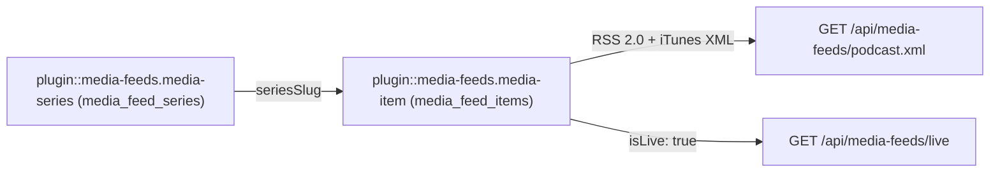
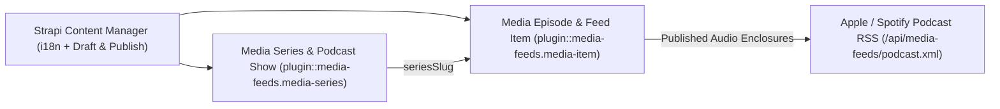
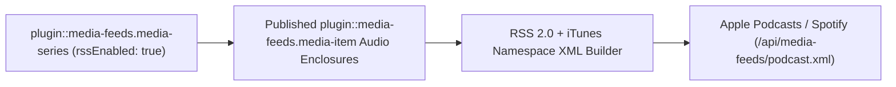
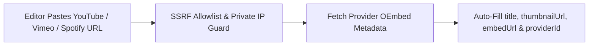
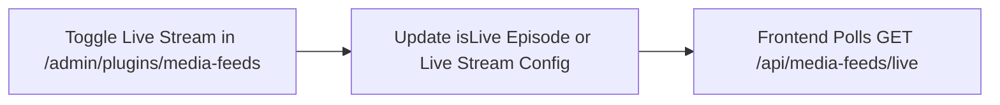

Generic **Multi-Language Audio/Video Media Hub, YouTube & OEmbed Enricher, Apple/Spotify Podcast RSS 2.0 Generator & Live Broadcast Status Plugin** for **Strapi v5**, powered by [`@vicacha-devs/strapi-plugin-calendar`](../strapi-plugin-calendar).

---

## Key Features

- **Media Episodes & Series (`plugin::media-feeds.media-item`, `plugin::media-feeds.media-series`)**:
  - Manage multilingual sermons (khutbahs), lectures, interviews, and podcast series (`GET /api/media-feeds/episodes`, `GET /api/media-feeds/episodes/:slug`, `GET /api/media-feeds/series`) with duration, transcript, speaker, and downloadable audio/video enclosures.
- **YouTube, Vimeo & OEmbed Metadata Enricher**:
  - Automatically extracts video IDs, thumbnails, embed URLs, and durations from YouTube, Vimeo, and direct media URLs.
- **RSS 2.0 & Apple/Spotify Podcast Feeds**:
  - Generates standard RSS 2.0 XML (`GET /api/media-feeds/rss.xml`) and iTunes/Spotify-compliant Podcast XML (`GET /api/media-feeds/podcast.xml`).
- **Live Broadcast Status (`GET /api/media-feeds/live`)**:
  - Exposes real-time livestream status, embed URL, and upcoming broadcast schedule synced with `@vicacha-devs/strapi-plugin-calendar`.
- **13-Locale Admin UI**:
  - Ships with full translations for `en`, `es`, `ar`, `tr`, `fr`, `de`, `pt`, `it`, `nl`, `pl`, `id`, `ur`, and `zh`.

## Quick Installation & Configuration

```bash
pnpm add @vicacha-devs/strapi-plugin-media-feeds
```

Enable the plugin in `config/plugins.ts`:

```ts
export default () => ({
  "media-feeds": {
    enabled: true,
  },
});
```

## Content-Type Entities & Where to Find Them

Registers two localized, draft-and-publish Collection Types (`plugin::media-feeds.media-item` and `plugin::media-feeds.media-series`). Media Series group episodes into podcast shows or video playlists; Media Items store multi-language audio/video episodes, OEmbed metadata, audio enclosures, transcripts, and chapter markers. Supports `schemaExtensions` in `config/plugins.ts`.



- **Content Manager**: `/admin/content-manager/collection-types/plugin::media-feeds.media-item` & `/admin/content-manager/collection-types/plugin::media-feeds.media-series` (`visible: true`)
- **Content-Type Builder**: `/admin/plugins/content-type-builder` under **Collection Types** (`Media Episode & Feed Item` & `Media Series & Podcast Show`)
- **Plugin Workspace & Settings**: `/admin/plugins/media-feeds` (Episode Hub, Series, OEmbed Enricher, Live Stream Control) and `/admin/settings/media-feeds`
- **Database Tables**: `media_feed_items` and `media_feed_series`

## Strapi v5 Content Manager Integration (`/admin/content-manager`)

> **Content Manager Sidebar Group**: `Media, Resources & Library`

### Content Manager Entities & Components

- `plugin::media-feeds.media-item` (**Media Episode & Feed Item** — `/admin/content-manager/collection-types/plugin::media-feeds.media-item`)
- `plugin::media-feeds.media-series` (**Media Series & Podcast Show** — `/admin/content-manager/collection-types/plugin::media-feeds.media-series`)


### Why This Plugin Creates & Integrates Content Manager Entities

`@vicacha-devs/strapi-plugin-media-feeds` registers **Media Episode & Feed Item** (`plugin::media-feeds.media-item`) and **Media Series & Podcast Show** (`plugin::media-feeds.media-series`) with `i18n.localized: true`, `draftAndPublish: true`, and `content-manager.visible: true` so media producers can manage multilingual episodes, transcripts, and speaker relations in Content Manager:

- **Multilingual (`i18n`) Episode & Podcast Show Publishing**: Localize episode titles, summaries, full transcripts, and chapter markers across `en`, `es`, `ar`, and `tr` (`?plugins[i18n][locale]=en`).
- **Relational Speaker & Series Linking**: Link episodes in Content Manager to `Staff, Scholar & Author` (`api::leader.leader`) profiles via `schemaExtensions` and group them under `Media Series & Podcast Show` (`seriesSlug`).
- **Draft Staging Before Podcast RSS Syndication**: Only `Published` `plugin::media-feeds.media-item` records are emitted in `/api/media-feeds/podcast.xml`, allowing producers to stage upcoming episodes in `Draft` status inside Content Manager.

### How to Use in Strapi Content Manager (Step-by-Step)

1. **Open in Content Manager**: In the left sidebar, click **Content Manager -> Collection Types -> Media, Resources & Library** and select **Media Episode & Feed Item** (`/admin/content-manager/collection-types/plugin::media-feeds.media-item?plugins[i18n][locale]=en`) or **Media Series & Podcast Show** (`/admin/content-manager/collection-types/plugin::media-feeds.media-series`).
2. **Create Podcast Shows & Video Series**: In **Media Series & Podcast Show**, define `title`, `slug`, `author`, `coverUrl`, `itunesCategory`, and `rssEnabled`.
3. **Publish Multilingual Episodes**: In **Media Episode & Feed Item**, populate `title`, `slug`, `mediaType` (`video`, `audio`, `podcast`, `khutbah`, `live`), `sourceUrl`, `audioEnclosureUrl`, `durationSeconds`, and `transcript`, then click **Publish**.
4. **Workspace vs. Content Manager**: Use **Content Manager** for multilingual transcript authoring, draft staging, and speaker relations; use the **Media Feeds Workspace** (`/admin/plugins/media-feeds`) for 1-click SSRF-safe YouTube/Vimeo OEmbed enrichment and live stream banner toggling.

### Content Manager & Plugin Workspace Synchronization



### Content Manager Use Cases & Editorial Workflows

#### Content Manager Use Case 1 — Staging & Translating Friday Khutbahs and Podcast Episodes

- **Why & What it is for**: Author English, Spanish, and Arabic episode descriptions, chapter markers, and transcripts in Content Manager before publishing to Apple Podcasts and Spotify.
- **How to use in Content Manager**: Open `/admin/content-manager/collection-types/plugin::media-feeds.media-item?plugins[i18n][locale]=en`, edit `Jumu'ah Khutbah: Mercy and Coexistence`, switch locales, and click **Publish**.

## End-to-End Use Cases & Workflows

### Use Case 1 — Apple Podcasts & Spotify iTunes RSS 2.0 XML Syndication

- **What it is for**: Automatically generate standards-compliant podcast RSS feeds with `<itunes:image>`, `<enclosure>`, duration, and per-series filtering.
- **How it works**: Organize `plugin::media-feeds.media-item` records under a `plugin::media-feeds.media-series` (`rssEnabled: true`) and syndicate `GET /api/media-feeds/podcast.xml` or `GET /api/media-feeds/podcast/{seriesSlug}.xml`.




### Use Case 2 — SSRF-Hardened YouTube, Vimeo & Spotify OEmbed Auto-Enrichment

- **What it is for**: Allow editors to paste a YouTube or Vimeo URL and automatically populate episode title, thumbnail, embed URL, and provider ID.
- **How it works**: In `/admin/plugins/media-feeds`, trigger `POST /media-feeds/enrich` (which validates hostnames against SSRF private IP ranges) before saving `plugin::media-feeds.media-item`.




### Use Case 3 — Live Broadcast Status Banner & Stream Switcher

- **What it is for**: Toggle a live khutbah, lecture, or webinar stream on the website header with real-time status polling.
- **How it works**: Mark an episode `isLive: true` or update live stream settings in `/admin/plugins/media-feeds`, and poll `GET /api/media-feeds/live` from the frontend.




## Admin Workspace, Content Manager & Settings Panel Preview


### Strapi v5 Content Manager Entities (`/admin/content-manager`)


### Settings Panel (`Settings -> Configuration`)


> Explore [**Content Types & Use Cases**](/strapi-plugin-media-feeds/use-cases/), the [**Developer Guide & Admin UI Tour**](/strapi-plugin-media-feeds/guide/), and the [**Interactive OpenAPI Reference**](/strapi-plugin-media-feeds/api/) for complete schema, workflow diagram, and endpoint documentation.
