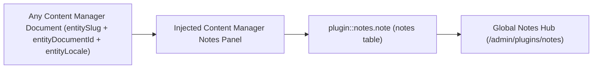
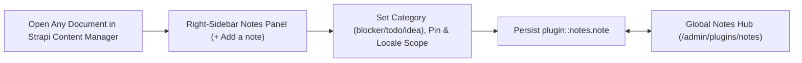
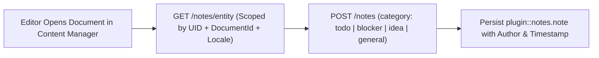
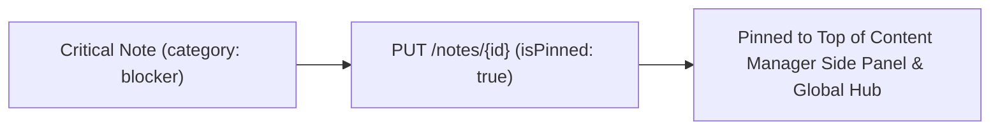
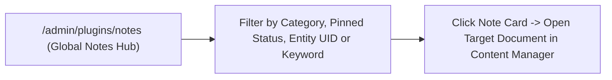

## 1. Installation & Peer Setup

```bash
pnpm add @vicacha-devs/strapi-plugin-notes
```

## 2. Server Configuration (`config/plugins.ts`)

Add the plugin configuration to your Strapi v5 `config/plugins.ts` file:

```ts
// config/plugins.ts
export default ({
  env,
}: {
  env: (key: string, defaultValue?: string) => string;
}) => ({
  notes: {
    enabled: true,
    config: {
      enablePinning: true,
      enableLocaleScoping: true,
    },
  },
});
```


## 3. Strapi v5 Admin UI Tour

Once enabled, the plugin registers its workspace and settings inside the Strapi v5 Admin panel using Strapi Design System v2 components:


### Key Localized Admin UI Labels

| Translation Key                  | Rendered UI Label                   |
| :------------------------------- | :---------------------------------- |
| `plugin.name`                    | Notes                               |
| `notes.loading`                  | Loading Content ...                 |
| `notes.notification.loadError`   | Unable to load notes.               |
| `notes.notification.created`     | Note has been successfully created. |
| `notes.notification.createError` | Failed to create note.              |
| `notes.notification.updated`     | Note has been successfully updated. |
| `notes.notification.updateError` | Failed to update note.              |
| `notes.notification.deleted`     | Note has been successfully deleted. |

## 4. Content-Type Entities, Locations & Schemas (`strapi.documents`)

Registers one internal polymorphic Collection Type (`plugin::notes.note`, `content-manager.visible: false`) that attaches editorial annotations to **any** Strapi Content Manager document via `entitySlug` (e.g., `api::article.article`), `entityDocumentId`, and `entityLocale`.



### Where to Find Content-Type Entities in Strapi v5

- **Content Manager Right Side Panel**: Open **any** document in `/admin/content-manager/collection-types/...` or `single-types/...` to view, create, and pin notes scoped to that document and locale
- **Global Notes Hub Workspace**: `/admin/plugins/notes` (centralized search, category filter, and pin board across all Content-Type entities)
- **Database Table**: `notes` (`plugin::notes.note` queried via `strapi.documents('plugin::notes.note')`)

### `plugin::notes.note` — Notes

Editorial notes attached to Content Manager entity records

> **Kind**: `collectionType` · **DB Table**: `notes` · **Admin Location**: Internal (`/admin/plugins/notes`) · **Draft & Publish**: `No` · **i18n**: `No`

| Attribute          | Strapi Type   | Required | Constraints / Target                                       |
| :----------------- | :------------ | :------- | :--------------------------------------------------------- |
| `title`            | `string`      | Yes      | max: 255                                                   |
| `content`          | `text`        | No       | —                                                          |
| `category`         | `enumeration` | Yes      | enum: `general, todo, blocker, idea`; default: `"general"` |
| `isPinned`         | `boolean`     | No       | default: `false`                                           |
| `entityId`         | `integer`     | No       | —                                                          |
| `entityDocumentId` | `string`      | No       | max: 128                                                   |
| `entitySlug`       | `string`      | Yes      | max: 160                                                   |
| `entityLocale`     | `string`      | No       | max: 32                                                    |
| `createdByName`    | `string`      | No       | max: 120                                                   |
| `updatedByName`    | `string`      | No       | max: 120                                                   |

## Strapi v5 Content Manager Integration (`/admin/content-manager`)

> **Content Manager Sidebar Group**: `Injected into All Content Manager Collection Types & Single Types (Right Sidebar)`

### Content Manager Entities & Components

- Right-Sidebar **Notes (`NOTES`)** Panel injected into every `/admin/content-manager/collection-types/*` and `/admin/content-manager/single-types/*` edit view
- Internal Polymorphic Entity `plugin::notes.note` (`notes` table, managed via Content Manager side panel & `/admin/plugins/notes`)


### Why This Plugin Creates & Integrates Content Manager Entities

`@vicacha-devs/strapi-plugin-notes` is purpose-built for the **Strapi v5 Content Manager**: it injects an interactive **Notes** panel directly into the right sidebar of every document edit view while keeping `plugin::notes.note` (`content-manager.visible: false`) out of the collection list to avoid cluttering the left sidebar:

- **Works on Every `api::*` and `plugin::*` Content Manager Entity**: Attach `general`, `todo`, `blocker`, or `idea` notes to an `Article & Course`, `Event`, `Donation Campaign`, `Islam Scripture Entry`, or `Resource Publication` directly inside Content Manager.
- **Per-Locale (`Scope only to locale`) or Cross-Locale Pinning**: Scope a translation note specifically to `en`, `es`, `ar`, or `tr`, and pin critical blockers (`Pin note to top`) so editors see them immediately upon opening the entry.

### How to Use in Strapi Content Manager (Step-by-Step)

1. **Open Any Entry in Content Manager**: Open any document in `/admin/content-manager/collection-types/...` or `/admin/content-manager/single-types/...`.
2. **Click `+ Add a note`**: In the right-hand sidebar under **NOTES**, click the button to open the note modal.
3. **Set Category, Pin & Locale Scope**: Enter `Title`, select `Category` (`General`, `To-Do`, `Blocker`, `Idea`), write the `Content`, optionally check `Pin note to top` or `Scope only to locale`, and click **Save**.
4. **Triage Across All Entities**: Visit `/admin/plugins/notes` (**Global Notes Hub**) to filter all notes across the entire CMS and click any card to jump back into Content Manager.

### Content Manager & Plugin Workspace Synchronization



### Content Manager Use Cases & Editorial Workflows

#### Content Manager Use Case 1 — Attaching Locale-Scoped Translation & Scholar Review Notes

- **Why & What it is for**: Leave a `blocker` or `todo` review note on a course or scripture entry directly inside the Content Manager edit screen.
- **How to use in Content Manager**: Open `/admin/content-manager/collection-types/api::article.article/{documentId}?plugins[i18n][locale]=en`, click **+ Add a note** in the right sidebar, check `Scope only to locale (en)`, and save.

## 5. End-to-End Use Cases & Workflows

### Use Case 1 — In-Context Editorial Review & Translation Handoff Notes

- **What it is for**: Leave `todo`, `blocker`, `idea`, or `general` notes directly on a draft Article, Event, or Donation Campaign for fellow editors and translators.
- **How it works**: Open the record in Content Manager; the injected side panel queries `GET /notes/entity?entitySlug=...&entityDocumentId=...&entityLocale=...` and creates notes via `POST /notes`.




### Use Case 2 — Pinning Critical Editorial Blockers to the Top of a Document

- **What it is for**: Ensure legal, theological, or fact-checking warnings stay pinned (`isPinned: true`) at the top of a Content Manager entry.
- **How it works**: Toggle pin status in the Content Manager side panel (`PUT /notes/{id}`), surfacing the note both on the document and in the Global Notes Hub.




### Use Case 3 — Cross-Collection Editorial Triage in the Global Notes Hub

- **What it is for**: Review all unresolved `blocker` and `todo` annotations across every collection type from a single dashboard.
- **How it works**: Navigate to `/admin/plugins/notes` to filter `plugin::notes.note` records by `category`, `isPinned`, `entitySlug`, or keyword and jump straight to the target document.




## 6. REST API Endpoints (`content-api` & `admin`)

| Method   | Endpoint Path           | Scope         | Controller Handler        | Auth       |
| :------- | :---------------------- | :------------ | :------------------------ | :--------- |
| `GET`    | `/notes/notes`          | `admin`       | `notesController.find`    | Bearer JWT |
| `GET`    | `/notes/notes/stats`    | `admin`       | `notesController.stats`   | Bearer JWT |
| `GET`    | `/notes/notes/{id}`     | `admin`       | `notesController.findOne` | Bearer JWT |
| `POST`   | `/notes/notes`          | `admin`       | `notesController.create`  | Bearer JWT |
| `PUT`    | `/notes/notes/{id}`     | `admin`       | `notesController.update`  | Bearer JWT |
| `DELETE` | `/notes/notes/{id}`     | `admin`       | `notesController.delete`  | Bearer JWT |
| `GET`    | `/api/notes/notes`      | `content-api` | `notesController.find`    | Bearer JWT |
| `GET`    | `/api/notes/notes/{id}` | `content-api` | `notesController.findOne` | Bearer JWT |

## 7. Programmatic Server Usage (`strapi.plugin` & `strapi.documents`)

```ts
// Registered services on plugin "notes": "notesService", "noteService", "note"
const pluginService = strapi.plugin("notes")?.service("notesService");

// Querying records via the Strapi v5 Document Service API
const records = await strapi.documents("plugin::notes.note").findMany({
  limit: 25,
  sort: "createdAt:desc",
});
```

## 8. Troubleshooting & Verification

- **Admin panel changes not visible**: Run `pnpm strapi build` after modifying `config/plugins.ts`.
- **Peer dependency isolation**: Keep `hoistPattern: ["*", "!@strapi/*"]` in `pnpm-workspace.yaml` so `@strapi/*` contexts are never duplicated.
- **TypeScript type-checking**: Validate both `admin/tsconfig.json` and `server/tsconfig.json` via `pnpm --filter <pkg> test:ts`.
