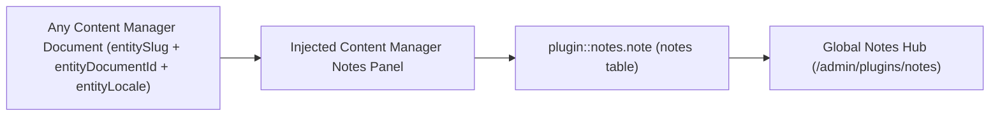
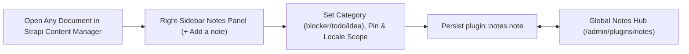
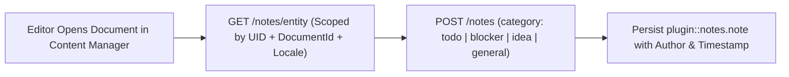
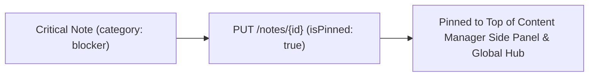
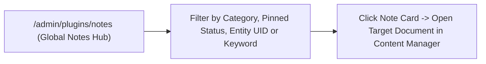

A Strapi v5 plugin (forked and modernized from [`strapi-community/strapi-plugin-notes`](https://github.com/strapi-community/strapi-plugin-notes)) that enables editorial teams to attach rich, categorized, and pinned notes to any Content Manager entry and browse all notes from a centralized Admin Hub.

## Key Features

1. **Note Modal Meta Information ([Issue #18](https://github.com/strapi-community/strapi-plugin-notes/issues/18))**:
   - Displays a Strapi **Audit Logs**-style 2×2 metadata panel (`Created At`, `Created By`, `Updated At`, `Updated By`) inside `NoteModal` when viewing or editing an existing note.
   - Automatically tracks `createdBy` and `updatedBy` on the server from `ctx.state.user`, with safe fallback display names if an admin user is later removed and strict PII sanitization.
2. **Pinned & Color/Category Badges**:
   - Pin critical notes so they stay at the top of the Content Manager side panel (`isPinned DESC, createdAt DESC`).
   - Classify notes with color-coded category badges (`General`, `Todo`, `Blocker`, `Idea`).
3. **Strapi v5 Document & Locale Scoping**:
   - Binds notes to Strapi v5's stable `documentId` (`entityDocumentId`) alongside legacy `entityId` and `entitySlug`, ensuring notes remain attached across Draft/Publish cycles.
   - Optional per-locale scoping (`entityLocale`) so editors can attach notes either to all locales of a document or to the currently active i18n locale.
4. **Content Manager Side Panel UX Polish**:
   - Quick search & category filtering inside the Content Manager side panel.
   - Compact author and date subtitle on each note item.
   - Delete confirmation dialog to prevent accidental one-click note deletion.
5. **Global Notes Hub**:
   - Dedicated **Notes** page in the Strapi Admin navigation with KPI summary cards, search/filter controls across content types, categories, and pinned status, plus one-click deep links straight into the target Content Manager entry.

## Quick Installation & Configuration

```bash
pnpm add @vicacha-devs/strapi-plugin-notes
```

Enable the plugin in `config/plugins.ts`:

```ts
export default () => ({
  notes: {
    enabled: true,
  },
});
```

## Content-Type Entities & Where to Find Them

Registers one internal polymorphic Collection Type (`plugin::notes.note`, `content-manager.visible: false`) that attaches editorial annotations to **any** Strapi Content Manager document via `entitySlug` (e.g., `api::article.article`), `entityDocumentId`, and `entityLocale`.



- **Content Manager Right Side Panel**: Open **any** document in `/admin/content-manager/collection-types/...` or `single-types/...` to view, create, and pin notes scoped to that document and locale
- **Global Notes Hub Workspace**: `/admin/plugins/notes` (centralized search, category filter, and pin board across all Content-Type entities)
- **Database Table**: `notes` (`plugin::notes.note` queried via `strapi.documents('plugin::notes.note')`)

## Strapi v5 Content Manager Integration (`/admin/content-manager`)

> **Content Manager Sidebar Group**: `Injected into All Content Manager Collection Types & Single Types (Right Sidebar)`

### Content Manager Entities & Components

- Right-Sidebar **Notes (`NOTES`)** Panel injected into every `/admin/content-manager/collection-types/*` and `/admin/content-manager/single-types/*` edit view
- Internal Polymorphic Entity `plugin::notes.note` (`notes` table, managed via Content Manager side panel & `/admin/plugins/notes`)


### Why This Plugin Creates & Integrates Content Manager Entities

`@vicacha-devs/strapi-plugin-notes` is purpose-built for the **Strapi v5 Content Manager**: it injects an interactive **Notes** panel directly into the right sidebar of every document edit view while keeping `plugin::notes.note` (`content-manager.visible: false`) out of the collection list to avoid cluttering the left sidebar:

- **Works on Every `api::*` and `plugin::*` Content Manager Entity**: Attach `general`, `todo`, `blocker`, or `idea` notes to an `Article & Course`, `Event`, `Donation Campaign`, `Islam Scripture Entry`, or `Resource Publication` directly inside Content Manager.
- **Per-Locale (`Scope only to locale`) or Cross-Locale Pinning**: Scope a translation note specifically to `en`, `es`, `ar`, or `tr`, and pin critical blockers (`Pin note to top`) so editors see them immediately upon opening the entry.

### How to Use in Strapi Content Manager (Step-by-Step)

1. **Open Any Entry in Content Manager**: Open any document in `/admin/content-manager/collection-types/...` or `/admin/content-manager/single-types/...`.
2. **Click `+ Add a note`**: In the right-hand sidebar under **NOTES**, click the button to open the note modal.
3. **Set Category, Pin & Locale Scope**: Enter `Title`, select `Category` (`General`, `To-Do`, `Blocker`, `Idea`), write the `Content`, optionally check `Pin note to top` or `Scope only to locale`, and click **Save**.
4. **Triage Across All Entities**: Visit `/admin/plugins/notes` (**Global Notes Hub**) to filter all notes across the entire CMS and click any card to jump back into Content Manager.

### Content Manager & Plugin Workspace Synchronization



### Content Manager Use Cases & Editorial Workflows

#### Content Manager Use Case 1 — Attaching Locale-Scoped Translation & Scholar Review Notes

- **Why & What it is for**: Leave a `blocker` or `todo` review note on a course or scripture entry directly inside the Content Manager edit screen.
- **How to use in Content Manager**: Open `/admin/content-manager/collection-types/api::article.article/{documentId}?plugins[i18n][locale]=en`, click **+ Add a note** in the right sidebar, check `Scope only to locale (en)`, and save.

## End-to-End Use Cases & Workflows

### Use Case 1 — In-Context Editorial Review & Translation Handoff Notes

- **What it is for**: Leave `todo`, `blocker`, `idea`, or `general` notes directly on a draft Article, Event, or Donation Campaign for fellow editors and translators.
- **How it works**: Open the record in Content Manager; the injected side panel queries `GET /notes/entity?entitySlug=...&entityDocumentId=...&entityLocale=...` and creates notes via `POST /notes`.




### Use Case 2 — Pinning Critical Editorial Blockers to the Top of a Document

- **What it is for**: Ensure legal, theological, or fact-checking warnings stay pinned (`isPinned: true`) at the top of a Content Manager entry.
- **How it works**: Toggle pin status in the Content Manager side panel (`PUT /notes/{id}`), surfacing the note both on the document and in the Global Notes Hub.




### Use Case 3 — Cross-Collection Editorial Triage in the Global Notes Hub

- **What it is for**: Review all unresolved `blocker` and `todo` annotations across every collection type from a single dashboard.
- **How it works**: Navigate to `/admin/plugins/notes` to filter `plugin::notes.note` records by `category`, `isPinned`, `entitySlug`, or keyword and jump straight to the target document.




## Admin Workspace, Content Manager & Settings Panel Preview


### Strapi v5 Content Manager Entities (`/admin/content-manager`)


### Settings Panel (`Settings -> Configuration`)


> Explore [**Content Types & Use Cases**](/strapi-plugin-notes/use-cases/), the [**Developer Guide & Admin UI Tour**](/strapi-plugin-notes/guide/), and the [**Interactive OpenAPI Reference**](/strapi-plugin-notes/api/) for complete schema, workflow diagram, and endpoint documentation.
