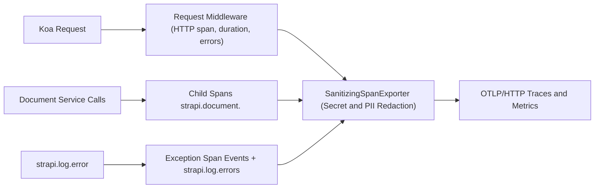
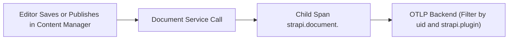
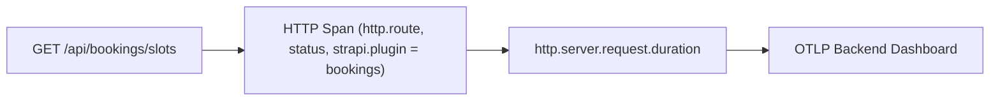
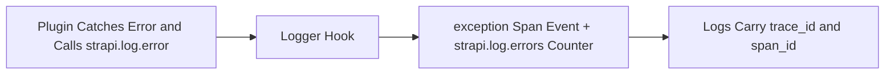
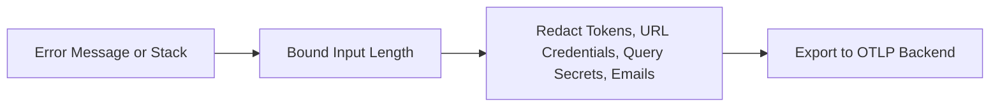

Vendor-neutral **OpenTelemetry** error tracking and performance monitoring (APM) plugin for **Strapi v5**.

Instruments Node.js, HTTP/Koa requests, PostgreSQL/SQLite queries, Strapi v5 Document Service operations, and caught plugin errors (`strapi.log.error`), exporting traces and metrics over **OTLP/HTTP** to **SigNoz**, **Grafana Tempo / Alloy**, **Sentry OTLP**, **Datadog**, **Jaeger**, or any OpenTelemetry Collector.

## Key Features

- **Automatic Node.js & Database Instrumentation**: Traces incoming/outgoing HTTP (`http`, `undici`) and database calls (`pg`, etc.) via `@opentelemetry/auto-instrumentations-node` (with noisy `fs` instrumentation disabled).
- **HTTP Request Tracking & APM Metrics**: Records `http.server.request.duration` histograms, `http.server.errors` counters, `http.route`, `http.response.status_code`, and authenticated `enduser.id`.
- **Strapi v5 Document Service Tracing**: Wraps `strapi.documents.use(...)` in child spans (`strapi.document.<action> <uid>`) with `strapi.document.uid`, `strapi.document.action`, and `strapi.plugin` attributes.
- **Per-Plugin Failure Attribution**: Automatically extracts `strapi.plugin` from `plugin::<name>.<model>` UIDs and plugin route paths (e.g., `/api/bookings/...` -> `bookings`).
- **Caught Plugin Error Capture**: Hooks `strapi.log.error` so errors caught and logged inside plugins, email lifecycles, or background jobs are recorded as `exception` span events and counted in `strapi.log.errors`.
- **Log-Trace Correlation**: Logs `trace_id`, `span_id`, `method`, `path`, and `plugin` on unhandled request errors.
- **Built-In Secret & PII Redaction**: Scrubs `Bearer`/`Basic` tokens, URL credentials (`user:pass@`), sensitive query parameters (`token`, `api_key`, `secret`, `password`, etc.), and email addresses from error messages, stack traces, and outgoing `url.full`/`http.url`/`url.query` span attributes before export.
- **Graceful Shutdown**: Flushes buffered spans and metrics in Strapi's `destroy()` lifecycle hook.

## Installation & Configuration

Add `@vicacha-devs/strapi-plugin-opentelemetry` to your Strapi v5 project and configure it in `config/plugins.ts`:

```ts
export default ({ env }) => ({
  opentelemetry: {
    enabled: env.bool("OTEL_ENABLED", true),
    config: {
      serviceName: env("OTEL_SERVICE_NAME", "strapi-backend"),
      serviceVersion: env("npm_package_version", "1.0.0"),
      environment: env("NODE_ENV", "development"),
      otlpEndpoint: env("OTEL_EXPORTER_OTLP_ENDPOINT", ""),
      sampleRate: Number(env("OTEL_TRACES_SAMPLE_RATE", "1.0")),
      ignorePaths: ["/_health", "/favicon.ico"],
      captureDocumentService: true,
      consoleExporter: env.bool("OTEL_CONSOLE_EXPORTER", false),
    },
  },
});
```

## Configuration Reference

All options are validated at Strapi boot time by `validateOtelConfig`. Standard OpenTelemetry environment variables (`OTEL_EXPORTER_OTLP_ENDPOINT`, `OTEL_SERVICE_NAME`, `OTEL_EXPORTER_OTLP_HEADERS`) are automatically merged.

| Option                   | Env Variable                  | Type                     | Default                                   | Description                                                    |
| :----------------------- | :---------------------------- | :----------------------- | :---------------------------------------- | :------------------------------------------------------------- |
| `enabled`                | `OTEL_ENABLED`                | `boolean`                | `true`                                    | Enable or disable SDK, middleware, and hooks                   |
| `serviceName`            | `OTEL_SERVICE_NAME`           | `string`                 | `"strapi"`                                | Service name reported in `service.name`                        |
| `serviceVersion`         | —                             | `string`                 | `"1.0.0"`                                 | Service version reported in `service.version`                  |
| `environment`            | `NODE_ENV`                    | `string`                 | `process.env.NODE_ENV \|\| "development"` | Reported in `deployment.environment.name`                      |
| `otlpEndpoint`           | `OTEL_EXPORTER_OTLP_ENDPOINT` | `string`                 | `""`                                      | Base OTLP/HTTP URL (exports to `/v1/traces` and `/v1/metrics`) |
| `otlpHeaders`            | `OTEL_EXPORTER_OTLP_HEADERS`  | `Record<string, string>` | `{}`                                      | Auth/tenant headers (env format: `k1=v1,k2=v2`)                |
| `sampleRate`             | `OTEL_TRACES_SAMPLE_RATE`     | `number` (`0..1`)        | `1.0`                                     | Root trace sampling ratio wrapped in `ParentBasedSampler`      |
| `ignorePaths`            | —                             | `string[]`               | `["/_health", "/favicon.ico"]`            | URL path prefixes excluded from HTTP tracing/metrics           |
| `captureDocumentService` | —                             | `boolean`                | `true`                                    | Wrap `strapi.documents.use(...)` calls in child spans          |
| `consoleExporter`        | `OTEL_CONSOLE_EXPORTER`       | `boolean`                | `false`                                   | Export spans to stdout when `otlpEndpoint` is empty            |
| `metricExportIntervalMs` | —                             | `number` (`>= 1000`)     | `60000`                                   | Interval in ms for `PeriodicExportingMetricReader`             |

## Telemetry Emitted

### Span Attributes

- **HTTP Requests**: `http.request.method`, `url.path`, `http.route`, `http.response.status_code`, `strapi.plugin` (when matched), `enduser.id` (when authenticated).
- **Document Service**: `strapi.document.uid`, `strapi.document.action`, `strapi.plugin` (for `plugin::*` UIDs).
- **Errors**: `exception` span event with sanitized `Error` + `SpanStatusCode.ERROR` on unhandled exceptions, HTTP `>= 500` responses, and `strapi.log.error(...)` calls.

### Metrics

- `http.server.request.duration` (Histogram, `ms`) — Request latency by method, route, status/error type, and `strapi.plugin`.
- `http.server.errors` (Counter) — Count of `>= 500` and unhandled HTTP errors.
- `strapi.log.errors` (Counter) — Count of errors logged via `strapi.log.error`.

## Security & Privacy

- **Zero body/header logging**: Request/response payloads, `Authorization`, `Cookie`, and user emails/names are never attached to spans.
- **Automatic redaction**: `SanitizingSpanExporter`, `sanitizeError`, and `sanitizeTelemetryText` scrub `Bearer`/`Basic` tokens, URL credentials, sensitive query keys (`token`, `access_token`, `api_key`, `key`, `secret`, `password`, `auth`, `signature`, `code`), and email addresses before telemetry leaves the process.
- **Production checklist**:
  - Use `https://` for `OTEL_EXPORTER_OTLP_ENDPOINT` outside localhost/private VPCs.
  - Keep `OTEL_CONSOLE_EXPORTER=false` in production.
  - Store `OTEL_EXPORTER_OTLP_HEADERS` in your secrets manager.

## Collector Examples

- **SigNoz / Grafana Alloy / Local OTel Collector:**
  ```env
  OTEL_EXPORTER_OTLP_ENDPOINT=http://localhost:4318
  ```
- **Sentry OTLP Ingest:**
  ```env
  OTEL_EXPORTER_OTLP_ENDPOINT=https://o0.ingest.sentry.io/api/<project-id>/integration/otlp
  OTEL_EXPORTER_OTLP_HEADERS="x-sentry-auth=sentry sentry_key=<public-key>"
  ```
- **Local Development (stdout only):**
  ```env
  OTEL_CONSOLE_EXPORTER=true
  ```

## Custom Instrumentation

Use `@opentelemetry/api` anywhere in your Strapi services, controllers, or plugins—spans will automatically nest under the active request trace:

```ts
import { trace } from "@opentelemetry/api";

const tracer = trace.getTracer("my-plugin");

await tracer.startActiveSpan("bookings.syncCalendar", async (span) => {
  try {
    // your work
  } finally {
    span.end();
  }
});
```

## Content-Type Entities & Where to Find Them

Registers no Content-Types, routes, or admin pages. When `enabled`, the server `register()` lifecycle validates the config, starts the OpenTelemetry Node SDK (OTLP/HTTP traces and metrics plus auto-instrumentations), hooks `strapi.log.error`, adds a request middleware (HTTP spans, the `http.server.request.duration` histogram, and the `http.server.errors` counter), and, when `captureDocumentService` is `true`, wraps Document Service calls in child spans named `strapi.document.<action> <uid>`. `bootstrap()` logs the active exporter and `destroy()` flushes buffered spans and metrics. All exported error text passes through built-in secret and PII redaction.



- **Strapi Boot Log**: `[opentelemetry] Active for service ...` is logged from `bootstrap()` with the service name and the exporter target (`otlpEndpoint`, `console`, or `no-exporter`).
- **Your OTLP Backend**: traces and metrics arrive at `<otlpEndpoint>/v1/traces` and `<otlpEndpoint>/v1/metrics` in SigNoz, Grafana, Sentry OTLP ingest, or any OTLP/HTTP collector.
- **Strapi Config**: `config/plugins.ts` -> `opentelemetry.config`, validated at boot by `validateOtelConfig`.
- **No Admin UI or Content-Types**: this plugin creates no entities, routes, settings page, or database tables.

## Strapi v5 Content Manager Integration (`/admin/content-manager`)

> **Content Manager Sidebar Group**: `No Content Manager panel; instruments the Document Service calls that Content Manager actions trigger`

### Content Manager Entities & Components

- Document Service calls (`strapi.documents(...)`) made when editors create, update, publish, or delete entries in `/admin/content-manager`, recorded as `strapi.document.<action> <uid>` child spans
- No Content-Type, route, or database table is created by this plugin

### Why This Plugin Creates & Integrates Content Manager Entities

`@vicacha-devs/strapi-plugin-opentelemetry` adds no Content Manager UI. Every create, update, publish, or delete an editor performs becomes a traced Document Service operation, so slow or failing saves can be tied to a specific content type and plugin in your observability backend.

- **Per-Content-Type Visibility**: spans carry `strapi.document.uid`, `strapi.document.action`, and `strapi.plugin` (for `plugin::*` UIDs).
- **Opt-Out per Environment**: set `captureDocumentService: false` to stop wrapping Document Service calls without disabling HTTP tracing.
- **Safe by Default**: payloads and user identity beyond `enduser.id` are never attached to spans, and error text is redacted before export.

### How to Use in Strapi Content Manager (Step-by-Step)

1. **Enable the Plugin**: add `opentelemetry` to `config/plugins.ts` and set `OTEL_EXPORTER_OTLP_ENDPOINT` (or `OTEL_CONSOLE_EXPORTER=true` locally).
2. **Work Normally in Content Manager**: save or publish entries in `/admin/content-manager`.
3. **Inspect the Traces**: search your backend for `strapi.document.update` (or `create`, `publish`, `delete`) spans filtered by `strapi.document.uid`.

### Content Manager & Plugin Workspace Synchronization



### Content Manager Use Cases & Editorial Workflows

#### Content Manager Use Case 1 — Diagnosing Slow Publishes

- **Why & What it is for**: Identify which content type and plugin make publishing slow, without logging any entry content.
- **How to use in Content Manager**: Publish an entry in `/admin/content-manager`, then find the `strapi.document.publish <uid>` span under the request trace and compare its duration with other content types.

## End-to-End Use Cases & Workflows

### Use Case 1 — Tracing Slow or Failing Requests Across Plugins

- **What it is for**: Find which plugin makes an endpoint slow or failing, using the `strapi.plugin` attribute derived from `plugin::<name>.<model>` UIDs and plugin route paths (for example `/api/bookings/...` -> `bookings`).
- **How it works**: Point `otlpEndpoint` at your collector; each request produces an HTTP span with `http.route`, `http.response.status_code`, and `strapi.plugin`, and `http.server.request.duration` is recorded by method, route, and status.



### Use Case 2 — Capturing Caught Errors from Plugins and Background Jobs

- **What it is for**: Surface errors that plugins, email lifecycles, or background jobs catch and only log, which would otherwise never reach an error tracker.
- **How it works**: The plugin hooks `strapi.log.error`, records each call as an `exception` span event, and counts it in `strapi.log.errors`; unhandled request errors also log `trace_id`, `span_id`, `method`, `path`, and `plugin` for log-trace correlation.



### Use Case 3 — Shipping Telemetry Without Leaking Secrets or PII

- **What it is for**: Send traces to a third-party backend while keeping credentials and personal data out of them.
- **How it works**: Request bodies, `Authorization`, `Cookie`, and user emails or names are never attached to spans. Error text is redacted for `Bearer`/`Basic` tokens, URL credentials, sensitive query parameters, and email addresses, and is length-bounded before redaction so pathological input cannot stall the sanitizer.


