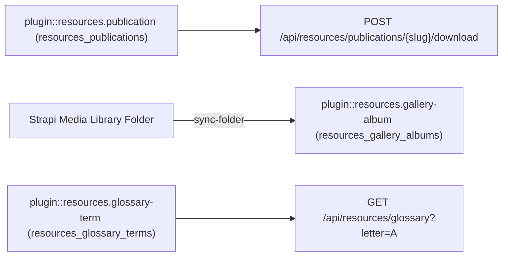
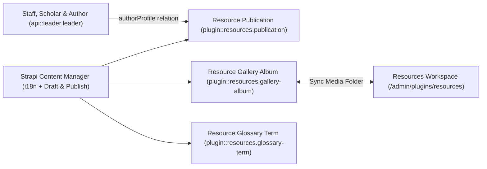
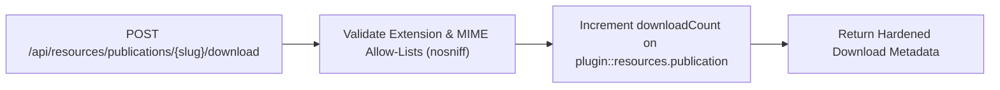
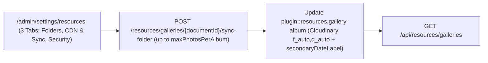
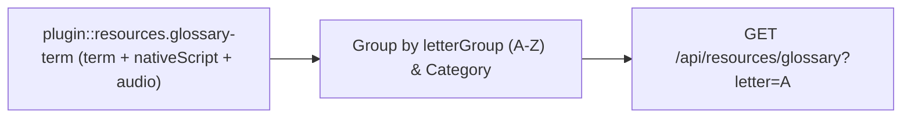

Reusable **Strapi v5 Media Library, Digital Publications, Photo Galleries & Glossary Plugin** (`plugin::resources`) built natively on top of Strapi v5's `@strapi/upload` (`plugin::upload.file` & `plugin::upload.folder`).

## Features

- **Native Strapi v5 Media Library Integration**:
  - Uses `plugin::upload.file` for PDFs, eBooks, cover artwork, multi-photo gallery albums, and glossary pronunciation audio.
  - Uses `plugin::upload.folder` for one-click folder-to-album synchronization (`POST /api/resources/galleries/:documentId/sync-media-folder`).
  - Automatic Cloudinary `f_auto,q_auto` responsive URL optimization when `@strapi/provider-upload-cloudinary` is active.
- **3 Localized Content-Types (`i18n` Ready)**:
  - `plugin::resources.publication`: Digital library guides, books, pamphlets, and press kits with hardened download tracking (`Content-Disposition: attachment`, `X-Content-Type-Options: nosniff`).
  - `plugin::resources.gallery-album`: Curated photo & video albums with photographer credit, framing notes, and secondary calendar dates.
  - `plugin::resources.glossary-term`: Structured A–Z terminology index with native script, transliteration, definition, and optional audio pronunciation.
- **Multi-Calendar Secondary Dates**:
  - Supports `islamic-umalqura`, `islamic-civil`, `hebrew`, `persian`, `buddhist`, or `none`.
- **3-Tab Admin Settings Panel (`/admin/settings/resources`)**:
  - **Tab 1 — Media Library Folders & Organization**: Configure `organizationName`, `defaultPublicationsFolderPath` (`/resources/publications`), `defaultGalleriesFolderPath` (`/resources/galleries`), `secondaryCalendar` (`islamic-umalqura`, `islamic-civil`, `hebrew`, `persian`, `buddhist`, `none`), `defaultLocale` (`SingleSelect`), and `supportedLocales` (`MultiSelect` with removable tag chips).
  - **Tab 2 — CDN Optimization & Folder Sync**: Toggle `enableCloudinaryOptimization` (`f_auto,q_auto` + responsive widths `400w`–`1600w`), `autoSyncMediaFolders` (one-click `plugin::upload.folder` sync), and `maxPhotosPerAlbum` (`1`–`500`, default `200`).
  - **Tab 3 — Download Security & Allow-Lists**: Select `allowedDownloadExtensions` (`.pdf`, `.epub`, `.mobi`, `.png`, `.jpg`, `.jpeg`, `.webp`, `.mp3`, `.m4a`, `.ogg`, `.wav`, `.zip`, etc.) and `allowedDownloadMimeTypes` via `MultiSelect` (`withTags`) enforced by `POST /api/resources/publications/:slug/download` (`X-Content-Type-Options: nosniff`).
- **13 Admin UI Locales**: `en`, `es`, `ar`, `tr`, `fr`, `de`, `pt`, `it`, `nl`, `pl`, `id`, `ur`, `zh`.

## Quick Installation & Configuration

```bash
pnpm add @vicacha-devs/strapi-plugin-resources
```

Enable and configure the plugin in `config/plugins.ts`:

```ts
export default ({ env }) => ({
  resources: {
    enabled: true,
    config: {
      organizationName: env("RESOURCES_ORG_NAME", "Community Resource Center"),
      defaultPublicationsFolderPath: "/resources/publications",
      defaultGalleriesFolderPath: "/resources/galleries",
      secondaryCalendar: "islamic-umalqura",
      defaultLocale: "es",
      supportedLocales: ["es", "en", "ar", "tr"],
      enableCloudinaryOptimization: true,
      autoSyncMediaFolders: true,
      maxPhotosPerAlbum: 200,
      allowedDownloadExtensions: [
        ".pdf",
        ".epub",
        ".mobi",
        ".zip",
        ".mp3",
        ".m4a",
        ".ogg",
        ".wav",
      ],
      allowedDownloadMimeTypes: [
        "application/pdf",
        "application/epub+zip",
        "application/x-mobipocket-ebook",
        "application/zip",
        "audio/mpeg",
        "audio/mp4",
        "audio/ogg",
        "audio/wav",
      ],
    },
  },
});
```

## Content-Type Entities & Where to Find Them

Registers three localized (`i18n.localized: true`), draft-and-publish (`draftAndPublish: true`) Collection Types: `plugin::resources.publication`, `plugin::resources.gallery-album`, and `plugin::resources.glossary-term`, plus a 3-tab settings panel (`/admin/settings/resources`) covering Media Library folder paths, multi-calendar secondary dates, Cloudinary `f_auto,q_auto` optimization, album photo caps, and download extension/MIME allow-lists. Supports runtime `schemaExtensions` in `config/plugins.ts`.



- **Content Manager**: `/admin/content-manager/collection-types/plugin::resources.publication`, `plugin::resources.gallery-album`, and `plugin::resources.glossary-term` (`visible: true`)
- **Content-Type Builder**: `/admin/plugins/content-type-builder` under **Collection Types** (`Resource Publication`, `Resource Gallery Album`, `Resource Glossary Term`)
- **Plugin Workspace**: `/admin/plugins/resources` (Publications, Gallery Albums, Glossary Terms, Media Folder Sync)
- **Settings Panel (3 Tabs)**: `/admin/settings/resources` — **Media Library Folders & Organization** (`organizationName`, `defaultPublicationsFolderPath`, `defaultGalleriesFolderPath`, `secondaryCalendar`, `defaultLocale`, `supportedLocales`), **CDN Optimization & Folder Sync** (`enableCloudinaryOptimization`, `autoSyncMediaFolders`, `maxPhotosPerAlbum`), and **Download Security & Allow-Lists** (`allowedDownloadExtensions`, `allowedDownloadMimeTypes`)
- **Database Tables**: `resources_publications`, `resources_gallery_albums`, and `resources_glossary_terms`

## Strapi v5 Content Manager Integration (`/admin/content-manager`)

> **Content Manager Sidebar Group**: `Media, Resources & Library`

### Content Manager Entities & Components

- `plugin::resources.publication` (**Resource Publication** — `/admin/content-manager/collection-types/plugin::resources.publication`)
- `plugin::resources.gallery-album` (**Resource Gallery Album** — `/admin/content-manager/collection-types/plugin::resources.gallery-album`)
- `plugin::resources.glossary-term` (**Resource Glossary Term** — `/admin/content-manager/collection-types/plugin::resources.glossary-term`)


### Why This Plugin Creates & Integrates Content Manager Entities

`@vicacha-devs/strapi-plugin-resources` registers all three of its entities (`Resource Publication`, `Resource Gallery Album`, and `Resource Glossary Term`) with `i18n.localized: true`, `draftAndPublish: true`, and `content-manager.visible: true` so librarians, scholars, and archivists can manage digital books, photo albums, and glossary terms inside the Strapi v5 Content Manager:

- **Multilingual (`i18n`) Digital Library & Glossary Authoring**: Author publications, photo gallery descriptions, and A–Z glossary definitions across `en`, `es`, `ar`, and `tr` (`?plugins[i18n][locale]=en`) with native Draft & Publish staging.
- **Relational Author Profile Linking (`authorProfile`)**: In Content Manager, link `Resource Publication` records directly to `Staff, Scholar & Author` (`api::leader.leader`) profiles via `config/plugins.ts -> schemaExtensions.publication`.
- **Direct Media Library Asset & Folder Binding**: Attach cover images, downloadable PDF files, pronunciation audio clips, and Media Library folder paths directly inside Content Manager forms.

### How to Use in Strapi Content Manager (Step-by-Step)

1. **Open in Content Manager**: In the left sidebar, expand **Content Manager -> Collection Types -> Media, Resources & Library** and select **Resource Publication** (`/admin/content-manager/collection-types/plugin::resources.publication?plugins[i18n][locale]=en`), **Resource Gallery Album** (`plugin::resources.gallery-album`), or **Resource Glossary Term** (`plugin::resources.glossary-term`).
2. **Publish Books, Guides & Press Kits**: In **Resource Publication**, populate `title`, `slug`, `summary`, `category` (`book`, `guide`, `pamphlet`, `press_kit`), `fileUrl`, `pageCount`, and `authorProfile`, then click **Publish**.
3. **Curate A–Z Glossary Terms**: In **Resource Glossary Term**, enter `term`, `nativeScript` (Arabic script), `transliteration`, `definition`, `letterGroup` (`A`–`Z`), and `pronunciationAudioUrl`.
4. **Workspace vs. Content Manager**: Use **Content Manager** for multilingual authoring, scholar `authorProfile` relations, and bulk publishing; use the **Resources Workspace** (`/admin/plugins/resources`) for 1-click Media Library folder synchronization (`Sync Folder`) and download analytics.

### Content Manager & Plugin Workspace Synchronization



### Content Manager Use Cases & Editorial Workflows

#### Content Manager Use Case 1 — Publishing Multilingual PDF Guides Linked to Institutional Authors (`api::leader.leader`)

- **Why & What it is for**: Author downloadable PDF guides (`Mosque Welcome & Visitor Etiquette Guide`, `Introduction to the Five Pillars of Islam`) in Content Manager and link each publication to its scholar author.
- **How to use in Content Manager**: Open `/admin/content-manager/collection-types/plugin::resources.publication?plugins[i18n][locale]=en`, edit the entry, select the `authorProfile` relation, switch locales (`es`, `ar`, `tr`) to translate, and click **Publish**.

#### Content Manager Use Case 2 — Managing Multilingual Glossary Terms with Native Script & Audio

- **Why & What it is for**: Curate A–Z glossary entries with vocalized Arabic script, phonetic transliteration, and audio pronunciation links in Content Manager.
- **How to use in Content Manager**: Open `/admin/content-manager/collection-types/plugin::resources.glossary-term?plugins[i18n][locale]=en`, filter by `letterGroup` or `category`, and publish.

## End-to-End Use Cases & Workflows

### Use Case 1 — Digital Publications Library with Hardened Download Allow-Lists

- **What it is for**: Publish downloadable books, PDF guides, pamphlets, and press kits protected by extension (`allowedDownloadExtensions`) and MIME (`allowedDownloadMimeTypes`) allow-lists, `X-Content-Type-Options: nosniff`, and atomic download counters.
- **How it works**: Configure allowed extensions/MIME types in `/admin/settings/resources` (**Download Security & Allow-Lists** tab), create `plugin::resources.publication` records, and serve downloads via `POST /api/resources/publications/{slug}/download`.




### Use Case 2 — Configuring Media Library Folders, Secondary Calendars, CDN Optimization & Download Security

- **What it is for**: Manage all 11 `ResourcesPluginSettings` fields across 3 organized tabs in `/admin/settings/resources` (`Media Library Folders & Organization`, `CDN Optimization & Folder Sync`, and `Download Security & Allow-Lists`) and automatically sync `plugin::upload.folder` assets into `plugin::resources.gallery-album` up to `maxPhotosPerAlbum`.
- **How it works**: Configure `defaultPublicationsFolderPath`, `defaultGalleriesFolderPath`, `secondaryCalendar`, `enableCloudinaryOptimization`, `autoSyncMediaFolders`, `maxPhotosPerAlbum`, and download allow-lists in `/admin/settings/resources` (`PUT /resources/settings`), then click **Sync Folder** (`POST /resources/galleries/{documentId}/sync-folder`).




### Use Case 3 — Multilingual A–Z Glossary with Native Script & Audio Pronunciation

- **What it is for**: Maintain an educational glossary of Arabic/Islamic or domain terms (`term`, `nativeScript`, `transliteration`, `definition`, `pronunciationAudio`, `letterGroup`).
- **How it works**: Manage entries in `plugin::resources.glossary-term` and query grouped A–Z terms via `GET /api/resources/glossary?letter=A&category=worship`.




## Admin Workspace, Content Manager & Settings Panel Preview


### Strapi v5 Content Manager Entities (`/admin/content-manager`)


### Settings Panel (`Settings -> Configuration`)


> Explore [**Content Types & Use Cases**](/strapi-plugin-resources/use-cases/), the [**Developer Guide & Admin UI Tour**](/strapi-plugin-resources/guide/), and the [**Interactive OpenAPI Reference**](/strapi-plugin-resources/api/) for complete schema, workflow diagram, and endpoint documentation.
