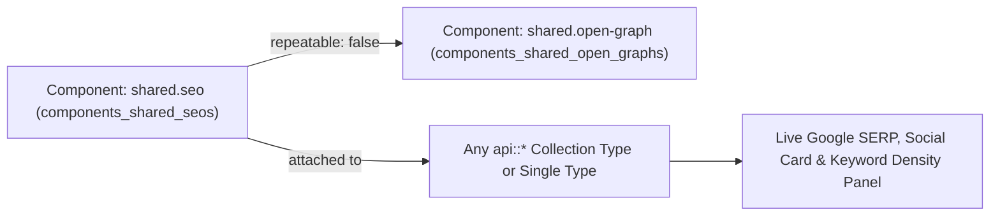
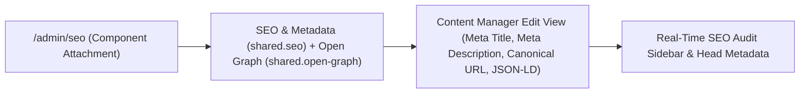
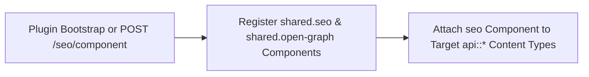
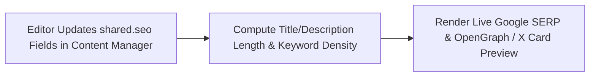
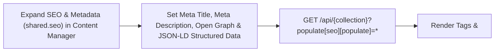

The official plugin to make your Strapi content SEO friendly

## Features

- Easily see which Content-Types does have the SEO component or not.
- Manage the important tags for your SEO (metatitle, metadescription) and preview your content in the SERP
- Manage your meta social tags (Facebook & Twitter) and preview your post.
- Strong SEO analysis for your content.

## Installation

To install this plugin, you need to add an NPM dependency to your Strapi application.

```sh
yarn add @vicacha-devs/strapi-plugin-seo

pnpm add @vicacha-devs/strapi-plugin-seo

npm install @vicacha-devs/strapi-plugin-seo
```

## How it works

When clicking on the plugin homepage for the first time, the plugin will automatically look if a `shared.seo` component exists in your project. If not, the plugin will automatically create it with a sub `shared.meta-social` component.

If a `shared.seo` component already exists in your project. You might want to rename it or delete it otherwise, the plugin will not create the necessary component in order to work.

#### Homepage

From there you can get an overview of which content-types contains the SEO component or not. You can quickly add the SEO component to a selected content-type.

**Note**: By doing this, you will be redirected to the Content-Types builder on the specific content-type. You'll need to create a new component at the **root** of this content-type called `seo` using the existing component the plugin created for you: `shared.seo`.

#### Content Manager

From any content manager view for a content-type that contains the SEO component, you'll be able to see a right-side card dedicated for the SEO plugin. From there you can see a quick SEO analysis and action for you to perform (opening preview, opening complete analysis details modal).

**Note**: You'll need to fill your SEO component with data to be able to see the SERP preview, Social post preview and complete analysis.

## Configuration

`./config/plugins.ts`

```ts
export default () => ({
  // ...
  seo: {
    enabled: true,
  },
  // ...
});
```

Then, you'll need to build your admin panel:

```sh
yarn build

pnpm build

npm run build
```

## SEO settings page

You'll be able from the SEO settings page to import a `shared.seo` & `shared.meta-social` components from any GitHub repository By default, our [components GitHub repository](https://github.com/strapi/components) is being used.

**Notice**: If you decide to import your own components, make sure that they belong to a `shared` category that their names is the same (`seo`, `meta-social`).
**Notice2**: When adding your SEO component, make sure to name it 'seo' and to include it in the root of your Content-Type.

## EditView SEO button

Once you create your SEO component in the edit view inside the Content Manager, the SEO button will appear on the the [right-links injection zone](https://docs.strapi.io/developer-docs/latest/developer-resources/plugin-api-reference/admin-panel.html#injection-zones-api). You'll be able to:

- Manage the meta title & description of your content and preview it in SERP.
- Manage your meta social tags (Facebook & Twitter) and preview your post.
- Analyze your content a little deeper via an SEO analysis of your content.

## Content-Type Entities & Where to Find Them

Registers and manages two shared Strapi Components (`shared.seo` and `shared.open-graph`) inside the Content-Type Builder and injects a live Google SERP, OpenGraph/X Social Card, and Keyword Density Analyzer into the Content Manager edit view for any `api::*` Collection Type or Single Type that includes `shared.seo`.



- **Content-Type Builder (Components)**: `/admin/plugins/content-type-builder` under **COMPONENTS -> Shared** (`seo` -> `components_shared_seos`, `openGraph` -> `components_shared_open_graphs`)
- **Content Manager Edit View**: Open any Collection Type or Single Type with the `seo` component attached (e.g., `/admin/content-manager/single-types/api::about-page.about-page`)
- **Plugin Workspace & Settings**: `/admin/plugins/seo` (Content-Type SEO Coverage Audit & 1-Click Component Attachment) and `/admin/settings/seo`

## Strapi v5 Content Manager Integration (`/admin/content-manager`)

> **Content Manager Sidebar Group**: `Components (`shared.seo`— **SEO & Metadata** &`shared.open-graph` — **Open Graph (Social Sharing)**) inside Content Manager Edit Views`

### Content Manager Entities & Components

- Component `shared.seo` (**SEO & Metadata** attached to `api::article.article` and other Collection/Single Types in Content Manager)
- Component `shared.open-graph` (**Open Graph (Social Sharing)** nested inside `SEO & Metadata`)


### Why This Plugin Creates & Integrates Content Manager Entities

`@vicacha-devs/strapi-plugin-seo` registers the reusable `shared.seo` (**SEO & Metadata**) and `shared.open-graph` (**Open Graph (Social Sharing)**) Strapi Components so every Collection Type (`api::article.article`, `api::page.page`) and Single Type in the **Strapi v5 Content Manager** includes a complete, localized SEO & structured-data panel alongside a live **SEO Audit** sidebar:

- **Native Localization & Draft Support via `SEO & Metadata` (`shared.seo`)**: Because `shared.seo` is embedded directly inside Content Manager entries, `Meta Title*` (`metaTitle`, max. 60 chars), `Meta Description*` (`metaDescription`, 50–160 chars), `Meta Social Share Image` (`metaImage`), `SEO Keywords` (`keywords`), `Meta Robots Directive` (`metaRobots`), `Meta Viewport` (`metaViewport`), `Canonical URL` (`canonicalURL`), and `JSON-LD Structured Data` (`structuredData`) automatically inherit each document's `i18n` locale (`en`, `es`, `ar`, `tr`) and Draft/Publish state.
- **Nested Open Graph Social Card Component (`shared.open-graph`)**: Expand **Open Graph (Social Sharing)** inside `SEO & Metadata` to customize `ogTitle`, `ogDescription`, `ogImage`, `ogUrl`, and `ogType` per locale.

### How to Use in Strapi Content Manager (Step-by-Step)

1. **Attach `shared.seo` in `/admin/seo`**: Enable the `seo` component on your target Collection Types and Single Types in `/admin/seo` (or automatically on bootstrap).
2. **Open Any Entry in Content Manager & Expand `SEO & Metadata`**: Navigate to `/admin/content-manager/collection-types/api::article.article/{documentId}` and scroll down to the **SEO & Metadata** (`shared.seo`) component panel (click `+` if no entry has been initialized yet).
3. **Populate Meta, Open Graph & JSON-LD Fields**: Fill in `Meta Title*` (`max. 60 characters`), `Meta Description*` (`min. 50 / max. 160 characters`), upload `Meta Social Share Image`, optionally expand `Open Graph (Social Sharing)`, configure `SEO Keywords`, `Meta Robots Directive` (e.g. `index, follow`), `Meta Viewport` (e.g. `width=device-width, initial-scale=1`), `Canonical URL`, and paste valid Schema.org JSON into `JSON-LD Structured Data`.

### Content Manager & Plugin Workspace Synchronization



### Content Manager Use Cases & Editorial Workflows

#### Content Manager Use Case 1 — Authoring Localized `SEO & Metadata`, Open Graph Cards & `JSON-LD Structured Data`

- **Why & What it is for**: Configure per-locale `Meta Title*`, `Meta Description*`, `Canonical URL`, and `JSON-LD Structured Data` (`structuredData`) directly inside an Article (`api::article.article`) in Content Manager.
- **How to use in Content Manager**: Open `/admin/content-manager/collection-types/api::article.article/{documentId}?plugins[i18n][locale]=en`, expand **SEO & Metadata**, complete the required meta title (<= 60 chars) and meta description (50–160 chars), add your JSON-LD block, and click **Publish**.

## End-to-End Use Cases & Workflows

### Use Case 1 — 1-Click `shared.seo` Component Bootstrap Across Content Types

- **What it is for**: Automatically create the `shared.seo` and `shared.open-graph` components and attach them to Articles, Pages, Events, or Courses without manual field setup.
- **How it works**: On bootstrap (when `autoCreateComponent: true`) or via `/admin/plugins/seo` (`POST /seo/component`), the plugin registers `shared.seo` and attaches it to selected `api::*` schemas.




### Use Case 2 — Live Google SERP, Social Card Preview & Keyword Density Scoring

- **What it is for**: Give editors real-time feedback on `metaTitle` (<= 60 chars), `metaDescription` (50–160 chars), `canonicalURL`, `metaRobots`, and focus keyword density while editing.
- **How it works**: Edit the `seo` component inside any Content Manager entry to preview desktop/mobile Google SERP snippets and OpenGraph social cards.




### Use Case 3 — Authoring `SEO & Metadata` (`Meta Title`, `Meta Description`, `Open Graph`, `Canonical URL` & `JSON-LD Structured Data`) in Content Manager

- **What it is for**: Configure localized meta titles (`max. 60 characters`), meta descriptions (`50–160 characters`), Open Graph social cards, robots/viewport directives, canonical URLs, and Schema.org JSON-LD (`Article`, `Event`, `FAQPage`, `Organization`) directly inside the Content Manager edit view.
- **How it works**: Expand **SEO & Metadata** (`shared.seo`) on any entry in `/admin/content-manager`, populate `Meta Title*` (`metaTitle`), `Meta Description*` (`metaDescription`), `Meta Social Share Image` (`metaImage`), `Open Graph (Social Sharing)` (`openGraph`), `SEO Keywords` (`keywords`), `Meta Robots Directive` (`metaRobots`), `Meta Viewport` (`metaViewport`), `Canonical URL` (`canonicalURL`), and `JSON-LD Structured Data` (`structuredData`), and query via `?populate[seo][populate]=*`.




## Admin Workspace, Content Manager & Settings Panel Preview


### Strapi v5 Content Manager Entities (`/admin/content-manager`)


### Settings Panel (`Settings -> Configuration`)


> Explore [**Content Types & Use Cases**](/strapi-plugin-seo/use-cases/), the [**Developer Guide & Admin UI Tour**](/strapi-plugin-seo/guide/), and the [**Interactive OpenAPI Reference**](/strapi-plugin-seo/api/) for complete schema, workflow diagram, and endpoint documentation.
