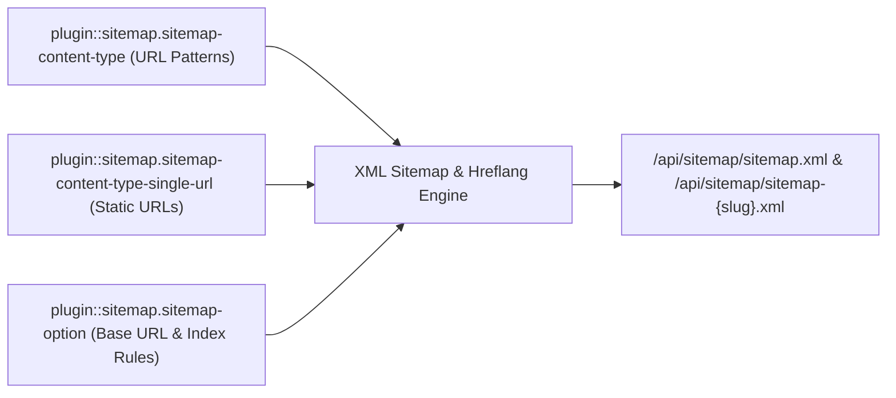
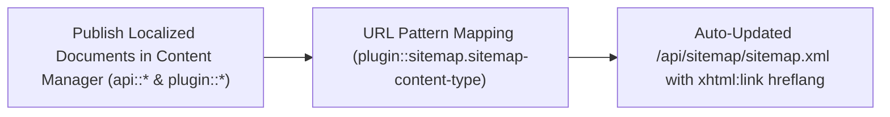
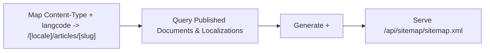
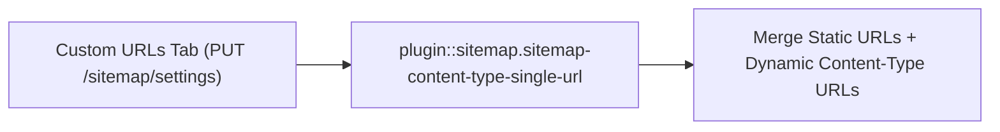
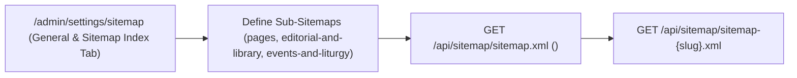

## 1. Installation & Peer Setup

```bash
pnpm add @vicacha-devs/strapi-plugin-sitemap
```

## 2. Server Configuration (`config/plugins.ts`)

Add the plugin configuration to your Strapi v5 `config/plugins.ts` file:

```ts
// config/plugins.ts
export default ({
  env,
}: {
  env: (key: string, defaultValue?: string) => string;
}) => ({
  sitemap: {
    enabled: true,
    config: {
      hostname: env("SITEMAP_HOSTNAME", "https://example.org"),
      includeHreflang: true,
    },
  },
});
```


## 3. Strapi v5 Admin UI Tour

Once enabled, the plugin registers its workspace and settings inside the Strapi v5 Admin panel using Strapi Design System v2 components:


### Key Localized Admin UI Labels

| Translation Key                | Rendered UI Label                               |
| :----------------------------- | :---------------------------------------------- |
| `plugin.name`                  | Sitemap                                         |
| `plugin.section.item`          | Configuration                                   |
| `settings.title`               | Sitemap                                         |
| `settings.subtitle`            | Settings for the XML sitemap and sitemap index  |
| `settings.showSitemap`         | Show Sitemap                                    |
| `settings.baseUrl.title`       | Base URL                                        |
| `settings.baseUrl.description` | Enter the base URL used for all sitemap entries |
| `settings.baseUrl.placeholder` | https://example.com                             |

## 4. Content-Type Entities, Locations & Schemas (`strapi.documents`)

Registers two internal Collection Types (`plugin::sitemap.sitemap-content-type` and `plugin::sitemap.sitemap-content-type-single-url`) and one Single Type (`plugin::sitemap.sitemap-option`) with `content-manager.visible: false`, while introspecting all public `api::*` and `plugin::*` Content-Type entities to generate `/api/sitemap/sitemap.xml` and `/api/sitemap/sitemap-{slug}.xml`.



### Where to Find Content-Type Entities in Strapi v5

- **Settings Panel (4 Tabs)**: `/admin/settings/sitemap` (`Settings -> Sitemap -> Configuration` — organized into **General & Sitemap Index**, **Collection Types**, **Custom URLs**, and **Excluded URLs** tabs)
- **Internal Persistence Entities**: `plugin::sitemap.sitemap-content-type` (`strapi_5_sitemap_plugin_content_types`), `plugin::sitemap.sitemap-content-type-single-url` (`strapi_5_sitemap_plugin_content_type_single_urls`), and `plugin::sitemap.sitemap-option` (`strapi_5_sitemap_plugin_options`)

### `plugin::sitemap.sitemap-content-type` — Sitemap Content Type

Per-locale URL pattern, priority, and changefreq mapping for a Strapi Content-Type entity

> **Kind**: `collectionType` · **DB Table**: `strapi_5_sitemap_plugin_content_types` · **Admin Location**: Internal (`/admin/plugins/sitemap`) · **Draft & Publish**: `No` · **i18n**: `No`

| Attribute              | Strapi Type | Required | Constraints / Target |
| :--------------------- | :---------- | :------- | :------------------- |
| `type`                 | `string`    | No       | —                    |
| `langcode`             | `string`    | No       | —                    |
| `pattern`              | `string`    | No       | —                    |
| `priority`             | `float`     | No       | —                    |
| `frequency`            | `string`    | No       | —                    |
| `lastModified`         | `string`    | No       | —                    |
| `thumbnail`            | `string`    | No       | —                    |
| `populateLinkedModels` | `string`    | No       | —                    |

### `plugin::sitemap.sitemap-content-type-single-url` — Sitemap Single URL

Custom static URL entry included alongside dynamic CMS entries in sitemap.xml

> **Kind**: `collectionType` · **DB Table**: `strapi_5_sitemap_plugin_content_type_single_urls` · **Admin Location**: Internal (`/admin/plugins/sitemap`) · **Draft & Publish**: `No` · **i18n**: `No`

| Attribute   | Strapi Type | Required | Constraints / Target |
| :---------- | :---------- | :------- | :------------------- |
| `slug`      | `string`    | No       | —                    |
| `priority`  | `float`     | No       | —                    |
| `frequency` | `string`    | No       | —                    |

### `plugin::sitemap.sitemap-option` — Sitemap Options

Global sitemap configuration (baseUrl, excludedUrls, useSitemapIndex, sitemapDefinitions)

> **Kind**: `singleType` · **DB Table**: `strapi_5_sitemap_plugin_options` · **Admin Location**: Internal (`/admin/plugins/sitemap`) · **Draft & Publish**: `No` · **i18n**: `No`

| Attribute            | Strapi Type | Required | Constraints / Target |
| :------------------- | :---------- | :------- | :------------------- |
| `baseUrl`            | `string`    | No       | —                    |
| `excludedUrls`       | `json`      | No       | default: `[]`        |
| `useSitemapIndex`    | `boolean`   | No       | default: `false`     |
| `sitemapDefinitions` | `json`      | No       | default: `[]`        |

## Strapi v5 Content Manager Integration (`/admin/content-manager`)

> **Content Manager Sidebar Group**: `Maps All Public Content Manager Collection Types & Single Types`

### Content Manager Entities & Components

- `plugin::sitemap.sitemap-content-type` (Internal URL pattern mapping for Content Manager entities)
- `plugin::sitemap.sitemap-content-type-single-url` (Internal custom static URL entries)
- `plugin::sitemap.sitemap-option` (Internal global sitemap settings)


### Why This Plugin Creates & Integrates Content Manager Entities

`@vicacha-devs/strapi-plugin-sitemap` keeps its 3 configuration schemas (`sitemap-content-type`, `sitemap-content-type-single-url`, `sitemap-option`) hidden from the Content Manager sidebar (`content-manager.visible: false`) to prevent accidental schema edits, while dynamically reading published documents and `i18n` localizations from **every public Content Manager Collection Type** (`api::*` and `plugin::*`):

- **Automatic Sync with Content Manager Publishing**: Whenever an editor publishes, updates, or unpublishes an `Article`, `Event`, `Donation Campaign`, or `Resource Publication` in Content Manager, `/api/sitemap/sitemap.xml` automatically reflects its `lastmod` and `xhtml:link` `hreflang` alternates.

### How to Use in Strapi Content Manager (Step-by-Step)

1. **Publish Content in Content Manager**: Author and publish localized entries in any `api::*` or `plugin::*` collection inside `/admin/content-manager`.
2. **Map URL Patterns in Sitemap Settings**: Open `/admin/settings/sitemap` -> **Collection Types** tab and bind each Content Manager collection UID + locale to its frontend route pattern (e.g., `/[locale]/articles/[slug]`).
3. **Configure Sitemap Index, Custom & Excluded URLs**: Use the **General & Sitemap Index** tab (`Use sitemap index with multiple sitemaps` + `getSitemapBySlug in Users & Permissions → Public → Sitemap`), **Custom URLs** tab, and **Excluded URLs** tab in `/admin/settings/sitemap`.

### Content Manager & Plugin Workspace Synchronization



### Content Manager Use Cases & Editorial Workflows

#### Content Manager Use Case 1 — Auto-Syndicating Published Content Manager Entries to Multilingual XML Sitemaps

- **Why & What it is for**: Ensure every newly published localized Event, Article, or Publication in Content Manager is immediately indexed with `hreflang` alternates.
- **How to use in Content Manager**: Publish the entry across `es`, `en`, `ar`, and `tr` in `/admin/content-manager` and verify its `<url>` block in `GET /api/sitemap/sitemap.xml`.

## 5. End-to-End Use Cases & Workflows

### Use Case 1 — Dynamic Multilingual Entity URL Pattern Mapping & `xhtml:link` Hreflang

- **What it is for**: Map any localized Strapi Content-Type entity (`api::article.article`, `plugin::events.event`, `plugin::resources.publication`) to dynamic URL patterns with automatic `hreflang` alternates.
- **How it works**: In `/admin/settings/sitemap` (**Collection Types** tab), map a content type + `langcode` to a pattern (e.g., `/[locale]/articles/[slug]`), `priority`, and `frequency` (`plugin::sitemap.sitemap-content-type`).




### Use Case 2 — Hybrid Static + CMS Sitemap with Custom Single URLs & Excluded Paths

- **What it is for**: Include static frontend routes (`/es`, `/es/about-us`, `/en/about-us`) alongside dynamic CMS entries in the same XML sitemap while excluding internal paths (`/admin`, `/api`, `/404`).
- **How it works**: Add static route entries in the **Custom URLs** tab (`plugin::sitemap.sitemap-content-type-single-url`) and exclude internal routes in the **Excluded URLs** tab of `/admin/settings/sitemap`.




### Use Case 3 — Multi-File Sitemap Index (`sitemap-{slug}.xml`) for Large Sites

- **What it is for**: Split large portals into dedicated sub-sitemaps (e.g., `/api/sitemap/sitemap-pages.xml`, `/api/sitemap/sitemap-editorial-and-library.xml`, `/api/sitemap/sitemap-events-and-liturgy.xml`) referenced by a master `<sitemapindex>`.
- **How it works**: Enable **Use sitemap index with multiple sitemaps** (`useSitemapIndex: true`), grant `getSitemapBySlug` in `Users & Permissions → Public → Sitemap`, and define `sitemapDefinitions` in the **General & Sitemap Index** tab of `/admin/settings/sitemap` (`PUT /sitemap/settings`).




## 6. REST API Endpoints (`content-api` & `admin`)

| Method | Endpoint Path                     | Scope         | Controller Handler            | Auth       |
| :----- | :-------------------------------- | :------------ | :---------------------------- | :--------- |
| `GET`  | `/api/sitemap/sitemap.xml`        | `content-api` | `controller.getSitemap`       | Bearer JWT |
| `GET`  | `/api/sitemap/sitemap-{slug}.xml` | `content-api` | `controller.getSitemapBySlug` | Bearer JWT |
| `GET`  | `/sitemap/settings`               | `admin`       | `controller.getSettings`      | Bearer JWT |
| `PUT`  | `/sitemap/settings`               | `admin`       | `controller.updateSettings`   | Bearer JWT |
| `GET`  | `/sitemap/content-types`          | `admin`       | `controller.getContentTypes`  | Bearer JWT |
| `GET`  | `/sitemap/locales`                | `admin`       | `controller.getLocales`       | Bearer JWT |
| `GET`  | `/sitemap/allowed-fields`         | `admin`       | `controller.getAllowedFields` | Bearer JWT |

## 7. Programmatic Server Usage (`strapi.plugin` & `strapi.documents`)

```ts
// Registered services on plugin "sitemap": "service", "settings"
const pluginService = strapi.plugin("sitemap")?.service("service");

// Querying records via the Strapi v5 Document Service API
const records = await strapi
  .documents("plugin::sitemap.sitemap-content-type")
  .findMany({
    limit: 25,
    sort: "createdAt:desc",
  });
```

## 8. Troubleshooting & Verification

- **Admin panel changes not visible**: Run `pnpm strapi build` after modifying `config/plugins.ts`.
- **Peer dependency isolation**: Keep `hoistPattern: ["*", "!@strapi/*"]` in `pnpm-workspace.yaml` so `@strapi/*` contexts are never duplicated.
- **TypeScript type-checking**: Validate both `admin/tsconfig.json` and `server/tsconfig.json` via `pnpm --filter <pkg> test:ts`.
