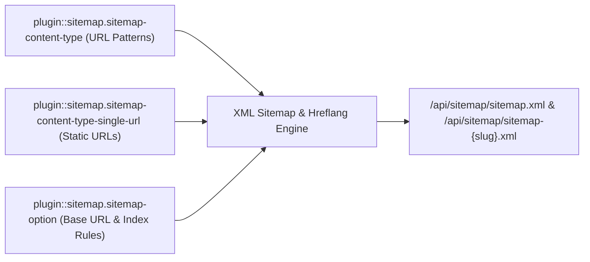
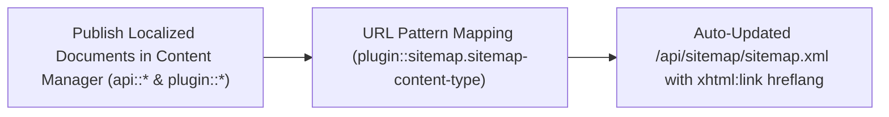
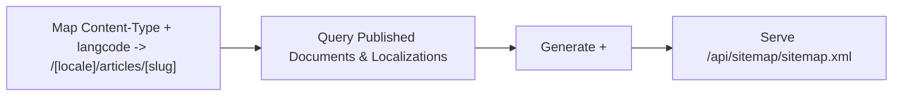
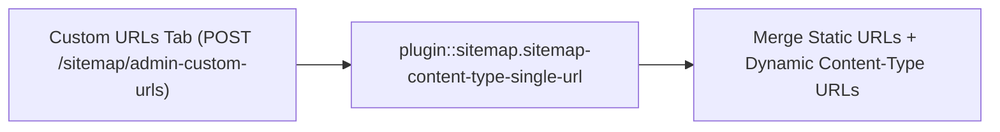
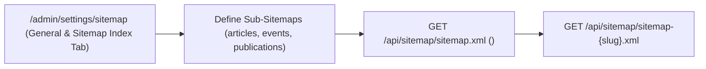

XML Sitemap and Sitemap Index generator for Strapi v5 with multilingual (`i18n`) support, collection & plugin content-type URL patterns, custom static URLs, image sitemap tags (`xmlns:image`), and excluded path rules.

## Public Endpoints

- `GET /api/sitemap/sitemap.xml` — Main XML sitemap (or `<sitemapindex>` when Sitemap Index mode is enabled)
- `GET /api/sitemap/sitemap-:slug.xml` — Individual named XML sitemap when Sitemap Index mode is enabled

## Quick Installation & Configuration

```bash
pnpm add @vicacha-devs/strapi-plugin-sitemap
```

Enable the plugin in `config/plugins.ts`:

```ts
export default () => ({
  sitemap: {
    enabled: true,
  },
});
```

## Content-Type Entities & Where to Find Them

Registers two internal Collection Types (`plugin::sitemap.sitemap-content-type` and `plugin::sitemap.sitemap-content-type-single-url`) and one Single Type (`plugin::sitemap.sitemap-option`) with `content-manager.visible: false`, while introspecting all public `api::*` and `plugin::*` Content-Type entities to generate `/api/sitemap/sitemap.xml` and `/api/sitemap/sitemap-{slug}.xml`.



- **Settings Panel (4 Tabs)**: `/admin/settings/sitemap` (`Settings -> Sitemap -> Configuration` — organized into **General & Sitemap Index**, **Collection Types**, **Custom URLs**, and **Excluded URLs** tabs)
- **Internal Persistence Entities**: `plugin::sitemap.sitemap-content-type` (`strapi_5_sitemap_plugin_content_types`), `plugin::sitemap.sitemap-content-type-single-url` (`strapi_5_sitemap_plugin_content_type_single_urls`), and `plugin::sitemap.sitemap-option` (`strapi_5_sitemap_plugin_options`)

## Strapi v5 Content Manager Integration (`/admin/content-manager`)

> **Content Manager Sidebar Group**: `Maps All Public Content Manager Collection Types & Single Types`

### Content Manager Entities & Components

- `plugin::sitemap.sitemap-content-type` (Internal URL pattern mapping for Content Manager entities)
- `plugin::sitemap.sitemap-content-type-single-url` (Internal custom static URL entries)
- `plugin::sitemap.sitemap-option` (Internal global sitemap settings)

### Why This Plugin Creates & Integrates Content Manager Entities

`@vicacha-devs/strapi-plugin-sitemap` keeps its 3 configuration schemas (`sitemap-content-type`, `sitemap-content-type-single-url`, `sitemap-option`) hidden from the Content Manager sidebar (`content-manager.visible: false`) to prevent accidental schema edits, while dynamically reading published documents and `i18n` localizations from **every public Content Manager Collection Type** (`api::*` and `plugin::*`):

- **Automatic Sync with Content Manager Publishing**: Whenever an editor publishes, updates, or unpublishes an `Article`, `Event`, `Donation Campaign`, or `Resource Publication` in Content Manager, `/api/sitemap/sitemap.xml` automatically reflects its `lastmod` and `xhtml:link` `hreflang` alternates.

### How to Use in Strapi Content Manager (Step-by-Step)

1. **Publish Content in Content Manager**: Author and publish localized entries in any `api::*` or `plugin::*` collection inside `/admin/content-manager`.
2. **Map URL Patterns in Sitemap Settings**: Open `/admin/settings/sitemap` (or `/admin/settings/strapi-5-sitemap-plugin`) -> **Collection Types** tab and bind each Content Manager collection UID + locale to its frontend route pattern (e.g., `/[locale]/articles/[slug]`).

### Content Manager & Plugin Workspace Synchronization



### Content Manager Use Cases & Editorial Workflows

#### Content Manager Use Case 1 — Auto-Syndicating Published Content Manager Entries to Multilingual XML Sitemaps

- **Why & What it is for**: Ensure every newly published localized Event, Article, or Publication in Content Manager is immediately indexed with `hreflang` alternates.
- **How to use in Content Manager**: Publish the entry across `es`, `en`, `ar`, and `tr` in `/admin/content-manager` and verify its `<url>` block in `GET /api/sitemap/sitemap.xml`.

## End-to-End Use Cases & Workflows

### Use Case 1 — Dynamic Multilingual Entity URL Pattern Mapping & `xhtml:link` Hreflang

- **What it is for**: Map any localized Strapi Content-Type entity (`api::article.article`, `plugin::events.event`, `plugin::resources.publication`) to dynamic URL patterns with automatic `hreflang` alternates.
- **How it works**: In `/admin/settings/sitemap` (**Collection Types** tab), map a content type + `langcode` to a pattern (e.g., `/[locale]/articles/[slug]`), `priority`, and `frequency` (`plugin::sitemap.sitemap-content-type`).




### Use Case 2 — Hybrid Static + CMS Sitemap with Custom Single URLs

- **What it is for**: Include static frontend routes (`/`, `/es/contact`, `/ar/prayer-times`) alongside dynamic CMS entries in the same XML sitemap.
- **How it works**: Add static route entries in the **Custom URLs** tab (`plugin::sitemap.sitemap-content-type-single-url`) and exclude internal routes in the **Excluded URLs** tab.



### Use Case 3 — Multi-File Sitemap Index (`sitemap-{slug}.xml`) for Large Sites

- **What it is for**: Split large portals into dedicated sub-sitemaps (e.g., `/api/sitemap/sitemap-articles.xml`, `/api/sitemap/sitemap-events.xml`) referenced by a master `<sitemapindex>`.
- **How it works**: Enable `useSitemapIndex: true` and define `sitemapDefinitions` in the **General & Sitemap Index** tab of `/admin/settings/sitemap` (`PUT /sitemap/admin-put-options`).




## Admin Workspace, Content Manager & Settings Panel Preview


### Settings Panel (`Settings -> Configuration`)


> Explore [**Content Types & Use Cases**](/strapi-plugin-sitemap/use-cases/), the [**Developer Guide & Admin UI Tour**](/strapi-plugin-sitemap/guide/), and the [**Interactive OpenAPI Reference**](/strapi-plugin-sitemap/api/) for complete schema, workflow diagram, and endpoint documentation.
