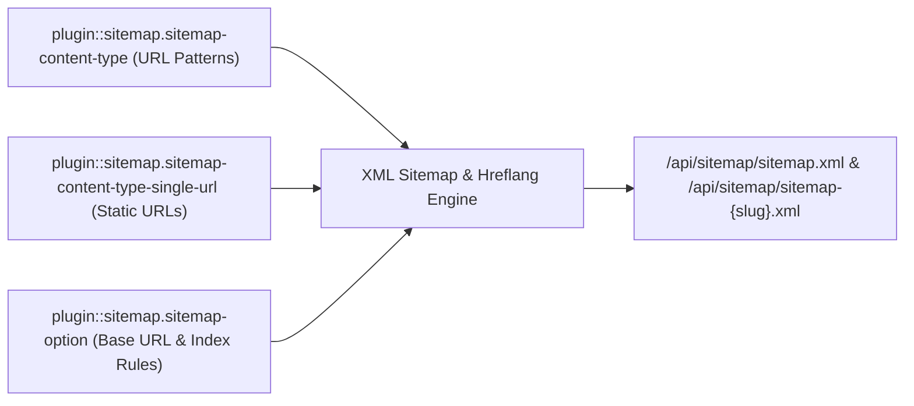
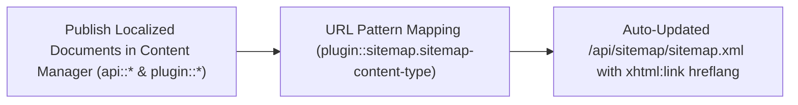
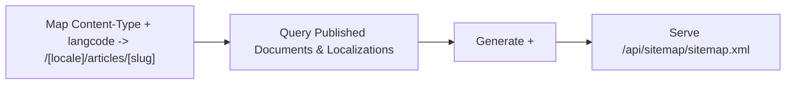
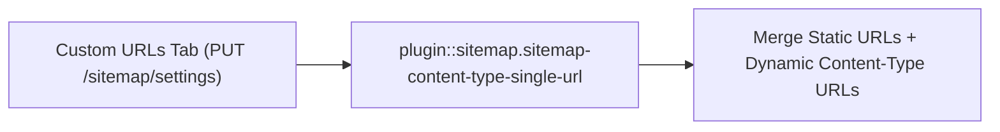
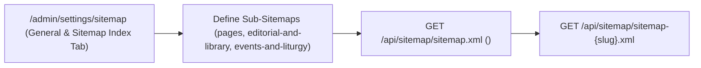

XML Sitemap and Sitemap Index generator for Strapi v5 with automatic multilingual (`i18n` + `xhtml:link` `hreflang`) alternates, collection & plugin content-type URL patterns, nested relation and component placeholders, Google Image Sitemap (`xmlns:image`) support, custom static URLs, and excluded path rules.

## Key Features

- **Dynamic Collection & Plugin Content-Type URL Patterns**: Map any visible `api::*` or `plugin::*` collection type to custom URL patterns such as `/[locale]/articles/[category.slug]/[slug]`.
- **Automatic `xhtml:link` `hreflang` Alternates**: Automatically links localized Strapi v5 documents sharing the same `documentId` with `<xhtml:link rel="alternate" hreflang="..." href="..." />` (`xmlns:xhtml="http://www.w3.org/1999/xhtml"`).
- **Sitemap Index & Multi-File Sub-Sitemaps**: Serve either a single `<urlset>` at `/api/sitemap/sitemap.xml` or a master `<sitemapindex>` referencing dedicated sub-sitemaps at `/api/sitemap/sitemap-:slug.xml`.
- **Google Image Sitemap (`xmlns:image`)**: Include `<image:image><image:loc>...</image:loc><image:title>...</image:title></image:image>` tags from media fields, automatically resolving relative `/uploads/...` URLs against `baseUrl` and falling back to document titles when media names are empty.
- **Static Custom URLs & Excluded Paths**: Combine static frontend routes (`/about`, `/es/contact`) with dynamic CMS entries while filtering out excluded paths.
- **Unified Settings Persistence**: Synchronizes configuration across Strapi's internal `plugin::sitemap.sitemap-option`, `plugin::sitemap.sitemap-content-type`, and `plugin::sitemap.sitemap-content-type-single-url` entities via `GET / PUT /sitemap/settings`.

## Installation & Configuration

Enable the plugin in `config/plugins.ts` (or `config/plugins.js`):

```ts
export default ({ env }) => ({
  sitemap: {
    enabled: true,
    config: {
      // Optional fallback base URL when baseUrl is not yet set in the Admin UI
      hostname: env("PUBLIC_SITE_URL", "https://example.com"),
      // Emit <xhtml:link rel="alternate" hreflang="..." /> across localized documents (default: true)
      includeHreflang: true,
    },
  },
});
```

## Public Endpoints (Content API)

- `GET /api/sitemap/sitemap.xml` — Main XML sitemap (`<urlset>`) or `<sitemapindex>` when Sitemap Index mode is enabled (`auth: false`).
- `GET /api/sitemap/sitemap-:slug.xml` — Named sub-sitemap (`<urlset>`) for a specific sitemap definition slug when Sitemap Index mode is enabled (`auth: false`).

## Admin Endpoints

- `GET /sitemap/settings` — Retrieve unified sitemap settings (`baseUrl`, `collectionTypes`, `customURLs`, `excludedUrls`, `useSitemapIndex`, `sitemaps`).
- `PUT /sitemap/settings` — Update and synchronize unified sitemap settings across all internal sitemap tables.
- `GET /sitemap/content-types` — List visible `api::*` and `plugin::*` collection types available for URL pattern mapping.
- `GET /sitemap/locales` — List configured Strapi `i18n` locale codes.
- `GET /sitemap/allowed-fields?singularName=<type>&populateLinkedModels=<bool>` — Inspect scalar, component, media (`mediaFields`), and first-level relation fields (`allowedFields`) for pattern interpolation.

## URL Pattern Placeholders

Patterns use bracket notation (`[field]`) and support:

- **Top-level scalar fields**: `[id]`, `[slug]`, `[title]`
- **Locale placeholder**: `[locale]` (automatically falls back to the entry's configured `langcode` if the document does not carry a `locale` property)
- **Component & nested relation fields**: `[meta.canonical]`, `[category.slug]`, `[department.category.slug]` (when `populateLinkedModels` is enabled)

## Admin Settings UI (`/admin/settings/sitemap` — 4 Tabs)

Navigate to **Settings → Sitemap → Configuration** (`/admin/settings/sitemap`) in the Strapi v5 Admin panel:

1. **General & Sitemap Index** (`/screenshots/sitemap-settings.png`): Configure the canonical **Base URL**, toggle **Use sitemap index with multiple sitemaps** (`When enabled, sitemap.xml becomes the index; each entry below generates sitemap-{name}.xml.`), review the public permission notice (`getSitemapBySlug in Users & Permissions → Public → Sitemap`), and manage named sub-sitemaps (`pages`, `editorial-and-library`, `events-and-liturgy`).
2. **Collection Types** (`/screenshots/sitemap-admin.png`): Bind localized `api::*` and `plugin::*` collection types (`type` + `langcode`) to dynamic URL patterns (`/[locale]/articles/[slug]`), `priority`, `frequency`, `lastModified`, and `thumbnail` media fields.
3. **Custom URLs** (`/screenshots/sitemap-content-manager.png`): Add, edit, or delete static frontend route entries (`/es`, `/es/about-us`, `/en/about-us`) with per-route priority and frequency.
4. **Excluded URLs** (`/screenshots/sitemap-excluded-urls.png`): Exclude internal or non-indexable route prefixes (`/admin`, `/api`, `/404`) from all generated XML sitemaps.


## Content-Type Entities & Where to Find Them

Registers two internal Collection Types (`plugin::sitemap.sitemap-content-type` and `plugin::sitemap.sitemap-content-type-single-url`) and one Single Type (`plugin::sitemap.sitemap-option`) with `content-manager.visible: false`, while introspecting all public `api::*` and `plugin::*` Content-Type entities to generate `/api/sitemap/sitemap.xml` and `/api/sitemap/sitemap-{slug}.xml`.



- **Settings Panel (4 Tabs)**: `/admin/settings/sitemap` (`Settings -> Sitemap -> Configuration` — organized into **General & Sitemap Index**, **Collection Types**, **Custom URLs**, and **Excluded URLs** tabs)
- **Internal Persistence Entities**: `plugin::sitemap.sitemap-content-type` (`strapi_5_sitemap_plugin_content_types`), `plugin::sitemap.sitemap-content-type-single-url` (`strapi_5_sitemap_plugin_content_type_single_urls`), and `plugin::sitemap.sitemap-option` (`strapi_5_sitemap_plugin_options`)

## Strapi v5 Content Manager Integration (`/admin/content-manager`)

> **Content Manager Sidebar Group**: `Maps All Public Content Manager Collection Types & Single Types`

### Content Manager Entities & Components

- `plugin::sitemap.sitemap-content-type` (Internal URL pattern mapping for Content Manager entities)
- `plugin::sitemap.sitemap-content-type-single-url` (Internal custom static URL entries)
- `plugin::sitemap.sitemap-option` (Internal global sitemap settings)


### Why This Plugin Creates & Integrates Content Manager Entities

`@vicacha-devs/strapi-plugin-sitemap` keeps its 3 configuration schemas (`sitemap-content-type`, `sitemap-content-type-single-url`, `sitemap-option`) hidden from the Content Manager sidebar (`content-manager.visible: false`) to prevent accidental schema edits, while dynamically reading published documents and `i18n` localizations from **every public Content Manager Collection Type** (`api::*` and `plugin::*`):

- **Automatic Sync with Content Manager Publishing**: Whenever an editor publishes, updates, or unpublishes an `Article`, `Event`, `Donation Campaign`, or `Resource Publication` in Content Manager, `/api/sitemap/sitemap.xml` automatically reflects its `lastmod` and `xhtml:link` `hreflang` alternates.

### How to Use in Strapi Content Manager (Step-by-Step)

1. **Publish Content in Content Manager**: Author and publish localized entries in any `api::*` or `plugin::*` collection inside `/admin/content-manager`.
2. **Map URL Patterns in Sitemap Settings**: Open `/admin/settings/sitemap` -> **Collection Types** tab and bind each Content Manager collection UID + locale to its frontend route pattern (e.g., `/[locale]/articles/[slug]`).
3. **Configure Sitemap Index, Custom & Excluded URLs**: Use the **General & Sitemap Index** tab (`Use sitemap index with multiple sitemaps` + `getSitemapBySlug in Users & Permissions → Public → Sitemap`), **Custom URLs** tab, and **Excluded URLs** tab in `/admin/settings/sitemap`.

### Content Manager & Plugin Workspace Synchronization



### Content Manager Use Cases & Editorial Workflows

#### Content Manager Use Case 1 — Auto-Syndicating Published Content Manager Entries to Multilingual XML Sitemaps

- **Why & What it is for**: Ensure every newly published localized Event, Article, or Publication in Content Manager is immediately indexed with `hreflang` alternates.
- **How to use in Content Manager**: Publish the entry across `es`, `en`, `ar`, and `tr` in `/admin/content-manager` and verify its `<url>` block in `GET /api/sitemap/sitemap.xml`.

## End-to-End Use Cases & Workflows

### Use Case 1 — Dynamic Multilingual Entity URL Pattern Mapping & `xhtml:link` Hreflang

- **What it is for**: Map any localized Strapi Content-Type entity (`api::article.article`, `plugin::events.event`, `plugin::resources.publication`) to dynamic URL patterns with automatic `hreflang` alternates.
- **How it works**: In `/admin/settings/sitemap` (**Collection Types** tab), map a content type + `langcode` to a pattern (e.g., `/[locale]/articles/[slug]`), `priority`, and `frequency` (`plugin::sitemap.sitemap-content-type`).




### Use Case 2 — Hybrid Static + CMS Sitemap with Custom Single URLs & Excluded Paths

- **What it is for**: Include static frontend routes (`/es`, `/es/about-us`, `/en/about-us`) alongside dynamic CMS entries in the same XML sitemap while excluding internal paths (`/admin`, `/api`, `/404`).
- **How it works**: Add static route entries in the **Custom URLs** tab (`plugin::sitemap.sitemap-content-type-single-url`) and exclude internal routes in the **Excluded URLs** tab of `/admin/settings/sitemap`.




### Use Case 3 — Multi-File Sitemap Index (`sitemap-{slug}.xml`) for Large Sites

- **What it is for**: Split large portals into dedicated sub-sitemaps (e.g., `/api/sitemap/sitemap-pages.xml`, `/api/sitemap/sitemap-editorial-and-library.xml`, `/api/sitemap/sitemap-events-and-liturgy.xml`) referenced by a master `<sitemapindex>`.
- **How it works**: Enable **Use sitemap index with multiple sitemaps** (`useSitemapIndex: true`), grant `getSitemapBySlug` in `Users & Permissions → Public → Sitemap`, and define `sitemapDefinitions` in the **General & Sitemap Index** tab of `/admin/settings/sitemap` (`PUT /sitemap/settings`).




## Admin Workspace, Content Manager & Settings Panel Preview


### Strapi v5 Content Manager Entities (`/admin/content-manager`)


### Settings Panel (`Settings -> Configuration`)


> Explore [**Content Types & Use Cases**](/strapi-plugin-sitemap/use-cases/), the [**Developer Guide & Admin UI Tour**](/strapi-plugin-sitemap/guide/), and the [**Interactive OpenAPI Reference**](/strapi-plugin-sitemap/api/) for complete schema, workflow diagram, and endpoint documentation.
