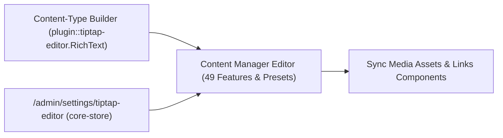
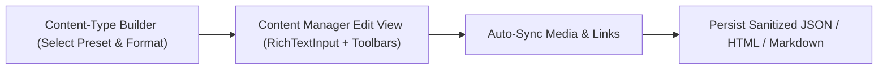
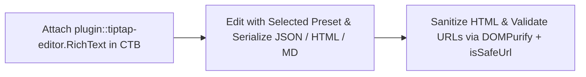
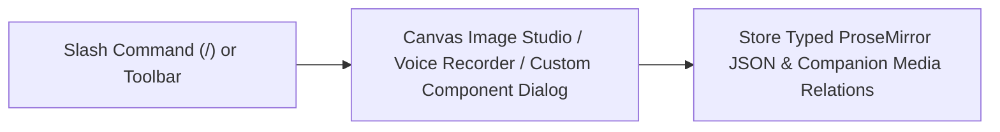
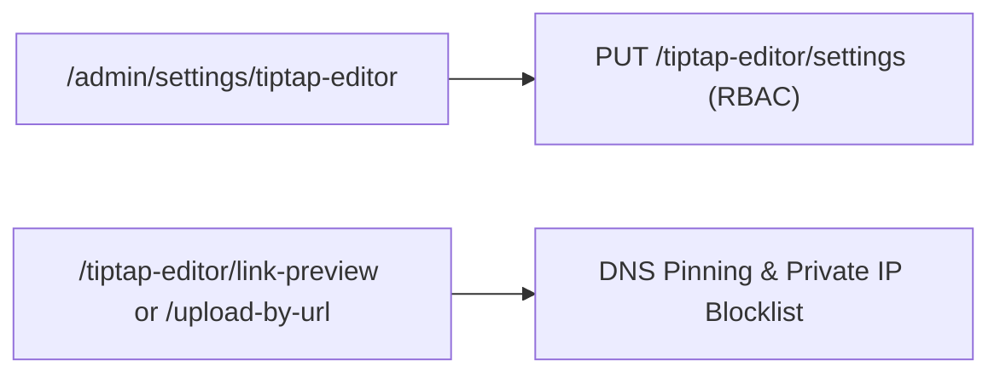

TipTap v3 + Edifice IO WYSIWYG editor plugin for Strapi v5. Includes 49 configurable rich-text features, schema-driven custom components, Edifice IO multimedia & structured blocks, relational media & internal link sync, in-editor HTML5 Canvas image studio & voice recorder, speech tools, and WCAG 2.1 AA accessibility.

## Features

- **Powered by [TipTap v3.20+](https://tiptap.dev/)** — headless ProseMirror architecture with React NodeViews and zero-side-effect state updates (`useEditorState`).
- **49 Configurable Features** across 4 built-in presets (`minimal`, `default`, `full`, `edifice`) plus custom presets in `config/plugins.ts` and runtime overrides in Strapi Admin Settings.
- **Schema-Driven Custom Components (`components`)** — reusable block or inline components (with built-in `button` included out of the box), generated attribute dialogs, custom React previews, and shared `./shared` schema helpers.
- **Multi-Format Serialization** — stores **ProseMirror JSON** by default, or outputs sanitized **HTML** or **Markdown** per field.
- **Edifice IO Multimedia Suite**:
  - **Images (`mediaLibrary`)** with in-editor **HTML5 Canvas Image Crop/Rotate/Flip/Zoom Studio**, `<figure>`/`<figcaption>`, `alt`, `title`, Media Library metadata refresh, alignment, and drag-resize handle.
  - **Videos (`video`)** via Strapi Media Library or privacy-enhanced YouTube (`youtube-nocookie.com`), Vimeo, and direct MP4 URLs.
  - **Audio (`audio`)** via Strapi Media Library or **in-browser `MediaRecorder` Voice Note Recorder** with live timer and direct upload.
  - **Attachments (`attachment`)** with downloadable file cards, MIME badge, and formatted byte size.
  - **Iframes (`iframe`)** with strict `https:` enforcement, `sandbox` attributes, and domain allowlisting.
- **Relational Media & Internal Link Sync**:
  - Automatically extracts all 4 embedded media types (`image`, `video`, `audio`, `attachment`) into a companion `<FieldName>Media` field and internal Strapi links (`strapi://collectionName/documentId` & `linker` nodes) into a companion `<FieldName>Links` component.
- **Structured Blocks & Editorial Tools**:
  - `informationPane`, `accordion`, `columns`, `taskList`, `conversationHistory`, `tableOfContents`, `pageBreak`, `mathematics`, `emoji`, and `slashCommands`.
- **Typography & Semantic Accessibility Marks**:
  - `fontFamily`, `fontSize`, `lineHeight`, `clearFormatting`, `typography`, `leadParagraph`, `abbr`, and `language` (`<span lang="..." dir="...">` for WCAG 2.1 SC 3.1.2).
- **Speech & Productivity Modes**:
  - `speechToText`, `textToSpeech`, `characterCount`, `fullscreen`, Edifice Read-Only Preview, and JSON / HTML / Markdown Source Inspector.
- **Zero-Data-Loss Content Safety**:
  - Disabling any rich node in a preset renders existing content via read-only NodeViews so content is never silently stripped on save, and unknown unregistered types surface a clear warning via `stripUnknownContent`.

## Supported Versions

| Plugin Version | Strapi Version | Node.js Version                        | TipTap Version |
| -------------- | -------------- | -------------------------------------- | -------------- |
| `1.3.x+`       | `5.39.0`       | `^20.19.0 \|\| ^22.13.0 \|\| >=24.0.0` | `3.20.1`       |

## Installation

```bash
pnpm add @vicacha-devs/strapi-plugin-tiptap-editor
pnpm build && pnpm start
```

## Configuration

The plugin uses a hybrid **preset + runtime settings** architecture:

1. **Built-in Presets**: `minimal`, `default`, `full`, and `edifice` work out of the box with zero configuration.
2. **Code-first Presets (`config/plugins.ts`)**: Define custom named presets and theme options in version control.
3. **Runtime Settings UI (`/settings/tiptap-editor`)**: Override global defaults, allowed iframe domains, relational sync, and per-preset feature toggles stored in Strapi `core-store`.

### Built-In Presets

| Preset Name | Included Features                                                                                                                                                                                                            |
| ----------- | ---------------------------------------------------------------------------------------------------------------------------------------------------------------------------------------------------------------------------- |
| `minimal`   | `bold`, `italic`                                                                                                                                                                                                             |
| `default`   | `bold`, `italic`, `underline`, `strike`, `code`, `codeBlock`, `blockquote`, `bulletList`, `orderedList`, `hardBreak`, `horizontalRule`, `history`, `heading`, `link`, `table`, `textAlign`, `mediaLibrary`, `characterCount` |
| `full`      | All **49** feature keys enabled                                                                                                                                                                                              |
| `edifice`   | All **49** feature keys enabled (complete Edifice IO Playground experience)                                                                                                                                                  |

### Defining Custom Presets (`config/plugins.ts`)

```ts
export default () => ({
  "tiptap-editor": {
    config: {
      presets: {
        minimal: { bold: true, italic: true, link: true },
        editorial: {
          bold: true,
          italic: true,
          underline: true,
          heading: { levels: [1, 2, 3, 4] },
          leadParagraph: true,
          abbr: true,
          language: true,
          bulletList: true,
          orderedList: true,
          taskList: true,
          blockquote: true,
          informationPane: true,
          accordion: true,
          columns: true,
          link: true,
          linker: true,
          mediaLibrary: { resize: { enabled: true } },
          video: true,
          audio: true,
          attachment: true,
          table: { resizable: true, cellBackground: true },
          components: { button: true },
          characterCount: { limit: 10000 },
          fullscreen: true,
        },
      },
    },
  },
});
```

### Field-Level Options (Content-Type Builder)

- **Output Format (`options.outputFormat`)**: `json` (default ProseMirror JSON), `html` (sanitized HTML string), or `markdown` (Markdown string).
- **Editor Preset (`options.preset`)**: Select which preset this field uses (`default`, `minimal`, `full`, `edifice`, or custom).
- **Character Limit (`options.characterLimit`)**: Optional maximum character count for the field.
- **Placeholder (`options.placeholder`)**: Custom placeholder text when the editor is empty.

## Custom Components

Components are enabled per preset under a `components` key mapping component names (`^[a-zA-Z][\w-]*$`, excluding `RESERVED_NODE_NAMES`) to `true`, `false`, or an options object:

```tsx
import type { StrapiApp } from "@strapi/strapi/admin";
import type { RichTextComponentSchema } from "@vicacha-devs/strapi-plugin-tiptap-editor/shared";
import {
  defineRichTextComponent,
  registerRichTextComponent,
} from "@vicacha-devs/strapi-plugin-tiptap-editor/strapi-admin";

export const calloutSchema: RichTextComponentSchema = {
  name: "callout",
  label: "Callout",
  content: "block+",
  attributes: {
    tone: {
      default: "info",
      form: {
        type: "select",
        label: "Tone",
        options: [
          { value: "info", label: "Info" },
          { value: "warning", label: "Warning" },
        ],
      },
    },
  },
};

const calloutComponent = defineRichTextComponent<{ tone: "info" | "warning" }>({
  ...calloutSchema,
  label: { id: "app.components.callout.label", defaultMessage: "Callout" },
  defaultAttrs: { tone: "info" },
  validate: (attrs) => (attrs.tone ? null : { tone: "Tone is required" }),
});

export default {
  register(_app: StrapiApp) {
    registerRichTextComponent(calloutComponent);
  },
};
```

- **Inline Components**: Set `inline: true` on a schema (without `content`) to create an inline atom with `marks: ''` that renders as a compact `<span>` chip.
- **Shared Schema Helpers**: Import `RichTextComponentSchema`, `toNodeSpec`, `isInlineComponent`, `buttonSchema`, `BUILT_IN_COMPONENT_SCHEMAS`, `stripUnknownContent`, `isComponentEnabled`, `getComponentOptions`, and `RESERVED_NODE_NAMES` from `@vicacha-devs/strapi-plugin-tiptap-editor/shared`.

## Relational Media & Internal Links Synchronization

- **Companion `<FieldName>Media` Field**: Add a Multiple Media field named `<FieldName>Media` (e.g. `contentMedia`). `useRelationalSync` extracts all embedded `image`, `video`, `audio`, and `attachment` assets (`data-asset-id` / `data-document-id`) and updates `<FieldName>Media`.
- **Companion `<FieldName>Links` Component**: Define a `links.links` component in your Strapi project and add a `<FieldName>Links` field (e.g. `contentLinks`). Internal Strapi links inserted via `linker` or `strapi://api::collection.collection/documentId` URIs are grouped by collection and synced automatically.

## Available Extensions (49 Feature Keys)

### Inline Formatting, Typography & Semantic Marks

| Key                                                                         | Description                                                                                     |
| --------------------------------------------------------------------------- | ----------------------------------------------------------------------------------------------- |
| `bold`, `italic`, `underline`, `strike`, `code`, `superscript`, `subscript` | Standard inline formatting marks (`<strong>`, `<em>`, `<u>`, `<s>`, `<code>`, `<sup>`, `<sub>`) |
| `clearFormatting`                                                           | Strip all inline marks and reset block to paragraph                                             |
| `leadParagraph`                                                             | Lead / intro paragraph (`<p class="lead-paragraph" data-lead="true">`)                          |
| `abbr`                                                                      | Semantic abbreviation (`<abbr title="...">`) with modal                                         |
| `language`                                                                  | WCAG 3.1.2 language & direction (`<span lang=".." dir="..">`)                                   |
| `fontFamily`, `fontSize`, `lineHeight`                                      | Customizable font family, font size (`12px`–`40px`), and line height (`1.0`–`2.0`) selectors    |
| `typography`                                                                | Smart typography input rules (`--` → `—`, `...` → `…`, `(c)` → `©`)                             |

### Block Elements, Headings, Links, Tables & Colors

| Key                                                                                                            | Description                                                                                                                                             |
| -------------------------------------------------------------------------------------------------------------- | ------------------------------------------------------------------------------------------------------------------------------------------------------- |
| `blockquote`, `codeBlock`, `bulletList`, `orderedList`, `taskList`, `hardBreak`, `horizontalRule`, `history`   | Core block elements, interactive checklists, and undo/redo history                                                                                      |
| `heading`                                                                                                      | Visual heading levels (`h1`–`h6`), independent SEO tag, and sanitized slug `id` attributes                                                              |
| `link`                                                                                                         | External/internal hyperlinks with protocol validation (`https:`, `mailto:`)                                                                             |
| `linker`                                                                                                       | Internal Strapi Document Linker chip & live search modal                                                                                                |
| `table`                                                                                                        | Resizable tables with row/column controls, `cellBackground` color picker (`TableCellWithBackground`, `TableHeaderWithBackground`), and cell merge/split |
| `textAlign`, `textColor`, `highlightColor`                                                                     | Paragraph/heading alignment and theme-driven text/highlight color pickers                                                                               |
| `informationPane`, `accordion`, `columns`, `conversationHistory`, `pageBreak`, `tableOfContents`, `components` | Edifice IO callout boxes, `<details>` accordions, 2/3-col CSS grids, discussion logs, page breaks, dynamic TOC, and custom components                   |

### Edifice IO Multimedia, Math, Emoji, Slash & Speech Tools

| Key                                     | Description                                                                                                                             |
| --------------------------------------- | --------------------------------------------------------------------------------------------------------------------------------------- |
| `mediaLibrary`                          | Strapi Media Library images with alt/title/caption popover, metadata sync, resize handle, and HTML5 Canvas crop/rotate/flip/zoom studio |
| `video`                                 | Strapi Media Library videos (`<video controls>`) or YouTube/Vimeo/MP4 embeds                                                            |
| `audio`                                 | Strapi Media Library audio or in-browser `MediaRecorder` voice note recorder                                                            |
| `attachment`                            | Downloadable file cards with filename, extension badge, MIME type, and size                                                             |
| `iframe`                                | Sandboxed `https:` iframes (`sandbox="allow-scripts allow-popups"`, `allowedDomains`)                                                   |
| `mathematics`, `emoji`, `slashCommands` | Inline/block LaTeX math, searchable emoji picker + `:shortcode:`, and `/` command palette                                               |
| `speechToText`, `textToSpeech`          | Web Speech API voice dictation and read-aloud                                                                                           |
| `characterCount`, `fullscreen`          | Live word/character/reading-time footer bar, fullscreen mode, read-only preview, and JSON/HTML/Markdown source inspector                |

## Accessibility (WCAG 2.1 AA) & Security

- **WCAG 2.1 AA Toolbar Navigation**: Roving `ArrowRight`/`ArrowLeft`/`Home`/`End`/`Escape` keyboard navigation, `role="toolbar"`, `aria-label`, `aria-pressed`, `aria-live="polite"`, and WCAG 3.1.2 `language` marks.
- **Defense-in-Depth Security**:
  - **URL & Attribute Sanitization**: Blocks `javascript:`, `vbscript:`, protocol-relative (`//`, `/\`), and `data:text/html` across links, media nodes, custom component `url` attributes, and preset `HTMLAttributes` overrides.
  - **DNS-Aware SSRF Protection (`isSsrfSafeUrl` & `assertSafeResolvedHost`)**: Backend `/link-preview` and `/upload-by-url` routes validate hostnames and DNS-resolved IPv4/IPv6 addresses, pin DNS records via an undici `Agent` dispatcher, disable automatic redirects, and cap response streams (64 KB for link previews, 25 MB for uploads).

## Theme & Public Admin API

Configure `theme.colors` (`{ label, color }[]`) and `theme.css` / `theme.stylesheet` in `config/plugins.ts`.

Import from `@vicacha-devs/strapi-plugin-tiptap-editor/strapi-admin`:

- `registerRichTextComponent`, `defineRichTextComponent`, `listRichTextComponents`, `ColorPickerPopover`
- `registerTiptapExtension`, `unregisterTiptapExtension`, `getRegisteredTiptapExtension`, `getRegisteredTiptapExtensions`
- `MediaLibraryWrapper`, `ToolbarButton`

## Backend API Routes

All admin routes are mounted under `/tiptap-editor`:

| Method        | Path                                              | Description                                                |
| ------------- | ------------------------------------------------- | ---------------------------------------------------------- |
| `GET`         | `/tiptap-editor/presets`                          | List all available preset names (built-in + custom)        |
| `GET`         | `/tiptap-editor/presets/:preset`                  | Get resolved feature configuration for a preset            |
| `GET`         | `/tiptap-editor/theme`                            | Get theme colors and custom CSS/stylesheet                 |
| `GET` / `PUT` | `/tiptap-editor/settings`                         | Get or update runtime settings and preset overrides        |
| `GET`         | `/tiptap-editor/search?q=<query>&locale=<locale>` | Search linkable Strapi collection documents                |
| `GET`         | `/tiptap-editor/get/:collectionName/:documentId`  | Resolve a single Strapi document's label and publish state |
| `GET`         | `/tiptap-editor/identify/:collectionName`         | Identify the human-readable title field for a collection   |
| `GET`         | `/tiptap-editor/link-preview?url=<https_url>`     | DNS-aware SSRF-safe OpenGraph metadata preview             |
| `POST`        | `/tiptap-editor/upload-by-url`                    | DNS-aware SSRF-safe remote media URL upload                |

## Content-Type Entities & Where to Find Them

Registers the `plugin::tiptap-editor.RichText` custom field in Content-Type Builder & Content Manager alongside Strapi `core-store` runtime settings (`settings`), optional `links.links` internal reference sync, and companion `<FieldName>Media` relational media tracking.



- **Content Manager Rich-Text Fields**: `/admin/content-manager` (any Collection Type or Single Type field configured with custom field `plugin::tiptap-editor.RichText`)
- **Content-Type Builder Preset Selector**: `/admin/plugins/content-type-builder` (`PresetSelect`, output format `json | html | markdown`, character limit, and placeholder options)
- **Global Settings Panel**: `/admin/settings/tiptap-editor` (`Settings -> Global Settings -> Tiptap Editor` — runtime preset overrides, iframe domain allowlist, and relational sync)

## Strapi v5 Content Manager Integration (`/admin/content-manager`)

> **Content Manager Sidebar Group**: `Operates Inside Every Content Manager Entry Using plugin::tiptap-editor.RichText`

### Content Manager Entities & Components

- Custom Field `plugin::tiptap-editor.RichText` (attached to `api::article.article`, `api::page.page`, or any Collection/Single Type in `/admin/content-manager`)
- Companion `<FieldName>Media` & `<FieldName>Links` fields automatically synchronized on edit (`enableRelationalSync`)
- Settings Store `plugin::tiptap-editor.settings` (`core-store` managed via `/admin/settings/tiptap-editor`)


### Why This Plugin Creates & Integrates Content Manager Entities

`@vicacha-devs/strapi-plugin-tiptap-editor` delivers a WCAG 2.1 AA WYSIWYG editing workspace directly inside **Strapi v5 Content Manager** edit views via custom field `plugin::tiptap-editor.RichText` without creating intrusive standalone tables:

- **Hybrid Code + Runtime Presets**: Fields inherit code-first presets (`minimal`, `default`, `full`, `edifice`, or custom `config/plugins.ts` presets) and respect live overrides saved at `/admin/settings/tiptap-editor`.
- **Automatic Relational Media & Document Linker Sync**: `useRelationalSync` extracts embedded Media Library assets (`<FieldName>Media`) and internal `linker` document references (`<FieldName>Links`) as editors type.
- **Zero-Data-Loss Fallback**: Disabling an extension renders existing nodes read-only rather than dropping structured content on publish.

### How to Use in Strapi Content Manager (Step-by-Step)

1. **Add the Custom Field in Content-Type Builder**: Open `/admin/plugins/content-type-builder`, add custom field **Rich Text (Tiptap)** (`plugin::tiptap-editor.RichText`), and pick a preset and output format (`json`, `html`, or `markdown`).
2. **Edit Content in Content Manager**: Open `/admin/content-manager` for the entry, format text using the roving toolbar, `/` slash menu, HTML5 Canvas image studio, voice recorder, or custom components, and click **Publish**.
3. **Review Global Overrides**: Visit `/admin/settings/tiptap-editor` (`Settings -> Global Settings -> Tiptap Editor`) to tune allowed iframe domains and runtime feature toggles.

### Content Manager & Plugin Workspace Synchronization



### Content Manager Use Cases & Editorial Workflows

#### Content Manager Use Case 1 — Authoring Accessible Multilingual Rich Content & Linked Assets

- **Why & What it is for**: Compose localized articles in `/admin/content-manager` with WCAG `language` spans (`dir='rtl'|'ltr'`), semantic headings, internal document links, cropped images, and automatic relational asset tracking.
- **How to use in Content Manager**: Open an entry in `/admin/content-manager`, switch locale via i18n, insert media/links/blocks in the `RichText` field, verify the inspector preview (JSON/HTML/Markdown), and click **Publish**.

## End-to-End Use Cases & Workflows

### Use Case 1 — Configuring Preset-Driven Rich-Text Fields & Output Formats (`json`, `html`, `markdown`)

- **What it is for**: Bind fields on `api::article.article` or `api::page.page` to tailored TipTap presets (`minimal`, `default`, `full`, `edifice`, or custom presets in `config/plugins.ts`) with strict DOMPurify + URL sanitization.
- **How it works**: Assign custom field `plugin::tiptap-editor.RichText` in Content-Type Builder (or `fieldBindings` in config), choose preset & output format, and edit richly in `/admin/content-manager`.




### Use Case 2 — Schema-Driven Custom Components, Multimedia Studio & Slash Commands

- **What it is for**: Let editors insert `button` CTA atoms, callouts (`informationPane`), accordions, multi-column grids, LaTeX math, HTML5 Canvas-cropped images, voice recordings, and `/` slash commands cleanly.
- **How it works**: Register reusable components via `registerRichTextComponent()` or use built-in Edifice IO blocks inside `/admin/content-manager` with zero-data-loss fallback for unknown nodes.




### Use Case 3 — Runtime Governance, Allowed Iframe Domains & SSRF-Safe Media Ingestion

- **What it is for**: Manage global editor defaults, trusted iframe host allowlists, per-preset overrides (`PUT /tiptap-editor/settings`), link previews (`GET /tiptap-editor/link-preview`), and remote uploads (`POST /tiptap-editor/upload-by-url`) safely.
- **How it works**: Open `/admin/settings/tiptap-editor` to toggle runtime overrides and configure `allowedIframeDomains`; remote URL lookups enforce DNS-pinned SSRF checks (`isSsrfSafeUrl`).




## Admin Workspace, Content Manager & Settings Panel Preview


### Strapi v5 Content Manager Entities (`/admin/content-manager`)


### Settings Panel (`Settings -> Configuration`)


> Explore [**Content Types & Use Cases**](/strapi-plugin-tiptap-editor/use-cases/), the [**Developer Guide & Admin UI Tour**](/strapi-plugin-tiptap-editor/guide/), and the [**Interactive OpenAPI Reference**](/strapi-plugin-tiptap-editor/api/) for complete schema, workflow diagram, and endpoint documentation.
