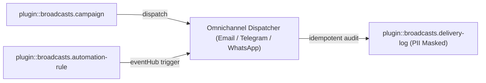
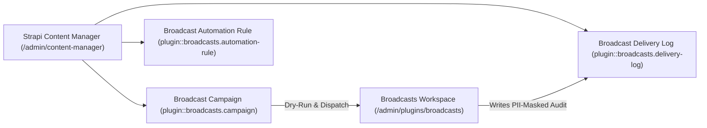
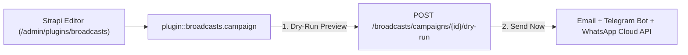
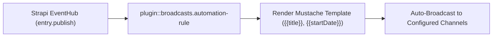
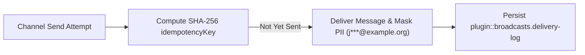

> **Package**: `@vicacha-devs/strapi-plugin-broadcasts` · **Plugin ID**: `broadcasts` · **Category**: `Community & Engagement` · **Version**: `0.2.1` · **Routes**: `15`

Strapi EventHub otomasyon kuralları ve PII maskeli teslimat günlükleri ile WhatsApp, Telegram ve E-posta üzerinden çok kanallı yayınlar.

```bash
pnpm add @vicacha-devs/strapi-plugin-broadcasts
```


## 1. Temel Yetenekler ve Mimari Özellikler

- [İçerik Türü Varlıkları ve Kullanım Senaryolarını İnceleyin (Diyagramlarla)](/tr/strapi-plugin-broadcasts/use-cases/)
- [Geliştirici Kılavuzu ve Admin UI Turunu İnceleyin](/tr/strapi-plugin-broadcasts/guide/)
- [Etkileşimli OpenAPI Referansını İnceleyin](/strapi-plugin-broadcasts/api/)

## 2. İçerik Türü Varlıkları, Konumları ve Şemaları (`strapi.documents`)

Registers three Collection Types (`plugin::broadcasts.campaign`, `plugin::broadcasts.automation-rule`, `plugin::broadcasts.delivery-log`). Campaigns store multi-channel message payloads; Automation Rules subscribe to Strapi `eventHub` events (e.g., `entry.publish`); Delivery Logs store idempotent (`idempotencyKey`), PII-masked (`recipientMasked`) audit trails. Supports `schemaExtensions` in `config/plugins.ts`.



### Strapi v5 İçinde İçerik Türü Varlıkları Nerede Bulunur?

- **Content Manager**: `/admin/content-manager/collection-types/plugin::broadcasts.campaign`, `plugin::broadcasts.automation-rule`, and `plugin::broadcasts.delivery-log` (`visible: true`)
- **Content-Type Builder**: `/admin/plugins/content-type-builder` under **Collection Types**
- **Plugin Workspace & Settings**: `/admin/plugins/broadcasts` (Campaigns, Automation Rules, Delivery Audit) and `/admin/settings/broadcasts`
- **Database Tables**: `broadcast_campaigns`, `broadcast_automation_rules`, and `broadcast_delivery_logs`

### `plugin::broadcasts.automation-rule` — Broadcast Automation Rule

EventHub-driven automated multi-channel broadcast rule

> **Kind**: `collectionType` · **DB Table**: `broadcast_automation_rules` · **Admin Location**: `/admin/content-manager/collection-types/plugin::broadcasts.automation-rule` · **Draft & Publish**: `No` · **i18n**: `No`

| Alan (Attribute)    | Strapi Türü   | Zorunlu | Kısıtlamalar / İlişki                                  |
| :------------------ | :------------ | :------ | :----------------------------------------------------- |
| `name`              | `string`      | Yes     | —                                                      |
| `slug`              | `uid`         | Yes     | —                                                      |
| `eventName`         | `string`      | Yes     | —                                                      |
| `targetContentType` | `string`      | No      | —                                                      |
| `topic`             | `string`      | Yes     | default: `"announcements"`                             |
| `channels`          | `json`        | Yes     | default: `["telegram"]`                                |
| `active`            | `boolean`     | No      | default: `true`                                        |
| `priority`          | `enumeration` | No      | enum: `low, normal, high, urgent`; default: `"normal"` |
| `subjectTemplate`   | `string`      | Yes     | —                                                      |
| `bodyTextTemplate`  | `text`        | Yes     | —                                                      |
| `bodyHtmlTemplate`  | `richtext`    | No      | —                                                      |
| `ctaLabelTemplate`  | `string`      | No      | —                                                      |
| `ctaUrlTemplate`    | `string`      | No      | —                                                      |
| `translations`      | `json`        | No      | default: `{}`                                          |
| `lastTriggeredAt`   | `datetime`    | No      | —                                                      |
| `triggerCount`      | `integer`     | No      | default: `0`                                           |

### `plugin::broadcasts.campaign` — Broadcast Campaign

Omnichannel Email, Telegram & WhatsApp broadcast campaign

> **Kind**: `collectionType` · **DB Table**: `broadcast_campaigns` · **Admin Location**: `/admin/content-manager/collection-types/plugin::broadcasts.campaign` · **Draft & Publish**: `No` · **i18n**: `No`

| Alan (Attribute)       | Strapi Türü   | Zorunlu | Kısıtlamalar / İlişki                                                          |
| :--------------------- | :------------ | :------ | :----------------------------------------------------------------------------- |
| `title`                | `string`      | Yes     | —                                                                              |
| `slug`                 | `uid`         | Yes     | —                                                                              |
| `topic`                | `string`      | Yes     | default: `"announcements"`                                                     |
| `channels`             | `json`        | Yes     | default: `["email","telegram"]`                                                |
| `priority`             | `enumeration` | Yes     | enum: `low, normal, high, urgent`; default: `"normal"`                         |
| `status`               | `enumeration` | Yes     | enum: `draft, scheduled, sending, sent, failed, cancelled`; default: `"draft"` |
| `scheduledAt`          | `datetime`    | No      | —                                                                              |
| `sentAt`               | `datetime`    | No      | —                                                                              |
| `subject`              | `string`      | Yes     | —                                                                              |
| `bodyText`             | `text`        | Yes     | —                                                                              |
| `bodyHtml`             | `richtext`    | No      | —                                                                              |
| `ctaLabel`             | `string`      | No      | —                                                                              |
| `ctaUrl`               | `string`      | No      | —                                                                              |
| `mediaUrl`             | `string`      | No      | —                                                                              |
| `emailTemplateRef`     | `string`      | No      | —                                                                              |
| `whatsappTemplateName` | `string`      | No      | —                                                                              |
| `whatsappGroupIds`     | `json`        | No      | default: `[]`                                                                  |
| `telegramChatId`       | `string`      | No      | —                                                                              |
| `telegramThreadId`     | `integer`     | No      | —                                                                              |
| `translations`         | `json`        | No      | default: `{}`                                                                  |
| `secondaryDate`        | `json`        | No      | default: `{}`                                                                  |
| `secondaryDateLabel`   | `string`      | No      | —                                                                              |
| `stats`                | `json`        | No      | default: `{}`                                                                  |
| `metadata`             | `json`        | No      | default: `{}`                                                                  |

### `plugin::broadcasts.delivery-log` — Broadcast Delivery Log

Idempotent, PII-masked multi-channel delivery audit log

> **Kind**: `collectionType` · **DB Table**: `broadcast_delivery_logs` · **Admin Location**: `/admin/content-manager/collection-types/plugin::broadcasts.delivery-log` · **Draft & Publish**: `No` · **i18n**: `No`

| Alan (Attribute)     | Strapi Türü   | Zorunlu | Kısıtlamalar / İlişki                              |
| :------------------- | :------------ | :------ | :------------------------------------------------- |
| `idempotencyKey`     | `string`      | Yes     | —                                                  |
| `campaignSlug`       | `string`      | Yes     | —                                                  |
| `channel`            | `enumeration` | Yes     | enum: `email, telegram, whatsapp`                  |
| `driver`             | `string`      | Yes     | —                                                  |
| `recipientMasked`    | `string`      | Yes     | —                                                  |
| `locale`             | `string`      | Yes     | default: `"es"`                                    |
| `status`             | `enumeration` | Yes     | enum: `sent, simulated, skipped_duplicate, failed` |
| `externalMessageId`  | `string`      | No      | —                                                  |
| `errorMessage`       | `text`        | No      | —                                                  |
| `sentAt`             | `datetime`    | Yes     | —                                                  |
| `secondaryDateLabel` | `string`      | No      | —                                                  |

## Strapi v5 İçerik Yöneticisi (Content Manager) Entegrasyonu (`/admin/content-manager`)

> **İçerik Yöneticisi Kenar Çubuğu Grubu**: `Inbox & Omnichannel Broadcasts`

### İçerik Yöneticisi Varlıkları ve Bileşenleri

- `plugin::broadcasts.campaign` (**Broadcast Campaign** — `/admin/content-manager/collection-types/plugin::broadcasts.campaign`)
- `plugin::broadcasts.automation-rule` (**Broadcast Automation Rule** — `/admin/content-manager/collection-types/plugin::broadcasts.automation-rule`)
- `plugin::broadcasts.delivery-log` (**Broadcast Delivery Log** — `/admin/content-manager/collection-types/plugin::broadcasts.delivery-log`)


### Bu Eklenti Neden Content Manager Varlıkları Oluşturur?

`@vicacha-devs/strapi-plugin-broadcasts` exposes all three of its entities (`Broadcast Campaign`, `Broadcast Automation Rule`, and `Broadcast Delivery Log`) in the Strapi v5 Content Manager so communication teams can author rich campaign payloads, audit PII-masked delivery logs, and govern access via native RBAC:

- **Structured Campaign Authoring & Review**: Draft `bodyHtml`, `bodyText`, `telegramParseMode`, `whatsappTemplateName`, and `ctaUrl` in Content Manager with collaborative `@vicacha-devs/strapi-plugin-notes` annotations before dispatching from `/admin/plugins/broadcasts`.
- **Declarative EventHub Rule Management**: Inspect and bulk-toggle `Broadcast Automation Rule` (`plugin::broadcasts.automation-rule`) triggers (`entry.publish`, `entry.create`) and Mustache templates (`{{title}}`, `{{slug}}`) in Content Manager.
- **Compliance & Delivery Log Auditing**: Filter `Broadcast Delivery Log` (`plugin::broadcasts.delivery-log`) by `channel`, `status` (`sent`, `failed`, `skipped_duplicate`), `idempotencyKey`, and `recipientMasked` using Content Manager's native search and pagination.
- **Role-Based Access Separation**: Grant copywriters Content Manager permission to draft `plugin::broadcasts.campaign` records while restricting actual live dispatch (`POST /broadcasts/campaigns/{id}/send`) to senior administrators.

### Strapi Content Manager İçinde Nasıl Kullanılır? (Adım Adım)

1. **Open in Content Manager**: Navigate to **Content Manager -> Collection Types -> Inbox & Omnichannel Broadcasts** and select **Broadcast Campaign**, **Broadcast Automation Rule**, or **Broadcast Delivery Log**.
2. **Author & Schedule Campaigns**: In **Broadcast Campaign** (`/admin/content-manager/collection-types/plugin::broadcasts.campaign`), create an entry with `title`, `slug`, `topic`, `targetLocale`, `channels` (`['email', 'telegram', 'whatsapp']`), and channel-specific templates.
3. **Configure EventHub Automation Rules**: In **Broadcast Automation Rule** (`/admin/content-manager/collection-types/plugin::broadcasts.automation-rule`), bind `eventName` (`entry.publish`) and `targetContentType` (e.g., `plugin::events.event` or `plugin::islam.hilal-announcement`).
4. **Workspace vs. Content Manager**: Use **Content Manager** to draft campaign copy, attach review notes, and query `Broadcast Delivery Log` history; use the **Broadcasts Workspace** (`/admin/plugins/broadcasts`) to execute dry-run previews and trigger live omnichannel sends.

### Content Manager ve Eklenti Çalışma Alanı Senkronizasyonu



### Content Manager Kullanım Senaryoları ve Editöryal İş Akışları

#### Content Manager Use Case 1 — Two-Stage Editorial Approval Before Omnichannel Dispatch

- **Amacı ve Neden Kullanıldığı**: Allow editors to prepare multilingual campaign copy and WhatsApp template variables in Content Manager while a reviewer leaves approval notes before sending.
- **Content Manager İçinde Uygulama Adımları**: Create a `Broadcast Campaign` with `status: 'draft'` in `/admin/content-manager/collection-types/plugin::broadcasts.campaign`, review it via the Content Manager **Notes** panel, and dispatch it from `/admin/plugins/broadcasts`.

#### Content Manager Use Case 2 — Filtering Failed or Skipped Delivery Logs by Channel & Campaign

- **Amacı ve Neden Kullanıldığı**: Investigate delivery failures or idempotent duplicate skips across Email, Telegram, and WhatsApp without exposing raw subscriber PII.
- **Content Manager İçinde Uygulama Adımları**: Open `/admin/content-manager/collection-types/plugin::broadcasts.delivery-log` and filter by `status = failed` or `channel = whatsapp` to inspect `errorMessage` and `recipientMasked`.

## 3. Uçtan Uca Kullanım Senaryoları ve İş Akışları

### Use Case 1 — Omnichannel Manual & Scheduled Community Campaigns

- **What it is for**: Dispatch announcements simultaneously across Email (SMTP/Resend), Telegram Bot channels/threads, and WhatsApp Cloud API.
- **How it works**: Create a `plugin::broadcasts.campaign` entity with `channels: ['email', 'telegram', 'whatsapp']`, preview via `POST /broadcasts/campaigns/{id}/dry-run`, and dispatch via `POST /broadcasts/campaigns/{id}/send`.




### Use Case 2 — EventHub Zero-Touch Publish Automation

- **What it is for**: Automatically broadcast a Telegram/WhatsApp notification whenever an editor publishes a new Event, Hilal Announcement, or Urgent Campaign.
- **How it works**: Create a `plugin::broadcasts.automation-rule` entity matching `eventName: 'entry.publish'` and `targetContentType: 'plugin::events.event'` with Mustache-style `subjectTemplate` and `bodyTextTemplate`.




### Use Case 3 — Idempotent PII-Masked Delivery Auditing

- **What it is for**: Guarantee no subscriber receives duplicate messages on retry while keeping phone numbers and emails masked in database logs.
- **How it works**: Every dispatch computes a deterministic `idempotencyKey` recorded in `plugin::broadcasts.delivery-log` with `recipientMasked` (`j***@example.org`, `+57***4821`).




## 4. REST API Uç Noktaları (`content-api` ve `admin`)

| Metot  | Uç Nokta Yolu                         | Kapsam        | Denetleyici (Handler)                      | Kimlik Doğrulama |
| :----- | :------------------------------------ | :------------ | :----------------------------------------- | :--------------- |
| `GET`  | `/api/broadcasts/public/channels`     | `content-api` | `broadcastController.listPublicChannels`   | Public           |
| `GET`  | `/api/broadcasts/public/archive`      | `content-api` | `broadcastController.listPublicArchive`    | Public           |
| `GET`  | `/broadcasts/settings`                | `admin`       | `broadcastController.getSettings`          | Bearer JWT       |
| `PUT`  | `/broadcasts/settings`                | `admin`       | `broadcastController.updateSettings`       | Bearer JWT       |
| `GET`  | `/broadcasts/templates`               | `admin`       | `broadcastController.listStarterTemplates` | Bearer JWT       |
| `GET`  | `/broadcasts/email-templates`         | `admin`       | `broadcastController.listEmailTemplates`   | Bearer JWT       |
| `GET`  | `/broadcasts/campaigns`               | `admin`       | `broadcastController.listCampaigns`        | Bearer JWT       |
| `POST` | `/broadcasts/campaigns`               | `admin`       | `broadcastController.createCampaign`       | Bearer JWT       |
| `PUT`  | `/broadcasts/campaigns/{documentId}`  | `admin`       | `broadcastController.updateCampaign`       | Bearer JWT       |
| `POST` | `/broadcasts/campaigns/from-template` | `admin`       | `broadcastController.createFromTemplate`   | Bearer JWT       |
