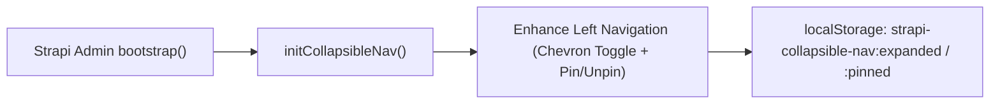
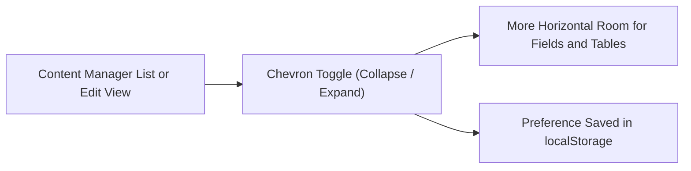
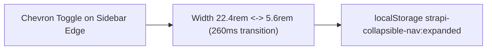
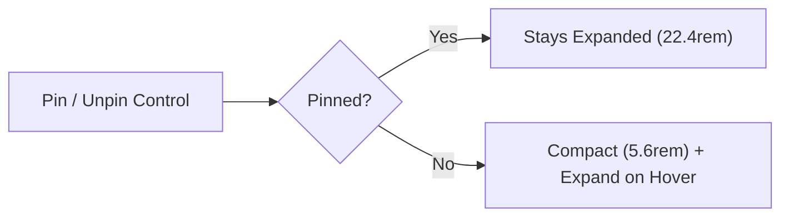
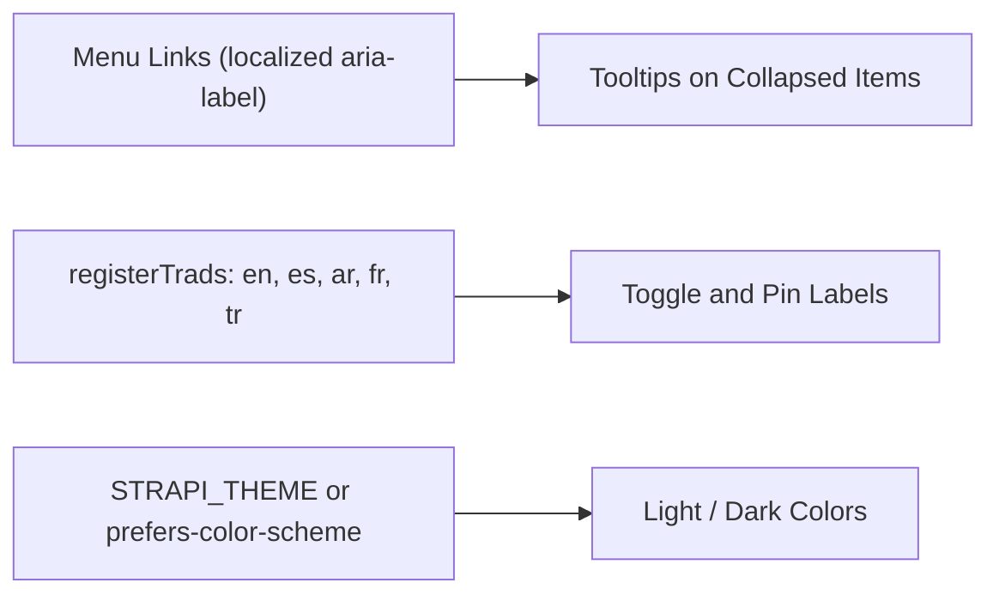

> **Package**: `@vicacha-devs/strapi-plugin-collapsible-nav` · **Plugin ID**: `collapsible-nav` · **Category**: `Admin Experience` · **Version**: `1.0.1` · **Routes**: `0`

Strapi v5 yönetim paneli için Strapi v4 tarzı daraltılabilir ve sabitlenebilir sol gezinme; sabitle/sabitlemeyi kaldır, üzerine gelince önizleme, localStorage kalıcılığı ve sıçramasız masaüstü geçişleri.

```bash
pnpm add @vicacha-devs/strapi-plugin-collapsible-nav
```

## 1. Temel Yetenekler ve Mimari Özellikler

- [İçerik Türü Varlıkları ve Kullanım Senaryolarını İnceleyin (Diyagramlarla)](/tr/strapi-plugin-collapsible-nav/use-cases/)
- [Geliştirici Kılavuzu ve Admin UI Turunu İnceleyin](/tr/strapi-plugin-collapsible-nav/guide/)

## 2. İçerik Türü Varlıkları, Konumları ve Şemaları (`strapi.documents`)

Registers no Content-Types, routes, or server services (`server/index.ts` exports an empty object). The admin entry registers the plugin and calls `initCollapsibleNav()` once from `bootstrap()`: a DOM controller that finds Strapi's main left navigation, adds a floating chevron toggle and a Pin/Unpin control, animates the width between `22.4rem` (expanded) and `5.6rem` (collapsed), and stores both choices in the browser's `localStorage` (`strapi-collapsible-nav:expanded` and `strapi-collapsible-nav:pinned`). It only activates at Strapi's `large` desktop breakpoint (`>= 1080px`).



### Strapi v5 İçinde İçerik Türü Varlıkları Nerede Bulunur?

- **Every Admin Page**: the chevron toggle sits on the edge of the left navigation sidebar across `/admin/*`, with the Pin/Unpin control next to it.
- **Browser Storage**: `localStorage` keys `strapi-collapsible-nav:expanded` and `strapi-collapsible-nav:pinned` (per browser profile, not per Strapi user).
- **No Content-Types or API**: this plugin creates no entities, routes, settings page, or database tables.

Bu eklenti, doğrudan mevcut Strapi içerik türü varlıkları (`api::*` ve `plugin::*`) üzerinde çalışır.

## Strapi v5 İçerik Yöneticisi (Content Manager) Entegrasyonu (`/admin/content-manager`)

> **İçerik Yöneticisi Kenar Çubuğu Grubu**: `Applies to Strapi's left navigation on every admin page, including all Content Manager screens`

### İçerik Yöneticisi Varlıkları ve Bileşenleri

- Strapi main left navigation (`NavBrand`, menu links, `NavUser`), enhanced in place with a chevron toggle and a Pin/Unpin control
- Browser `localStorage` keys `strapi-collapsible-nav:expanded` and `strapi-collapsible-nav:pinned` (no Content-Type, route, or database table is created)

### Bu Eklenti Neden Content Manager Varlıkları Oluşturur?

`@vicacha-devs/strapi-plugin-collapsible-nav` does not add fields or panels to Content Manager documents. It gives editors more horizontal room while they work in Content Manager lists and edit views by letting them collapse the left navigation that Strapi v5 does not collapse on desktop.

- **Wider Content Manager Lists and Edit Views**: collapse the sidebar to `5.6rem` icons to fit more columns and wider rich-text fields on screen.
- **Zero Configuration, Zero Server Footprint**: install, enable, and restart Strapi; there are no options, routes, or install scripts.
- **Per-Browser Preference**: the expanded and pinned state is remembered in `localStorage`, so each editor keeps their own layout.

### Strapi Content Manager İçinde Nasıl Kullanılır? (Adım Adım)

1. **Open Any Content Manager Screen**: go to `/admin/content-manager` on a desktop viewport (`>= 1080px`).
2. **Click the Chevron Toggle**: use the control on the sidebar edge to collapse or expand the navigation.
3. **Choose Pinned or Hover-to-Peek**: use Pin/Unpin to keep the labels visible, or leave the sidebar compact and hover it to read the labels.

### Content Manager ve Eklenti Çalışma Alanı Senkronizasyonu



### Content Manager Kullanım Senaryoları ve Editöryal İş Akışları

#### Content Manager Use Case 1 — Editing Wide Entries Without Horizontal Squeeze

- **Amacı ve Neden Kullanıldığı**: Keep wide Content Manager tables and multi-column edit views readable on laptop screens by collapsing the navigation to icons.
- **Content Manager İçinde Uygulama Adımları**: Open a collection in `/admin/content-manager`, click the chevron toggle to collapse the sidebar, and reopen it later; the collapsed state is restored automatically.

## 3. Uçtan Uca Kullanım Senaryoları ve İş Akışları

### Use Case 1 — Reclaiming Workspace Width on Dense Admin Pages

- **What it is for**: Give editors more room for wide Content Manager tables, the Calendar, and the Media Library by collapsing the left navigation to icons only (`5.6rem`).
- **How it works**: Click the chevron toggle on the sidebar edge; the width animates between `22.4rem` and `5.6rem` while icons, the brand logo, and the user avatar stay anchored. The choice is saved in `strapi-collapsible-nav:expanded` and restored on the next visit.



### Use Case 2 — Compact Sidebar with Hover-to-Peek (Unpinned Mode)

- **What it is for**: Keep the navigation compact by default but still read the full labels on demand.
- **How it works**: Unpin the sidebar with the Pin/Unpin control: it stays at `5.6rem` and expands on hover, then collapses again. Pin it to keep the labels visible. The state is saved in `strapi-collapsible-nav:pinned`.



### Use Case 3 — Localized, Theme-Aware Labels for Multilingual Teams

- **What it is for**: Show tooltips and control labels in each editor's language and in the active light or dark theme.
- **How it works**: The controller reads each menu link's localized `aria-label` (plus the `NavBrand` and `NavUser` labels) so collapsed items keep readable tooltips; toggle and pin labels come from the plugin's `en`, `es`, `ar`, `fr`, and `tr` translations registered through `registerTrads`, and colors follow Strapi's `STRAPI_THEME` setting or the system preference.



## 4. REST API Uç Noktaları (`content-api` ve `admin`)

| Metot | Uç Nokta Yolu | Kapsam | Denetleyici (Handler) | Kimlik Doğrulama |
| :---- | :------------ | :----- | :-------------------- | :--------------- |
