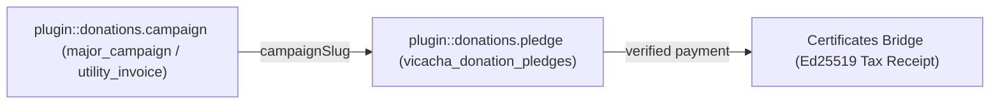
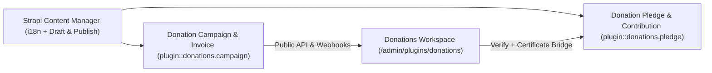
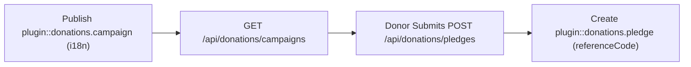
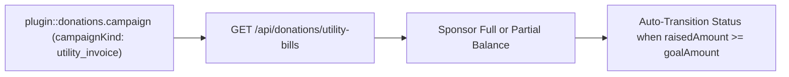
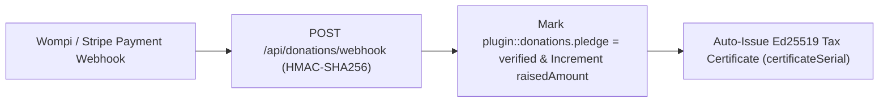
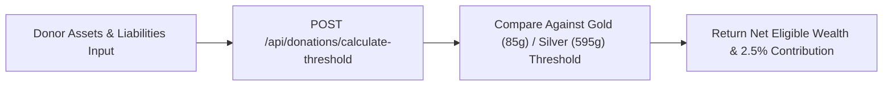

> **Package**: `@vicacha-devs/strapi-plugin-donations` · **Plugin ID**: `donations` · **Admin Workspace**: `/admin/plugins/donations`

## 1. İçerik Türü Varlıkları, Konumları ve Şemaları (`strapi.documents`)

Registers two Collection Types (`plugin::donations.campaign` with `draftAndPublish: true` and `i18n.localized: true`, and `plugin::donations.pledge`) plus two Custom Fields (`plugin::donations.currency` and `plugin::donations.country`). Supports runtime `schemaExtensions` in `config/plugins.ts`.

### Strapi v5 İçinde İçerik Türü Varlıkları Nerede Bulunur?

- **Content Manager**: `/admin/content-manager/collection-types/plugin::donations.campaign` & `/admin/content-manager/collection-types/plugin::donations.pledge` (`visible: true`)
- **Content-Type Builder**: `/admin/plugins/content-type-builder` under **Collection Types** + Custom Fields `plugin::donations.currency` & `plugin::donations.country`
- **Plugin Workspace & Settings**: `/admin/plugins/donations` (Campaigns, Utility Bills, Pledges, Nisab Calculator) and `/admin/settings/donations`
- **Database Tables**: `vicacha_donation_campaigns` and `vicacha_donation_pledges`

### `plugin::donations.campaign` — Donation Campaign & Invoice

Generic fundraising campaign, operational utility invoice, or micro-need

> **Kind**: `collectionType` · **DB Table**: `vicacha_donation_campaigns` · **Admin Location**: `/admin/content-manager/collection-types/plugin::donations.campaign` · **Draft & Publish**: `Yes` · **i18n**: `Yes`

| Alan (Attribute)         | Strapi Türü   | Zorunlu | Kısıtlamalar / İlişki                                                            |
| :----------------------- | :------------ | :------ | :------------------------------------------------------------------------------- |
| `title`                  | `string`      | Yes     | —                                                                                |
| `slug`                   | `uid`         | Yes     | —                                                                                |
| `description`            | `text`        | Yes     | —                                                                                |
| `body`                   | `richtext`    | No      | —                                                                                |
| `campaignKind`           | `enumeration` | Yes     | enum: `major_campaign, utility_invoice, micro_need`; default: `"major_campaign"` |
| `categoryKey`            | `string`      | Yes     | default: `"general_fund"`                                                        |
| `goalAmount`             | `decimal`     | Yes     | —                                                                                |
| `raisedAmount`           | `decimal`     | No      | default: `0`                                                                     |
| `currency`               | `customField` | Yes     | customField: `plugin::donations.currency`; default: `"COP"`                      |
| `donorCount`             | `integer`     | No      | default: `0`                                                                     |
| `isUrgent`               | `boolean`     | No      | default: `false`                                                                 |
| `isFeatured`             | `boolean`     | No      | default: `false`                                                                 |
| `isActive`               | `boolean`     | No      | default: `true`                                                                  |
| `startDate`              | `date`        | No      | —                                                                                |
| `endDate`                | `date`        | No      | —                                                                                |
| `dueDate`                | `date`        | No      | —                                                                                |
| `billingPeriod`          | `string`      | No      | —                                                                                |
| `invoiceReference`       | `string`      | No      | —                                                                                |
| `invoiceProvider`        | `string`      | No      | —                                                                                |
| `invoiceStatus`          | `enumeration` | No      | enum: `open, partially_funded, paid, overdue`; default: `"open"`                 |
| `suggestedAmounts`       | `json`        | No      | —                                                                                |
| `allowCustomAmount`      | `boolean`     | No      | default: `true`                                                                  |
| `allowFullBalancePayoff` | `boolean`     | No      | default: `true`                                                                  |
| `ctaLabel`               | `string`      | No      | —                                                                                |
| `ctaHref`                | `string`      | No      | —                                                                                |
| `coverUrl`               | `string`      | No      | —                                                                                |
| `invoiceDocumentUrl`     | `string`      | No      | —                                                                                |
| `paymentGatewayUrl`      | `string`      | No      | —                                                                                |
| `icon`                   | `string`      | No      | —                                                                                |
| `evidences`              | `json`        | No      | —                                                                                |

### `plugin::donations.pledge` — Donation Pledge & Contribution

Donor pledge, utility bill payment, or verified donation record

> **Kind**: `collectionType` · **DB Table**: `vicacha_donation_pledges` · **Admin Location**: `/admin/content-manager/collection-types/plugin::donations.pledge` · **Draft & Publish**: `No` · **i18n**: `No`

| Alan (Attribute)          | Strapi Türü   | Zorunlu | Kısıtlamalar / İlişki                                                                                 |
| :------------------------ | :------------ | :------ | :---------------------------------------------------------------------------------------------------- |
| `referenceCode`           | `string`      | Yes     | —                                                                                                     |
| `donorName`               | `string`      | Yes     | —                                                                                                     |
| `donorEmail`              | `email`       | Yes     | —                                                                                                     |
| `donorPhone`              | `string`      | No      | —                                                                                                     |
| `donorTaxId`              | `string`      | No      | —                                                                                                     |
| `donorTaxIdType`          | `string`      | No      | —                                                                                                     |
| `isAnonymous`             | `boolean`     | No      | default: `false`                                                                                      |
| `amount`                  | `decimal`     | Yes     | —                                                                                                     |
| `currency`                | `customField` | Yes     | customField: `plugin::donations.currency`; default: `"COP"`                                           |
| `convertedBaseAmount`     | `decimal`     | No      | default: `0`                                                                                          |
| `categoryKey`             | `string`      | Yes     | default: `"general_fund"`                                                                             |
| `campaignSlug`            | `string`      | No      | —                                                                                                     |
| `campaignKind`            | `enumeration` | No      | enum: `major_campaign, utility_invoice, micro_need`; default: `"major_campaign"`                      |
| `coversRemainingBalance`  | `boolean`     | No      | default: `false`                                                                                      |
| `paymentChannel`          | `enumeration` | Yes     | enum: `bank_transfer, digital_wallet, card_gateway, qr_code, cash, other`; default: `"bank_transfer"` |
| `paymentProvider`         | `string`      | No      | —                                                                                                     |
| `transactionReference`    | `string`      | No      | —                                                                                                     |
| `receiptProofUrl`         | `string`      | No      | —                                                                                                     |
| `donorNotes`              | `text`        | No      | —                                                                                                     |
| `status`                  | `enumeration` | Yes     | enum: `pending, verified, rejected, certificate_issued`; default: `"pending"`                         |
| `verifiedAt`              | `datetime`    | No      | —                                                                                                     |
| `verifiedBy`              | `string`      | No      | —                                                                                                     |
| `certificateSerialNumber` | `string`      | No      | —                                                                                                     |
| `certificateVerifyUrl`    | `string`      | No      | —                                                                                                     |
| `locale`                  | `string`      | No      | default: `"en"`                                                                                       |

## Strapi v5 İçerik Yöneticisi (Content Manager) Entegrasyonu (`/admin/content-manager`)

> **İçerik Yöneticisi Kenar Çubuğu Grubu**: `Donations & Certificates`

### İçerik Yöneticisi Varlıkları ve Bileşenleri

- `plugin::donations.campaign` (**Donation Campaign & Invoice** — `/admin/content-manager/collection-types/plugin::donations.campaign`)
- `plugin::donations.pledge` (**Donation Pledge & Contribution** — `/admin/content-manager/collection-types/plugin::donations.pledge`)
- Custom Fields `plugin::donations.currency` & `plugin::donations.country`

### Bu Eklenti Neden Content Manager Varlıkları Oluşturur?

`@vicacha-devs/strapi-plugin-donations` registers **Donation Campaign & Invoice** (`plugin::donations.campaign`, with `i18n.localized: true` and `draftAndPublish: true`) and **Donation Pledge & Contribution** (`plugin::donations.pledge`) in the Strapi v5 Content Manager so fundraising and accounting teams get full multilingual publishing and ledger auditing:

- **Multilingual (`i18n`) Campaign & Utility Invoice Authoring**: Translate campaign titles, descriptions, and impact stories across `en`, `es`, `ar`, and `tr` using Content Manager's locale switcher (`?plugins[i18n][locale]=en`) while sharing unified financial progress.
- **Draft & Publish Staging for Fundraising Appeals**: Prepare Ramadan, Zakat, or emergency relief campaigns in `Draft` mode, attach Media Library invoice PDFs or cover images, and publish when ready.
- **Accounting & Pledge Reconciliation**: Filter `Donation Pledge & Contribution` (`plugin::donations.pledge`) in Content Manager by `status` (`pending`, `verified`, `refunded`), `paymentMethod`, `currency`, `isZakatEligible`, or linked `certificateSerial`.

### Strapi Content Manager İçinde Nasıl Kullanılır? (Adım Adım)

1. **Open in Content Manager**: Navigate to **Content Manager -> Collection Types -> Donations & Certificates** and select **Donation Campaign & Invoice** (`/admin/content-manager/collection-types/plugin::donations.campaign?plugins[i18n][locale]=en`) or **Donation Pledge & Contribution** (`/admin/content-manager/collection-types/plugin::donations.pledge`).
2. **Create Major Campaigns or Utility Invoices**: Click **+ Create new entry** in **Donation Campaign & Invoice**, choose `campaignKind` (`major_campaign` or `utility_invoice`), set `goalAmount`, `currency` (`plugin::donations.currency`), and for utility bills populate `utilityProvider`, `invoiceReference`, and `dueDate`.
3. **Translate Across Locales**: Use the top-right locale dropdown (`English (en)`, `Spanish (es)`, `Arabic (ar)`, `Turkish (tr)`) in Content Manager to localize campaign copy.
4. **Workspace vs. Content Manager**: Use **Content Manager** for multilingual campaign authoring, media uploads, and accounting filters; use the **Donations Workspace** (`/admin/plugins/donations`) for real-time KPI dashboards, 1-click pledge verification, and Nisab threshold testing.

### Content Manager ve Eklenti Çalışma Alanı Senkronizasyonu

### Content Manager Kullanım Senaryoları ve Editöryal İş Akışları

#### Content Manager Use Case 1 — Publishing Localized Crowdfunding Campaigns & Monthly Utility Bills

- **Amacı ve Neden Kullanıldığı**: Manage both major Waqf/social campaigns (`major_campaign`) and monthly electricity/water/fiber invoices (`utility_invoice`) with localized descriptions in Content Manager.
- **Content Manager İçinde Uygulama Adımları**: Open `/admin/content-manager/collection-types/plugin::donations.campaign?plugins[i18n][locale]=en`, edit `Educational Endowment & Scholarship Fund` or `Monthly Natural Gas Utility Bill`, switch locales to translate, and click **Publish**.

#### Content Manager Use Case 2 — Reconciling Verified Pledges & Linked Tax Certificate Serials

- **Amacı ve Neden Kullanıldığı**: Filter verified Zakat and Sadaqah contributions in Content Manager and verify their issued Ed25519 tax certificate serial numbers.
- **Content Manager İçinde Uygulama Adımları**: Open `/admin/content-manager/collection-types/plugin::donations.pledge` and filter by `status = verified` and `certificateSerial is not null`.

## 3. Uçtan Uca Kullanım Senaryoları ve İş Akışları

### Use Case 1 — Multi-Currency Crowdfunding Campaigns (`major_campaign`)

- **What it is for**: Run localized (`en`, `es`, `ar`, `tr`) fundraising campaigns with real-time progress bars (`goalAmount`, `raisedAmount`, `donorCount`).
- **How it works**: Publish a `plugin::donations.campaign` entity (`campaignKind: 'major_campaign'`), list via `GET /api/donations/campaigns`, and submit pledges via `POST /api/donations/pledges`.

### Use Case 2 — Operational Utility Invoice Sponsorship (`utility_invoice`)

- **What it is for**: Allow community members to pay off specific monthly utility bills (electricity, water, internet) partially or in full (`coversRemainingBalance`).
- **How it works**: Create a `plugin::donations.campaign` with `campaignKind: 'utility_invoice'`, `invoiceReference`, `dueDate`, and `invoiceDocumentUrl`; query via `GET /api/donations/utility-bills`.

### Use Case 3 — HMAC-SHA256 Payment Gateway Webhooks & Auto-Certificate Bridge

- **What it is for**: Automatically verify pledges from Wompi/Stripe webhooks, increment campaign totals, and issue an Ed25519 tax certificate.
- **How it works**: `POST /api/donations/webhook` verifies the signature, marks `plugin::donations.pledge` as `verified`, updates `raisedAmount`, and calls `strapi.plugin('certificates').service('issuance')`.

### Use Case 4 — Precious-Metal Threshold (Zakat / Nisab) Calculation

- **What it is for**: Provide donors with an interactive calculator based on live gold/silver gram thresholds in their local currency.
- **How it works**: Call `POST /api/donations/calculate-threshold` with asset balances and liabilities to compute net zakatable wealth and recommended contribution.

---

- [Geliştirici Kılavuzu ve Admin UI Turunu İnceleyin](/tr/strapi-plugin-donations/guide/)
- [Etkileşimli OpenAPI Referansını İnceleyin](/strapi-plugin-donations/api/)
