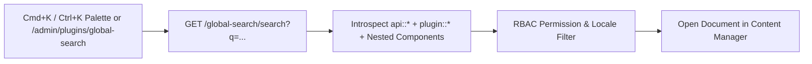
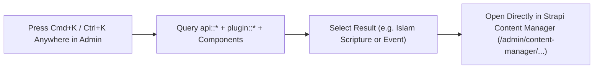
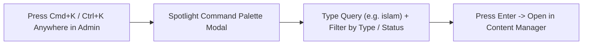
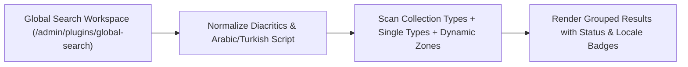
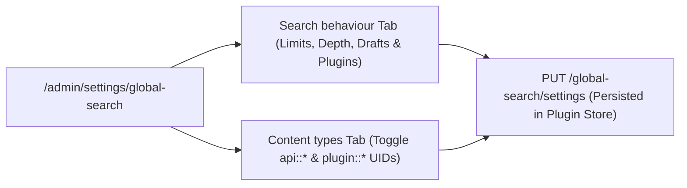

> **Package**: `@vicacha-devs/strapi-plugin-global-search` · **Plugin ID**: `global-search` · **Category**: `Editorial & SEO` · **Version**: `2.1.1` · **Routes**: `6`

Tüm Strapi v5 koleksiyon türleri, tekil türler ve iç içe bileşenler genelinde Spotlight tarzı Cmd+K / Ctrl+K komut paleti ve küresel arama.

```bash
pnpm add @vicacha-devs/strapi-plugin-global-search
```


## 1. Temel Yetenekler ve Mimari Özellikler

- [İçerik Türü Varlıkları ve Kullanım Senaryolarını İnceleyin (Diyagramlarla)](/tr/strapi-plugin-global-search/use-cases/)
- [Geliştirici Kılavuzu ve Admin UI Turunu İnceleyin](/tr/strapi-plugin-global-search/guide/)
- [Etkileşimli OpenAPI Referansını İnceleyin](/strapi-plugin-global-search/api/)

## 2. İçerik Türü Varlıkları, Konumları ve Şemaları (`strapi.documents`)

Operates as a universal zero-schema introspection engine over **all** registered Strapi v5 Content-Type entities (`api::*` collection types, single types, and `plugin::*` entities) plus nested components and dynamic zones. Uses `strapi.contentTypes` metadata and `strapi.documents(uid).findMany()` with RBAC permission filtering.



### Strapi v5 İçinde İçerik Türü Varlıkları Nerede Bulunur?

- **Spotlight Command Palette Overlay**: Press `Cmd+K` (macOS) or `Ctrl+K` (Windows/Linux) from **any** Strapi Admin screen (including Content Manager, Calendar, or Settings)
- **Dedicated Search Workspace**: `/admin/plugins/global-search` (`Global Search` in the main left sidebar)
- **Settings Panel**: `/admin/settings/global-search` (`Settings -> Global Search -> Configuration` — organized into **Search behaviour** and **Content types** tabs)
- **Target Entities**: Opens matched documents directly at `/admin/content-manager/collection-types/{uid}/{documentId}?plugins[i18n][locale]={locale}`

Bu eklenti, doğrudan mevcut Strapi içerik türü varlıkları (`api::*` ve `plugin::*`) üzerinde çalışır.

## Strapi v5 İçerik Yöneticisi (Content Manager) Entegrasyonu (`/admin/content-manager`)

> **İçerik Yöneticisi Kenar Çubuğu Grubu**: `All Content Manager Collection Types & Single Types (`Cmd+K`/`Ctrl+K`)`

### İçerik Yöneticisi Varlıkları ve Bileşenleri

- Universal Introspection across all `api::*` and `plugin::*` Content Manager Collection Types, Single Types, and Nested Components

### Bu Eklenti Neden Content Manager Varlıkları Oluşturur?

`@vicacha-devs/strapi-plugin-global-search` does not create an isolated database table because its entire purpose is to act as a high-speed **Content Manager Command Palette & Deep-Link Router** over every `api::*` and `plugin::*` entity registered in Strapi v5:

- **Instant Deep-Linking into Content Manager**: Pressing `Enter` on any search result navigates directly to `/admin/content-manager/collection-types/{uid}/{documentId}?plugins[i18n][locale]={locale}` (or `single-types/{uid}`).
- **Searches Both Host `api::*` and Plugin `plugin::*` Entities**: Simultaneously indexes articles, scholars (`api::leader.leader`), events (`plugin::events.event`), scripture entries (`plugin::islam.scripture-entry`), donations (`plugin::donations.campaign`), and publications (`plugin::resources.publication`).

### Strapi Content Manager İçinde Nasıl Kullanılır? (Adım Adım)

1. **Invoke from Anywhere**: Press `Cmd+K` (macOS) or `Ctrl+K` (Windows/Linux) while inside Content Manager or any plugin page.
2. **Filter by Entity Type, Status & Locale**: Type a keyword and narrow results by Collection Type, `Draft`/`Published` status, or `i18n` locale badge.
3. **Open in Content Manager**: Press `Enter` to open the entry in Content Manager in the current tab, or `Cmd/Ctrl + Enter` to open it in a new tab.

### Content Manager ve Eklenti Çalışma Alanı Senkronizasyonu



### Content Manager Kullanım Senaryoları ve Editöryal İş Akışları

#### Content Manager Use Case 1 — Jumping Between Plugin Entities & Host Collections Without Leaving the Keyboard

- **Amacı ve Neden Kullanıldığı**: Switch from editing a `Booking Resource` to a `Donation Campaign` or `Islam Scripture Entry` in Content Manager in under a second.
- **Content Manager İçinde Uygulama Adımları**: Press `Cmd+K`, type the title or slug, and press `Enter` to load the target document in Content Manager.

## 3. Uçtan Uca Kullanım Senaryoları ve İş Akışları

### Use Case 1 — Instant `Cmd+K` / `Ctrl+K` Spotlight Navigation Across All Entities

- **What it is for**: Jump directly to any Article, Course, Event, Booking, Certificate, or Single Type record from anywhere in Strapi Admin without leaving the keyboard.
- **How it works**: Press `Cmd+K`, type a query (e.g., `islam`), navigate with `↑`/`↓`, and press `Enter` to open the document in Content Manager (or `Cmd/Ctrl + Enter` for a new tab).




### Use Case 2 — Deep Component & Multilingual Script Search (Arabic, Turkish, Spanish)

- **What it is for**: Find records by text buried inside repeatable components, SEO meta descriptions, or Arabic/RTL localized variants.
- **How it works**: `GET /global-search/search?q=...&locale=all` normalizes diacritics and Arabic Alef/Teh Marbuta variants and searches both top-level and nested component fields.




### Use Case 3 — Tabbed Search Behaviour & Per-Content-Type Inclusion Tuning

- **What it is for**: Fine-tune query thresholds (`Minimum characters`, `Debounce (ms)`, `Results per content type`, `Maximum results`, `Component depth`, `Query timeout (ms)`, `Search inside components`, `Include drafts`, `Include plugin content types`) and toggle which Content-Type entities appear in global search.
- **How it works**: Configure the **Search behaviour** and **Content types** tabs in `/admin/settings/global-search` (`PUT /global-search/settings`).




## 4. REST API Uç Noktaları (`content-api` ve `admin`)

| Metot  | Uç Nokta Yolu                   | Kapsam  | Denetleyici (Handler) | Kimlik Doğrulama |
| :----- | :------------------------------ | :------ | :-------------------- | :--------------- |
| `GET`  | `/global-search/search`         | `admin` | `search.find`         | Bearer JWT       |
| `GET`  | `/global-search/schema`         | `admin` | `schema.find`         | Bearer JWT       |
| `GET`  | `/global-search/schema/all`     | `admin` | `schema.findAll`      | Bearer JWT       |
| `GET`  | `/global-search/settings`       | `admin` | `settings.find`       | Bearer JWT       |
| `PUT`  | `/global-search/settings`       | `admin` | `settings.update`     | Bearer JWT       |
| `POST` | `/global-search/settings/reset` | `admin` | `settings.reset`      | Bearer JWT       |
