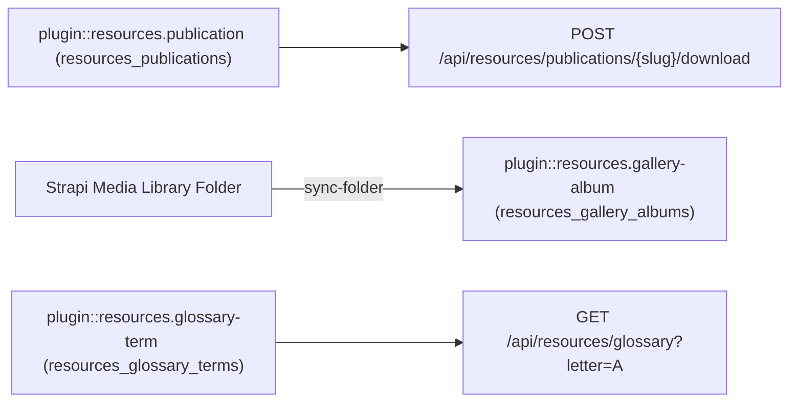
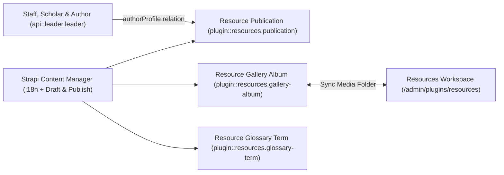
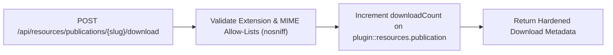
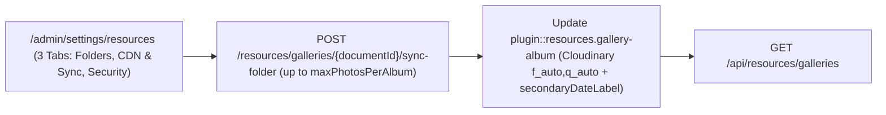
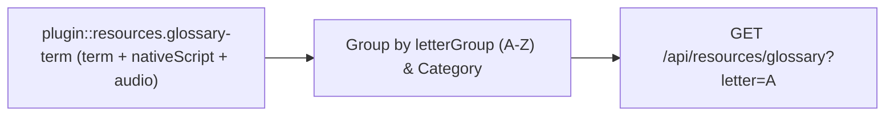

## 1. Kurulum ve Bağımlılıklar

```bash
pnpm add @vicacha-devs/strapi-plugin-resources
```

## 2. Sunucu Yapılandırması (`config/plugins.ts`)

Strapi v5 projenizin `config/plugins.ts` dosyasına eklenti yapılandırmasını ekleyin:

```ts
// config/plugins.ts
export default ({
  env,
}: {
  env: (key: string, defaultValue?: string) => string;
}) => ({
  resources: {
    enabled: true,
    config: {
      organizationName: env("RESOURCES_ORG_NAME", "Community Resource Center"),
      defaultPublicationsFolderPath: "/resources/publications",
      defaultGalleriesFolderPath: "/resources/galleries",
      secondaryCalendar: "islamic-umalqura",
      enableCloudinaryOptimization: true,
      autoSyncMediaFolders: true,
      maxPhotosPerAlbum: 200,
    },
  },
});
```


## 3. Strapi v5 Yönetim Arayüzü (Admin UI) Turu

Etkinleştirildiğinde eklenti, Strapi Design System v2 bileşenlerini kullanarak çalışma alanını ve ayarlarını yönetim paneline kaydeder:


### Yerelleştirilmiş Arayüz Etiketleri (Türkçe)

| Çeviri Anahtarı                                            | Arayüz Metni                                       |
| :--------------------------------------------------------- | :------------------------------------------------- |
| `page.ui.resources_media_galleries_glossary`               | Kaynaklar, Fotoğraf Galerileri ve Sözlük           |
| `page.ui.add_digital_library_publication_media_library_pd` | Dijital Kütüphane Yayını Ekle (PDF / e-Kitap)      |
| `field.publication_title`                                  | Yayın Başlığı                                      |
| `placeholder.e_g_gu_a_de_bienvenida_a_la_mezquita_pdf`     | örn., Cami Ziyaret ve İbadet Rehberi               |
| `page.ui.display_title_shown_in_the_public_digital_librar` | Herkese açık Dijital Kütüphanede gösterilen başlık |
| `field.publication_category`                               | Yayın Kategorisi                                   |
| `placeholder.select_category`                              | Kategori seçin                                     |
| `page.ui.guide_visitor_prayer_guide`                       | Ziyaretçi ve İbadet Rehberi                        |

## 4. İçerik Türü Varlıkları, Konumları ve Şemaları (`strapi.documents`)

Registers three localized (`i18n.localized: true`), draft-and-publish (`draftAndPublish: true`) Collection Types: `plugin::resources.publication`, `plugin::resources.gallery-album`, and `plugin::resources.glossary-term`, plus a 3-tab settings panel (`/admin/settings/resources`) covering Media Library folder paths, multi-calendar secondary dates, Cloudinary `f_auto,q_auto` optimization, album photo caps, and download extension/MIME allow-lists. Supports runtime `schemaExtensions` in `config/plugins.ts`.



### Strapi v5 İçinde İçerik Türü Varlıkları Nerede Bulunur?

- **Content Manager**: `/admin/content-manager/collection-types/plugin::resources.publication`, `plugin::resources.gallery-album`, and `plugin::resources.glossary-term` (`visible: true`)
- **Content-Type Builder**: `/admin/plugins/content-type-builder` under **Collection Types** (`Resource Publication`, `Resource Gallery Album`, `Resource Glossary Term`)
- **Plugin Workspace**: `/admin/plugins/resources` (Publications, Gallery Albums, Glossary Terms, Media Folder Sync)
- **Settings Panel (3 Tabs)**: `/admin/settings/resources` — **Media Library Folders & Organization** (`organizationName`, `defaultPublicationsFolderPath`, `defaultGalleriesFolderPath`, `secondaryCalendar`, `defaultLocale`, `supportedLocales`), **CDN Optimization & Folder Sync** (`enableCloudinaryOptimization`, `autoSyncMediaFolders`, `maxPhotosPerAlbum`), and **Download Security & Allow-Lists** (`allowedDownloadExtensions`, `allowedDownloadMimeTypes`)
- **Database Tables**: `resources_publications`, `resources_gallery_albums`, and `resources_glossary_terms`

### `plugin::resources.gallery-album` — Resource Gallery Album

Curated photo and video albums synced with Strapi v5 Media Library folders and Cloudinary optimization

> **Kind**: `collectionType` · **DB Table**: `resources_gallery_albums` · **Admin Location**: `/admin/content-manager/collection-types/plugin::resources.gallery-album` · **Draft & Publish**: `Yes` · **i18n**: `Yes`

| Alan (Attribute)        | Strapi Türü   | Zorunlu | Kısıtlamalar / İlişki                                                                         |
| :---------------------- | :------------ | :------ | :-------------------------------------------------------------------------------------------- |
| `title`                 | `string`      | Yes     | max: 200                                                                                      |
| `slug`                  | `uid`         | Yes     | —                                                                                             |
| `description`           | `text`        | No      | —                                                                                             |
| `category`              | `enumeration` | Yes     | enum: `architecture, community, events, ramadan_eid, heritage, press`; default: `"community"` |
| `coverPhoto`            | `media`       | No      | —                                                                                             |
| `photos`                | `media`       | No      | —                                                                                             |
| `mediaFolderId`         | `integer`     | No      | —                                                                                             |
| `mediaFolderPath`       | `string`      | No      | max: 160                                                                                      |
| `eventDate`             | `date`        | No      | —                                                                                             |
| `secondaryDateOverride` | `string`      | No      | max: 80                                                                                       |
| `photographerCredit`    | `string`      | No      | max: 140                                                                                      |
| `framingNotes`          | `string`      | No      | max: 500                                                                                      |
| `featured`              | `boolean`     | No      | default: `false`                                                                              |
| `sortOrder`             | `integer`     | No      | default: `0`                                                                                  |
| `photoCount`            | `integer`     | No      | default: `0`                                                                                  |

### `plugin::resources.glossary-term` — Resource Glossary Term

Multilingual A-Z glossary terms with native script, transliteration, and Strapi Media Library audio pronunciation

> **Kind**: `collectionType` · **DB Table**: `resources_glossary_terms` · **Admin Location**: `/admin/content-manager/collection-types/plugin::resources.glossary-term` · **Draft & Publish**: `Yes` · **i18n**: `Yes`

| Alan (Attribute)     | Strapi Türü   | Zorunlu | Kısıtlamalar / İlişki                                                               |
| :------------------- | :------------ | :------ | :---------------------------------------------------------------------------------- |
| `term`               | `string`      | Yes     | max: 120                                                                            |
| `slug`               | `uid`         | Yes     | —                                                                                   |
| `nativeScript`       | `string`      | No      | max: 200                                                                            |
| `transliteration`    | `string`      | No      | max: 200                                                                            |
| `definition`         | `text`        | Yes     | —                                                                                   |
| `category`           | `enumeration` | Yes     | enum: `beliefs, worship, ethics, history, community, general`; default: `"general"` |
| `letterGroup`        | `string`      | No      | max: 4; default: `"A"`                                                              |
| `pronunciationAudio` | `media`       | No      | —                                                                                   |
| `relatedTerms`       | `json`        | No      | —                                                                                   |
| `featured`           | `boolean`     | No      | default: `false`                                                                    |

### `plugin::resources.publication` — Resource Publication

Localized digital library books, guides, pamphlets, and press kit assets backed by the Strapi v5 Media Library

> **Kind**: `collectionType` · **DB Table**: `resources_publications` · **Admin Location**: `/admin/content-manager/collection-types/plugin::resources.publication` · **Draft & Publish**: `Yes` · **i18n**: `Yes`

| Alan (Attribute)        | Strapi Türü   | Zorunlu | Kısıtlamalar / İlişki                                                           |
| :---------------------- | :------------ | :------ | :------------------------------------------------------------------------------ |
| `title`                 | `string`      | Yes     | max: 200                                                                        |
| `slug`                  | `uid`         | Yes     | —                                                                               |
| `summary`               | `text`        | No      | —                                                                               |
| `category`              | `enumeration` | Yes     | enum: `guide, book, pamphlet, press_kit, academic, general`; default: `"guide"` |
| `file`                  | `media`       | No      | —                                                                               |
| `coverImage`            | `media`       | No      | —                                                                               |
| `authorName`            | `string`      | No      | max: 140                                                                        |
| `authorSlug`            | `string`      | No      | max: 140                                                                        |
| `isbnOrReference`       | `string`      | No      | max: 80                                                                         |
| `pageCount`             | `integer`     | No      | —                                                                               |
| `languageCode`          | `string`      | No      | max: 10; default: `"es"`                                                        |
| `publishedAtDate`       | `date`        | No      | —                                                                               |
| `secondaryDateOverride` | `string`      | No      | max: 80                                                                         |
| `mediaFolderPath`       | `string`      | No      | max: 160                                                                        |
| `externalDownloadUrl`   | `string`      | No      | max: 500                                                                        |
| `downloadCount`         | `integer`     | No      | default: `0`                                                                    |
| `featured`              | `boolean`     | No      | default: `false`                                                                |
| `allowPublicDownload`   | `boolean`     | No      | default: `true`                                                                 |

## Strapi v5 İçerik Yöneticisi (Content Manager) Entegrasyonu (`/admin/content-manager`)

> **İçerik Yöneticisi Kenar Çubuğu Grubu**: `Media, Resources & Library`

### İçerik Yöneticisi Varlıkları ve Bileşenleri

- `plugin::resources.publication` (**Resource Publication** — `/admin/content-manager/collection-types/plugin::resources.publication`)
- `plugin::resources.gallery-album` (**Resource Gallery Album** — `/admin/content-manager/collection-types/plugin::resources.gallery-album`)
- `plugin::resources.glossary-term` (**Resource Glossary Term** — `/admin/content-manager/collection-types/plugin::resources.glossary-term`)


### Bu Eklenti Neden Content Manager Varlıkları Oluşturur?

`@vicacha-devs/strapi-plugin-resources` registers all three of its entities (`Resource Publication`, `Resource Gallery Album`, and `Resource Glossary Term`) with `i18n.localized: true`, `draftAndPublish: true`, and `content-manager.visible: true` so librarians, scholars, and archivists can manage digital books, photo albums, and glossary terms inside the Strapi v5 Content Manager:

- **Multilingual (`i18n`) Digital Library & Glossary Authoring**: Author publications, photo gallery descriptions, and A–Z glossary definitions across `en`, `es`, `ar`, and `tr` (`?plugins[i18n][locale]=en`) with native Draft & Publish staging.
- **Relational Author Profile Linking (`authorProfile`)**: In Content Manager, link `Resource Publication` records directly to `Staff, Scholar & Author` (`api::leader.leader`) profiles via `config/plugins.ts -> schemaExtensions.publication`.
- **Direct Media Library Asset & Folder Binding**: Attach cover images, downloadable PDF files, pronunciation audio clips, and Media Library folder paths directly inside Content Manager forms.

### Strapi Content Manager İçinde Nasıl Kullanılır? (Adım Adım)

1. **Open in Content Manager**: In the left sidebar, expand **Content Manager -> Collection Types -> Media, Resources & Library** and select **Resource Publication** (`/admin/content-manager/collection-types/plugin::resources.publication?plugins[i18n][locale]=en`), **Resource Gallery Album** (`plugin::resources.gallery-album`), or **Resource Glossary Term** (`plugin::resources.glossary-term`).
2. **Publish Books, Guides & Press Kits**: In **Resource Publication**, populate `title`, `slug`, `summary`, `category` (`book`, `guide`, `pamphlet`, `press_kit`), `fileUrl`, `pageCount`, and `authorProfile`, then click **Publish**.
3. **Curate A–Z Glossary Terms**: In **Resource Glossary Term**, enter `term`, `nativeScript` (Arabic script), `transliteration`, `definition`, `letterGroup` (`A`–`Z`), and `pronunciationAudioUrl`.
4. **Workspace vs. Content Manager**: Use **Content Manager** for multilingual authoring, scholar `authorProfile` relations, and bulk publishing; use the **Resources Workspace** (`/admin/plugins/resources`) for 1-click Media Library folder synchronization (`Sync Folder`) and download analytics.

### Content Manager ve Eklenti Çalışma Alanı Senkronizasyonu



### Content Manager Kullanım Senaryoları ve Editöryal İş Akışları

#### Content Manager Use Case 1 — Publishing Multilingual PDF Guides Linked to Institutional Authors (`api::leader.leader`)

- **Amacı ve Neden Kullanıldığı**: Author downloadable PDF guides (`Mosque Welcome & Visitor Etiquette Guide`, `Introduction to the Five Pillars of Islam`) in Content Manager and link each publication to its scholar author.
- **Content Manager İçinde Uygulama Adımları**: Open `/admin/content-manager/collection-types/plugin::resources.publication?plugins[i18n][locale]=en`, edit the entry, select the `authorProfile` relation, switch locales (`es`, `ar`, `tr`) to translate, and click **Publish**.

#### Content Manager Use Case 2 — Managing Multilingual Glossary Terms with Native Script & Audio

- **Amacı ve Neden Kullanıldığı**: Curate A–Z glossary entries with vocalized Arabic script, phonetic transliteration, and audio pronunciation links in Content Manager.
- **Content Manager İçinde Uygulama Adımları**: Open `/admin/content-manager/collection-types/plugin::resources.glossary-term?plugins[i18n][locale]=en`, filter by `letterGroup` or `category`, and publish.

## 5. Uçtan Uca Kullanım Senaryoları ve İş Akışları

### Use Case 1 — Digital Publications Library with Hardened Download Allow-Lists

- **What it is for**: Publish downloadable books, PDF guides, pamphlets, and press kits protected by extension (`allowedDownloadExtensions`) and MIME (`allowedDownloadMimeTypes`) allow-lists, `X-Content-Type-Options: nosniff`, and atomic download counters.
- **How it works**: Configure allowed extensions/MIME types in `/admin/settings/resources` (**Download Security & Allow-Lists** tab), create `plugin::resources.publication` records, and serve downloads via `POST /api/resources/publications/{slug}/download`.




### Use Case 2 — Configuring Media Library Folders, Secondary Calendars, CDN Optimization & Download Security

- **What it is for**: Manage all 11 `ResourcesPluginSettings` fields across 3 organized tabs in `/admin/settings/resources` (`Media Library Folders & Organization`, `CDN Optimization & Folder Sync`, and `Download Security & Allow-Lists`) and automatically sync `plugin::upload.folder` assets into `plugin::resources.gallery-album` up to `maxPhotosPerAlbum`.
- **How it works**: Configure `defaultPublicationsFolderPath`, `defaultGalleriesFolderPath`, `secondaryCalendar`, `enableCloudinaryOptimization`, `autoSyncMediaFolders`, `maxPhotosPerAlbum`, and download allow-lists in `/admin/settings/resources` (`PUT /resources/settings`), then click **Sync Folder** (`POST /resources/galleries/{documentId}/sync-folder`).




### Use Case 3 — Multilingual A–Z Glossary with Native Script & Audio Pronunciation

- **What it is for**: Maintain an educational glossary of Arabic/Islamic or domain terms (`term`, `nativeScript`, `transliteration`, `definition`, `pronunciationAudio`, `letterGroup`).
- **How it works**: Manage entries in `plugin::resources.glossary-term` and query grouped A–Z terms via `GET /api/resources/glossary?letter=A&category=worship`.




## 6. REST API Uç Noktaları (`content-api` ve `admin`)

| Metot    | Uç Nokta Yolu                                         | Kapsam        | Denetleyici (Handler)                       | Kimlik Doğrulama |
| :------- | :---------------------------------------------------- | :------------ | :------------------------------------------ | :--------------- |
| `GET`    | `/resources/hub`                                      | `admin`       | `resourcesController.getAdminHubOverview`   | Bearer JWT       |
| `GET`    | `/resources/publications`                             | `admin`       | `resourcesController.listAdminPublications` | Bearer JWT       |
| `POST`   | `/resources/publications`                             | `admin`       | `resourcesController.createPublication`     | Bearer JWT       |
| `PUT`    | `/resources/publications/{documentId}`                | `admin`       | `resourcesController.updatePublication`     | Bearer JWT       |
| `DELETE` | `/resources/publications/{documentId}`                | `admin`       | `resourcesController.deletePublication`     | Bearer JWT       |
| `GET`    | `/resources/galleries`                                | `admin`       | `resourcesController.listAdminGalleries`    | Bearer JWT       |
| `POST`   | `/resources/galleries`                                | `admin`       | `resourcesController.createGalleryAlbum`    | Bearer JWT       |
| `PUT`    | `/resources/galleries/{documentId}`                   | `admin`       | `resourcesController.updateGalleryAlbum`    | Bearer JWT       |
| `DELETE` | `/resources/galleries/{documentId}`                   | `admin`       | `resourcesController.deleteGalleryAlbum`    | Bearer JWT       |
| `POST`   | `/resources/galleries/{documentId}/sync-media-folder` | `admin`       | `resourcesController.syncAlbumMediaFolder`  | Bearer JWT       |
| `GET`    | `/resources/glossary`                                 | `admin`       | `resourcesController.listAdminGlossary`     | Bearer JWT       |
| `POST`   | `/resources/glossary`                                 | `admin`       | `resourcesController.createGlossaryTerm`    | Bearer JWT       |
| `PUT`    | `/resources/glossary/{documentId}`                    | `admin`       | `resourcesController.updateGlossaryTerm`    | Bearer JWT       |
| `DELETE` | `/resources/glossary/{documentId}`                    | `admin`       | `resourcesController.deleteGlossaryTerm`    | Bearer JWT       |
| `GET`    | `/resources/media-folders`                            | `admin`       | `resourcesController.listMediaFolders`      | Bearer JWT       |
| `GET`    | `/resources/media-files`                              | `admin`       | `resourcesController.listMediaFiles`        | Bearer JWT       |
| `GET`    | `/resources/settings`                                 | `admin`       | `resourcesController.getSettings`           | Bearer JWT       |
| `PUT`    | `/resources/settings`                                 | `admin`       | `resourcesController.updateSettings`        | Bearer JWT       |
| `GET`    | `/api/resources/hub`                                  | `content-api` | `resourcesController.getHubOverview`        | Public           |
| `GET`    | `/api/resources/publications`                         | `content-api` | `resourcesController.listPublications`      | Public           |
| `GET`    | `/api/resources/publications/{slug}`                  | `content-api` | `resourcesController.getPublicationBySlug`  | Public           |
| `POST`   | `/api/resources/publications/{slug}/download`         | `content-api` | `resourcesController.downloadPublication`   | Public           |
| `GET`    | `/api/resources/galleries`                            | `content-api` | `resourcesController.listGalleries`         | Public           |
| `GET`    | `/api/resources/galleries/{slug}`                     | `content-api` | `resourcesController.getGalleryBySlug`      | Public           |
| `GET`    | `/api/resources/glossary`                             | `content-api` | `resourcesController.listGlossary`          | Public           |

## 7. Sunucu Tarafı Programatik Kullanım (`strapi.plugin` ve `strapi.documents`)

```ts
// Registered services on plugin "resources": "settings", "mediaLibraryService", "catalogService"
const pluginService = strapi
  .plugin("resources")
  ?.service("mediaLibraryService");

// Querying records via the Strapi v5 Document Service API
const records = await strapi
  .documents("plugin::resources.gallery-album")
  .findMany({
    limit: 25,
    sort: "createdAt:desc",
  });
```

## 8. Sorun Giderme ve Doğrulama

- **Yönetim paneli değişiklikleri görünmüyor**: `config/plugins.ts` dosyasını güncelledikten sonra `pnpm strapi build` komutunu çalıştırın.
- **Strapi bağımlılık izolasyonu**: React bağlam çakışmalarını önlemek için `pnpm-workspace.yaml` içinde `hoistPattern: ["*", "!@strapi/*"]` ayarını koruyun.
- **Sıkı TypeScript kontrolü**: Hem `admin` hem de `server` paketlerini doğrulamak için `pnpm check` komutunu çalıştırın.
