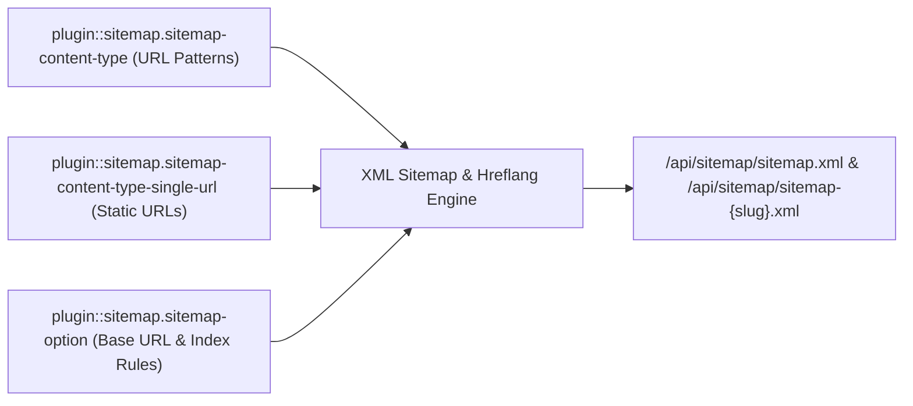
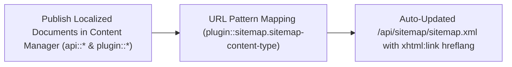
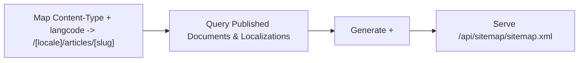
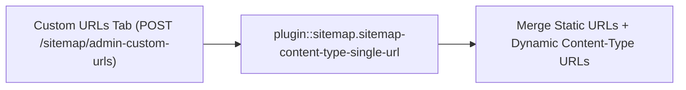
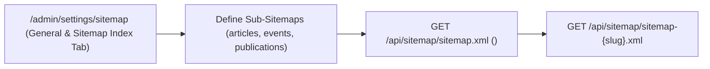

> **Package**: `@vicacha-devs/strapi-plugin-sitemap` · **Plugin ID**: `sitemap` · **Category**: `Editorial & SEO` · **Version**: `1.1.0` · **Routes**: `15`

Çok dilli hreflang alternatifleri, özel statik URL'ler ve XSL stil sayfası ile Strapi v5 için otomatik XML Site Haritası ve Site Haritası İndeksi üreticisi.

```bash
pnpm add @vicacha-devs/strapi-plugin-sitemap
```


## 1. Temel Yetenekler ve Mimari Özellikler

- [İçerik Türü Varlıkları ve Kullanım Senaryolarını İnceleyin (Diyagramlarla)](/tr/strapi-plugin-sitemap/use-cases/)
- [Geliştirici Kılavuzu ve Admin UI Turunu İnceleyin](/tr/strapi-plugin-sitemap/guide/)
- [Etkileşimli OpenAPI Referansını İnceleyin](/strapi-plugin-sitemap/api/)

## 2. İçerik Türü Varlıkları, Konumları ve Şemaları (`strapi.documents`)

Registers two internal Collection Types (`plugin::sitemap.sitemap-content-type` and `plugin::sitemap.sitemap-content-type-single-url`) and one Single Type (`plugin::sitemap.sitemap-option`) with `content-manager.visible: false`, while introspecting all public `api::*` and `plugin::*` Content-Type entities to generate `/api/sitemap/sitemap.xml` and `/api/sitemap/sitemap-{slug}.xml`.



### Strapi v5 İçinde İçerik Türü Varlıkları Nerede Bulunur?

- **Settings Panel (4 Tabs)**: `/admin/settings/sitemap` (`Settings -> Sitemap -> Configuration` — organized into **General & Sitemap Index**, **Collection Types**, **Custom URLs**, and **Excluded URLs** tabs)
- **Internal Persistence Entities**: `plugin::sitemap.sitemap-content-type` (`strapi_5_sitemap_plugin_content_types`), `plugin::sitemap.sitemap-content-type-single-url` (`strapi_5_sitemap_plugin_content_type_single_urls`), and `plugin::sitemap.sitemap-option` (`strapi_5_sitemap_plugin_options`)

### `plugin::sitemap.sitemap-content-type` — Sitemap Content Type

Per-locale URL pattern, priority, and changefreq mapping for a Strapi Content-Type entity

> **Kind**: `collectionType` · **DB Table**: `strapi_5_sitemap_plugin_content_types` · **Admin Location**: Internal (`/admin/plugins/sitemap`) · **Draft & Publish**: `No` · **i18n**: `No`

| Alan (Attribute)       | Strapi Türü | Zorunlu | Kısıtlamalar / İlişki |
| :--------------------- | :---------- | :------ | :-------------------- |
| `type`                 | `string`    | No      | —                     |
| `langcode`             | `string`    | No      | —                     |
| `pattern`              | `string`    | No      | —                     |
| `priority`             | `float`     | No      | —                     |
| `frequency`            | `string`    | No      | —                     |
| `lastModified`         | `string`    | No      | —                     |
| `thumbnail`            | `string`    | No      | —                     |
| `populateLinkedModels` | `string`    | No      | —                     |

### `plugin::sitemap.sitemap-content-type-single-url` — Sitemap Single URL

Custom static URL entry included alongside dynamic CMS entries in sitemap.xml

> **Kind**: `collectionType` · **DB Table**: `strapi_5_sitemap_plugin_content_type_single_urls` · **Admin Location**: Internal (`/admin/plugins/sitemap`) · **Draft & Publish**: `No` · **i18n**: `No`

| Alan (Attribute) | Strapi Türü | Zorunlu | Kısıtlamalar / İlişki |
| :--------------- | :---------- | :------ | :-------------------- |
| `slug`           | `string`    | No      | —                     |
| `priority`       | `float`     | No      | —                     |
| `frequency`      | `string`    | No      | —                     |

### `plugin::sitemap.sitemap-option` — Sitemap Options

Global sitemap configuration (baseUrl, excludedUrls, useSitemapIndex, sitemapDefinitions)

> **Kind**: `singleType` · **DB Table**: `strapi_5_sitemap_plugin_options` · **Admin Location**: Internal (`/admin/plugins/sitemap`) · **Draft & Publish**: `No` · **i18n**: `No`

| Alan (Attribute)     | Strapi Türü | Zorunlu | Kısıtlamalar / İlişki |
| :------------------- | :---------- | :------ | :-------------------- |
| `baseUrl`            | `string`    | No      | —                     |
| `excludedUrls`       | `json`      | No      | default: `[]`         |
| `useSitemapIndex`    | `boolean`   | No      | default: `false`      |
| `sitemapDefinitions` | `json`      | No      | default: `[]`         |

## Strapi v5 İçerik Yöneticisi (Content Manager) Entegrasyonu (`/admin/content-manager`)

> **İçerik Yöneticisi Kenar Çubuğu Grubu**: `Maps All Public Content Manager Collection Types & Single Types`

### İçerik Yöneticisi Varlıkları ve Bileşenleri

- `plugin::sitemap.sitemap-content-type` (Internal URL pattern mapping for Content Manager entities)
- `plugin::sitemap.sitemap-content-type-single-url` (Internal custom static URL entries)
- `plugin::sitemap.sitemap-option` (Internal global sitemap settings)

### Bu Eklenti Neden Content Manager Varlıkları Oluşturur?

`@vicacha-devs/strapi-plugin-sitemap` keeps its 3 configuration schemas (`sitemap-content-type`, `sitemap-content-type-single-url`, `sitemap-option`) hidden from the Content Manager sidebar (`content-manager.visible: false`) to prevent accidental schema edits, while dynamically reading published documents and `i18n` localizations from **every public Content Manager Collection Type** (`api::*` and `plugin::*`):

- **Automatic Sync with Content Manager Publishing**: Whenever an editor publishes, updates, or unpublishes an `Article`, `Event`, `Donation Campaign`, or `Resource Publication` in Content Manager, `/api/sitemap/sitemap.xml` automatically reflects its `lastmod` and `xhtml:link` `hreflang` alternates.

### Strapi Content Manager İçinde Nasıl Kullanılır? (Adım Adım)

1. **Publish Content in Content Manager**: Author and publish localized entries in any `api::*` or `plugin::*` collection inside `/admin/content-manager`.
2. **Map URL Patterns in Sitemap Settings**: Open `/admin/settings/sitemap` (or `/admin/settings/strapi-5-sitemap-plugin`) -> **Collection Types** tab and bind each Content Manager collection UID + locale to its frontend route pattern (e.g., `/[locale]/articles/[slug]`).

### Content Manager ve Eklenti Çalışma Alanı Senkronizasyonu



### Content Manager Kullanım Senaryoları ve Editöryal İş Akışları

#### Content Manager Use Case 1 — Auto-Syndicating Published Content Manager Entries to Multilingual XML Sitemaps

- **Amacı ve Neden Kullanıldığı**: Ensure every newly published localized Event, Article, or Publication in Content Manager is immediately indexed with `hreflang` alternates.
- **Content Manager İçinde Uygulama Adımları**: Publish the entry across `es`, `en`, `ar`, and `tr` in `/admin/content-manager` and verify its `<url>` block in `GET /api/sitemap/sitemap.xml`.

## 3. Uçtan Uca Kullanım Senaryoları ve İş Akışları

### Use Case 1 — Dynamic Multilingual Entity URL Pattern Mapping & `xhtml:link` Hreflang

- **What it is for**: Map any localized Strapi Content-Type entity (`api::article.article`, `plugin::events.event`, `plugin::resources.publication`) to dynamic URL patterns with automatic `hreflang` alternates.
- **How it works**: In `/admin/settings/sitemap` (**Collection Types** tab), map a content type + `langcode` to a pattern (e.g., `/[locale]/articles/[slug]`), `priority`, and `frequency` (`plugin::sitemap.sitemap-content-type`).




### Use Case 2 — Hybrid Static + CMS Sitemap with Custom Single URLs

- **What it is for**: Include static frontend routes (`/`, `/es/contact`, `/ar/prayer-times`) alongside dynamic CMS entries in the same XML sitemap.
- **How it works**: Add static route entries in the **Custom URLs** tab (`plugin::sitemap.sitemap-content-type-single-url`) and exclude internal routes in the **Excluded URLs** tab.



### Use Case 3 — Multi-File Sitemap Index (`sitemap-{slug}.xml`) for Large Sites

- **What it is for**: Split large portals into dedicated sub-sitemaps (e.g., `/api/sitemap/sitemap-articles.xml`, `/api/sitemap/sitemap-events.xml`) referenced by a master `<sitemapindex>`.
- **How it works**: Enable `useSitemapIndex: true` and define `sitemapDefinitions` in the **General & Sitemap Index** tab of `/admin/settings/sitemap` (`PUT /sitemap/admin-put-options`).




## 4. REST API Uç Noktaları (`content-api` ve `admin`)

| Metot    | Uç Nokta Yolu                      | Kapsam        | Denetleyici (Handler)             | Kimlik Doğrulama |
| :------- | :--------------------------------- | :------------ | :-------------------------------- | :--------------- |
| `GET`    | `/api/sitemap/sitemap.xml`         | `content-api` | `controller.getSitemap`           | Bearer JWT       |
| `GET`    | `/api/sitemap/sitemap-{slug}.xml`  | `content-api` | `controller.getSitemapBySlug`     | Bearer JWT       |
| `GET`    | `/sitemap/admin`                   | `admin`       | `controller.adminGET`             | Bearer JWT       |
| `POST`   | `/sitemap/admin`                   | `admin`       | `controller.adminPOST`            | Bearer JWT       |
| `PUT`    | `/sitemap/admin`                   | `admin`       | `controller.adminPUT`             | Bearer JWT       |
| `DELETE` | `/sitemap/admin`                   | `admin`       | `controller.adminDELETE`          | Bearer JWT       |
| `GET`    | `/sitemap/admin-get-content-types` | `admin`       | `controller.adminGETContentTypes` | Bearer JWT       |
| `GET`    | `/sitemap/admin-get-locales`       | `admin`       | `controller.adminGETLocales`      | Bearer JWT       |
| `GET`    | `/sitemap/admin-allowed-fields`    | `admin`       | `controller.adminAllowedFields`   | Bearer JWT       |
| `GET`    | `/sitemap/admin-get-options`       | `admin`       | `controller.adminGetOptions`      | Bearer JWT       |
